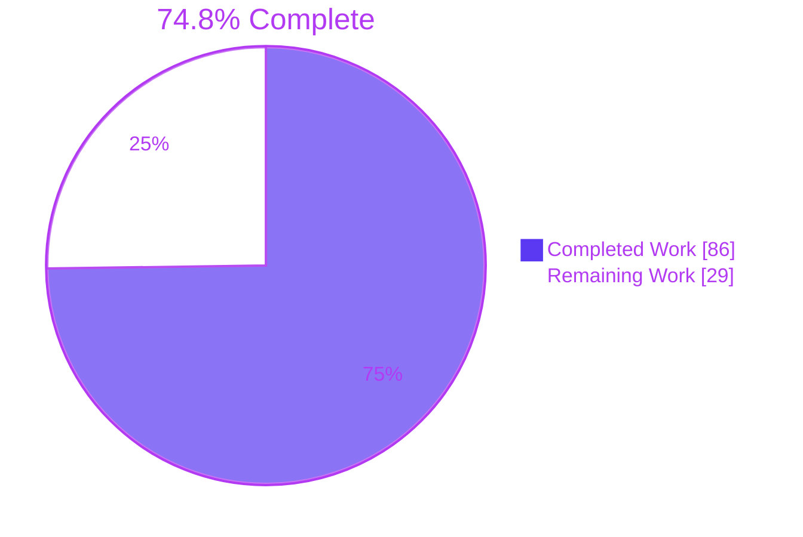
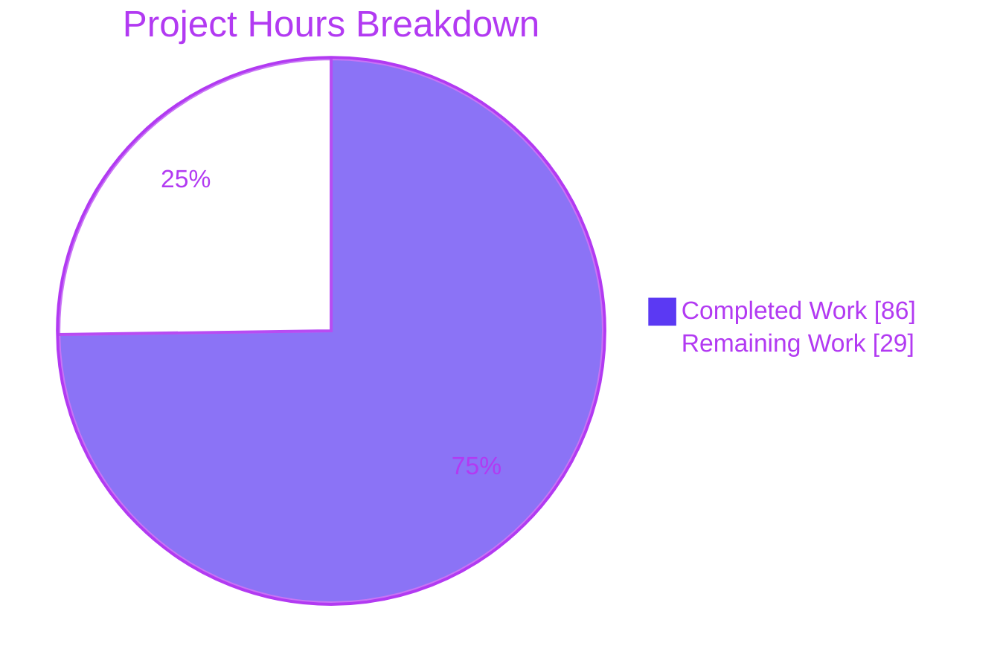
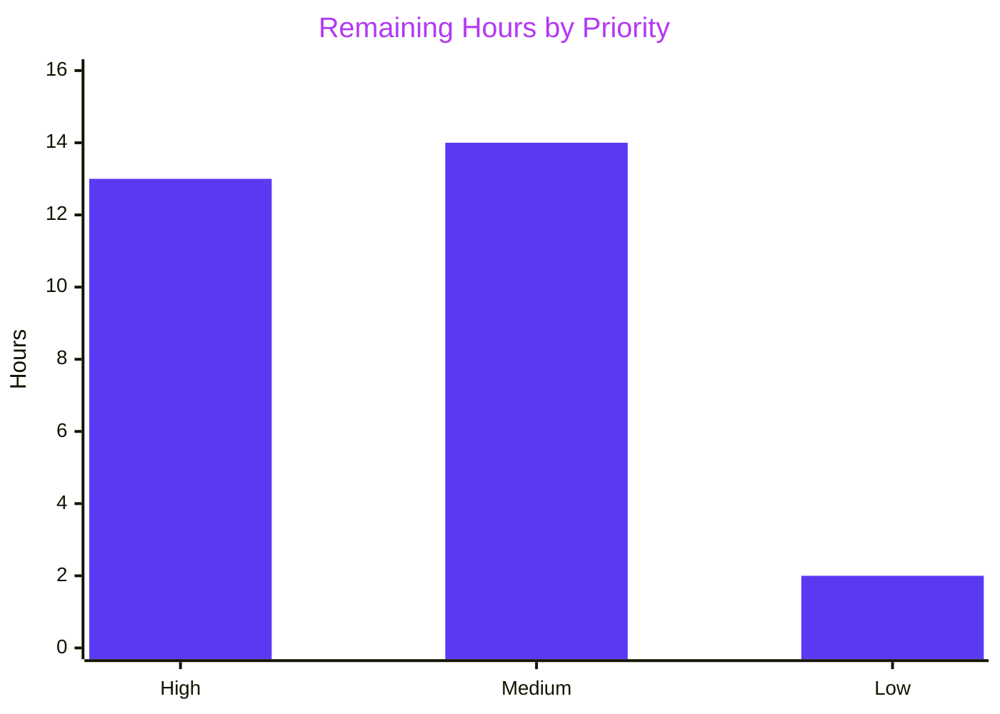

# 1. Executive Summary

## 1.1 Project Overview

This project adds one requirements specification, `docs/requirements/bank-reconciliation-exceptions-workbench-requirements.md`, for an Openbravo ERP Bank Reconciliation Exceptions Workbench. It turns two analyses and a project guide into 25 functional and 4 non-functional requirements in three delivery phases. Under them, every unmatched bank statement line gets an owner, status, reason code and visible age, and today's matching rules run unattended. Product, Business and Operations staff read it, and delivery teams take it as tickets. Scope is documentation only, with no code, database, Application Dictionary, test or configuration change. Code claims are anchored to `master` commit `77692f968d` and source citations to commit `68ab20e6bd`.

## 1.2 Completion Status



| Metric | Value |
|---|---|
| Total Hours | 115 |
| Completed Hours (AI + Manual) | 86 |
| Remaining Hours | 29 |
| Percent Complete | 74.8% |

86 hours completed out of 115 total hours = 74.8% complete. The document itself is finished and passes every AAP quality check. The remaining 29 hours are human review, decisions and ticket handoff.

## 1.3 Key Accomplishments

- [x] One 708-line requirements document added; no other tracked file changed
- [x] REQ-01 to REQ-25 and NFR-01 to NFR-04, each with sources, reuse, 2 to 4 Given/When/Then criteria and a regression risk
- [x] Conflicts C-01 to C-18 and a 20-row code confirmation, all locators resolving at `77692f968d`
- [x] Two-way traceability from 14 findings through F1 to F9 to every REQ and NFR
- [x] Three phase test gates, each tied to its requirements and an existing harness
- [x] Figure 1 renders the exception-status flow: 4 statuses, 8 labelled transitions
- [x] 12 of 12 scripted checks pass: 8,910 prose words, 0 em dashes, 178 valid citations
- [x] Readable from 375 to 1920 px; every desktop table fits the content column

## 1.4 Critical Unresolved Issues

0 of the 11 required document parts (Key Takeaways, Sections 1 to 9, Appendix A) are incomplete, and all pass their checks. 10 follow-up items remain open, in the 4 groups below. None stops the document going to reviewers. O-01, O-02 and the NFR-01 time limit stay `TBD` by design until baselines exist.

| Issue | Impact | Owner | ETA |
|---|---|---|---|
| 1 item: C-01 names source-branch head `af6933f42b`, but the head is now `05794d4845` (Section 3.1, line 104) | Readers who follow the branch head instead of the `68ab20e6bd` pin find a rewritten Project Guide. Citations stay valid at the pin | Document owner | 1 h |
| 1 item: no Product, Business or Operations review or sign-off yet | Requirements have not been validated by their audience | Product owner | 8 h |
| 7 items: decisions O-03, O-04, O-05 and O-09, and installation checks O-06, O-07 and O-08 | Tickets for REQ-01, REQ-03, REQ-12, REQ-14, REQ-16, REQ-18 to REQ-21 and REQ-24 cannot be accepted | Finance, Operations, IT Operations | 8 h |
| 1 item: tables in Sections 3.1 and 3.2 and Appendix A scroll sideways at 768 px and narrower | Tablet and phone readers must pan. Desktop is unaffected | Document owner | 2 h |

## 1.5 Access Issues

| System/Resource | Type of Access | Issue Description | Resolution Status | Owner |
|---|---|---|---|---|
| Production Openbravo installations, each client | Read-only configuration access | O-06 to O-08 need the V3 Roles dataset state, the alert-run schedule and a test import per bank file format. This environment holds only shipped defaults | Not provisioned | Finance / IT Operations |

## 1.6 Recommended Next Steps

1. [High] Update C-01's source-branch head reference word-neutrally and re-run the gate (Section 9.4).
2. [High] Send the document to Product, Business and Operations for review and sign-off.
3. [High] Settle O-03 (reason-code wording), O-04 (age bands), O-05 (exclusion acceptance) and O-09 (owner email).
4. [Medium] Run installation checks O-06 to O-08 in each client.
5. [Medium] Create delivery tickets per the document's Section 9, in phase order, gate tests first.

# 2. Project Hours Breakdown

## 2.1 Completed Work Detail

| Component | Hours | Description |
|---|---|---|
| Source analysis and codebase verification (AAP 0.2) | 14 | Read the three sources at `68ab20e6bd` (1,737 lines). Confirmed 19 named tables, classes, roles and screens and 8 behaviour assertions at `77692f968d`. Built the 33-file evidence key with 21 test and tool locators |
| Key Takeaways and Section 1 Summary (AAP 0.4.1) | 4 | Five-bullet opening, plain-words overview with the five capability names and the exact objective quote, phases table, excluded-account comparison, six deferred items with their hooks |
| Section 2 Traceability (AAP 0.4.2.2, 0.7.1) | 4 | 14 finding rows mapped to F1 to F9, REQ and NFR IDs, objective elements and phases. Two-way check tables record the REQ-22 and NFR-01/NFR-02 limitations |
| Section 3 Conflicts and confirmations (AAP 0.3.2, 0.2.2) | 10 | C-01 to C-18, each with what was claimed, what the code or source shows, requirements affected and resolution. 20-row confirmed inventory and evidence key |
| Section 4 Requirements by phase (AAP 0.3.1, 0.4.2.1, 0.4.3, 0.5.2) | 22 | REQ-01 to REQ-25 with 59 Given/When/Then criteria, the edit policy, Figure 1 and the Phase 1, 2 and 3 test gates |
| Section 5 Non-functional requirements (AAP 0.4.1) | 3 | NFR-01 (`TBD` limit plus its measurement), NFR-02 scoping, NFR-03 posting and NFR-04 trigger safeguards, with 9 criteria |
| Sections 6 to 9 (AAP 0.4.2.2) | 5 | Gap closure for six objective elements, U1 to U7 and A-1 to A-3 carried forward, O-01 to O-09, ticket handoff rules |
| Appendix A Glossary (AAP 0.4.2.4) | 6 | 31 term rows, each marked Existing with a code address or Proposed with its requirement |
| Writing-rule conformance (AAP 0.4.2.4, 0.7.2) | 6 | Plain language, first-use definitions, 178 singular citations, at most four sentences per unit, zero em dashes, length held within 6,000 to 9,000 words |
| Validation and quality assurance (AAP 0.7, 0.9.1) | 12 | Scripted 12-check gate, Mermaid render, GitHub-style browser rendering at four widths, recipe baselines R1, R4 and R5, and repository-scope checks |
| **Total** | **86** | |

## 2.2 Remaining Work Detail

| Category | Hours | Priority |
|---|---|---|
| Update C-01's source-branch head reference without changing the word count, and re-run the gate | 1 | High |
| Product, Business and Operations review and sign-off of the requirements | 8 | High |
| Pre-delivery decisions O-03, O-04, O-05 and O-09 (Finance, Operations) | 4 | High |
| Installation checks O-06, O-07 and O-08 in each client | 4 | Medium |
| Apply the review outcome, including the Key Takeaways length and section balance decisions, re-run the gate and merge | 4 | Medium |
| Create delivery tickets per the document's Section 9 (at least 29 requirement stories plus gate-test stories) | 6 | Medium |
| Narrow-width readability of the Section 3.1, 3.2 and Appendix A tables | 2 | Low |
| **Total** | **29** | |

## 2.3 Hours Calculation

- Completed hours: 14 + 4 + 4 + 10 + 22 + 3 + 5 + 6 + 6 + 12 = 86
- Remaining hours: 1 + 8 + 4 + 4 + 4 + 6 + 2 = 29
- Total project hours: 86 + 29 = 115
- Completion: 86 / 115 × 100 = 74.8%

Confidence is high for completed hours, because every component exists and passes its checks. It is medium for remaining hours, which depend on how much the review changes and how quickly Finance and Operations decide.

# 3. Test Results

Every test below was run against the delivered file at commit `a2b322b567`. The scripted checks implement the AAP 0.9.1 parsing rules and read the source documents at commit `68ab20e6bd`.

| Area / Category | Framework | Tests | Passed | Failed | Coverage | What This Proves |
|---|---|---|---|---|---|---|
| Outline and opening summary | Python 3 check script (AAP 0.9.1) | 2 | 2 | 0 | 58 of 58 headings; 5 of 5 bullets | The outline follows the request's order, numbering and nesting with no skipped levels |
| Writing rules | Python 3 check script | 3 | 3 | 0 | 824 of 824 sentence units; 8,910 prose words | Length is inside 6,000 to 9,000, no unit exceeds four sentences, and no em dash appears |
| Requirement entries and identifiers | Python 3 check script | 2 | 2 | 0 | 29 of 29 entries; 68 criteria; F1 to F9 counted 8/1/1/2/6/2/1/1/3 | Every REQ and NFR has all five fields and 2 to 4 testable criteria, and appears in Section 2.1 and Section 9 |
| Citations and internal references | Python 3 check script | 2 | 2 | 0 | 178 of 178 citations; 20 of 20 section references; 37 C, O, U and A IDs | Every source citation names a heading that exists, and every cross-reference resolves |
| Figure, tables and request values | Python 3 check script | 3 | 3 | 0 | 1 figure; 18 tables; objective quoted 2 times | Figure placement, all ten planned table headers, and the exact objective, statuses and reason codes are intact |
| Figure 1 rendering | Mermaid CLI 12.0.0 | 1 | 1 | 0 | 4 of 4 statuses; 8 of 8 transitions | The diagram parses and draws with correct labels and an accessible title |
| Repository scope and code baselines | git, GNU grep (recipes R1, R4, R5) | 4 | 4 | 0 | 1 file added; 3 columns, 5 list values, 7 classes | Only the document is added, and the code facts it cites still hold at `77692f968d` |
| Checker sensitivity | Python 3 check script, negative control | 5 | 5 | 0 | 5 injected defects | The gate fails when a bullet, citation, em dash, criterion or quote is broken |

**Not Covered**

- **Reader comprehension.** No Product, Business or Operations reader has tested the plain-language rules. Before release, have one reader from each audience walk through Sections 1, 4.1 and 6.
- **Source support for each requirement.** The script proves cited sections exist, not that they support the claim. Support was checked by reading, so a reviewer should spot-check REQ-17, REQ-19 and REQ-25 against Analysis 1 and Analysis 2.
- **Code locators after `77692f968d`.** They are verified at that commit only. Re-run recipes R1 to R5 before implementation starts.
- **Target hosting platform.** Rendering was verified with a local GitHub-style renderer and the Mermaid CLI only. Preview on the platform that will host the document.
- **Workbench behaviour.** Nothing is built. The 68 criteria and three gates are specifications that delivery must implement and run.

# 4. Runtime Validation & UI Verification

The runtime surface is the document as readers see it. It was rendered GitHub-style in headless Chrome and drawn independently with the Mermaid CLI.

- ✅ **Figure 1 (Mermaid CLI)** – exit 0, "Found 1 mermaid charts". The SVG holds Open, Assigned, In Review and Resolved, 8 labelled edges and the accessible title "Figure 1. Exception status of a statement line"
- ✅ **Full render at 1280 px** – 58 headings, 18 tables (150 rows, 583 cells), 29 entries with 68 criteria and one diagram, with zero console errors
- ✅ **Desktop table fit** – Conflicts, Confirmed and Glossary tables measure 890 of 890 px at 1280 and 1440 px, so every column is visible
- ⚠ **Narrow widths (375 and 768 px)** – all content renders and can be reached, but the Section 3.1, 3.2 and Appendix A tables need horizontal panning, and Figure 1 labels are small on phones
- ✅ **Tracked copy** – a fresh render from the git index matches the working file byte for byte (same SHA-256) and in the DOM
- ✅ **Navigation stability** – reloads, resizes, keyboard Home/End and recovery after a failed fetch all return the complete document
- ✅ **Render safety** – no scripts, event handlers, unsafe URLs or click links in the rendered output

**Not exercised at runtime:** the Openbravo ERP application and the proposed workbench (nothing is built, booted or tested), rendering on the platform that will host the document, and any reading session with the target audience.

# 5. Compliance & Quality Review

## 5.1 Compliance Matrix

| AAP Deliverable | Benchmark | Status | Progress |
|---|---|---|---|
| One new file, nothing else changed (0.5.1, 0.8) | `git diff --name-status 77692f968d HEAD` prints only `A` and the file; no source documents copied in | ✅ Pass | ██████████ 100% |
| Outline: title, Key Takeaways, Sections 1 to 9, Appendix A (0.4.1, 0.5.2) | 5 bullets; 58 numbered, nested headings; AAP 0.5.2 sub-section titles | ✅ Pass | ██████████ 100% |
| Length (0.1.2, 0.7.2) | 6,000 to 9,000 prose words by the AAP 0.9.1 method | ✅ Pass (8,910) | ██████████ 100% |
| Writing rules (0.4.2.4) | 0 em dashes; at most 4 sentences per unit; first-use definitions; technical names after plain meaning | ✅ Pass | ██████████ 100% |
| Citation form and validity (0.4.2.4, 0.9.2) | 178 singular citations resolve at `68ab20e6bd`; file paths only in Section 3 and the glossary Basis | ✅ Pass | ██████████ 100% |
| 29 requirement entries (0.3.1, 0.4.2.1, 0.7.3) | Five fields in order; 2 to 4 Given/When/Then; valid Analysis 2, Section 4.2 risk areas | ✅ Pass | ██████████ 100% |
| Two-way traceability (0.7.1) | F1 to F9 covered; every ID in entries, Section 2.1 and Section 9; limitations listed | ✅ Pass | ██████████ 100% |
| Conflicts and verification inventory (0.3.2, 0.2.2) | C-01 to C-18 complete; 19 artefacts confirmed; locators resolve | ⚠ Pass with open item (C-01 head reference) | █████████░ 95% |
| Figure 1 (0.4.3) | Renders; after REQ-05; one-sentence reading line; only diagram | ✅ Pass | ██████████ 100% |
| Phase test gates (0.5.2) | Gated IDs and harnesses per phase, including the C-08 manual check | ✅ Pass | ██████████ 100% |
| Sections 6 to 9 and Appendix A (0.4.2.2) | Planned columns; six elements; ten carried IDs; nine open items; 31 glossary rows | ✅ Pass | ██████████ 100% |
| Scope boundaries (0.8.2) | No deferred-item requirement, multi-line action, aging email or relabel | ✅ Pass | ██████████ 100% |

## 5.2 AAP & Rule Divergences and Gaps

No user rules were set (AAP 0.10), so every row below is measured against the AAP and the request it quotes.

| What the AAP/Rule Required | What Was Delivered Instead | Why It Diverged | Impact | Remediation |
|---|---|---|---|---|
| C-01: name the source branch and commit once in Section 3 (AAP 0.3.2) | C-01 (line 104) names the branch, the pin `68ab20e6bd`, and later commits `e26102ab7b` and head `af6933f42b`. The branch head is now `05794d4845` | The head came from a snapshot of the source branch taken before delivery. The branch reached `05794d4845` (07:19 UTC) before the document's first commit (07:29 UTC), and the reference was never re-checked | Low. One stale fact, though citations stay valid at the pin | Update or drop the head reference with no change to the word count, then re-run the gate |
| Section 7 U6 mapping: "if line auditing is already on" (AAP 0.4.2.2) | U6 (line 640): audited fields add log volume on every change, "and at import only if new records are audited" | The code keeps a separate insert-audit setting (`ISAUDITINSERTS`), and AAP 0.1.1 requires verification against the codebase | None. The statement is more accurate | None required. **Sanctioned** by AAP 0.1.1 |
| Code evidence as full repository paths in Sections 3.1 and 3.2 (AAP 0.2.2, 0.3.2) | Cells cite file name and lines (line 100). A fenced key (lines 148 to 224) lists every full path | Full paths would make the tables 2,252 and 1,529 px wide in an 890 px column and hide columns. Fenced text is excluded from the word count | Low. A reader takes one extra step through the key | None required |
| Glossary Basis with full code addresses (AAP 0.4.2.4) | Basis paths use `...` folder elision (line 674) | Full addresses would make the glossary 1,312 px wide and hide its Basis column at desktop width | Low. Every elided path matches exactly one tracked file | None required |
| Outline of Section 5 with no sub-heading (AAP 0.5.2) | Added H3 "5.1 Requirement entries", with NFRs as H4 5.1.1 to 5.1.4 | AAP 0.4.2.4 requires entries as numbered H4, which needs an H3 parent so no heading level is skipped | None | None required |
| Figure 1 shows the paths AAP 0.4.3 lists | 8 edges, adding user-choice moves Open to and from In Review, Assigned to Open, and user choice for Open to Assigned | REQ-15, the edit policy and C-13 let users set any of Open, Assigned or In Review | None. The figure matches the requirements | None required |
| Phase 2 gate row wording "assignee" (AAP 0.5.2) | "proposed owner" (line 517) | The AAP 0.4.2.4 terminology rule fixes "owner" as the term | None | None required |
| Planned entry wording and the behaviour-assertion table (AAP 0.3.1, 0.2.2) | Most entries carry the minimum 2 criteria; behaviour assertions are folded into Section 3.2 rows, with an added `APRM_MatchingUtility` row | Keeping within the 9,000-word limit | Low. Unhappy paths are covered where they exist (REQ-07, REQ-09, REQ-13, REQ-15 to REQ-17, REQ-19, REQ-25, NFR-02) | Delivery may add story tests beyond the document's criteria |
| Template: Section 1 "Open with the Feature Overview, in plain words" | Section 1.1 opens with definitions of transaction, financial account and matching, and quotes the objective in its second paragraph (lines 15 to 17) | The objective uses terms that must be defined at first use (AAP 0.4.2.4) | None. All of 1.1 is the plain-words overview | None required |
| Per-part prose budgets (AAP 0.4.1) | Section 4 has 3,943 words against 3,100, Section 1 has 794 against 600 and Appendix A 784 against 650. Sections 6 to 9 are under budget | First-use definitions, singular citations and split criteria need more words in these parts than the plan allotted. Only the overall total binds | Low. The 6,000 to 9,000 total holds | Decide during review whether to rebalance |
| Request: "Begin with a 5-line Key Takeaways summary" | 5 single-line bullets totalling 151 words against a 90-word budget. Bullet 1 is 60 words and renders as about 4 lines | First-use definitions for statement line, owner, status, reason code, age and workbench sit in bullet 1 | Low to Medium. The summary scans less quickly | Decide during review whether to accept the length or move glosses to Section 1.1, keeping first-use order |
| Glossary rows planned in AAP 0.4.2.4 (27 groups) | 31 rows, regrouped, adding Backfill, Client, Measurement stamps, Posting and Transaction | Terms used in the body need a first-use definition and an entry in the appendix | None. Every planned term is present | None required |
| AAP 0.9.1: read sources from `origin/blitzy-e5d40ea1-c3ed-4994-87eb-e962dec9dc66` and count em dashes with `$'\u2014'` | Sources read at pinned `68ab20e6bd`; em dashes counted with the byte form `$'\xe2\x80\x94'` | The branch tip has moved past the commit every citation refers to, and `$'\u2014'` falsely prints 0 in a C-locale shell | None. Checks are reproducible | None required. **Sanctioned** by AAP 0.2.1, which places every source citation at commit `68ab20e6bd` |

**C-01 source-branch head.** C-01 (Section 3.1, line 104) states that commits `e26102ab7b` to head `af6933f42b` reword both analyses but keep every heading. The branch `origin/blitzy-e5d40ea1-c3ed-4994-87eb-e962dec9dc66` now ends at `05794d4845`, which rewrites the Project Guide (+272/−188 lines). The analyses' headings are unchanged at that head, and every citation still resolves at the stated pin `68ab20e6bd`, so no requirement is affected. A reader who opens the branch instead of the pin will still see a Project Guide that differs from the cited one. The owner should drop the head reference or name the pin alone, offset the words to stay under 9,000, and re-run the gate.

**Key Takeaways length.** The request asks for a "5-line" summary. The file holds five single-line bullets, and all 12 checks pass. Still, bullet 1 carries six first-use definitions and wraps to about four rendered lines, so the summary runs 151 words against the plan's 90. The owner decides whether this is acceptable. One alternative is to move the glosses into Section 1.1, but that only works if every term stays defined at its first appearance. Any trim must keep the 6,000 to 9,000 range and be re-checked with Section 9.4.

**Section balance.** Section 4 runs 27% over its planned budget, and Sections 6 to 9 sit well under theirs. The binding total is met at 8,910 words. The space-replace count (Section 9.3) is exactly 9,000, so any expansion needs an equal trim. Reviewers should decide whether Sections 6 to 9 need more explanation for Business readers, and fund any additions by tightening Section 4 prose without touching criteria or IDs.

# 6. Risk Assessment

| Risk | Category | Severity | Probability | Mitigation | Status |
|---|---|---|---|---|---|
| The word budget is at its limit: 8,910 prose words by the AAP method and 9,000 by space-replace, while plain `wc -w` gives 10,004 because it counts the fenced key, tables and figure. Review edits can easily break the 6,000 to 9,000 gate | Technical | Medium | High | Agree on the AAP 0.9.1 deletion method, offset every addition with an equal trim, and re-run Section 9.4 after each edit | Open |
| The source branch keeps moving (head `05794d4845` rewrites the Project Guide), so readers may compare against text that is not the cited version | Integration | Low | Medium | Cite the `68ab20e6bd` pin alone in C-01, or tag that commit so it cannot be lost | Open |
| Code locators cite `master` at `77692f968d`, so line numbers drift as `master` moves (for example `APRM_MatchingUtility.java:283-329`) | Integration | Low | High | Re-run recipes R1 to R5 and the Section 3.2 key check before each phase starts | Monitor |
| Requirements rest on installation facts nobody has confirmed (U1 to U7, O-06 to O-08), for example that the Finance role exists in every client or that the alert run happens at 23:59 | Operational | Medium | Medium | Complete the O-06 to O-08 checks before Phase 2 tickets are accepted | Open |
| The gates need tests that do not exist today: no test refers to `AlertProcess`, `APRM_MatchingUtility` or five other cited classes, and no screen-level test framework exists (C-08) | Technical | Medium | High | Write gate tests first, as Section 9 orders, and size them as separate stories | Planned |
| The counts widget's query runs with elevated rights (C-09), so an implementation that misses NFR-02 could show counts from organizations a role cannot read | Security | High | Low | Keep the organization limit inside the widget query, run the Phase 2 role-scoped datasource tests, and review the query for security | Specified, not built |
| Wide tables in Sections 3.1 and 3.2 and Appendix A need horizontal panning on tablets and phones | Operational | Low | Medium | Read on desktop, or split the tables if the audience reads on tablets | Accepted |
| The hosting platform may render Mermaid or wide tables differently from the local GitHub-style renderer | Integration | Low | Low | Preview on the target platform before sending the document out | Open |

# 7. Visual Project Status



Remaining hours by priority (29 hours in total, matching Sections 1.2 and 2.2):



| Priority | Tasks | Hours |
|---|---|---|
| High | C-01 update, stakeholder review, decisions O-03, O-04, O-05 and O-09 | 13 |
| Medium | Installation checks O-06 to O-08, applying the review outcome and merging, ticket creation | 14 |
| Low | Narrow-width table readability | 2 |
| **Total** | | **29** |

# 8. Summary & Recommendations

The project is 74.8% complete: 86 of 115 hours are delivered. The deliverable is finished. `docs/requirements/bank-reconciliation-exceptions-workbench-requirements.md` is a 708-line, 8,910-word specification that covers all nine capabilities with 25 functional and 4 non-functional requirements and 68 Given/When/Then criteria. It also holds an 18-entry conflicts register with a resolution for each conflict, three phase test gates, a 14-row traceability table and a 31-term glossary. It is the only file the branch adds, and it is tracked despite the `docs` ignore rule.

All 12 scripted AAP checks pass on the delivered file, and a negative control proves the gate fails on injected defects. Every one of the 178 source citations names a heading that exists at the pinned commit. The cited code facts (statement-line columns, match-level values, untested classes) still hold at `master` `77692f968d`. Figure 1 renders cleanly, and the document reads correctly at desktop width, with every column visible.

The remaining 29 hours are human work the document cannot do for itself. Product, Business and Operations must review and sign it off. Finance and Operations must settle four decisions (O-03, O-04, O-05, O-09) and confirm three installation facts (O-06 to O-08). After that, the requirements become tickets in phase order, with gate tests written first. Of the thirteen divergences from the plan (Section 5.2), only C-01 needs an edit, because the source-branch head it names has moved. The Key Takeaways length and the section balance are owner decisions, and the other ten need no action.

The critical path is: refresh C-01 (1 h), then review and sign-off (8 h), then pre-delivery decisions (4 h), then installation checks (4 h), then applying the review outcome and merging (4 h), then ticket creation (6 h). Success means the review signs off with no change to requirement IDs, every edit keeps the gate at 12 of 12, and tickets carry the criteria unchanged.

**Readiness:** ready for stakeholder review now, and ready for delivery handoff once the High-priority items close. Implementation risk sits downstream: the gates call for tests the codebase lacks today, and widget scoping (C-09, NFR-02) needs security attention when it is built.

# 9. Development Guide

The deliverable is plain Markdown with one Mermaid figure. Nothing is compiled, served or deployed, so Java, Ant, PostgreSQL, Tomcat, Docker and `npm install` are not needed. Run every command from the repository root in one shell session, because later steps reuse the `S` and `F` variables.

## 9.1 System Prerequisites

- Linux or macOS shell (bash 5.x tested)
- Git 2.40 or later (2.56.0 tested), with network access to `origin` for one fetch
- Python 3.10 or later (3.13.18 tested), standard library only
- GNU grep (3.12 tested) and `wc`
- Mermaid CLI `mmdc` 12.0.0 on Node.js 22 (v22.23.4 tested), with Google Chrome for its headless renderer
- About 5 MB of free space for source copies and rendered output

## 9.2 Environment Setup

```bash
# Scratch folder outside the checkout: source copies never go into the repository
S="$(mktemp -d)"; mkdir -p "$S/render"
F=docs/requirements/bank-reconciliation-exceptions-workbench-requirements.md

# Mermaid CLI needs these Chrome flags when run as root or in a container
echo '{"args":["--no-sandbox","--disable-dev-shm-usage"]}' > "$S/pptr.json"
export PUPPETEER_EXECUTABLE_PATH="$(command -v google-chrome)"

# Make sure the pinned source commit is available, then copy the three sources
git cat-file -e 68ab20e6bd^{commit} 2>/dev/null || git fetch origin blitzy-e5d40ea1-c3ed-4994-87eb-e962dec9dc66
git show 68ab20e6bd:docs/analysis/analysis-1-current-state-reconciliation.md > "$S/a1.md"
git show 68ab20e6bd:docs/analysis/analysis-2-extension-points-and-risks.md > "$S/a2.md"
git show "68ab20e6bd:blitzy/documentation/Project Guide - e5d40ea1-c3ed-4994-87eb-e962dec9dc66.md" > "$S/pg.md"
wc -l "$S/a1.md" "$S/a2.md" "$S/pg.md"
```

Expected output: `704`, `591` and `442` lines. Always use `68ab20e6bd`: the branch tip has moved, and the document's citations refer to the pin.

## 9.3 Per-Edit Checks

Run these after every change to the document.

```bash
grep -c $'\xe2\x80\x94' "$F"                              # em dashes: must print 0
LC_ALL=C.UTF-8 wc -w "$F"                                 # cross-check only: 10004 today
mmdc -p "$S/pptr.json" -i "$F" -o "$S/render/doc.md"      # must exit 0 and print "Found 1 mermaid charts"

# Prose words by the AAP 0.9.1 method: drop fenced blocks and table separator rows, delete | # ` * >
python3 - "$F" <<'EOF'
import re, sys
lines, out, fence = open(sys.argv[1], encoding="utf-8").read().split("\n"), [], False
for ln in lines:
    if ln.startswith("`" * 3):
        fence = not fence
        continue
    if fence or (re.match(r"^\s*\|?[\s|:-]+\|[\s|:-]*$", ln) and "-" in ln):
        continue
    out.append(re.sub(r"[|#`*>]", "", ln))
print("prose words:", len(" ".join(out).split()))
EOF
```

Expected: `0`, `10004`, mmdc exit 0, and `prose words: 8910`, which must stay between 6,000 and 9,000. Replacing the deleted characters with spaces instead gives exactly 9,000, so any addition needs an equal trim.

## 9.4 Full Validation Gate

Run this before every commit.

```bash
# Source citations must name headings that exist at the pin
python3 - "$F" "$S" <<'EOF'
import re, sys
doc, s = open(sys.argv[1], encoding="utf-8").read(), sys.argv[2]
heads = {}
for key, name in (("Analysis 1", "a1.md"), ("Analysis 2", "a2.md"), ("Project Guide", "pg.md")):
    text = open(f"{s}/{name}", encoding="utf-8").read()
    heads[key] = set(re.findall(r"^#{1,4} (?:Appendix )?([0-9A-Z]+(?:\.[0-9]+)*)\.?\s", text, re.M))
body = re.sub(r"`{3}.*?`{3}", "", doc, flags=re.S)
cites = re.findall(r"(Analysis 1|Analysis 2|Project Guide), Section (\d+(?:\.\d+)*)", body)
bad = [f"{k}, Section {n}" for k, n in cites if n not in heads[k]]
print(f"citations: {len(cites)}, unresolved: {bad or 'none'}")
EOF

# Structure and entry counts
awk '/^## Key Takeaways/{f=1;next} /^## 1\./{f=0} f && /^- /' "$F" | wc -l   # 5 bullets
grep -nE '^## ' "$F"                                       # Key Takeaways, 1. to 9., Appendix A. Glossary
grep -cE '^#### [0-9.]+ (REQ|NFR)-[0-9]{2}: ' "$F"          # 29 entries
grep -cE '^  - Given ' "$F"                                # 68 criteria
grep -n 'TBD' "$F"                                         # 5 lines, each naming its measurement

# Repository scope: only the one document differs from master
git diff --name-status 77692f968d HEAD                     # A  docs/requirements/...md
git diff --check 77692f968d HEAD && echo "whitespace clean"
```

Expected: `citations: 178, unresolved: none`, then `5`, eleven H2 lines, `29`, `68`, five `TBD` lines, a single `A` line, and `whitespace clean`. Sentence limits, first-use definitions and source support are also manual checks under AAP 0.9.1. Read every changed paragraph against Appendix A and its cited sections.

## 9.5 Preview

- `mmdc` writes `$S/render/doc.md` and `$S/render/doc-1.svg`. Open the SVG in a browser to inspect Figure 1.
- For the full page, push the branch and open the file in the Git host's web view, which renders GitHub-flavoured tables and Mermaid.
- Check the tables in Sections 3.1 and 3.2 and Appendix A at the width your readers use. They fit at desktop width and need panning at tablet width.

## 9.6 Example Usage: Editing the Document

```bash
# 1. Edit the file in any editor, keeping IDs (REQ-nn, NFR-nn, C-nn, O-nn, U#, A-#) unchanged
# 2. Re-run Section 9.3, then Section 9.4
# 3. Stage with -f: .gitignore line 11 ignores "docs", so a plain "git add" silently skips the file
git add -f docs/requirements/bank-reconciliation-exceptions-workbench-requirements.md
git diff --cached --name-status                            # M  docs/requirements/...md, and nothing else
git commit -m "Refresh C-01 source-branch reference"
```

## 9.7 Troubleshooting

| Symptom | Cause | Resolution |
|---|---|---|
| `mmdc` fails with "Failed to launch the browser process" | Chrome sandbox is unavailable when run as root or in a container | Pass `-p "$S/pptr.json"` with the `--no-sandbox` flags from Section 9.2 |
| `mmdc` exits 1 | Mermaid syntax error in Figure 1 | Check each edge's arrow and quoted label, and keep the `accTitle` and `accDescr` lines intact |
| `mmdc` reports that the output folder is missing | The `-o` folder must already exist | `mkdir -p "$S/render"` |
| `grep -c $'\u2014'` prints 0 even though an em dash is present | `$'\u2014'` expands to nothing in a C-locale shell | Use the byte form `$'\xe2\x80\x94'` |
| `git show 68ab20e6bd:...` reports "invalid object name" | The source branch has not been fetched | `git fetch origin blitzy-e5d40ea1-c3ed-4994-87eb-e962dec9dc66` |
| Citations fail after reading sources from the branch tip | The tip has moved past `68ab20e6bd` | Re-create `a1.md`, `a2.md` and `pg.md` from the pin |
| Word count reads over 9,000 | `wc -w`, or a counter that replaces symbols with spaces, counts markup and fenced text | Use the AAP deletion method in Section 9.3 |
| `git add` stages nothing | `docs` is ignored | `git add -f <file>` |

# 10. Appendices

## A. Command Reference

| Purpose | Command | Expected result |
|---|---|---|
| Copy sources at the pin | `git show 68ab20e6bd:<path> > "$S/<name>.md"` | 704, 591 and 442 lines |
| Em-dash count | `grep -c $'\xe2\x80\x94' "$F"` | `0` |
| Raw word cross-check | `LC_ALL=C.UTF-8 wc -w "$F"` | `10004` |
| Render Figure 1 | `mmdc -p "$S/pptr.json" -i "$F" -o "$S/render/doc.md"` | Exit 0, "Found 1 mermaid charts" |
| Prose words (AAP method) | Python snippet in Section 9.3 | `prose words: 8910` |
| Citation check | Python snippet in Section 9.4 | `citations: 178, unresolved: none` |
| Entry and criteria counts | The two `grep -cE` lines in Section 9.4 | `29` and `68` |
| Repository scope | `git diff --name-status 77692f968d HEAD` | One `A` line for the document |
| Recipe R1 (columns) | `grep -n -e 'name="DATETRX"' -e 'name="MATCHINGTYPE"' -e 'name="DESCRIPTION"' src-db/database/model/tables/FIN_BANKSTATEMENTLINE.xml` | Lines 52, 68, 76 |
| Recipe R5 (test references) | `grep -rlw APRM_MatchingUtility src-test/src modules/*/src-test` | No output (exit 1): no test refers to the class |
| Stage the document | `git add -f "$F"` | Staged despite the `docs` ignore rule |

## B. Port Reference

No ports, services, databases or brokers are used. Validation runs entirely from the command line.

## C. Key File Locations

| Path | Role |
|---|---|
| `docs/requirements/bank-reconciliation-exceptions-workbench-requirements.md` | The deliverable: Key Takeaways, Sections 1 to 9, Appendix A |
| `.gitignore` (line 11) | Ignores `docs`, so the deliverable must be force-added |
| `src-db/database/model/tables/FIN_BANKSTATEMENTLINE.xml` | Statement-line table the F1 fields extend (cited as lines 2 to 112) |
| `modules/org.openbravo.advpaymentmngt/src/org/openbravo/advpaymentmngt/utility/APRM_MatchingUtility.java` | Single match and unmatch write points the requirements rely on |
| `modules/org.openbravo.advpaymentmngt/src-db/database/model/triggers/APRM_FIN_BNKSTM_LINE_CHECK_TRG.xml` | Processing-lock trigger that NFR-04 keeps unchanged |
| `src/org/openbravo/erpCommon/ad_process/AlertProcess.java` | Daily alert run behind REQ-19, REQ-20 and C-04 |
| `modules/org.openbravo.client.querylist/src/org/openbravo/client/querylist/QueryListDataSource.java` | Widget data service whose elevated query drives C-09 |
| `src-test/src/org/openbravo/test/datasource/` | Harnesses named by the Phase 2 gate |
| `68ab20e6bd:docs/analysis/` and `68ab20e6bd:blitzy/documentation/` | Pinned source documents, read with `git show` only |

## D. Technology Versions

| Tool | Version | Use |
|---|---|---|
| Python | 3.13.18 | Prose-word, citation and structure checks |
| Git | 2.56.0 | Source pin, scope checks, force-add |
| GNU grep | 3.12 | Em-dash count, recipes R1 to R5 |
| bash | 5.3.9 | Command execution |
| Mermaid CLI (`mmdc`) | 12.0.0 | Figure 1 render |
| Node.js | v22.23.4 | Runtime for `mmdc` |
| Google Chrome | Stable channel | Headless renderer for `mmdc` |
| `wc` | uutils coreutils 0.10.0 and GNU coreutils 9.7, both giving `10004` for `-w` | Raw word cross-check |

## E. Environment Variable Reference

| Variable | Example value | Purpose |
|---|---|---|
| `PUPPETEER_EXECUTABLE_PATH` | `$(command -v google-chrome)` | Points `mmdc` at the installed Chrome |
| `LC_ALL` | `C.UTF-8` | Makes `wc -w` count UTF-8 text consistently |
| `S` | `$(mktemp -d)` | Scratch folder for source copies and render output, outside the checkout |
| `F` | `docs/requirements/bank-reconciliation-exceptions-workbench-requirements.md` | The document under check |

## F. Developer Tools Guide

- **Mermaid CLI** renders the one figure and fails with exit 1 on a syntax error, so it doubles as the diagram's syntax check.
- **Python standard library** runs the AAP 0.9.1 parsing rules: delete `|`, `#`, `` ` ``, `*` and `>` for the word count, and match citation section numbers against source headings.
- **git show at a pin** reads the sources without copying them into the repository, as AAP 0.8.2 requires.
- **Recipes R1 to R6** (AAP 0.9.1) re-confirm every code and source locator before implementation begins.
- No Markdown linter applies. The repository's `.githooks/pre-commit.d` hooks check JavaScript only (instrumentation, `.js`/`.jsx` lint and format), and they run only if `core.hooksPath` points at `.githooks`, which it does not by default.

## G. Glossary

| Term | Meaning |
|---|---|
| Workbench | The set of capabilities F1 to F9 the document specifies |
| Exception | An unmatched statement line under the workbench's tracking |
| F1 to F9 | The nine capabilities, from exception fields (F1) to scheduled matching (F9) |
| REQ / NFR | Functional and non-functional requirement IDs, fixed for ticket links |
| C-nn / O-nn / U# / A-# | Conflict, open item, unconfirmed fact and assumption IDs |
| Pin | Commit `68ab20e6bd`, at which every source citation resolves |
| Prose words | Words counted by the AAP 0.9.1 deletion method, excluding fenced blocks and table separator rows |
| Test gate | Tests that must pass before a phase's stories are accepted |
| `TBD` | A number still to be set by the measurement the document names |
