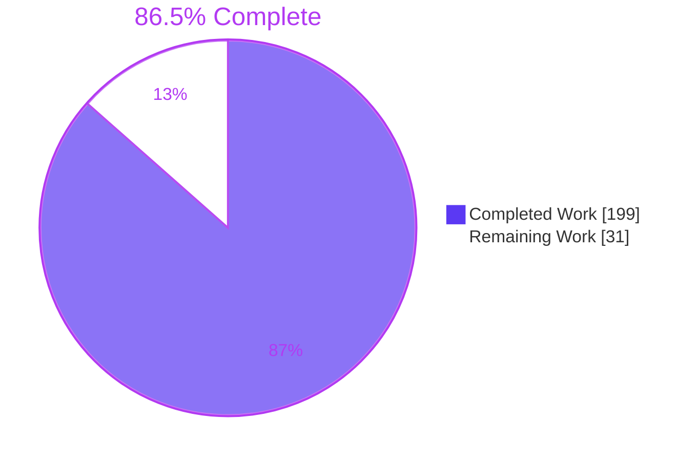
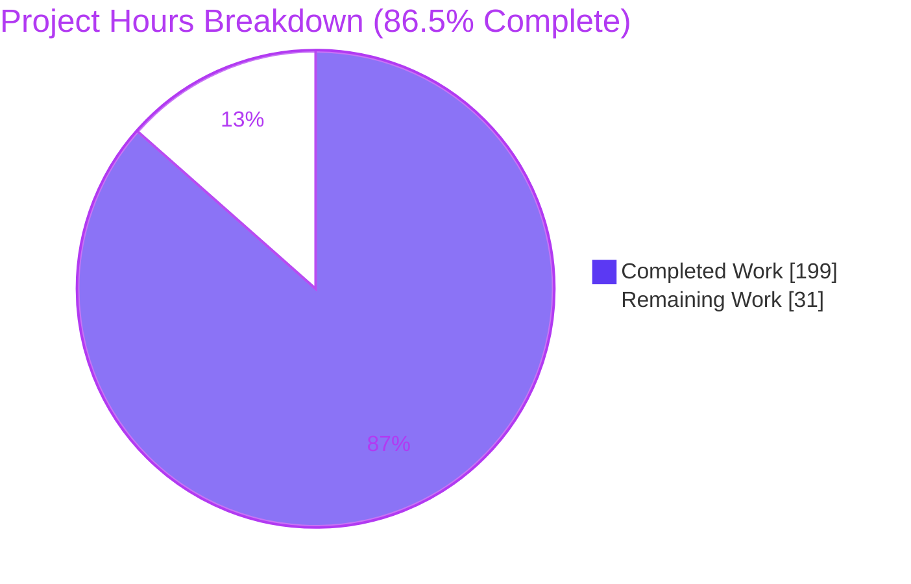
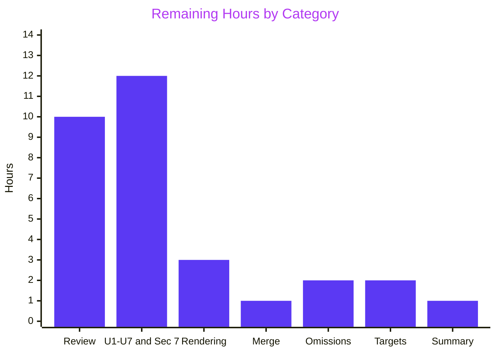

# 1. Executive Summary

## 1.1 Project Overview

Two plain-language analyses under `docs/analysis/` let Product, Business and Operations readers define requirements for a bank reconciliation exceptions workbench. Analysis 1 walks today's flow in `modules/org.openbravo.advpaymentmngt` from import to posting in 12 steps. It inventories 57 manual actions, documents every matching parameter, traces 11 exception types and ranks five effort sources. Analysis 2 names screens to mirror, rates reusable services, pairs data-model changes, assesses 17 integration points, and sequences a rated two-tier capability set. Each runs to about 12,000 words, with diagrams and a glossary. Every claim cites the repository, and no code changed.

## 1.2 Completion Status



| Metric | Value |
|---|---|
| Total Hours | 230 |
| Completed Hours (AI + Manual) | 199 (199 AI + 0 manual) |
| Remaining Hours | 31 |
| Percent Complete | 86.5% |

199 hours completed out of 230 total hours = 86.5% complete, covering the AAP scope, the owner's full-depth expansion, and the path to production.

## 1.3 Key Accomplishments

- [x] Analysis 1: a 12-step walkthrough, 57 manual actions, every matching parameter, 11 exception types, a gap table and 11 open questions
- [x] Analysis 2: 3 screens to mirror, 5 rated services, 17 rated integration points, 5 + 6 capabilities and 6 phases
- [x] 14 diagrams render with 0 errors, each captioned, cited and at most 12 nodes
- [x] 448 of 448 distinct citations resolve against the repository
- [x] Both documents are within the 10,000–12,000-word target
- [x] 38 of 38 references into Analysis 1 resolve, and the AAP's fixed wordings are verbatim in both glossaries
- [x] Every earlier finding and label is kept
- [x] Only the two documents differ from `77692f968d`

## 1.4 Critical Unresolved Issues

None of the 40 directive acceptance items or the 14 required sections fails its gate. 18 follow-up items remain open, and none blocks structural acceptance:

| Issue | Impact | Owner | ETA |
|---|---|---|---|
| Unconfirmed installation facts U1–U7 (7 items): installed bank file formats, each account's matching record and switches, match rates and volumes, posting configuration, posting schedule, audit state, Finance role holders. The two Section 7 tables expand them into 21 questions in total | Requirements may rest on shipped defaults rather than the live configuration | Finance / IT Operations | 12 h, shared with the next row |
| Assumptions A-1 to A-3 (3 items): Finance role coverage, the basis of the effort ranking, effort sizes | Ranking and sizing are reasoned from code, not measured | Product owner | Within the 12 h above |
| Stakeholder review and sign-off (1 item) | Neither document is accepted yet. Each has 3–4 words of headroom under 12,000, so every edit must be offset | Product, Business, Operations leads | 10 h |
| Rendering in the publishing viewer (1 item): the Analysis 2 §4.2 six-column table is cut off in the plain PDF print, and the diagrams have been rendered only by the Mermaid CLI and Mermaid 12.2.0 | PDF readers lose the last columns, and another viewer may draw the swimlanes differently | Documentation owner | 3 h |
| Minor content omissions (3 items): "workbench", "worklist" and "exception" are undefined in Analysis 2; its roles row omits client restriction; Analysis 1 §2.1 rows 15–16 do not say that Force replaces Process | Small gaps for non-technical readers | Documentation owner | 2 h |
| The placeholder objective has no numeric targets (1 item) | "Most statement lines" and the target cycle time are undefined | Business owner | 2 h |
| Merge, and the tracking policy for the ignored `docs/` folder (1 item) | `git add -A` silently skips new analyses | Repository maintainer | 1 h |
| Completion summary with current figures (1 item) | Figures recorded at first delivery are stale | Delivery lead | 1 h |

## 1.5 Access Issues

| System/Resource | Type of Access | Issue Description | Resolution Status | Owner |
|---|---|---|---|---|
| Production Openbravo installation (configuration and volume data in `FIN_FINANCIAL_ACCOUNT`, `FIN_MATCHING_ALGORITHM`, `FIN_BANKSTATEMENTLINE`, `AD_PROCESS_REQUEST`, `AD_TABLE`, `AD_USER_ROLES`) | Read-only query access | Needed to settle U1–U7 and the questions in Section 7 of both documents. The repository holds only shipped defaults and sample data | Open, not provisioned | Finance / IT Operations |

The document gate itself needs no credentials, ports or services.

## 1.6 Recommended Next Steps

1. [High] Review and sign off both analyses, keeping every edit word-neutral, then re-run the Section 9 gate.
2. [Medium] Confirm U1–U7 and answer both Section 7 tables against a production installation.
3. [Medium] Render both documents in the publishing viewer, and decide how to present the widest tables.
4. [Medium] Merge, and decide how the ignored `docs/` folder is tracked.
5. [Low] Close the three minor content omissions, and set numeric targets for the objective.

# 2. Project Hours Breakdown

## 2.1 Completed Work Detail

| Component | Hours | Description |
|---|---|---|
| A1 §1 End-to-end walkthrough (AAP R2; directive D1.2, D1.9a) | 13 | 12 steps in three stages, from import (`ImportBankFile`, `FIN_BankStatementImport`) through Match Statement to posting (`DocFINReconciliation`). Each step states what happens, the window or class, the tables read or written, and what the user sees. Includes §1.3 (accounts and periods off the main path), Figures 1–3, and U1, U4 and U5 |
| A1 §2 Manual-action inventory and swimlanes (R3; D1.3, D1.9b) | 21 | 57 rows in the columns Step / Who acts / Trigger / Window-class / Frequency driver / Data volume sensitivity / Could be automated. Built from window buttons, `ob-aprm-matchStatement.js` prompts, process definitions and `V3_Roles.xml` grants. Includes four swimlanes (Figures 4–7), Appendix B, Assumption A-1 and U7 |
| A1 §3 Matching logic (R4; D1.4, D1.9c) | 12 | Criteria, fixed gates and the pass table from `StandardMatchingAlgorithm` and `MatchTransactionDao`; an 8-row parameter table with defaults and admin changes (U2); limits and failure scenarios in business terms; and the decision flow (Figure 8) |
| A1 §4 Exception handling and lifecycle (R5; D1.5, D1.9d) | 11 | What counts as unmatched, the resolution paths, and what is not recorded. 11 exception types are traced from detection to resolution, with owner, age, reason and gap. Includes the lifecycle with automatic retry on reopening (Figure 9) and Appendix C |
| A1 §5–§7 and Key Takeaways (R6, R16; D1.6–D1.8, D4.5) | 10 | Five ranked effort sources, each with evidence, who is affected, business impact and ranking reason (A-2, U3); a gap table (auto-match rate, owner, age, reason code, cycle time, manual effort); 11 open questions; rewritten takeaways |
| A2 §1 UI framework, screens to mirror and wireframe (R8; D2.2, D2.9b) | 10 | Technology baseline from `build.xml`, `package.json` and `lib/test`; six screen patterns; three screens to mirror (Match Statement, Alert Management, Financial Account) with fit reasons; a proposed wireframe (Figure 1); Appendix B |
| A2 §2 Reusable components (R9; D2.3, D2.9a) | 11 | Roles, audit trail, notifications, scheduling and reporting, each with what exists, limits and gaps, a High/Medium/Low fit and a 2–3 sentence rationale. Includes U6, a reuse map (Figure 2) and Appendix C |
| A2 §3 Data model (R10; D2.4, D2.9c) | 8 | A two-column table of required changes against current support on `FIN_BANKSTATEMENTLINE` and related tables, plus a companion table of rationale and impact on existing data. Includes two data-model diagrams (Figures 3–4) and Appendix D |
| A2 §4 Integration points and test coverage (R11; D2.5) | 18 | 17 integration points, each with what it connects, what could break, severity, coverage (`Tested`/`Partial`/`Untested`, with test file paths and suite membership in `StandaloneTestSuite` and `WebserviceTestSuite`) and a mitigation. Includes Appendix E |
| A2 §5–§7 and Key Takeaways (R12; D2.6–D2.8, D2.9d) | 11 | A 5-row minimum-viable tier and a 6-row full-scope tier with description, Analysis 1 section, impact, effort rationale and dependencies (A-3). Then six proposed phases with a roadmap (Figure 5), 10 open questions and 8 assumptions |
| Plain language, definitions and glossaries (R14; D4.1–D4.4, D4.6) | 16 | Terms defined at first use, Appendix A glossaries (66 and 96 terms), openers and closers on all 14 sections, and at most 4 sentences per paragraph or cell |
| Diagram standards (D3.1–D3.6) | 6 | 14 Mermaid flowcharts with business labels, parenthesised code names that resolve, at most 12 nodes each, accessible titles, and dashed Proposed styling in Analysis 2 only |
| Claim-support verification against source (AAP 0.7.2; D4.8) | 32 | Each section's claims checked line by line against the cited code, metadata and tests, area by area (backend, frontend, database, security, tests) |
| Document gate tooling and runs (R17; IN1) | 10 | Two-count word check, markdown-it rendering, Chrome PDF printing, Key Takeaways lines, Mermaid CLI rendering, Mermaid-stripped citation check, and structure, sentence, opener and glossary checks |
| Cross-document consistency and finding preservation (R13; IN15, IN19) | 8 | 38 "Analysis 1, Section N" references, shared definitions that agree across both documents, and a check that every earlier finding and cited entity survives |
| Repository delivery (R18; D5.1–D5.4) | 2 | Both files edited in place under the ignored `docs/` path with `git add -f`, and the diff checked to show exactly two added files |
| **Total** | **199** | |

## 2.2 Remaining Work Detail

| Category | Hours | Priority |
|---|---|---|
| Stakeholder review and sign-off of both analyses: a Finance, Operations and Product read-through, a reviewer's claim spot-check, a decision on which proposed design content to adopt, confirming the Finance role as recipient of unassigned-item alerts, word-neutral edits, and a full gate re-run (path to production) | 10 | High |
| Confirm U1–U7 on a production installation, validate Assumptions A-1 to A-3, and answer both Section 7 tables, including who holds edit rights on `Bank File Format` and `Matching Algorithm` (path to production) | 12 | Medium |
| Render both documents in the publishing viewer (14 diagrams, the Analysis 2 §4.2 and Analysis 1 §2.1 tables), and decide whether a styled print is needed (path to production) | 3 | Medium |
| Merge the branch and decide the tracking policy for the ignored `docs/` folder (path to production) | 1 | Medium |
| Close three minor content omissions word-neutrally: define "workbench", "worklist" and "exception" in Analysis 2; add client restriction to its roles row; state in Analysis 1 §2.1 rows 15–16 that Force replaces Process (AAP R14; the directive's Section 2 and writing-constraint items) | 2 | Low |
| Set numeric targets for the placeholder objective (path to production) | 2 | Low |
| Circulate the completion summary with the current verification figures, the reference file and the left-out items (AAP R19) | 1 | Low |
| **Total** | **31** | |

## 2.3 Hours Calculation

- Completed hours: 199, the sum of Section 2.1. Of these, 71 built the capped first versions of both analyses, and 128 brought them to full depth, with diagrams, glossaries and Sections 6 and 7, and verified them
- Remaining hours: 31, the sum of Section 2.2
- Total project hours: 199 + 31 = 230
- Completion: 199 / 230 × 100 = 86.5%
- Confidence: medium-high for the completed hours. Medium for the remaining hours, because confirming U1–U7 depends on access to the installation, and reviewing about 24,000 words depends on reviewer availability

# 3. Test Results

The deliverable is documentation, so its test suite is the document gate the AAP defines (0.7.2 and 0.9.1), as amended by the owner's directive: a 10,000–12,000-word range in place of the caps, diagram standards, and the expanded structure. The gate was run in full from the repository root against the committed files at `af6933f42b`.

| Area / Category | Framework | Tests | Passed | Failed | Coverage | What This Proves |
|---|---|---|---|---|---|---|
| Length | GNU `wc -w` 9.4 under `C.UTF-8` (uutils `wc` 0.10.0 agrees) | 4 | 4 | 0 | Both documents: whole file and prose without diagrams | Each document falls in the 10,000–12,000-word range (10,932 and 11,393 prose; 11,996 and 11,997 whole) |
| Rendering, print and Key Takeaways | markdown-it-py 4.2.0, then Chrome 156 headless print, then pypdf 6.21.4 | 12 | 12 | 0 | Both documents: HTML render, PDF print, page size, takeaway bullets, entities and lines | Both render and print to US Letter (15 and 14 pages), and each opening shows 5 bullets on 5 lines |
| Diagrams | Mermaid CLI 12.0.0; Python parse of each block | 112 | 112 | 0 | 14 of 14 figures × 8 checks | Every figure renders, has at most 12 nodes, a caption, a reading note and an accessible title, is cited in its section, and uses only flowchart syntax; proposed elements are dashed in Analysis 2 only |
| Citations | Python with `git ls-files` and `git grep -F -w`, diagrams stripped | 448 | 448 | 0 | 448 of 448 distinct citations (1,132 spans) | Every cited path exists and every cited entity is in `src`, `src-db`, `modules`, `referencedata` or `src-test` |
| Structure, writing rules and required content | Python heading, paragraph and table parse | 59 | 59 | 0 | Both documents: headings, fences, HTML, links, whitespace, sentence counts, 14 openers and 14 closers, 13 required tables and lists | Exact titles, Sections 1–7 then appendices, at most 4 sentences per block, and the required counts (12 steps, 57 actions, 11 exception types, 5 effort items, 17 integration points, 5 + 6 capabilities, 6 phases) |
| Labels, glossaries and fixed wordings | Python table parse | 37 | 37 | 0 | Both documents | Labels appear 6 + 2 and 1 + 1 times; glossaries are sorted without duplicates; all applicable AAP fixed wordings are verbatim (14 and 15) |
| Cross-references and repository scope | Python regex; `git diff --name-status`; `git status` | 41 | 41 | 0 | 38 of 38 references, plus diff, status and whitespace checks | Every "Analysis 1, Section N(.M)" resolves, and only the two documents differ from `77692f968d` |
| Claim spot-check against source | Manual read of the cited code and data | 6 | 6 | 0 | Six claims across both documents | Sample switches all off (`FIN_MATCHING_ALGORITHM.xml`), strong `AU` / weak `AP` (`FIN_MatchedTransaction`), the import message dropping the zero-amount note (`FIN_BankStatementImport`), alert self-closing (`AlertProcess`), audit rebuild (`SL_TableAudit`) and `RecordID2Test` suite membership all read as stated |

**Not Covered**

- No Openbravo code was executed. The JUnit suites (`run.all.tests`, `run.webservice.tests`, `run.test` in `src-test/build.xml`) and Jest were not run, because no code changed. Behaviour the analyses describe, such as the matching passes, guard rails and posting, rests on reading the source.
- Claim support has no automated check. Each section was reviewed against its cited code, but before sign-off a reviewer should repeat the AAP's spot-check: every citation in §1 of each document, and at least three in each other section.
- Whether Analysis 1 §2.1 lists every manual action is a review judgement against window buttons, prompts and process definitions. No automated inventory compares it with the code.
- Readability for non-technical readers has no automated test. The sentence, opener and glossary checks are mechanical only.
- Rendering in GitHub, GitLab, IDE previews or a wiki was not checked. The diagrams were validated with the Mermaid CLI and Mermaid 12.2.0 only, and the Analysis 2 §4.2 table is cut off in the plain PDF print.
- Installation facts (U1–U7 and both Section 7 tables) cannot be tested from the repository. The proposed workbench content (wireframe, data-model changes, phases) is guidance and is not implemented.

# 4. Runtime Validation & UI Verification

The runtime for this deliverable is the rendering pipeline: markdown to HTML, HTML to PDF, diagrams to SVG, and on-screen viewing.

- ✅ Operational: **Markdown rendering.** Both documents render with markdown-it-py (CommonMark plus tables) and exit 0.
- ✅ Operational: **PDF print.** Chrome headless prints Analysis 1 to 15 and Analysis 2 to 14 US Letter pages (612×792 pt).
- ⚠ Partial: **Wide tables in print.** With no stylesheet, the six-column Analysis 2 §4.2 table runs past the right edge of PDF pages 7–8, so its last columns are cut off. On screen, it and the seven-column Analysis 1 §2.1 table scroll sideways with nothing lost.
- ✅ Operational: **Diagram rendering.** All 14 figures render to SVG with the Mermaid CLI with no syntax error. In headless Chrome with Mermaid 12.2.0, every figure draws with 0 JavaScript or Mermaid errors.
- ⚠ Partial: **Narrow screens.** At 375 px wide, figure text shrinks to about 4.5–10.5 px, so readers on phones need to zoom. Content stays complete.
- ✅ Operational: **Accessibility of figures.** Each of the 14 figures carries an accessible title equal to its caption and a description.
- ✅ Operational: **Opening blocks.** Each Key Takeaways block shows 5 bullets on 5 rendered lines on page 1.
- ✅ Operational: **Repository delivery.** Both files are tracked (`git ls-files docs/analysis`), the diff against `77692f968d` shows two `A` entries, and the working tree is clean.
- ⚠ Partial: **Never exercised at runtime.** The Openbravo ERP application (Tomcat, PostgreSQL), its windows such as `Match Statement` and `Financial Account`, the JUnit and Jest suites, and the GitHub or GitLab markdown renderers. None is needed for a documentation-only change, and none is provisioned.

# 5. Compliance & Quality Review

## 5.1 Compliance Matrix

| AAP Deliverable | Benchmark | Status | Progress | Evidence |
|---|---|---|---|---|
| Analysis 1 file, title and sections (R1–R6; D1.0–D1.10) | Exact H1, §1–§5 numbering kept, §6–§7 and appendices added, every directive item present | ✅ PASS | ██████████ 100% | `docs/analysis/analysis-1-current-state-reconciliation.md` |
| Analysis 2 file, title and sections (R7–R12; D2.0–D2.10) | Exact H1, §1–§5 numbering kept, §6–§7 and appendices added, every capability fully rated, coverage marked on every integration point | ✅ PASS | ██████████ 100% | `docs/analysis/analysis-2-extension-points-and-risks.md` |
| Length (D1.1, D2.1) | 10,000–12,000 words per document | ✅ PASS, 3–4 words under the ceiling | ██████████ 100% | 10,932 / 11,393 prose; 11,996 / 11,997 whole |
| Diagrams (D1.9, D2.9, D3.1–D3.6) | At least 4 per document, standards met | ✅ PASS | ██████████ 100% | 9 + 5 figures, all render |
| Proposed design content (AAP 0.8.2 as narrowed by the owner) | Labelled "Proposed", dashed, no code, DDL or invented column names | ✅ PASS | ██████████ 100% | Analysis 2 Figures 1–5, §6 |
| Writing constraints (R14; D4.1–D4.7) | Plain language, definitions at first use, glossary, at most 4 sentences, openers and closers, no repetition | ⚠ PASS with 3 minor omissions | █████████░ 95% | Section 5.2, rows 35–37 |
| Citations and traceability (R15; D4.8) | Inline backticks, no line numbers, 0 failures | ✅ PASS | ██████████ 100% | 448 of 448 distinct resolve |
| Labels and open questions (R16; D1.8, D2.8) | U1–U7 and A-1 to A-3 once each; Section 7 states "not determinable from code" with no invented figures | ✅ PASS | ██████████ 100% | A1: 6 + 2, 11 questions; A2: 1 + 1, 10 questions and 8 assumptions |
| Cross-references (R13) | Every "Analysis 1, Section N(.M)" resolves to a stable heading | ✅ PASS | ██████████ 100% | 38 of 38 |
| Claim support (AAP 0.7.2) | Cited code supports each sentence | ✅ PASS, reviewer spot-check pending | █████████░ 90% | Every section reviewed; 6 of 6 spot-checks hold |
| Modification boundaries and finding preservation (R18; D5.1–D5.4) | Only the two files change; titles and §1–§5 kept; no earlier finding removed | ✅ PASS | ██████████ 100% | `git diff --name-status 77692f968d HEAD` |
| Completion summary (R19) | Reference file, left-out items and verification results delivered with the documents | ⚠ PARTIAL | █████░░░░░ 50% | Current figures are in Sections 3 and 10 |

## 5.2 AAP & Rule Divergences and Gaps

No user rules were set (AAP 0.10), so every row is measured against the AAP and the owner's directive, which outranks the AAP. Rows 1–18 are departures the owner asked for, so they are **Sanctioned**. Rows 19–33 depart from the AAP's planned wording where the code says otherwise. AAP 0.7.2 requires cited code to support each sentence, so the AAP sanctions them. Row 34 is sanctioned by the directive's no-repetition rule. Rows 35–40 are open.

| # | What the AAP/Rule Required | What Was Delivered Instead | Why It Diverged | Impact | Remediation |
|---|---|---|---|---|---|
| 1 | At most 2,500 words and 6 pages per document, with every addition offset by a cut (R17, 0.7.2, 0.9.1, and the per-change gate) | 11,996 and 11,997 words, printing to 15 and 14 pages | **Sanctioned:** the owner asked to "Remove the 6-page and 2,500-word caps. Target 10,000-12,000 words" | Each document is 3–4 words under its new ceiling | None; offset every edit |
| 2 | One flow of at most 10 steps (R2; 0.3.1.1 §1 planned 8) | 12 steps, each with what happens, the window or class, the tables, and what the user sees (A1 §1.2) | **Sanctioned:** "Replace the 10-step flow with a full walkthrough" | Fuller trace | None |
| 3 | 17 merged rows in 4 columns (C5; 0.3.1.1 §2) | 57 rows in 7 columns (A1 §2.1) | **Sanctioned:** "Make the manual-action table exhaustive … Add columns" | Complete inventory | None |
| 4 | One-sentence rationale per effort item (R6; 0.4.2) | Each of the 5 items gives evidence, who is affected, business impact and why it ranks above the next (A1 §5) | **Sanctioned:** directive Section 5 bullet | Richer ranking basis | None |
| 5 | Sections 1–5 only (0.4.1, 0.7.1; the gate's "H2 1–5") | §6 and §7 in both documents (A1 §6 Gaps, §7 Open Questions; A2 §6 Sequencing, §7 Open Questions and Assumptions) | **Sanctioned:** "Add Section 6 … Add Section 7" | New sections | None |
| 6 | Labels only at their placements; items with no code left out of both documents (0.3.2, 0.8.2) | Section 7 tables list what the code cannot answer as "not determinable from code", referring to each label | **Sanctioned:** "State 'not determinable from code' where applicable" | Open questions are visible to readers | Answer them (Section 2.2) |
| 7 | No diagrams, no fenced blocks (0.4.3, 0.7.2, 0.7.3; the gate's "no code fences") | 14 Mermaid figures (A1 Figures 1–9, A2 Figures 1–5) | **Sanctioned:** "Diagrams (minimum 4)" and the diagram standards | Visual support | None |
| 8 | At most 3 sentences per paragraph (0.4.2, 0.7.2) | At most 4 | **Sanctioned:** "Max 4 sentences per paragraph" | None | None |
| 9 | No glossary, index or table of contents (0.5.5) | Appendix A glossaries (66 and 96 terms) and supporting appendices (A1 B–C, A2 B–E) | **Sanctioned:** "add a glossary appendix … Put supporting detail in appendices" | Easier lookup | None |
| 10 | Outlines carry no opener or closer lines (0.4.1) | "What this section tells you" and "Requirement implications" on all 14 sections | **Sanctioned:** directive writing constraint | Consistent framing | None |
| 11 | No screen layouts, table designs or workbench design (0.8.2) | A proposed wireframe (A2 Figure 1), data-model diagrams (Figures 3–4), six proposed phases (§6, Figure 5) and per-row mitigations, all labelled "Proposed" and dashed | **Sanctioned:** directive diagrams (b)–(d), Sections 4 and 6 | Design guidance may be read as decided scope | Decide adoption in review (Section 2.2) |
| 12 | Each area marked tested or untested in lower case (R11; 0.4.1) | 17 points with severity, `Tested`/`Partial`/`Untested` with test paths, and a mitigation. The 13 planned areas are kept and 4 added; five earlier "tested" areas now read `Partial` (A2 §4.2) | **Sanctioned:** directive Section 4 bullet | A more conservative coverage picture (0 Tested, 8 Partial, 9 Untested) | None |
| 13 | Three-column reuse table (0.4.1 A2 §2) | Adds limits and gaps, and a 2–3 sentence fit rationale per component (A2 §2.2) | **Sanctioned:** directive Section 2 bullet | Fuller fit basis | None |
| 14 | One two-column table (0.4.1 A2 §3; 0.7.2) | The two-column table, plus a companion table of rationale and impact on existing data (A2 §3) | **Sanctioned:** directive Section 3 bullet | Impact on existing records visible | None |
| 15 | Rank / Capability / Impact / Effort only (0.4.1 A2 §5) | Companion tables add a business description, the Analysis 1 section addressed, an effort rationale, and dependencies (A2 §5.1–§5.2) | **Sanctioned:** directive Section 5 bullet | Every capability fully rated | None |
| 16 | No illustrations about typical bank data (0.7.3) | Hypothetical failure scenarios introduced "for example", never as statistics (A1 §3) | **Sanctioned:** "a concrete limit or failure scenario in business terms" | Limits are concrete | None |
| 17 | Granularity at module, window, table and key-class level (0.1.2, 0.3.1) | Individual columns, message keys, preferences and test files named where a directive needs them | **Sanctioned:** the per-step, per-row and per-parameter directives | Traceable detail | None |
| 18 | Both files created (0.5.1) | Both edited in place; the diff still shows two `A` entries | **Sanctioned:** "Expand … in place" | None | None |
| 19 | §2 setup rows acted by "Finance user"; A-1 covers every step except the format install (0.3.1.1, 0.3.2) | "User with edit access" in rows 2, 3, 5 and 6 (A1 L178–182), and A-1 excludes them | `V3_Roles.xml` gives the Finance role view-only access to `Bank File Format` and `Matching Algorithm` | Accurate attribution | Confirm with U7 (Section 2.2) |
| 20 | "Reactivate the latest statement or reconciliation" | Row 43 reactivates a statement; row 44 the latest reconciliation (A1 L219–220) | `FIN_BankStatementProcess` does not limit statement reactivation to the latest | Accuracy | None |
| 21 | Partner guessed from the closest name after removing excluded words | Only a single partner sharing a name word is chosen; with several, the partner stays blank (A1 L61) | `FIN_BankStatementImport` returns no partner when several match | Accuracy | None |
| 22 | The period check applies to every cleared item | Only for organizations with accounting (A1 L146, L516) | `FIN_ReconciliationProcess` skips it where accounting does not apply | Accuracy | None |
| 23 | Switch defaults: name and reference on, date off; the sample record makes any same-amount candidate strong | Records from the window or a dataset take the application defaults, the database defaults apply only to direct inserts, and the sample turns all three off, so pass 3 makes any same-amount candidate strong (A1 L452) | `AD_COLUMN` and `DataImportService` set the defaults, and only pass 3 compares the switches | Accuracy | None |
| 24 | Unmatch merges split parts and deletes algorithm-created transactions and payments | Merges only still-unmatched split parts, and deletes algorithm-created records once reactivated (A1 L494) | Conditions in `APRM_MatchingUtility` and `StandardMatchingAlgorithm` | Accuracy | None |
| 25 | §4.3 lists the blocking checks without qualifiers | Qualified by force-processing and the Match Statement repair, and traced in §4.4 and Appendix C | The code paths for `APRM_BSLineReconciled` and `APRM_ReconciliationMixed` | Accuracy | None |
| 26 | §5 item 1: lines "the algorithm misses" | Lines "the rules never match", that no later automatic run matches (A1 L560) | A line a later run matches needs no person | Accuracy | None |
| 27 | Terms defined at first use (0.4.2) | The §1 heading uses "Reconciliation" before its definition (A1 L11) | The AAP fixes the heading text (0.4.1) | None | None |
| 28 | A2 "## 1." has no content before §1.1 (0.4.1) | The section opener and the objective quote come first (A2 L13–18) | The directive requires openers, and the AAP requires the objective quote | None | None |
| 29 | Servlet row cross-references "Analysis 1, Section 1.2" | "Analysis 1, Section 1.2 and Analysis 1, Section 2" (A2 L39) | The `Reconciliation` screen appears in Analysis 1 §2 | More precise | None |
| 30 | Audit row: created and updated "on every table" | "Tables such as `FIN_BANKSTATEMENTLINE`" (A2 L127) | Some tables lack those columns | Accuracy | None |
| 31 | Notifications row as planned | Adds that `AlertProcess` closes an alert once its rule stops returning the item (A2 L128) | `AlertProcess_data.xsql` marks such alerts solved | Added finding | None |
| 32 | `RecordID2Test` "unposts and reposts an existing reconciliation" | "Reposts three sample reconciliations" (A2 L292) | The test cases use three distinct reconciliations | Accuracy | None |
| 33 | §5.1 rank 4: aging and unassigned-item alerts to owners | Aging alerts go to owners, and unassigned-item alerts to the Finance role (`AD_ALERTRECIPIENT`, A2 L321) | An unassigned item has no owner | Broader recipients | Confirm in review (Section 2.2) |
| 34 | §5 item 4 names "free-text description and record notes" (0.3.1.1) | Item 4 points to §4.2 and §4.3, where record notes are covered (A1 L500) | **Sanctioned:** the directive forbids repeating a finding and asks for cross-references | None | None |
| 35 | Every technical term defined at first use (0.7.2; directive "Define each technical term … at first use") | "Workbench", "worklist" and "exception" are undefined in Analysis 2 (A2 L1, L9, L30). Analysis 1 defines exceptions (A1 L19) | They are the request's own vocabulary and were not defined in this run. Analysis 2 has 3 words of headroom | Operations or Business readers may need definitions | Define word-neutrally (Section 2.2) |
| 36 | Roles row covers record-level restriction (0.3.1.2 §2) | Organization access is covered (`AD_ROLE_ORGACCESS`), client restriction is not (A2 L126) | Not added in this run; the reason is not recorded | Minor omission | Add word-neutrally (Section 2.2) |
| 37 | Section 2 exhaustive, "with no omissions" (directive Section 2) | Rows 15–16 do not say that the Force button replaces Process when it appears (A1 L191–192) | Accepted as a known omission; the reason it was not added is not recorded | A reader may look for both buttons | Add word-neutrally (Section 2.2) |
| 38 | Diff check: `git status --porcelain --untracked-files=all` shows two `??` lines (0.9.1) | Not reproducible: the files are committed, and `.gitignore` line 11 ignores `docs` | Repository ignore rules, and the AAP forbids editing `.gitignore` | None. `git diff --name-status 77692f968d HEAD` shows two `A` entries | Decide `docs/` tracking (Section 2.2) |
| 39 | Completion summary carrying the verification results (C1, 0.9.1) | The figures recorded at first delivery (Analysis 1 at 2,349 words, 5 pages, 119 citations) are superseded | The documents grew after those figures were recorded | Stale figures if that summary is used | Circulate current figures (Section 2.2) |
| 40 | Documents printed through the AAP pipeline for human review (0.9.1) | The six-column A2 §4.2 table runs past the right edge on PDF pages 7–8 | Full test paths are required in each row, and the plain print has no stylesheet. It was accepted, since pages are no longer gated | PDF readers lose the last columns | Decide presentation (Section 2.2) |

**Row 1, word ceiling.** Removing the caps let both documents reach full depth, but each now sits 3–4 words under the 12,000-word ceiling, measured with GNU `wc` on the whole file. The prose floor of 10,000 words has more room (10,932 and 11,393). Any reviewer edit that adds words can break the ceiling without notice. Offset every change within the same document and run the full Section 9 gate before committing; if reviewers need more room, the owner decides whether to raise the ceiling or move detail into the appendices.

**Row 11, proposed design content.** Analysis 2 now carries a wireframe, data-model change diagrams and a six-phase roadmap, all labelled "Proposed" and dashed (A2 Figures 1, 3, 4 and 5, and §6). They name new entities in plain business words, and add no code, DDL or invented column names. They are recommendations derived from the code, not decided scope. In review, the owner should decide which phases and proposed fields to adopt as requirements, and keep anything not adopted labelled as proposed.

**Row 19, role attribution.** The AAP expected the Finance role to perform every step except the format install. `modules/org.openbravo.v3.datasets/referencedata/standard/V3_Roles.xml` grants that role view-only access to `Bank File Format` and `Matching Algorithm`, so Analysis 1 §2.1 rows 2, 3, 5 and 6 say "User with edit access", and the Assumption excludes those steps. Who holds edit rights is installation data (U7), which the owner must confirm. This matters most for shared matching records, because editing one silently changes matching for every account that selects it.

**Row 33, alert recipients.** The AAP planned aging and unassigned-item alerts to owners. An unassigned item has no owner, so Analysis 2 §5.1 rank 4 sends unassigned-item alerts to the Finance role, through `AD_ALERTRECIPIENT`, which supports role recipients and optional email. The rating stays Medium/S, but the capability widens who receives alerts. Before the minimum-viable tier is adopted as scope, reviewers should confirm that the Finance role is the right recipient for unassigned items.

**Row 35, undefined workbench vocabulary.** The directive asks for every technical term to be defined at first use. Analysis 2 uses "workbench", "worklist" and "exception" from its title onward without defining them, though Analysis 1 defines exceptions as items needing a person (A1 L19). The words come from the request itself, so Product readers will know them, but Operations and Business readers reading Analysis 2 alone may not. Defining all three takes about 20 words, which must be cut elsewhere in Analysis 2 to stay under 12,000.

**Row 38, ignored `docs/` folder.** The AAP's untracked-file check cannot produce its expected `??` lines, because `.gitignore` line 11 and `.hgignore` line 10 ignore `docs`, and both files are committed. The equivalent check passes: a diff against `77692f968d` shows two `A` entries. The open decision is policy: either un-ignore `docs/` in a separate change, or keep it ignored and require `git add -f` for every future analysis. Plain `git add -A` skips such files without warning.

**Row 39, completion summary figures.** The AAP calls for a completion summary delivered alongside the documents. The figures recorded at first delivery (Analysis 1 at 2,349 words, 5 pages and 119 citations) describe documents that have since grown roughly fivefold. Section 3 of this guide carries the current results, and Section 10 C names the reference file and the items left out. Circulate these with the documents, so that reviewers judge against current figures.

**Row 40, the widest table in print.** Each Analysis 2 §4.2 row must carry full test file paths, such as `src-test/src/org/openbravo/test/accounting/RecordID2Test.java`, so the six-column table is wider than a US Letter page in the plain, unstyled print. On screen it scrolls with nothing lost. If reviewers work from PDF, the owner must choose one of three options: print with a landscape or shrink-to-fit stylesheet, publish through a viewer that wraps code, or accept on-screen reading. The document text itself needs no change.

# 6. Risk Assessment

| Risk | Category | Severity | Probability | Mitigation | Status |
|---|---|---|---|---|---|
| Requirements rest on repository defaults and on a ranking and sizing reasoned from code, while the installation differs in formats, matching switches, posting, audit state, role holders and volumes (U1–U7, A-1 to A-3, both Section 7 tables) | Integration | High | Medium | Confirm U1–U7 and answer Section 7 against production before fixing workbench scope | Open |
| A workbench built on the analyses changes areas no repository test fully covers: of 17 integration points, 0 are `Tested`, 8 `Partial` and 9 `Untested`, including import, matching and completion (A2 §4.2) | Technical | High | High | Add tests around `StandardMatchingAlgorithm`, `MatchTransactionDao` and `APRM_MatchingUtility` before changing them, as A2 §6 sequences | Open; applies to workbench delivery |
| A workbench that reuses existing services inherits two behaviours: the boolean `APRM_MatchingUtility.matchBankStatementLine` returns true whether or not the match saved (`APRM_MatchingUtility.java` lines 262–268), and processing a statement updates at most one later reconciliation (`getAffectedReconciliations`, `FIN_BankStatementProcess.java` lines 227–239) | Technical | Medium | Medium | Check the saved line, not the return value; review the single-reconciliation update during workbench design | Open; source unchanged by design |
| A review edit breaks the gate: each document is 3–4 words under the 12,000-word ceiling, and the takeaways, sentence and 12-node rules leave no slack | Technical | Medium | High | Offset every addition, and run the Section 9 gate before committing | Open |
| Cited classes, tables or messages are renamed in later releases, so citations and claims go stale | Technical | Medium | Medium | Re-run the citation check and a claim spot-check whenever `modules/org.openbravo.advpaymentmngt` changes | Monitored by the gate |
| The publishing viewer draws the documents differently: the A2 §4.2 table is cut off in the plain PDF, the swimlane styling is validated only with the Mermaid CLI and Mermaid 12.2.0, and figure text is small on phones | Integration | Low | Medium | Render in the target viewer before circulating, and add a print stylesheet if PDFs are used | Open |
| New analyses under the ignored `docs/` path are left out of commits, because `git add -A` skips them silently | Operational | Low | High | Use `git add -f`, or un-ignore `docs/` in a separate change | Open; policy decision |
| Recommended capabilities widen Finance-role grants (`OBUIAPP_PROCESS_ACCESS`) and add email alerts (`AD_ALERTRECIPIENT`). The documents hold no credentials or installation data | Security | Low | Low | Review role grants and alert recipients during workbench design | Accepted |

# 7. Visual Project Status



**Remaining hours by category (31 h total, from Section 2.2)**



| Priority | Tasks | Hours |
|---|---|---|
| High | 1 | 10 |
| Medium | 3 | 16 |
| Low | 3 | 5 |
| **Total** | **7** | **31** |

# 8. Summary & Recommendations

The project is 86.5% complete: 199 of 230 hours delivered, 31 remaining. Both analyses are in `docs/analysis/`, with the exact titles and §1–§5 numbering the AAP sets, and the §6–§7, glossary and appendices the owner added. Analysis 1 gives readers a full account of today's bank reconciliation. It walks the 12 steps from import to posting, lists all 57 points where people act with what makes each recur and whether it could be automated, and documents every matching criterion and parameter with its failure scenario. It also traces 11 exception types from detection to resolution, ranks five effort sources, and maps the objective's auto-match rate, owner, age and reason code to Partial, None, Partial and None support.

Analysis 2 shows what a workbench can build on. It names three screens to mirror and rates five platform services, three High and two Medium. It pairs each data-model change with its impact on existing lines, and assesses 17 integration points: 11 High severity, and none fully covered by tests. Its two rated tiers of 5 and 6 capabilities run in six proposed phases that put tests before matching changes. Fourteen diagrams support both documents, each code-verified, with proposed elements dashed.

The full document gate passed: 719 of 719 checks, covering length, rendering, diagrams, 448 distinct citations, structure, labels, glossaries, cross-references and repository scope. Six of six claims spot-checked against the source held. Section 5.2 records 40 departures from the AAP. Of these, 18 are the owner's own expansion requests and 16 make the text more accurate or follow the directive. Six are open: three minor content omissions, the ignored `docs/` path, stale first-delivery figures, and one wide table that the plain PDF print cuts off.

What remains is mostly business work. Readers must review and sign off. U1–U7 and the Section 7 questions must be settled against a live system, and the objective needs numeric targets. The critical path runs from review and sign-off (10 h) to installation confirmation (12 h), then rendering in the publishing viewer (3 h) and merge (1 h). The content omissions, targets and completion summary (5 h) can run in parallel.

| Success Metric | Target | Current |
|---|---|---|
| Words per document (prose / whole file) | ≥ 10,000 / ≤ 12,000 | 10,932 / 11,996 and 11,393 / 11,997 |
| Diagrams per document | ≥ 4 | 9 and 5, 0 render errors |
| Citation failures | 0 | 0 of 448 distinct |
| Cross-reference failures | 0 | 0 of 38 |
| Files changed outside `docs/analysis/` | 0 | 0 |
| Unconfirmed findings settled | 7 | 0 (installation data needed) |

Production readiness: both documents are ready for stakeholder review, and every structural and directive acceptance criterion is met. Do not treat them as a requirements baseline until U1–U7 are confirmed and the owner decides which proposed content to adopt. Every edit must be word-neutral and pass the Section 9 gate.

# 9. Development Guide

The deliverable is two markdown files, and it has no application to build or run. This guide covers how to edit the analyses safely and how to re-run the document gate that proves they still meet the AAP and the owner's directive. Do not install or start Java, Ant, PostgreSQL, Tomcat or `npm install` for the project. None of them is needed.

## 9.1 System Prerequisites

- Linux or macOS shell (bash), run from the repository root
- git 2.43 or later (verified with 2.56.0)
- Python 3.12 or later (verified with 3.12.3 and 3.13.18), with markdown-it-py 4.2.0, mdurl 0.1.2 and pypdf 6.21.4
- Google Chrome (verified with 156.0.8078.79) for headless PDF printing
- Mermaid CLI `mmdc` (verified with 12.0.0 on Node.js 22) for diagram rendering. Where it is missing, install it with `npm install -g @mermaid-js/mermaid-cli`
- A `wc` for word counts: GNU coreutils 9.4 and uutils 0.10.0 give identical counts for these files under `C.UTF-8`
- About 1 GB free disk for a full checkout. No ports, databases or services are used

## 9.2 Environment Setup

Create a private Python environment outside the checkout, and a scratch folder for generated files. Never write scratch output inside the repository.

```bash
python3 -m venv "$HOME/.venvs/openbravo-docs"
"$HOME/.venvs/openbravo-docs/bin/pip" install markdown-it-py==4.2.0 mdurl==0.1.2 pypdf==6.21.4
export PY="$HOME/.venvs/openbravo-docs/bin/python"
export OUT=$(mktemp -d)
printf '{"args":["--no-sandbox","--disable-gpu"]}\n' > "$OUT/puppeteer.json"
```

Expected: pip exits 0, and `"$PY" -c "import markdown_it, pypdf; print(markdown_it.__version__, pypdf.__version__)"` prints `4.2.0 6.21.4`. The `puppeteer.json` file lets `mmdc` run headless Chrome in containers.

## 9.3 Word Count

Each document must keep at least 10,000 words of prose (diagram blocks removed) and at most 12,000 words in the whole file.

```bash
for F in docs/analysis/*.md; do
  printf '%s whole=%s prose=%s\n' "$(basename "$F" .md)" "$(LC_ALL=C.UTF-8 wc -w < "$F")" "$(sed '/^`\{3\}mermaid/,/^`\{3\}/d' "$F" | LC_ALL=C.UTF-8 wc -w)"
done
```

Expected:

```text
analysis-1-current-state-reconciliation whole=11996 prose=10932
analysis-2-extension-points-and-risks whole=11997 prose=11393
```

## 9.4 Render, Print and Count Pages

```bash
for F in docs/analysis/analysis-1-current-state-reconciliation.md docs/analysis/analysis-2-extension-points-and-risks.md; do
  N=$(basename "$F" .md)
  "$PY" -c "import sys; from markdown_it import MarkdownIt; h=MarkdownIt('commonmark').enable('table').render(open(sys.argv[1],encoding='utf-8').read()); open(sys.argv[2],'w',encoding='utf-8').write('<html><head><meta charset=\"utf-8\"></head><body>'+h+'</body></html>')" "$F" "$OUT/$N.html"
  google-chrome --headless=new --no-sandbox --disable-gpu --no-pdf-header-footer --print-to-pdf="$OUT/$N.pdf" "$OUT/$N.html" 2>/dev/null
  "$PY" -c "import sys; from pypdf import PdfReader; r=PdfReader(sys.argv[1]); p=r.pages[0]; l=p.extract_text().splitlines(); s=next(i for i,x in enumerate(l) if x.strip()=='Key Takeaways'); e=next(i for i,x in enumerate(l) if i>s and x.startswith('1.')); print(sys.argv[2], 'pages', len(r.pages), 'size', float(p.mediabox.width), float(p.mediabox.height), 'takeaway lines', e-s-1)" "$OUT/$N.pdf" "$N"
done
```

Expected output, with each print taking 1–30 seconds:

```text
analysis-1-current-state-reconciliation pages 15 size 612.0 792.0 takeaway lines 5
analysis-2-extension-points-and-risks pages 14 size 612.0 792.0 takeaway lines 5
```

The page count is not gated, but the page size must stay 612×792 and the takeaways at 5 lines or fewer. Do not use the markdown-it `gfm-like` preset, which fails with "Linkify enabled but not installed". In this plain print, diagrams appear as their source text.

Then render every diagram:

```bash
"$PY" - "$OUT" docs/analysis/*.md <<'EOF'
import re, sys, os
out = sys.argv[1]
for path in sys.argv[2:]:
    name = os.path.basename(path)[:-3]
    blocks = re.findall(r"^`{3}mermaid\n(.*?)^`{3}", open(path, encoding="utf-8").read(), re.S | re.M)
    for i, b in enumerate(blocks, 1):
        open(f"{out}/{name}-fig{i}.mmd", "w", encoding="utf-8").write(b)
    print(name, len(blocks), "figures")
EOF
fails=0; for f in "$OUT"/*.mmd; do timeout 180 mmdc -q -p "$OUT/puppeteer.json" -i "$f" -o "${f%.mmd}.svg" >/dev/null 2>&1 && ! grep -q 'Syntax error' "${f%.mmd}.svg" || { echo "FAIL $f"; fails=$((fails+1)); }; done; echo "mermaid failures: $fails"
```

Expected: `9 figures`, `5 figures`, then `mermaid failures: 0`. Keep each figure at 12 nodes or fewer, with its bold `Figure N.` caption directly above and a one-sentence `**How to read this:**` note directly below.

## 9.5 Citation Check

```bash
cat > "$OUT/cite.py" <<'EOF'
import re, subprocess, sys
EXT = (".java", ".xml", ".js", ".json", ".md", ".jrxml", ".jar", ".properties", ".html")
def git(*a):
    return subprocess.run(["git", *a], capture_output=True, text=True)
for path in sys.argv[1:]:
    text = re.sub(r"^`{3}mermaid\n.*?^`{3}\n?", "", open(path, encoding="utf-8").read(), flags=re.S | re.M)
    spans = re.findall(r"`([^`\n]+)`", text)
    bad = []
    for s in sorted(set(spans)):
        if "/" in s or s.endswith(EXT):
            ok = git("ls-files", "--error-unmatch", "--", s).returncode == 0 or git("ls-files", "--", s).stdout.strip()
        else:
            ok = git("grep", "-q", "-F", "-w", "--", s, "--", "src", "src-db", "modules", "referencedata", "src-test").returncode == 0
        if not ok:
            bad.append(s)
    print(f"{path}: {len(spans)} spans, {len(set(spans))} distinct, {len(bad)} failures {bad}")
EOF
"$PY" "$OUT/cite.py" docs/analysis/analysis-1-current-state-reconciliation.md docs/analysis/analysis-2-extension-points-and-risks.md
```

Expected, after about 2–3 minutes: `582 spans, 213 distinct, 0 failures []` for Analysis 1, and `550 spans, 235 distinct, 0 failures []` for Analysis 2. Diagram blocks are stripped first, because they must contain no backticks. Every other backtick span must be a citation.

## 9.6 Cross-Reference and Repository Checks

```bash
"$PY" -c "import re; a1=open('docs/analysis/analysis-1-current-state-reconciliation.md',encoding='utf-8').read(); a2=open('docs/analysis/analysis-2-extension-points-and-risks.md',encoding='utf-8').read(); h=set(re.findall(r'^#{2,3} (\d+(?:\.\d+)?)\.? ',a1,re.M)); r=re.findall(r'Analysis 1, Sections? (\d+(?:\.\d+)?)',a2); print(len(r), 'references to', sorted(set(r), key=lambda x: [int(p) for p in x.split('.')]), 'unresolved', sorted({x for x in r if x not in h}))"
"$PY" -c "import re,sys; [print(p.split('/')[-1], 'H1', len(re.findall(r'^# ', t, re.M)), 'second', re.findall(r'^#{1,6} (.*)$', t, re.M)[1], 'H2', re.findall(r'^## (\d)\. ', t, re.M), 'other fences', len(re.findall(r'^\`{3}(?!mermaid)\S', t, re.M)), 'Unconfirmed', t.count('**Unconfirmed:**'), 'Assumption', t.count('**Assumption:**')) for p in sys.argv[1:] for t in [open(p, encoding='utf-8').read()]]" docs/analysis/*.md
git diff --name-status 77692f968d HEAD -- . ':(exclude)blitzy'
git status --porcelain --untracked-files=all --ignored
```

Expected:

```text
38 references to ['1.1', '1.2', '2', '3', '3.1', '3.2', '3.3', '4.1', '4.2', '4.3', '5', '6'] unresolved []
analysis-1-current-state-reconciliation.md H1 1 second Key Takeaways H2 ['1', '2', '3', '4', '5', '6', '7'] other fences 0 Unconfirmed 6 Assumption 2
analysis-2-extension-points-and-risks.md H1 1 second Key Takeaways H2 ['1', '2', '3', '4', '5', '6', '7'] other fences 0 Unconfirmed 1 Assumption 1
A	docs/analysis/analysis-1-current-state-reconciliation.md
A	docs/analysis/analysis-2-extension-points-and-risks.md
```

After a commit, the last command prints nothing. Analysis 2 may cite Analysis 1 headings 1.1, 1.2, 2, 3, 3.1–3.3, 4.1–4.3, 5 and 6, but never Analysis 1 figure numbers, appendix letters or Section 7.

## 9.7 Example Usage: Editing an Analysis

1. Edit the markdown file. Keep each paragraph, list item and table cell to at most 4 sentences, and define any new technical term at first use, with a matching row in Appendix A.
2. Run 9.3. If the whole-file count rises above 12,000, cut the same number of words from that document. Never let the prose count fall below 10,000.
3. Run 9.4 to confirm the page size, 5 Key Takeaways lines, and 0 diagram failures.
4. Run 9.5 and 9.6. Fix every failure before committing.
5. Stage with an explicit force-add, because `docs` is ignored: `git add -f docs/analysis/analysis-2-extension-points-and-risks.md`. Then commit.

## 9.8 Troubleshooting

- **`git add docs/...` fails, or `git add -A` stages nothing.** `.gitignore` line 11 ignores `docs`. Use `git add -f <exact path>`, then confirm with `git ls-files docs/analysis`.
- **`git status` does not list a new docs file.** Add `--ignored`: `git status --porcelain --untracked-files=all --ignored`. Keep rendering screenshots and scratch output outside the checkout, and leave the `blitzy/` folder alone.
- **Chrome prints "Failed to connect to the bus".** This message is harmless. Check that the PDF file exists instead.
- **`mmdc` fails to launch Chrome.** Pass the `puppeteer.json` file from 9.2 with `-p`, which adds `--no-sandbox`.
- **A diagram fails to render.** Use `flowchart` syntax only, with no backticks, HTML tags, `click` lines or `%%{init}%%` lines inside the block. Close every `subgraph` with `end`.
- **The word count differs between machines.** Run `wc` under `LC_ALL=C.UTF-8`, and keep no-break or thin spaces out of the files. Em and en dashes are safe.
- **The Key Takeaways count prints more than 5.** Shorten or merge bullets. The count is taken from page 1 of the PDF, between the "Key Takeaways" heading and the line starting "1.".
- **A citation fails.** A path must be tracked by git exactly as written, and an entity must appear as a whole word under `src`, `src-db`, `modules`, `referencedata` or `src-test`. Use no wildcards, braces or line numbers.
- **The wide Analysis 2 §4.2 table is cut off in the PDF.** This is expected in the plain print. Read it on screen, or print with a landscape stylesheet.

# 10. Appendices

## A. Command Reference

| Purpose | Command (from the repository root) |
|---|---|
| Word count, whole file and prose | Loop in Section 9.3 (`LC_ALL=C.UTF-8 wc -w`, with a `sed` filter that drops diagram blocks for the prose count) |
| Render one file to HTML | `"$PY" -c "...MarkdownIt('commonmark').enable('table')..." "$F" "$OUT/$N.html"` (full form in Section 9.4) |
| Print to PDF | `google-chrome --headless=new --no-sandbox --disable-gpu --no-pdf-header-footer --print-to-pdf="$OUT/$N.pdf" "$OUT/$N.html"` |
| Page size and Key Takeaways lines | pypdf one-liner in Section 9.4 |
| Render one diagram | `mmdc -q -p "$OUT/puppeteer.json" -i fig.mmd -o fig.svg` (extraction loop in Section 9.4) |
| Citation check | `"$PY" "$OUT/cite.py" docs/analysis/*.md` (Section 9.5) |
| Cross-reference and structure checks | Python one-liners in Section 9.6 |
| Scope check | `git diff --name-status 77692f968d HEAD -- . ':(exclude)blitzy'` |
| Tracked docs | `git ls-files docs/analysis` |
| Status including ignored files | `git status --porcelain --untracked-files=all --ignored` |
| Stage a docs file | `git add -f <exact path>` |

## B. Port Reference

The pipeline uses no ports. Chrome's `--print-to-pdf` binds none, `mmdc` drives its own headless browser without a server, and no database or queue is involved.

## C. Key File Locations

| Path | Role |
|---|---|
| `docs/analysis/analysis-1-current-state-reconciliation.md` | Analysis 1: current-state workflow and manual effort (Sections 1–7, Appendices A–C, Figures 1–9) |
| `docs/analysis/analysis-2-extension-points-and-risks.md` | Analysis 2: extension points, reuse and risks (Sections 1–7, Appendices A–E, Figures 1–5) |
| `modules/org.openbravo.client.kernel/jslint/README.md` | Style reference for headings and bold inline labels. Module readmes are the only other markdown in the repository, and this one was preferred because the other, `modules/org.openbravo.client.kernel/jsformatter/README.md`, mislabels one of its own sections. The request's numbering, table and citation convention overrides the reference file's trailing colons, code fences and unnumbered headings |
| `modules/org.openbravo.advpaymentmngt` | The module both analyses describe: import, matching, reconciliation |
| `src-db/database/model/tables/FIN_BANKSTATEMENTLINE.xml` | The statement-line table whose missing exception fields both analyses discuss |
| `src-test/src/org/openbravo/test/StandaloneTestSuite.java` | One of the two suites behind the coverage labels in Analysis 2 §4.2, with `WebserviceTestSuite` |
| `.gitignore` (line 11) and `.hgignore` (line 10) | Ignore `docs`, so docs files need `git add -f` |

Items left out of both analyses as figures, because no repository code supports them: numeric values for the placeholder target (what share counts as "most" lines, and the target cycle time), the staff hours spent on reconciliation, and bank-side delivery or connectivity. Both Section 7 tables list them as "not determinable from code".

## D. Technology Versions

| Tool | Version verified |
|---|---|
| Python | 3.12.3 and 3.13.18 |
| markdown-it-py / mdurl | 4.2.0 / 0.1.2 |
| pypdf | 6.21.4 |
| Google Chrome | 156.0.8078.79 |
| Mermaid CLI (`mmdc`) / Node.js | 12.0.0 / 22.23.4 |
| Mermaid (browser bundle used for on-screen checks) | 12.2.0 |
| GNU coreutils `wc` / uutils `wc` | 9.4 / 0.10.0 |
| git | 2.56.0 |
| Described platform (from `build.xml`, `package.json`, `lib/test`) | Java 11 or later, Ant 1.9.2 or later, JUnit 4.13.2, Mockito 4.11.0, Jest 29.7 |

## E. Environment Variable Reference

| Variable | Purpose | Example |
|---|---|---|
| `PY` | Python interpreter with markdown-it-py and pypdf | `"$HOME/.venvs/openbravo-docs/bin/python"` |
| `OUT` | Private scratch folder for HTML, PDF, SVG and scripts, outside the checkout; holds `puppeteer.json` for `mmdc` | `$(mktemp -d)` |
| `LC_ALL` | Locale for consistent word counts | `C.UTF-8` |

## F. Developer Tools Guide

- **Gate order:** word count, then render and print, then page size and Key Takeaways, then diagrams, then citations, then cross-references and structure, then the git scope check. A failure at any step means the change is not ready.
- **Word range:** at least 10,000 words of prose without diagram blocks, and at most 12,000 for the whole file. Analysis 1 has 4 words of headroom and Analysis 2 has 3, so offset every addition.
- **Section shape:** each of Sections 1–7 opens with `**What this section tells you:**` and 2–3 sentences, and closes with a one-line `**Requirement implications:**`. Key Takeaways and the appendices are exempt.
- **Figures:** number them `Figure 1`, `Figure 2`… in order. Put the bold caption directly above the block and a one-sentence `**How to read this:**` note directly below, and cite the figure number in its section. Use business labels, with code names only in parentheses. In Analysis 2, start proposed labels with "Proposed:" and style them with the dashed `proposed` class.
- **Labels:** `**Unconfirmed:**` holds a finding the code cannot settle, with a one-sentence reason and the code consulted. `**Assumption:**` holds an assumption. Each appears only at its planned placement, and Section 7 refers to it by section number.
- **Cross-reference form:** "Analysis 1, Section N" or "Analysis 1, Section N.M". References within Analysis 2 to itself read "Section 5.2 of this document".

## G. Glossary

| Term | Meaning |
|---|---|
| APRM | Advanced Payables and Receivables Management, the module in `modules/org.openbravo.advpaymentmngt` |
| Bank statement line | One entry on the statement the bank sends (`FIN_BANKSTATEMENTLINE`) |
| Matching | Linking a statement line to the transaction it settles |
| Strong / weak match | A candidate found by the primary rules (`AU`) / only by the looser fallback rules (`AP`) |
| Pick and Execute | A pop-up grid where a user selects rows and runs an action, such as `Match Statement` |
| HQL-based table | A read-only list built from a database query, such as `aprm_matchstatement` |
| Exception | An item needing a person: an unmatched line, a wrong match or a blocked action |
| Swimlane | A diagram with one lane per actor, used in Analysis 1 Figures 4–7 to mark manual touchpoints |
| Proposed | A dashed diagram element or plan item in Analysis 2 that the code does not have today |
| `Tested` / `Partial` / `Untested` | Analysis 2 coverage labels: a repository test exercises the area's own behaviour at risk, only part of it, or none of it |
| Document gate | The word, render, Key Takeaways, diagram, citation, cross-reference, structure and scope checks in Section 9 |
| Unconfirmed (U1–U7) | Findings the repository cannot settle, because they depend on installation data |
| Assumption (A-1 to A-3) | Stated premises behind role coverage, the effort ranking and effort sizes |
