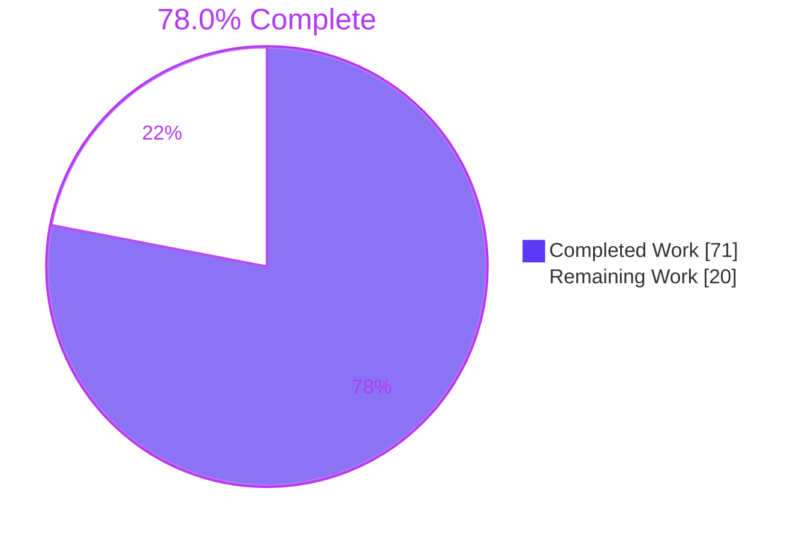
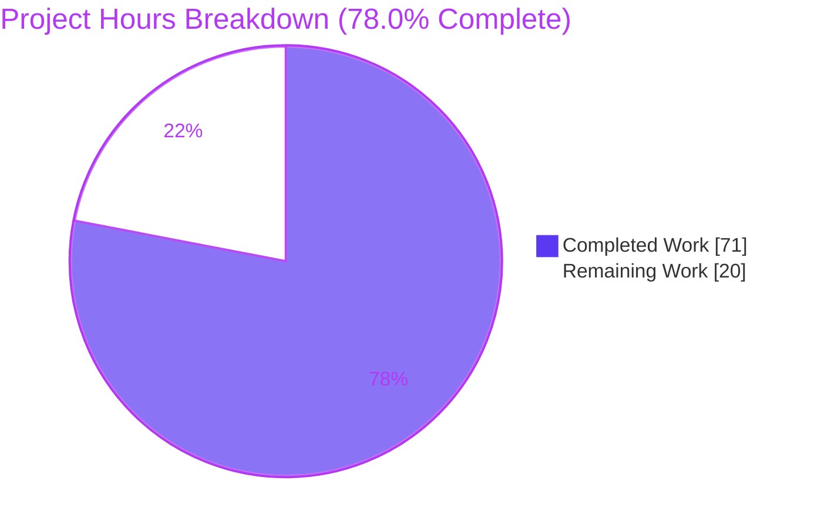
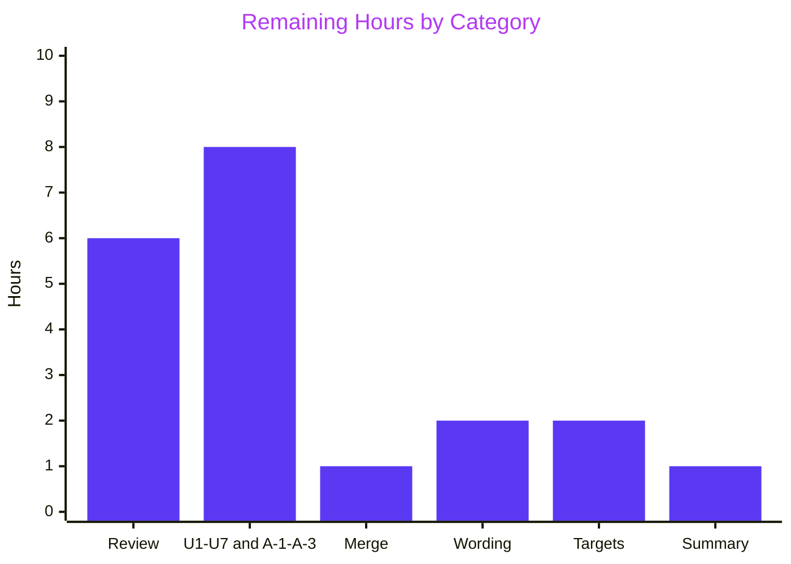

# 1. Executive Summary

## 1.1 Project Overview

Two plain-language analyses under `docs/analysis/` let Product, Business and Operations readers define requirements for a bank reconciliation exceptions workbench. Analysis 1 maps today's flow in `modules/org.openbravo.advpaymentmngt` from statement import to posting. It covers the 17 points where people act, the matching rules and their limits, and the five largest sources of manual effort. Analysis 2 covers the reusable UI patterns and services, the data-model gaps, 13 integration areas with their test status, and a rated two-tier capability set. Every claim cites a repository path or entity. No code, configuration or tests changed.

## 1.2 Completion Status



| Metric | Value |
|---|---|
| Total Hours | 91 |
| Completed Hours (AI + Manual) | 71 (71 AI + 0 manual) |
| Remaining Hours | 20 |
| Percent Complete | 78.0% |

71 hours completed out of 91 total hours = 78.0% complete. The total covers the AAP scope plus review, installation validation and merge.

## 1.3 Key Accomplishments

- [x] Analysis 1: an 8-step flow, 17 manual actions, 5 matching passes, unmatched-item handling and 5 ranked effort sources
- [x] Analysis 2: a technology baseline, 6 UI patterns, 5 rated components, 8 data-model pairs, 13 areas marked tested or untested, and 5 + 6 ranked capabilities
- [x] 174 of 174 distinct citations (286 spans) resolve against the repository
- [x] Within the caps: 2,497 and 2,500 of 2,500 words, 6 of 6 pages, and 5-line Key Takeaways
- [x] 5 of 5 cross-references into Analysis 1 resolve
- [x] 7 Unconfirmed findings and 3 Assumptions labelled at their planned placements
- [x] 14 of 14 spot-checked claims confirmed against the source
- [x] Only two files added since `77692f968d`

## 1.4 Critical Unresolved Issues

0 of the 10 required sections is open. 12 items remain open. None blocks structural acceptance, and each needs information or a decision from the business:

| Issue | Impact | Owner | ETA |
|---|---|---|---|
| Unconfirmed installation facts U1–U7 (7 items): installed bank file formats, each account's matching record and switches, match rates and volumes, posting configuration, posting schedule, audit state, Finance role holders | Requirements may rest on repository defaults rather than the live configuration | Finance / IT Operations | 8 h, shared with the next row |
| Assumptions A-1 to A-3 (3 items): Finance role coverage, the basis of the effort ranking, effort sizes | Ranking and sizing are reasoned from code, not measured | Product owner | Within the 8 h above |
| Stakeholder review and sign-off (1 item) | The documents are not yet accepted. Analysis 2 has 0 words of headroom, so every edit must be offset | Product, Business, Operations leads | 6 h |
| Placeholder objective has no numeric targets (1 item) | "Most statement lines" and the target cycle time are undefined | Business owner | 2 h |

## 1.5 Access Issues

| System/Resource | Type of Access | Issue Description | Resolution Status | Owner |
|---|---|---|---|---|
| Production Openbravo installation (configuration data in `FIN_FINANCIAL_ACCOUNT`, `FIN_MATCHING_ALGORITHM`, `AD_PROCESS_REQUEST`, `AD_TABLE`, `AD_USER_ROLES`) | Read-only query access | Needed to settle U1–U7. The repository holds only shipped defaults and sample data | Open, not provisioned | Finance / IT Operations |

## 1.6 Recommended Next Steps

1. [High] Review and sign off both analyses. Offset every edit within the caps, then re-run the Section 9 gate.
2. [Medium] Confirm U1–U7 against a production installation, and validate A-1 to A-3.
3. [Medium] Merge, and decide how `docs/` is tracked, since `.gitignore` line 11 ignores it.
4. [Low] Decide the two open wording divergences (Section 5.2, rows 11 and 13).
5. [Low] Set numeric targets for the placeholder objective.

# 2. Project Hours Breakdown

## 2.1 Completed Work Detail

| Component | Hours | Description |
|---|---|---|
| A1 §1 End-to-end flow (AAP R2) | 5 | Traced import (`ImportBankFile`, `FIN_BankStatementImport`), processing, Match Statement, completion and posting (`DocFINReconciliation`) into an 8-step flow, with Unconfirmed U1, U4 and U5 |
| A1 §2 Manual user actions (R3) | 5 | A 17-row Step / Who acts / Trigger / Window-class table, built from window buttons, grid actions and `V3_Roles.xml` grants, with Assumption A-1 and U7 |
| A1 §3 Matching logic (R4) | 4 | A 5-pass table from `StandardMatchingAlgorithm` and `MatchTransactionDao`, the switch configurability and its defaults (U2), and 7 limits |
| A1 §4 Unmatched and exception items (R5) | 3 | What counts as unmatched, the four resolution paths, and the missing owner, reason and status fields and blocking checks |
| A1 §5, Key Takeaways and labels (R6, R16) | 3 | Five effort sources in the AAP's fixed order, each tied to a part of the objective, plus Assumption A-2 and U3 |
| A2 §1 UI framework and technology baseline (R8) | 4 | Java/Ant/SmartClient/PostgreSQL/JUnit/Jest baseline from `build.xml`, `package.json` and `lib/test`, and 6 screen patterns |
| A2 §2 Reusable components (R9) | 5 | Roles, audit trail, notifications, scheduling and reporting, each with a High/Medium/Low fit, plus U6 |
| A2 §3 Data model (R10) | 2 | An 8-row comparison of current support and required change on `FIN_BANKSTATEMENTLINE` and related tables |
| A2 §4 Integration points and test coverage (R11) | 8 | 13 areas, each labelled tested (5) or untested (8) by tracing tests and suite membership in `StandaloneTestSuite` and `WebserviceTestSuite` |
| A2 §5 Capability tiers and Key Takeaways (R12) | 3 | A 5-row minimum-viable tier and a 6-row full-scope tier, rated on impact and effort and ranked, plus Assumption A-3 |
| Claim-support verification against source (R17, AAP 0.7.2) | 14 | Confirmed each section's claims against the cited code and metadata, line by line |
| Plain-language definitions and citation compliance (R14, R15) | 6 | Defined each term at its first use in each document and gave every claim an inline backtick citation, within the word caps |
| Document gate tooling and runs (R17) | 6 | Word count, markdown-it rendering, Chrome PDF printing, page and Key Takeaways line counts, citation resolution, and structure checks |
| Cross-document references and consistency (R13) | 2 | The five "Analysis 1, Section N" references, and checks that shared findings agree across both documents |
| Repository delivery (R18) | 1 | Force-added both files under the ignored `docs/` path, and confirmed the diff shows exactly two added files |
| **Total** | **71** | |

## 2.2 Remaining Work Detail

| Category | Hours | Priority |
|---|---|---|
| Stakeholder review and sign-off of both analyses, including a reviewer's claim spot-check, edits offset within the caps, and a full gate re-run (path to production) | 6 | High |
| Confirm Unconfirmed findings U1–U7 on a production installation and validate Assumptions A-1 to A-3 (path to production) | 8 | Medium |
| Merge the branch and decide the tracking policy for the ignored `docs/` folder (path to production) | 1 | Medium |
| Decide and apply the two open wording divergences: the GL-item definition, and the undefined "exception", "worklist" and "workbench" (AAP R14) | 2 | Low |
| Set numeric targets for the placeholder objective (path to production) | 2 | Low |
| Circulate the completion summary with the current verification figures, the reference file and the left-out items (AAP R19) | 1 | Low |
| **Total** | **20** | |

## 2.3 Hours Calculation

- Completed hours: 71, the sum of Section 2.1
- Remaining hours: 20, the sum of Section 2.2
- Total project hours: 71 + 20 = 91
- Completion: 71 / 91 × 100 = 78.0%
- Confidence: medium-high for the completed hours. Medium for the remaining hours, because the time to confirm U1–U7 depends on access to the installation.

# 3. Test Results

The deliverable is documentation, so its test suite is the document gate the AAP defines (0.7.2 and 0.9.1). It was run in full from the repository root against the committed files at `4184be5f26`.

| Area / Category | Framework | Tests | Passed | Failed | Coverage | What This Proves |
|---|---|---|---|---|---|---|
| Length and pagination caps | GNU `wc -w` under `C.UTF-8`; markdown-it-py 4.2.0, then Chrome 156 headless print, then pypdf 6.21.4 | 6 | 6 | 0 | Both documents: words, page count, page size | Each document fits 2,500 words (2,497 and 2,500) and 6 US Letter pages (612×792) |
| Key Takeaways limits | pypdf text extraction; Python source parse | 4 | 4 | 0 | Both openings | Each opening has 5 bullets that render on 5 lines |
| Headings, prose and prohibited content | Python heading and paragraph parse | 10 | 10 | 0 | All 15 + 11 headings and 19 prose paragraphs | Exact titles, Key Takeaways second, numbered H2/H3 headings, no fences, HTML or non-ASCII whitespace, at most 3 sentences per paragraph |
| Required section content and labels | Python table and list parse | 11 | 11 | 0 | Every required table and list in both documents | 8 flow steps, 17 action rows, 5 passes, 5 effort items, 5 rated components, an 8-row two-column table, 13 areas (5 tested, 8 untested), both tiers correctly ordered, and label counts of 6 + 2 and 1 + 1 |
| Citations | Python with `git ls-files` and `git grep -F -w` | 12 | 12 | 0 | 174 of 174 distinct citations (286 spans), and 10 of 10 sections at or above the minimum | Every cited path exists and every cited entity is in `src`, `src-db`, `modules`, `referencedata` or `src-test` |
| Cross-references and repository scope | Python regex; `git diff --name-status` | 2 | 2 | 0 | 5 of 5 references | Every "Analysis 1, Section N(.M)" resolves, and only the two documents were added since `77692f968d` |
| Claim support against source | Manual read of the cited code and metadata | 14 | 14 | 0 | Claims in A1 §2–§4 and A2 §1–§4 | The matching rules, role grants, missing columns, alert rule state, sample switches and test-suite membership read as the documents state |
| Rendered layout in a browser | Chrome at 1280×900, DOM inspection | 2 | 2 | 0 | Both rendered documents | All headings and tables (2 and 6) display, with no horizontal overflow and 0 console errors |

**Not Covered**

- No Openbravo code was executed. The JUnit suites (`run.all.tests`, `run.webservice.tests`, `run.test` in `src-test/build.xml`) and Jest were not run, because no code changed. Behaviour the analyses describe, such as the matching passes, blocking checks and posting, rests on reading the source, not on observed runs.
- Claim support is established by reading the cited source, and no automated check exists for it. Before sign-off, a reviewer should repeat the AAP's manual spot-check: every citation in §1 of each document, and at least three in each other section.
- Readability for non-technical readers, and whether every term is defined at first use, have no automated test and need a reader's review.
- Rendering in other markdown viewers, such as GitHub or IDE previews, was not checked. The page cap is defined only for the markdown-it and Chrome default pipeline.
- Installation-specific facts (U1–U7) cannot be tested from the repository.

# 4. Runtime Validation & UI Verification

The runtime for this deliverable is the rendering pipeline the AAP prescribes: markdown to HTML, HTML to PDF, and on-screen viewing.

- ✅ Operational: **Markdown rendering.** Both documents render with markdown-it-py (CommonMark plus tables) and exit 0. Re-rendering produces byte-identical HTML.
- ✅ Operational: **PDF print.** Chrome headless prints both documents to US Letter (612×792 pt), 6 pages each, with nothing clipped.
- ✅ Operational: **Browser view at 1280×900.** Analysis 1 shows 2 tables (17×4 and 5×4) and Analysis 2 shows 6 tables (6, 5, 8, 13, 5 and 6 rows). `scrollWidth` equals the viewport width (1280) in both, and the console shows 0 errors.
- ✅ Operational: **Opening blocks.** Each Key Takeaways block shows 5 bullets on 5 rendered lines on page 1.
- ⚠ Partial: **Layout polish.** With no stylesheet, capability cells in the Analysis 2 §5 tables sit flush against the rating columns, and the Analysis 1 §3.1 table narrows its Pass and Result columns. Analysis 2 places its 1.2 heading at the foot of PDF page 1, with its table on page 2. Chrome reports Quirks Mode because the AAP-mandated HTML wrapper has no DOCTYPE. All content stays readable.
- ✅ Operational: **Repository delivery.** Both files are tracked (`git ls-files docs/analysis`), the diff against `77692f968d` shows two `A` entries, and the working tree has no other change.
- ⚠ Partial: **Never exercised at runtime.** The Openbravo ERP application (Tomcat, PostgreSQL), its windows such as `Match Statement` and `Financial Account`, and the JUnit and Jest suites were not started. None is needed for a documentation-only change, and none is provisioned.

# 5. Compliance & Quality Review

## 5.1 Compliance Matrix

| AAP Deliverable | Benchmark | Status | Progress | Evidence |
|---|---|---|---|---|
| Analysis 1 file, title and sections (R1–R6) | Exact H1, numbered §1–§5, required tables and lists | ✅ PASS | ██████████ 100% | `docs/analysis/analysis-1-current-state-reconciliation.md` |
| Analysis 2 file, title and sections (R7–R12) | Exact H1, numbered §1–§5, required tables, ratings and ordering | ✅ PASS | ██████████ 100% | `docs/analysis/analysis-2-extension-points-and-risks.md` |
| Cross-references (R13) | Every "Analysis 1, Section N(.M)" resolves | ✅ PASS | ██████████ 100% | 5 of 5 resolve |
| Writing constraints (R14) | Plain language, definitions at first use, at most 3 sentences per paragraph, no prohibited content | ⚠ PASS with 2 open wording divergences | █████████░ 90% | Section 5.2, rows 11 and 13 |
| Citations (R15) | Inline backticks, no line numbers, at least 3 per section, 0 failures | ✅ PASS | ██████████ 100% | 174 of 174 distinct resolve |
| Labels (R16) | U1–U7 and A-1 to A-3 at their placements | ✅ PASS | ██████████ 100% | A1: 6 + 2; A2: 1 + 1 |
| Word and page caps (R17) | At most 2,500 words and 6 pages at 612×792 | ✅ PASS, at the cap | ██████████ 100% | 2,497 and 2,500 words; 6 and 6 pages |
| Claim support (AAP 0.7.2) | Cited code supports each sentence | ✅ PASS, reviewer spot-check pending | █████████░ 90% | 14 of 14 confirmed |
| Repository scope (R18) | Only two files added; nothing modified | ✅ PASS | ██████████ 100% | `git diff --name-status 77692f968d HEAD` |
| Completion summary (R19) | Reference file, left-out items and verification results delivered outside the repository | ⚠ PARTIAL | █████░░░░░ 50% | Current figures are in Sections 3 and 10 |
| No diagrams or images (R20) | None in either document | ✅ PASS | ██████████ 100% | No image or fence syntax |
| No workbench design (R21) | No screen layouts, table designs, new column names or code | ✅ PASS | ██████████ 100% | A2 §3 names needs only |

## 5.2 AAP & Rule Divergences and Gaps

No user rules were set (AAP 0.10), so every row below is measured against the AAP. Rows 1–8 and 15–19 depart from the AAP's planned wording where the code says otherwise. AAP 0.7.2 requires cited code to support each sentence, so these rows are sanctioned by the AAP.

| # | What the AAP/Rule Required | What Was Delivered Instead | Why It Diverged | Impact | Remediation |
|---|---|---|---|---|---|
| 1 | A1 §2 rows 2 and 4 acted by "Finance user"; A-1 covers every step except the format install (0.3.1.1, 0.3.2) | "User with edit access" in rows 2 and 4, and A-1 also excludes steps 2 and 4 (A1 lines 35, 40, 42) | `V3_Roles.xml` grants the Finance role view-only access to those windows (`editableField` false) | A more accurate picture of who acts | Confirm with U7 (task in Section 2.2) |
| 2 | Row 14: "Reactivate the latest statement or reconciliation" | "Reactivate … a statement or the latest reconciliation" (A1 line 52) | `FIN_BankStatementProcess` does not limit statement reactivation to the latest statement | Accuracy | None |
| 3 | Step 2: partner guessed from "the closest name after removing excluded words" | Only a single partner sharing a name word is chosen. With several, the partner stays blank (A1 line 22) | `FIN_BankStatementImport` returns no partner when several candidates match | Accuracy | None |
| 4 | Step 7: the period check applies to every cleared item | The check applies "for organizations set up for accounting" (A1 lines 28 and 109) | `FIN_ReconciliationProcess` skips the check where accounting does not apply | Accuracy | None |
| 5 | §3.2: switch defaults are name and reference on, date off, and the sample record makes any same-amount candidate strong | Adds that the window starts new records with all three switches on, and limits the sample effect to pass 3 (A1 line 79) | The window defaults differ from the table defaults, and only pass 3 compares the switches | Accuracy | None |
| 6 | §4.2: unmatch merges split parts and deletes algorithm-created transactions and payments | Merges only still-unmatched split parts, and deletes under the standard rules once reactivated (A1 line 102) | `APRM_MatchingUtility` and `StandardMatchingAlgorithm` put conditions on both steps | Accuracy | None |
| 7 | §4.3: lists the blocking checks without qualifiers | Adds "bypassed by force processing unless posted" and "Match Statement repairs it first" (A1 line 109) | The code paths for `APRM_BSLineReconciled` and `APRM_ReconciliationMixed` | Accuracy | None |
| 8 | §5 item 1: lines "the algorithm misses" | Lines "the rules never match" (A1 lines 9 and 115) | A line that a later run matches needs no person | Accuracy | None |
| 9 | §2 Window/class cells as planned (0.3.1.1), including message keys | 18 cells shortened, with some message keys moved or dropped (A1 lines 37–55) | To stay within the 2,500-word cap | Fewer citations per row, though each section still has at least 3 | None |
| 10 | §5 item 4 names "free-text description and record notes" | Points to §4.2 and §4.3 without naming record notes (A1 line 118) | Word cap. Record notes are covered in A2 §2 and §3 | Minor omission | None |
| 11 | GL item defined as "… with no invoice, such as bank fees" (0.4.2 fixed wording) | ", such as bank fees" omitted (A1 line 49) | Word cap, and the same row already names bank fees | The definition is narrower than the fixed wording | Decide (task in Section 2.2) |
| 12 | Terms defined at first use (0.4.2) | The §1 heading uses "Reconciliation" before its definition (A1 line 11) | The AAP fixes the heading text (0.4.1). Sanctioned by the AAP | None | None |
| 13 | Every technical term defined at first use (0.7.2) | "exception", "worklist" and "workbench" are not defined in A2 (for example A2 lines 9 and 32) | They are the request's own vocabulary, and the word cap leaves no room | Non-technical readers may need a definition | Decide (task in Section 2.2) |
| 14 | A2 "## 1." has no content before §1.1 (0.4.1 outline) | An objective quote and a definitions paragraph come before §1.1 (A2 lines 13–15) | Both documents must quote the objective, and the defined terms are used from §1.1 on | None | None |
| 15 | §1.2 servlet row cross-references "Analysis 1, Section 1.2" | "Analysis 1, Section 1.2 and Analysis 1, Section 2" (A2 line 35) | The `Reconciliation` screen appears in A1 §2 row 13, not in §1.2 | More precise, and the AAP reference form is kept | None |
| 16 | Audit row: created/updated "on every table" | Limited to reconciliation tables such as `FIN_BANKSTATEMENTLINE` (A2 line 46) | Some tables, such as `OBSCHED_JOB_DETAILS`, lack those columns | Accuracy | None |
| 17 | Roles row: "no record-level ownership" | Adds organization access (`AD_ROLE_ORGACCESS`), and client restriction is not described (A2 line 45) | Organization access limits which records a role sees. Client restriction was left out for the word cap | Minor omission | None |
| 18 | Notifications row as planned | Adds that `AlertProcess` closes an alert once its rule stops returning the item (A2 line 47) | The code shows this self-clearing behaviour, which matters for alerts on unmatched lines | Added finding | None |
| 19 | §4 Posting: `RecordID2Test` "unposts and reposts an existing reconciliation" | "three sample reconciliations' entries" (A2 line 80) | Test cases 1, 4 and 5 use three distinct reconciliations | Accuracy | None |
| 20 | §5.1 rank 4: "Aging and unassigned-item alerts to owners" | Aging alerts go to owners, and unassigned-item alerts go to the Finance role, adding `AD_ALERTRECIPIENT` (A2 line 101) | An unassigned item has no owner to alert | The recommendation is broader | Confirm during review (task in Section 2.2) |
| 21 | Each capability row cross-references "Analysis 1, Section 5" (0.4.1) | Rows say "item N" under one shared sentence naming Analysis 1, Section 5 (A2 line 92) | Word cap | None; the reference resolves | None |
| 22 | Section word budgets and page targets of 5.2 and 5.6; shorten a section that runs long (0.4.1) | Over budget: A1 §1 (643 of 400 words) and §3 (607 of 470); A2 §1 (596 of 380), §2 (477 of 400) and §5 (484 of 450). Both documents run to 6 pages | The accuracy qualifiers and first-use definitions need the space. The hard caps hold | No headroom: A2 is at 2,500 of 2,500 words | Offset every edit (task in Section 2.2) |
| 23 | Diff check: `git status --porcelain --untracked-files=all` shows two `??` lines (0.9.1) | Not reproducible, because the files are committed and `.gitignore` line 11 ignores `docs` | Repository ignore rules, and the AAP forbids editing `.gitignore` | None. `git diff --name-status 77692f968d HEAD` shows two `A` entries | Decide `docs/` tracking (task in Section 2.2) |
| 24 | Completion summary carrying the verification results (C1, 0.9.1) | The figures recorded when the documents were first written are superseded (Analysis 1 at 2,349 words and 5 pages) | The documents grew after those figures were recorded | Stale figures if that summary is used | Circulate current figures (task in Section 2.2) |

**Row 1, role attribution.** The AAP expected the Finance role to perform every step except the format install. `modules/org.openbravo.v3.datasets/referencedata/standard/V3_Roles.xml` grants that role view-only access to `Bank File Format` and `Matching Algorithm`, so A1 §2 rows 2 and 4 say "User with edit access", and the Assumption excludes those steps. Which users hold edit rights is installation data (U7). The owner must confirm who maintains partner-exclusion words and who edits shared matching records. The second matters most, because editing a shared record silently changes matching for every account that selects it.

**Row 11, GL-item definition.** The AAP fixes the wording "a general-ledger category for amounts with no invoice, such as bank fees". A1 line 49 drops the example to stay under the 2,500-word cap, since the same row already names bank fees. Readers of that row lose nothing, but the fixed wording is not met verbatim. Analysis 1 has 3 words of headroom, so restoring the example needs a three-word cut elsewhere. Re-run the word, page and Key Takeaways checks afterwards.

**Row 13, undefined workbench vocabulary.** AAP 0.7.2 requires every technical term to be defined at first use in each document. Analysis 2 uses "exception", "worklist" and "workbench" without definitions from its title onward, for example at A2 lines 9 and 32. They are the request's own vocabulary, and A2 sits at exactly 2,500 words. Product readers who wrote the request will likely understand them, but Operations or Business readers may not. The owner decides whether to add definitions, which means cutting the same number of words elsewhere in A2.

**Row 20, alert recipients.** The AAP planned "aging and unassigned-item alerts to owners". An unassigned item has no owner by definition, so A2 line 101 sends unassigned-item alerts to the Finance role and names `AD_ALERTRECIPIENT`, which supports role recipients and optional email. The rating stays Medium/S. The capability is broader than planned and widens who receives alerts. Reviewers should confirm that the Finance role is the right recipient for unassigned items before the minimum-viable tier is adopted as scope.

**Row 22, zero headroom.** Both documents meet the hard caps, but five sections exceed their word budgets and both documents fill all 6 pages. Analysis 2 has no words to spare and Analysis 1 has three. Both Key Takeaways blocks use all 5 lines. Any reviewer edit can therefore breach a cap without notice. Offset every change within the same document, and make sure the full gate in Section 9 passes before committing.

**Row 23, ignored `docs/` folder.** The AAP's untracked-file check cannot produce its expected `??` lines, because `.gitignore` line 11 ignores `docs` and both files are already committed. The equivalent check passes: a diff against `77692f968d` shows two `A` entries. The open decision is policy. Either un-ignore `docs/` in a separate change, or keep it ignored and require `git add -f` for every future analysis, which plain `git add -A` skips without warning.

**Row 24, completion summary figures.** The AAP calls for a completion summary delivered outside the repository. The figures recorded when the documents were first written (Analysis 1 at 2,349 words, 5 pages and 119 citations) no longer match the committed files. Section 3 of this guide carries the current results, and Appendix C names the reference file and the items left out. Circulate these with the documents so reviewers judge against current figures.

# 6. Risk Assessment

| Risk | Category | Severity | Probability | Mitigation | Status |
|---|---|---|---|---|---|
| Requirements are built on repository defaults while the installation is configured differently: formats, matching switches, posting schedule, audit state, role holders (U1–U7) | Integration | High | Medium | Confirm U1–U7 against production before writing workbench requirements | Open |
| A workbench built on the analyses changes reconciliation areas that 8 of 13 integration points leave untested: import, processing, matching, manual match, the Match Statement grid, completion, alerts and audit (A2 §4) | Technical | High | High | Add tests around `StandardMatchingAlgorithm`, `MatchTransactionDao` and `APRM_MatchingUtility` before changing them | Open; applies to workbench design |
| A review edit breaches the 2,500-word, 6-page or 5-line Key Takeaways cap, because Analysis 2 has 0 words of headroom | Technical | Medium | High | Offset every addition, and re-run the Section 9 gate before committing | Open |
| Cited classes, tables or messages are renamed or removed in later releases, so citations and claims go stale | Technical | Medium | Medium | Re-run the citation check and a claim spot-check whenever `modules/org.openbravo.advpaymentmngt` changes | Monitored by the gate |
| The effort ranking (A-2) and effort sizes (A-3) are reasoned from code paths, not measured, so they could misdirect prioritisation | Operational | Medium | Medium | Validate them against measured match rates and line volumes (U3) before fixing scope | Open |
| New analyses under the ignored `docs/` path are left out of commits, because `git add -A` skips them silently | Operational | Low | High | Use `git add -f`, or un-ignore `docs/` in a separate change | Open; policy decision |
| Recommended capabilities widen Finance-role grants and add email alerts (`AD_ALERTRECIPIENT`). The documents themselves hold no credentials or installation data | Security | Low | Low | Review role grants and alert recipients during workbench design | Accepted |
| Other markdown renderers, such as GitHub, paginate differently from the markdown-it and Chrome pipeline that defines the page cap | Technical | Low | Medium | Treat the Chrome PDF as the reference rendering for the page cap | Accepted |

# 7. Visual Project Status



**Remaining hours by category (20 h total, from Section 2.2)**



| Priority | Tasks | Hours |
|---|---|---|
| High | 1 | 6 |
| Medium | 2 | 9 |
| Low | 3 | 5 |
| **Total** | **6** | **20** |

# 8. Summary & Recommendations

The project is 78.0% complete: 71 of 91 hours delivered, 20 remaining. Both analyses are in `docs/analysis/` with the exact titles, file names and numbered structure the AAP sets. Analysis 1 gives readers one view of today's bank reconciliation: an 8-step flow from import to posting, 17 manual actions with their triggers, the five matching passes and their exact-equality limits, how unmatched lines are handled without an owner, reason or status, and five ranked sources of manual effort. Analysis 2 shows what a workbench can build on: metadata-defined screens and Pick and Execute grids, five platform services rated for reuse, eight data-model pairs, 13 integration areas with scoped test labels (5 tested, 8 untested), and an 11-capability plan in two ranked tiers.

The full document gate passed: 45 of 45 automated checks, covering length, pagination, structure, labels, 174 distinct citations, cross-references and repository scope. 14 of 14 claims spot-checked against the source held, and both documents render cleanly in a browser. Section 5.2 records 24 departures from the AAP. Most make the text more accurate where the code differs from the plan. Two are open wording choices (rows 11 and 13), and one is a lasting constraint: Analysis 2 sits at exactly 2,500 words.

What remains belongs to the business, not the code. Readers must review and sign off. The seven Unconfirmed installation facts and three Assumptions must be settled against a live system, and the placeholder objective needs numeric targets. The critical path is review and sign-off (6 h), then installation confirmation (8 h), then merge (1 h). The wording decisions, targets and completion summary (5 h) can run in parallel.

| Success Metric | Target | Current |
|---|---|---|
| Words per document | ≤ 2,500 | 2,497 / 2,500 |
| Pages per document (612×792) | ≤ 6 | 6 / 6 |
| Citation failures | 0 | 0 of 174 distinct |
| Cross-reference failures | 0 | 0 of 5 |
| Files changed outside `docs/analysis/` | 0 | 0 |
| Unconfirmed findings settled | 7 | 0 (installation data needed) |

Production readiness: the documents are ready for stakeholder review, and their structural acceptance criteria are met. Do not treat them as a requirements baseline until U1–U7 are confirmed. Any edit must stay within the caps and pass the Section 9 gate.

# 9. Development Guide

The deliverable is two markdown files, and it has no application to build or run. This guide covers how to edit the analyses safely and re-run the document gate that proves they still meet the AAP. Do not install or start Java, Ant, PostgreSQL, Tomcat or `npm`. None of them is needed.

## 9.1 System Prerequisites

- Linux or macOS shell (bash), run from the repository root
- git 2.43 or later (verified with 2.56.0)
- Python 3.12 or later (verified with 3.12.3 and 3.13.18), with markdown-it-py 4.2.0, mdurl 0.1.2 and pypdf 6.21.4
- Google Chrome (verified with 156.0.8078.79) for headless PDF printing
- GNU coreutils `wc` (verified with 9.4) for word counts. On a host whose `wc` is uutils, counts for these files are identical (2,497 and 2,500)
- About 1 GB free disk for a full checkout; no ports, databases or services are used

## 9.2 Environment Setup

Create a private Python environment outside the checkout, and a scratch folder for generated HTML and PDF files. Never write scratch output inside the repository.

```bash
python3 -m venv "$HOME/.venvs/openbravo-docs"
"$HOME/.venvs/openbravo-docs/bin/pip" install markdown-it-py==4.2.0 mdurl==0.1.2 pypdf==6.21.4
export PY="$HOME/.venvs/openbravo-docs/bin/python"
export OUT=$(mktemp -d)
```

Expected: pip exits 0, and `"$PY" -c "import markdown_it, pypdf; print(markdown_it.__version__, pypdf.__version__)"` prints `4.2.0 6.21.4`.

## 9.3 Word Count

```bash
LC_ALL=C.UTF-8 wc -w docs/analysis/analysis-1-current-state-reconciliation.md docs/analysis/analysis-2-extension-points-and-risks.md
```

Expected: `2497` and `2500`. Each must stay at or below 2,500.

## 9.4 Render, Print and Count Pages

```bash
for F in docs/analysis/analysis-1-current-state-reconciliation.md docs/analysis/analysis-2-extension-points-and-risks.md; do
  N=$(basename "$F" .md)
  "$PY" -c "import sys; from markdown_it import MarkdownIt; h=MarkdownIt('commonmark').enable('table').render(open(sys.argv[1],encoding='utf-8').read()); open(sys.argv[2],'w',encoding='utf-8').write('<html><head><meta charset=\"utf-8\"></head><body>'+h+'</body></html>')" "$F" "$OUT/$N.html"
  google-chrome --headless=new --no-sandbox --disable-gpu --no-pdf-header-footer --print-to-pdf="$OUT/$N.pdf" "$OUT/$N.html" 2>/dev/null
  "$PY" -c "import sys; from pypdf import PdfReader; r=PdfReader(sys.argv[1]); p=r.pages[0]; l=p.extract_text().splitlines(); s=next(i for i,x in enumerate(l) if x.strip()=='Key Takeaways'); e=next(i for i,x in enumerate(l) if i>s and x.startswith('1.')); print(sys.argv[2], 'pages', len(r.pages), 'size', float(p.mediabox.width), float(p.mediabox.height), 'takeaway lines', e-s-1)" "$OUT/$N.pdf" "$N"
done
```

Expected output, with each print taking 15–30 seconds:

```text
analysis-1-current-state-reconciliation pages 6 size 612.0 792.0 takeaway lines 5
analysis-2-extension-points-and-risks pages 6 size 612.0 792.0 takeaway lines 5
```

Do not use the markdown-it `gfm-like` preset, which fails with "Linkify enabled but not installed". Fix a page count above 6 by cutting content, never by changing fonts, margins or paper size.

## 9.5 Citation Check

```bash
cat > "$OUT/cite.py" <<'EOF'
import re, subprocess, sys
EXT = (".java", ".xml", ".js", ".json", ".md", ".jrxml", ".jar", ".properties", ".html")
def git(*a):
    return subprocess.run(["git", *a], capture_output=True, text=True)
for path in sys.argv[1:]:
    spans = re.findall(r"`([^`]+)`", open(path, encoding="utf-8").read())
    bad = []
    for s in sorted(set(spans)):
        if "/" in s or s.endswith(EXT):
            ok = git("ls-files", "--error-unmatch", "--", s).returncode == 0 or git("ls-files", "--", s).stdout.strip()
        else:
            ok = git("grep", "-q", "-F", "-w", "--", s, "--", "src", "src-db", "modules", "referencedata", "src-test").returncode == 0
        if not ok:
            bad.append(s)
    print(f"{path}: {len(spans)} spans, {len(set(spans))} distinct, {len(bad)} failures {bad}")
EOF
"$PY" "$OUT/cite.py" docs/analysis/analysis-1-current-state-reconciliation.md docs/analysis/analysis-2-extension-points-and-risks.md
```

Expected: `134 spans, 74 distinct, 0 failures []` for Analysis 1, and `152 spans, 100 distinct, 0 failures []` for Analysis 2. Every backtick span must be a citation, because backticks are used for nothing else.

## 9.6 Cross-Reference and Repository Checks

```bash
"$PY" -c "import re; a1=open('docs/analysis/analysis-1-current-state-reconciliation.md',encoding='utf-8').read(); a2=open('docs/analysis/analysis-2-extension-points-and-risks.md',encoding='utf-8').read(); h=set(re.findall(r'^#{2,3} (\d+(?:\.\d+)?)\.? ',a1,re.M)); r=sorted(set(re.findall(r'Analysis 1, Section (\d+(?:\.\d+)?)',a2))); print('references', r, 'unresolved', [x for x in r if x not in h])"
git diff --name-status 77692f968d HEAD
git ls-files docs/analysis
```

Expected: `references ['1.2', '2', '3', '4.3', '5'] unresolved []`, then two lines starting with `A`, then the two document paths.

## 9.7 Example Usage: Editing an Analysis

1. Edit the markdown file, and keep each paragraph to at most 3 sentences.
2. Run 9.3. If the count rises above 2,500, cut words from the same document until it passes.
3. Run 9.4 to confirm 6 pages or fewer, and 5 Key Takeaways lines or fewer.
4. Run 9.5 and 9.6. Fix every failure before committing.
5. Stage with an explicit force-add, because `docs` is ignored: `git add -f docs/analysis/analysis-2-extension-points-and-risks.md`. Then commit.

## 9.8 Troubleshooting

- **`git add docs/...` fails, or `git add -A` stages nothing.** `.gitignore` line 11 ignores `docs`. Use `git add -f <exact path>`, then confirm with `git ls-files docs/analysis`.
- **`git status` does not list a new docs file.** Add `--ignored`: `git status --porcelain --untracked-files=all --ignored`. The checkout also holds an untracked `blitzy/` folder of rendering screenshots. Do not commit it.
- **Chrome prints "Failed to connect to the bus".** This message is harmless. Check that the PDF file exists instead.
- **The word count differs between machines.** Run `wc` under `LC_ALL=C.UTF-8`, and keep no-break or thin spaces out of the files. Em and en dashes are safe.
- **The Key Takeaways count prints more than 5.** Shorten or merge bullets. The count is taken from page 1 of the PDF, between the "Key Takeaways" heading and the line starting "1.".
- **A citation fails.** A path must be tracked by git exactly as written, and an entity must appear as a whole word under `src`, `src-db`, `modules`, `referencedata` or `src-test`. Use no wildcards, braces or line numbers.

# 10. Appendices

## A. Command Reference

| Purpose | Command (from the repository root) |
|---|---|
| Word count | `LC_ALL=C.UTF-8 wc -w docs/analysis/*.md` |
| Render one file to HTML | `"$PY" -c "...MarkdownIt('commonmark').enable('table')..." "$F" "$OUT/$N.html"` (full form in Section 9.4) |
| Print to PDF | `google-chrome --headless=new --no-sandbox --disable-gpu --no-pdf-header-footer --print-to-pdf="$OUT/$N.pdf" "$OUT/$N.html"` |
| Pages, size, Key Takeaways lines | pypdf one-liner in Section 9.4 |
| Citation check | `"$PY" "$OUT/cite.py" docs/analysis/*.md` (Section 9.5) |
| Cross-reference check | Python one-liner in Section 9.6 |
| Scope check | `git diff --name-status 77692f968d HEAD` |
| Tracked docs | `git ls-files docs/analysis` |
| Status including ignored files | `git status --porcelain --untracked-files=all --ignored` |
| Stage a docs file | `git add -f <exact path>` |

## B. Port Reference

The pipeline uses no ports. Chrome's `--print-to-pdf` binds none, and no server, database or queue is involved.

## C. Key File Locations

| Path | Role |
|---|---|
| `docs/analysis/analysis-1-current-state-reconciliation.md` | Analysis 1: current-state workflow and manual effort |
| `docs/analysis/analysis-2-extension-points-and-risks.md` | Analysis 2: extension points, reuse and risks |
| `modules/org.openbravo.client.kernel/jslint/README.md` | Style reference for headings and bold inline labels. Module readmes are the only markdown in the repository, and this one was preferred because the other, `modules/org.openbravo.client.kernel/jsformatter/README.md`, mislabels one of its own sections. The request's numbering, table and citation convention overrides the reference file's trailing colons, code fences and unnumbered headings |
| `modules/org.openbravo.advpaymentmngt` | The module both analyses describe: import, matching, reconciliation |
| `src-db/database/model/tables/FIN_BANKSTATEMENTLINE.xml` | The statement-line table whose missing exception fields both analyses discuss |
| `src-test/src/org/openbravo/test/StandaloneTestSuite.java` | The suite behind the tested labels in Analysis 2 §4 |
| `.gitignore` (line 11) | Ignores `docs`, so docs files need `git add -f` |

Items left out of both analyses because no repository code supports them: numeric values for the placeholder target (what share counts as "most" lines, and the target cycle time), the staff hours spent on reconciliation, and bank-side delivery times or connectivity.

## D. Technology Versions

| Tool | Version verified |
|---|---|
| Python | 3.12.3 and 3.13.18 |
| markdown-it-py / mdurl | 4.2.0 / 0.1.2 |
| pypdf | 6.21.4 |
| Google Chrome | 156.0.8078.79 |
| GNU coreutils `wc` | 9.4 |
| git | 2.56.0 |
| Described platform (from `build.xml`, `package.json`, `lib/test`) | Java 11 or later, Ant 1.9.2 or later, JUnit 4.13.2, Mockito 4.11.0, Jest 29.7 |

## E. Environment Variable Reference

| Variable | Purpose | Example |
|---|---|---|
| `PY` | Python interpreter with markdown-it-py and pypdf | `"$HOME/.venvs/openbravo-docs/bin/python"` |
| `OUT` | Private scratch folder for HTML, PDF and scripts, outside the checkout | `$(mktemp -d)` |
| `LC_ALL` | Locale for consistent word counts | `C.UTF-8` |

## F. Developer Tools Guide

- **Gate order:** word count, then render and print, then pages and Key Takeaways, then citations, then cross-references, then the git scope check. A failure at any step means the change is not ready.
- **Word budget per section (AAP targets):** Analysis 1 aims for 100 / 400 / 620 / 470 / 360 / 320 words (Key Takeaways, §1–§5), and Analysis 2 for 100 / 380 / 400 / 380 / 620 / 450. The hard limit is 2,500 words per document.
- **Labels:** `**Unconfirmed:**` holds a finding the code cannot settle, with a one-sentence reason and the code consulted. `**Assumption:**` holds an assumption. Each appears only at its planned placement.
- **Cross-reference form:** "Analysis 1, Section N" or "Analysis 1, Section N.M". References within Analysis 2 to itself read "Section 5.2 of this document".

## G. Glossary

| Term | Meaning |
|---|---|
| APRM | Advanced Payables and Receivables Management, the module in `modules/org.openbravo.advpaymentmngt` |
| Bank statement line | One entry on the statement the bank sends (`FIN_BANKSTATEMENTLINE`) |
| Matching | Linking a statement line to the transaction it settles |
| Strong / weak match | A candidate found by the primary rules (`AU`) / only by the looser fallback rules (`AP`) |
| Pick and Execute | A pop-up grid where a user selects rows and runs an action, such as `Match Statement` |
| HQL-based table | A read-only list built from a database query, such as `aprm_matchstatement` |
| Document gate | The word, page, Key Takeaways, citation, cross-reference and scope checks in Section 9 |
| Unconfirmed (U1–U7) | Findings the repository cannot settle, because they depend on installation data |
| Assumption (A-1 to A-3) | Stated premises behind role coverage, the effort ranking and effort sizes |
