# Analysis 1: Current-State Reconciliation Workflow and Manual Effort

## Key Takeaways

- A bank file reaches the accounting records (`FACT_ACCT`) in twelve steps, most started by a person.
- People act at 40 points; the line-by-line ones sit in the `Match Statement` screen.
- The automatic rules (`StandardMatchingAlgorithm`) need exact values and take the first match found.
- Unmatched lines carry no owner, cause or status in `FIN_BANKSTATEMENTLINE`.
- The biggest effort is resolving, one at a time, bank lines the rules never match (`APRM_MatchingUtility`).

## 1. End-to-End Flow from Statement Import to Posted Reconciliation

**What this section tells you:** How a bank file becomes a completed, posted reconciliation today, step by step, with the screen or program, the records and what the person sees at each step. Every stage up to completion waits for a person, and a reconciliation can be completed while statement lines are still unmatched (Section 1.2, Figures S1.1 to S1.3).

### 1.1 How the Pieces Fit

The business objective is to "reduce manual effort and cycle time in bank reconciliation. Most statement lines are matched without human touch, and every unmatched item has an owner, age, and reason code." A reconciliation is the period document confirming the ERP (business-management software) balance agrees with the bank (`FIN_RECONCILIATION`), and a reason code records why an item is unresolved.

Apart from its data tables (stores of records) and accounting step (step 12), both in the core product, the flow lives in one module (a separately packaged part of the ERP), Advanced Payables and Receivables Management, `modules/org.openbravo.advpaymentmngt`. Everything hangs off the financial account (the ERP record for one bank account), kept in the `Financial Account` window (a data-entry screen): bank statements and their bank statement lines (one entry on the statement the bank sends) in `FIN_BANKSTATEMENT` and `FIN_BANKSTATEMENTLINE`, transactions (the ERP's record of money expected in or out of a financial account) in `FIN_FINACC_TRANSACTION`, and reconciliations in `FIN_RECONCILIATION`. These records and their lists therefore cover one account at a time (`FIN_FINANCIAL_ACCOUNT_ID`; rule records can be shared, Section 3.2), which matters for any screen meant to work exceptions (unmatched lines) across accounts.

Two account settings decide whether an account uses matching (linking a statement line to the transaction it settles). Only a bank-type account with a matching algorithm record (a saved set of matching rules that one or more financial accounts use) selected in `FIN_MATCHING_ALGORITHM_ID` shows the `Import Statement` and `Match Statement` buttons, and Section 1.2 follows these accounts. A cash account, or one with no record selected, is reconciled by hand instead (Section 1.3).

### 1.2 Step-by-Step Flow

The walkthrough has twelve steps in three stages: import (steps 1 to 4, Figure S1.1), matching (steps 5 to 9, Figure S1.2), and completion and posting (steps 10 to 12, Figure S1.3). Each step states what happens, the window or class (a program unit) that does it, the tables read or written, and what the user sees. Actions, matching rules and exception handling are detailed in Sections 2, 3 and 4.

**Figure S1.1. Import and statement processing**

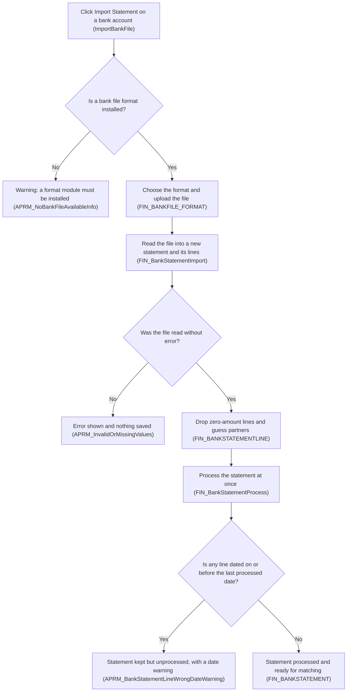

**How to read this:** Follow the arrows from the top, where diamonds are checks the system makes and each path ends in a message to the user or a statement ready for matching.

1. **Start the import.**
   - **What happens:** A finance user clicks `Import Statement` on the account (`EM_APRM_IMPORTBANKFILE`), and the system checks that a bank file format (one bank's file layout) is installed. `ImportBankFile` accepts only a file the user uploads, so how files arrive from the bank is not determinable from code.
   - **Done by:** the `Financial Account` window and `ImportBankFile`, an older hand-built screen.
   - **Tables read or written:** reads `FIN_FINANCIAL_ACCOUNT` and `FIN_BANKFILE_FORMAT`.
   - **What the user sees:** the Import Bank File pop-up with a file chooser and a format list (`ImportBankFile`). With no format installed, it closes with the warning `APRM_NoBankFileAvailableInfo`, which asks a system administrator to install a format module.
2. **Load the file into a new statement.**
   - **What happens:** When the user picks a format and a file and clicks OK, the system creates the statement header, named with its number and file name, and the format's importer (the program that reads that layout) turns each entry into a bank statement line. Any failure undoes the whole import (`FIN_BankStatementImport`).
   - **Done by:** `ImportBankFile`, which runs the importer the format names, built on the `FIN_BankStatementImport` class.
   - **Tables read or written:** reads `FIN_BANKFILE_FORMAT` and the statement document type (the setting that numbers a kind of document) in `C_DOCTYPE`; writes `FIN_BANKSTATEMENT` and `FIN_BANKSTATEMENTLINE`.
   - **What the user sees:** on failure, an error such as `APRM_InvalidOrMissingValues` (unreadable values), `APRM_DocumentTypeNotFound` (no numbering set up) or `APRM_WrongBankFileFormat` (importer not installed), with no statement kept.
   - **Unconfirmed:** which bank file formats an installation can import, because no code in this repository implements the importer, so formats come from separately installed modules (consulted `FIN_BankStatementImport`, `ImportBankFile`, `APRM_NoBankFileAvailableInfo`).
3. **Drop zero-amount lines and guess partners.**
   - **What happens:** Lines with zero credit and zero debit are discarded. Each other line takes its business partner (customer or supplier) and GL item (a general-ledger category for amounts with no invoice, such as bank fees) from the latest earlier line on the account with the same name, ignoring spaces and differences between digits; failing that, from the partner with exactly that name; failing that, after removing the words in `FIN_BANKFILE_EXCEPTION` and ignoring words of three letters or fewer, from the only partner sharing a name word. With several such partners, closest-name selection fails, leaving the partner blank, which weakens the partner-name rule (Section 3.1).
   - **Done by:** `FIN_BankStatementImport`.
   - **Tables read or written:** reads earlier lines in `FIN_BANKSTATEMENTLINE`, partners in `C_BPARTNER` and excluded words in `FIN_BANKFILE_EXCEPTION`; writes partner and GL item on the new lines.
   - **What the user sees:** nothing here; the final message counts only lines inserted (`RowsInserted`), since the prepared note on dropped zero-amount lines (`APRM_ZeroAmountNotInserted`) is never shown.
4. **Process the statement at once.**
   - **What happens:** The import immediately processes (confirms) the statement so that matching can use it. If any line is dated on or before the latest line of the account's earlier processed statements (or, if none, the last reconciliation's end date), the statement is kept but left unprocessed (`FIN_BankStatementProcess`) until the user corrects the dates or force-processes it (Section 2).
   - **Done by:** `FIN_AddPayment`, which runs `FIN_BankStatementProcess`.
   - **Tables read or written:** reads earlier lines in `FIN_BANKSTATEMENTLINE` and the last completed reconciliation in `FIN_RECONCILIATION`; writes the processed flag on `FIN_BANKSTATEMENT`.
   - **What the user sees:** on the `Financial Account` window, the statement number and lines inserted (`APRM_BankStatementNo`), or the date warning `APRM_BankStatementLineWrongDateWarning` with the cut-off date and affected line numbers (`APRM_BankStatementLineWrongDateWarning2`).

**Figure S1.2. Matching in the Match Statement screen**

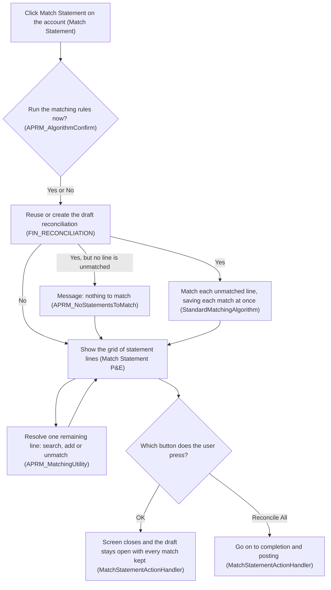

**How to read this:** Start at the top, where the prompt answer decides whether automatic matching runs before the grid appears, and the loop under the grid is line-by-line work that repeats until the user presses a button.

5. **Open Match Statement and answer the prompt.**
   - **What happens:** The user clicks `Match Statement` on the account (`EM_APRM_MATCHTRANSACTIONS`), which opens a process definition (Pick and Execute: a pop-up grid, or on-screen table, where the user selects rows and runs an action). Before any data loads, a prompt (a yes-or-no question) asks whether to run the matching rules, every time the screen opens.
   - **Done by:** the `Match Statement` process definition and its browser code, `modules/org.openbravo.advpaymentmngt/web/org.openbravo.advpaymentmngt/js/ob-aprm-matchStatement.js`.
   - **Tables read or written:** reads the user's saved preference in `AD_PREFERENCE`.
   - **What the user sees:** the prompt `APRM_AlgorithmConfirm`, warning that the run may create transactions, and a notice that every grid change is saved at once (`APRM_GRID_PERSIST_MESSAGE`), unless hidden by that preference (`APRM_NoPersistInfoMessageInMatching`). With no Cancel or close button, the screen is left only through its own buttons.
6. **Prepare the draft reconciliation.**
   - **What happens:** Whatever the answer, the system reuses the account's draft (unfinished) reconciliation or creates one (`APRM_MatchingUtility`). A reused draft is re-dated, after a repair if a transaction shows as cleared (linked) with no statement line, a sign that manual and statement reconciliation were mixed; a new draft is numbered from the reconciliation document type, dated at the latest processed statement line and opened at the last reconciliation's balance.
   - **Done by:** `MatchStatementOnLoadActionHandler`, using `APRM_MatchingUtility`.
   - **Tables read or written:** reads `FIN_BANKSTATEMENTLINE`, `C_DOCTYPE` and earlier reconciliations in `FIN_RECONCILIATION`; writes the draft in `FIN_RECONCILIATION` and any repaired transaction in `FIN_FINACC_TRANSACTION`.
   - **What the user sees:** nothing, unless an error stops it, such as `APRM_NoDocTypeRec` (no reconciliation numbering) or `APRM_ReconciliationMixed` (repair failed, Section 4.4).
7. **Run automatic matching, if accepted.**
   - **What happens:** If no line of a processed statement is unmatched, the system only reports that there is nothing to match. Otherwise it takes each unmatched line in date order (for a draft that is not the latest reconciliation, only lines up to its end date), asks the account's rules for one transaction, and saves each match permanently at once, so a later error cannot undo it. A matched transaction becomes cleared (`RPPC`) and joins the draft, while a line whose check fails with an error is silently left unmatched.
   - **Done by:** `MatchStatementOnLoadActionHandler`, applying the rules the account's matching algorithm record names (shipped as `StandardMatchingAlgorithm`, through `FIN_MatchingAlgorithm`; rules in Section 3.1).
   - **Tables read or written:** reads `FIN_MATCHING_ALGORITHM`, `FIN_BANKSTATEMENTLINE` and candidate transactions in `FIN_FINACC_TRANSACTION`, with `FIN_PAYMENT` and `C_BPARTNER` details; writes the link and match level (the code recording how a line was matched, `MATCHINGTYPE`) on the line, and the cleared status and draft link on `FIN_FINACC_TRANSACTION` and `FIN_PAYMENT`.
   - **What the user sees:** the number of matches made (`APRM_AutomaticMatchedLines`), `APRM_NoAutomaticMatchedLines` or `APRM_NoStatementsToMatch`, then the grid.
8. **Review the grid.**
   - **What happens:** The grid lists the account's processed statement lines that are still unmatched, including those left from earlier statements, plus those matched within the current draft, in date order. Lines cleared in earlier reconciliations do not appear (`MatchStatementTransformer`).
   - **Done by:** the `Match Statement P&E` window, a read-only list built from a database query (`aprm_matchstatement`) and filtered by `MatchStatementTransformer`.
   - **Tables read or written:** reads `FIN_BANKSTATEMENT`, `FIN_BANKSTATEMENTLINE`, `FIN_FINACC_TRANSACTION`, `C_BPARTNER` and `C_GLITEM`; writes nothing.
   - **What the user sees:** each line's date, partner, reference, amount and match strength (Section 3.1), plus the linked transaction's date, partner, amount and GL item (`aprm_matchstatement`). Each row has search and add buttons, usable only while unmatched, and an unmatch button, usable only once matched.
9. **Resolve the remaining lines.**
   - **What happens:** For each line still unmatched, the user searches for and links one or more existing transactions, splitting the line when amounts differ, or adds a missing transaction that is created and linked at once; a wrong link is undone with unmatch. Before each row action, the system checks that no one has changed the line since the grid loaded (`CheckRecordChangedActionHandler`). Section 2 lists these actions and Section 4.2 their side effects.
   - **Done by:** `FindTransactionsToMatchActionHandler`, `AddTransactionActionHandler` and the unmatch actions (`UnMatchSelectedTransactionsActionHandler`), all through `APRM_MatchingUtility`.
   - **Tables read or written:** reads and writes `FIN_BANKSTATEMENTLINE` (a split adds a line for the remainder), `FIN_FINACC_TRANSACTION` and `FIN_PAYMENT`.
   - **What the user sees:** a pop-up grid of candidate transactions or a pop-up entry form, then the refreshed grid, or `APRM_StaleDate` if the line changed meanwhile.

**Figure S1.3. Completing and posting the reconciliation**

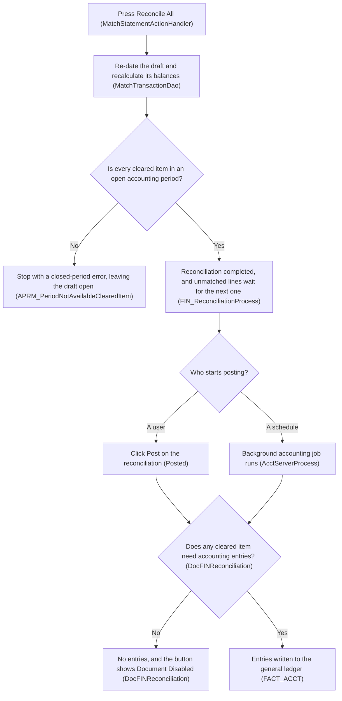

**How to read this:** Start at Reconcile All, where the first diamond is the check that can refuse completion and the second shows that posting starts either from a user's click or from a scheduled job.

10. **Save and leave, or press Reconcile All.**
    - **What happens:** OK closes the screen, leaving the draft open with every match saved. `Reconcile All` re-dates the draft to the latest processed statement line (for an earlier draft, its latest cleared line), recalculates its balances and asks for completion.
    - **Done by:** `MatchStatementActionHandler`, using `APRM_MatchingUtility` and `MatchTransactionDao`.
    - **Tables read or written:** reads `FIN_BANKSTATEMENTLINE` and `FIN_FINACC_TRANSACTION`; writes dates and balances on `FIN_RECONCILIATION`.
    - **What the user sees:** the `Financial Account` window again, with a success message after completion or the error that stopped it.
11. **Complete the reconciliation.**
    - **What happens:** For organizations set up for accounting, each cleared transaction's accounting date must fall in an open accounting period (a span open for bookings); if one does not, nothing is completed (`FIN_ReconciliationProcess`). Otherwise this reconciliation and any later one on the account get recalculated balances, and it is marked complete even with lines still unmatched. Because the balances add up every processed statement line, matched or not, the completed document shows the balance from the bank's lines either way, and unmatched lines wait for the next reconciliation (Section 4.2).
    - **Done by:** `FIN_ReconciliationProcess`, with balances from `MatchTransactionDao`.
    - **Tables read or written:** reads the cleared items in `FIN_RECONCILIATIONLINE_V`, their transactions in `FIN_FINACC_TRANSACTION` and the open periods in `C_PERIODCONTROL`; writes status and balances on `FIN_RECONCILIATION`.
    - **What the user sees:** a success message, or `APRM_PeriodNotAvailableClearedItem` naming the item in a closed period. The completed reconciliation then appears in the `Reconciliations` tab, with its cleared items in `Cleared items`.
12. **Post the reconciliation.**
    - **What happens:** Posting (creating the accounting entries in the general ledger, the company's books) books only cleared transactions for which the account's accounting setup, and for payments the payment method, names a ledger account for clearing, so a reconciliation with none gets no entries. Posting is also refused for an accounting date in a closed period (`DocFINReconciliation`).
    - **Done by:** the `Posted` button on the `Reconciliations` tab, shown once the reconciliation is complete, or `Acct Server Process`, a background process (a job the system runs on a schedule without a user) run by `AcctServerProcess`; both use `DocFINReconciliation`.
    - **Tables read or written:** reads `FIN_FINACC_TRANSACTION`, `FIN_FINACC_PAYMENTMETHOD` and `FIN_FINANCIAL_ACCOUNT_ACCT`; writes entries to `FACT_ACCT` and the posting status on `FIN_RECONCILIATION`.
    - **What the user sees:** after a successful click, the new entries in the General Ledger Journal report (`ReportGeneralLedgerJournal`); otherwise the button caption shows the outcome, such as `Post: Document Disabled` or `Post: Period Closed`. Once posted, the button reads `Unpost`, which deletes the entries (`ResetAccounting`).
    - **Unconfirmed:** whether posting a reconciliation produces entries, because that depends on how each payment method books cleared items and on the configured accounts (consulted `DocFINReconciliation`, `DocFINBankStatement`).
    - **Unconfirmed:** whether and how often posting runs on a schedule, because the data shipped with the core product sets no schedule for it and only the QA (test) sample data runs it every five minutes, so each installation sets its own (consulted `AcctServerProcess`, `src-db/database/sourcedata/referencedData/AD_PROCESS_REQUEST.xml`, `referencedata/sampledata/QA_Testing/AD_PROCESS_REQUEST.xml`).

### 1.3 Accounts and Periods Outside the Main Path

- **Accounts reconciled without a bank file:** a cash account, or a bank account with no matching algorithm record, shows the `Reconcile` button (`EM_APRM_RECONCILE`) instead of the import and matching buttons. It opens the older `Reconciliation` screen, where the user ticks transactions as cleared without linking any statement line, so a workbench that tracks unmatched statement lines would not cover these accounts. Section 2 lists the steps, and Section 4.4 the ban on mixing both methods.
- **Reopening an earlier period:** after an earlier reconciliation is force-reopened (Section 2), the account shows `Match Transactions Force` instead of `Match Statement`. The same screen then works only on lines up to that reconciliation's end date (`MatchStatementTransformer`), and completing it recalculates every later reconciliation's balances (`FIN_ReconciliationProcess`).

**Requirement implications:** A workbench must start from the statement lines of processed statements on each bank account, act on the same draft reconciliation that `Match Statement` uses, and expect completed reconciliations to leave lines unmatched. Accounts reconciled without a bank file need their own treatment (Section 1.3).

## 2. Manual User Actions and Their Triggers

**What this section tells you:** Section 2.1 lists all 40 actions in the flow that need a person: what triggers each, what brings it back, whether effort grows with volume and whether code could automate it (`modules/org.openbravo.advpaymentmngt`). Section 2.2 draws them as swimlanes beside the system's steps. The actions repeated for every statement line sit in `Match Statement`, so they set most of the manual effort.

### 2.1 Every Manual Action and What Drives It

Frequency driver is the event that brings an action back; Data volume sensitivity is High per line or transaction, Medium per statement, session or period, Low for rare corrections and None for one-time setup; real volumes are not determinable from code (see Section 5). Could be automated is Yes when code already does or can skip the step, Partly when it does part, No when a person must judge.

**Assumption:** users holding the standard Finance role (a named set of screen and process permissions) perform every row except 1 (System Administrator), 2, 4 and 5 (windows this role may only view in `AD_WINDOW_ACCESS`), and 9 and 10 (windows no standard role is granted). **Unconfirmed:** which people hold that role, because role assignments are installation data (consulted `modules/org.openbravo.v3.datasets/referencedata/standard/V3_Roles.xml`, `AD_USER_ROLES`).

| Step | Who acts | Trigger | Window / class | Frequency driver | Data volume sensitivity | Could be automated |
|------|----------|---------|----------------|------------------|-------------------------|--------------------|
| 1. Install a bank file format module and apply its dataset (packaged setup data) | System Administrator | Import warns that no format is installed (`APRM_NoBankFileAvailableInfo`) | `ImportBankFile` | One-time setup | None: one-time | No: the message assigns it to administrators |
| 2. Maintain words excluded from partner guessing | User with edit access | Partners guessed wrongly at import | `Bank File Format` (`FIN_BANKFILE_EXCEPTION`) | Setup, revisited after wrong guesses | Low: one list per format | Partly: the importer reuses earlier lines' partners (`FIN_BankStatementImport`); the list stays manual |
| 3. Choose the account's matching algorithm record (a saved set of matching rules that one or more financial accounts use) | Finance user | New bank account, or it should match differently; until chosen, the import and matching buttons stay hidden (`FIN_MATCHING_ALGORITHM_ID`) | `Financial Account` | One-time setup | None: one-time | No: a business choice |
| 4. Edit a record's three on/off switches, which changes every account that selects it | User with edit access | Matching too strict or too loose | `Matching Algorithm` (`FIN_MATCHING_ALGORITHM`) | Setup, revisited when results disappoint | Low: one record, many accounts | No: no match results are stored to tune from (see Section 3.2) |
| 5. Create a record naming a different rule program | User with edit access | A module with other rules is installed (`FIN_MatchingAlgorithm`) | `Matching Algorithm` (`CLASSNAME`) | One-time setup | None: one-time | No: the rules must first be written |
| 6. Set, per payment method (a way of paying, such as a bank transfer), whether payments create their transactions | Finance user | Payments missing from matching candidates | `Payment Method` tab (`AUTOMATIC_DEPOSIT`, `AUTOMATIC_WITHDRAWN`) | One-time setup | None, but each method left off adds rows 18 and 24 per payment | No: the switch is what lets `FIN_PaymentProcess` automate this |
| 7. Set the account's GL item (a general-ledger category for amounts with no invoice, such as bank fees) for differences | Finance user | Manual reconciliations book differences (row 29) | `Financial Account` (`EM_APRM_GLITEM_DIFF`) | One-time setup | None: one-time | No: an accounting choice |
| 8. Set up posting: statement posting switch, cleared-item accounts and each method's clearing use | Finance user | Posting creates no entries (see Section 1.2) | `Accounting Configuration`, `Payment Method` (`ENABLEBANKSTATEMENT`, `INUPONCLEARINGUSE`) | One-time setup | None: one-time | No: accounting policy |
| 9. Schedule background posting | User granted the `Process Request` window | Posting should run without a person | `Acct Server Process` (`AD_PROCESS_REQUEST`) | One-time setup | None: one-time | No: the schedule is the automation (see Section 1.2) |
| 10. Switch off the partial-match question (row 22) | User granted the `Preference` window | The question repeats for every split | `APRM_MATCHSTATEMENT_HIDE_PARTIALMATCH_POPUP`, a preference (a saved system setting) | One-time setup | None: one-time | No: a display choice |
| 11. Import the bank file | Finance user | Statement received from the bank | `Financial Account` (`EM_APRM_IMPORTBANKFILE`), `ImportBankFile` | Per statement | Medium: one upload per file | Partly: after upload, reading and processing run alone (`FIN_BankStatementImport`); no code fetches files |
| 12. Enter or correct a statement and its lines by hand | Finance user | No file, or file rejected (`APRM_InvalidOrMissingValues`) | `Imported Bank Statements`, `Bank Statement Lines` | Per statement without a usable file | High: per line | Partly: a format module reads files instead (row 1) |
| 13. Process a hand-entered statement | Finance user | Statement complete | `EM_APRM_PROCESS_BS`, `FIN_BankStatementProcess` | Per hand-entered statement | Medium: per statement | Yes: import already processes what it creates (`FIN_BankStatementImport`) |
| 14. Force-process a statement despite earlier dates | Finance user | Date warning (`APRM_BankStatementLineWrongDateWarning`) | `EM_APRM_PROCESS_BS_FORCE`, `FIN_BankStatementProcess` | Per warned statement | Medium: per statement | Partly: a fixed date rule only a person overrides (see Section 4.4) |
| 15. Open Match Statement | Finance user | Statement processed; shown for bank accounts with a record and no older draft | `Financial Account` (`EM_APRM_MATCHTRANSACTIONS`), `Match Statement` | Per opening of Match Statement | Medium: per session | Partly: draft handling and matching are programs only this screen starts (`MatchStatementOnLoadActionHandler`) |
| 16. Accept or decline the automatic matching run | Finance user | Prompt at every opening (`APRM_AlgorithmConfirm`) | `Match Statement` | Per opening of Match Statement | Medium: per session | Yes: the prompt only gates a program that needs no input (see Section 3.3) |
| 17. Dismiss the immediate-save notice for good | Finance user | Notice at every opening until dismissed (`APRM_GRID_PERSIST_MESSAGE`) | `MatchStatementOnLoadPreferenceActionHandler` (`APRM_NoPersistInfoMessageInMatching`) | Once per user | None: once per person | No: a personal choice |
| 18. Add several payments to the account as transactions | Finance user | Payments lack transactions (row 6) | `Add Multiple Payments`, `AddMultiplePaymentsHandler` | Per batch of payments | Medium: one run, many payments | Partly: unneeded where row 6 applies (`FIN_PaymentProcess`) |
| 19. Enter and process a transaction by hand | Finance user | An amount, such as a fee, must exist before matching | `Transaction` tab (`EM_APRM_PROCESSED`), `FIN_TransactionProcess` | Per transaction | High: per amount | Partly: as row 23 |
| 20. Set or correct a processed line's GL item or partner | Finance user | Line unmatched for want of a GL item (see Section 3.1) | `Bank Statement Lines` (`C_GLITEM_ID`, `C_BPARTNER_ID`, still editable under `APRM_FIN_BNKSTM_LINE_CHECK_TRG`) | Per unmatched line | High: per line | Partly: later imports copy both from lines with the same name (`FIN_BankStatementImport`) |
| 21. Search for and link transactions, splitting the line into parts when amounts differ | Finance user | Line left unmatched | `Find Transactions to Match`, `FindTransactionsToMatchActionHandler`, `APRM_MatchingUtility` | Per unmatched line | High: per line | Partly: code lists candidates but ranks none (see Section 3.3) |
| 22. Answer the partial-match question (whether to split the line) | Finance user | Chosen amount differs from the line (`APRM_SplitBankStatementLineConfirm`) | `Find Transactions to Match`, `Add Transaction` | Per split | High: per split line | Yes: row 10 removes it |
| 23. Add and link a bank-fee or GL-item transaction | Finance user | No transaction exists for the line | `Add Transaction`, `AddTransactionActionHandler` | Per unmatched line | High: per line | Partly: plugged-in rules may create them (`CREATEDBYALGORITHM`); standard rules create none (`StandardMatchingAlgorithm`) |
| 24. Link an existing payment through Add Transaction | Finance user | Payment has no transaction | `Add Transaction`, `AddTransactionActionHandler` | Per unmatched line | High: per line | Partly: unneeded where row 6 applies (`FIN_PaymentProcess`) |
| 25. Create a new payment from Add Transaction | Finance user | The money has no payment in the ERP | `Add Payment` (`OBUISEL_AddNewRecord`) | Per unmatched line | High: per line | Partly: only plugged-in rules could create payments (`CREATEDBYALGORITHM`, `FIN_PAYMENT`) |
| 26. Unmatch a wrong match, one row or a selection | Finance user | Link judged wrong; only the Affinity column (the grid's match-strength code) flags looser matches | `Match Statement P&E`, `UnMatchTransactionActionHandler`, `UnMatchSelectedTransactionsActionHandler` | Per wrong match | High: per matched line | No: nothing in code marks a link as wrong (see Section 3.3) |
| 27. Reconcile with Reconcile All | Finance user | Matching finished for the period | `Match Statement`, `MatchStatementActionHandler` | Per period | Medium: per period | Partly: completion is one program call (see Section 1.2); only the decision is manual |
| 28. Leave the draft open with OK | Finance user | Work to continue later | `MatchStatementActionHandler` | Per opening of Match Statement | Low: per session | Yes: OK changes nothing, as grid changes are already saved (`APRM_GRID_PERSIST_MESSAGE`) |
| 29. Reconcile without a statement: enter date, ending balance and any difference for row 7's GL item; save or process | Finance user | Cash account, or account with no record, the only cases the button shows | `Financial Account` (`EM_APRM_RECONCILE`), `Reconciliation` | Per period | Medium: per period | No: no statement lines exist to compare, and an unbooked difference is refused (`APRM_ReconciliationDiscrepancy`) |
| 30. Tick each cleared transaction | Finance user | Manual reconciliation open | `Reconciliation` | Per transaction, each tick saved at once | High: per transaction | No: as row 29 |
| 31. Reactivate (reopen for editing) a statement or the latest reconciliation | Finance user | Error found after completion; refusals in Section 4.4 | `FIN_BankStatementProcess`, `FIN_ReconciliationProcess` | Per correction | Low: rare | No: a person decides what to correct |
| 32. Unpost (remove the accounting entries of) a reconciliation or statement | Finance user | Reactivation refused while posted (`PostedDocument`) | `Posted` button, `ResetAccounting` | Per correction after posting | Low: rare | No: a person decides to undo the books |
| 33. Force-reactivate a statement with a matched line | Finance user | Reactivation refused (`APRM_BSLineReconciled`) | `EM_APRM_PROCESS_BS_FORCE` | Per correction | Low: rare | No: as row 31 |
| 34. Force-reactivate an earlier reconciliation that later ones follow | Finance user | Correction in a processed, non-latest, non-manual reconciliation, the only case the button shows | `Reconciliation Process Force` | Per correction | Low: rare | No: as row 31 |
| 35. Re-match that earlier draft | Finance user | The open draft is not the latest reconciliation, which hides row 15's button | `Match Transactions Force` (`EM_APRM_MATCHTRANS_FORCE`) | Per forced correction | Low: rare | No: follows row 34 |
| 36. Delete a wrong, unprocessed statement | Finance user | Duplicate or wrong file, after row 31; processed statements cannot be deleted (`APRM_FIN_BANK_STMT_CHECK_TRG`) | `Imported Bank Statements` | Per wrong import | Low: rare | No: a person judges the file wrong |
| 37. Delete a draft or later reconciliation | Finance user | A later reconciliation blocks a correction (`APRM_FutureReconciliationExists`) | `Reconciliations` (`APRM_FIN_RECON_CHECK_TRG`) | Per correction | Low: rare | No: as row 31 |
| 38. Print the reconciliation details or summary | Finance user | Printout needed | `ReportReconciliationDetail`, `ReportReconciliationSummary` | Per reconciliation | Low: per printout | Partly: code builds the report (`ReportReconciliation`); only a button starts it |
| 39. Post the reconciliation | Finance user | Completed reconciliation not yet posted | `Posted` button, `DocFINReconciliation` | Per reconciliation | Medium: per period | Yes: `Acct Server Process` posts it once scheduled (row 9), unless switched off (`ISBACKGROUNDDISABLED`) |
| 40. Post the bank statement | Finance user | Processed statement, with statement posting on (row 8) | `Posted` button, `DocFINBankStatement` | Per statement | Medium: per statement | Yes: as row 39 |

Recurring actions drive the effort: importing, opening Match Statement and answering its prompt return with every statement or session (`ImportBankFile`, `APRM_AlgorithmConfirm`); fixing GL items, searching, adding transactions or payments and answering the partial-match question with every line the rules never match (`FindTransactionsToMatchActionHandler`, `AddTransactionActionHandler`). Unmatching returns with every wrong match and ticking with every manually reconciled transaction (`UnMatchSelectedTransactionsActionHandler`, `Reconciliation`). Closing returns once per period (`MatchStatementActionHandler`); the rest are setup, corrections, printing and posting, which background posting can take over (row 9); Appendix [Section 2 detail] lists buttons left out.

### 2.2 Swimlanes of Manual Touchpoints

Figure S2.1 shows setup, Figure S2.2 import, Figure S2.3 matching and Figure S2.4 corrections, each as a swimlane (a diagram with one lane per actor). Bold boxes are manual touchpoints naming their Section 2.1 rows, each shown once. Every arrow back into the user lane, such as an unmatched line (`Match Statement`) or a refusal (`PostedDocument`), is manual effort.

**Figure S2.1. Setup**

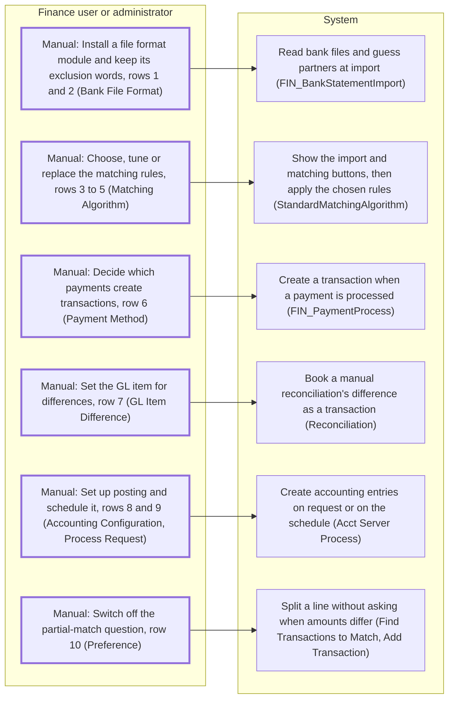

**How to read this:** Bold boxes are manual setup steps; arrows point to the behaviour each enables.

**Figure S2.2. Import and Opening**

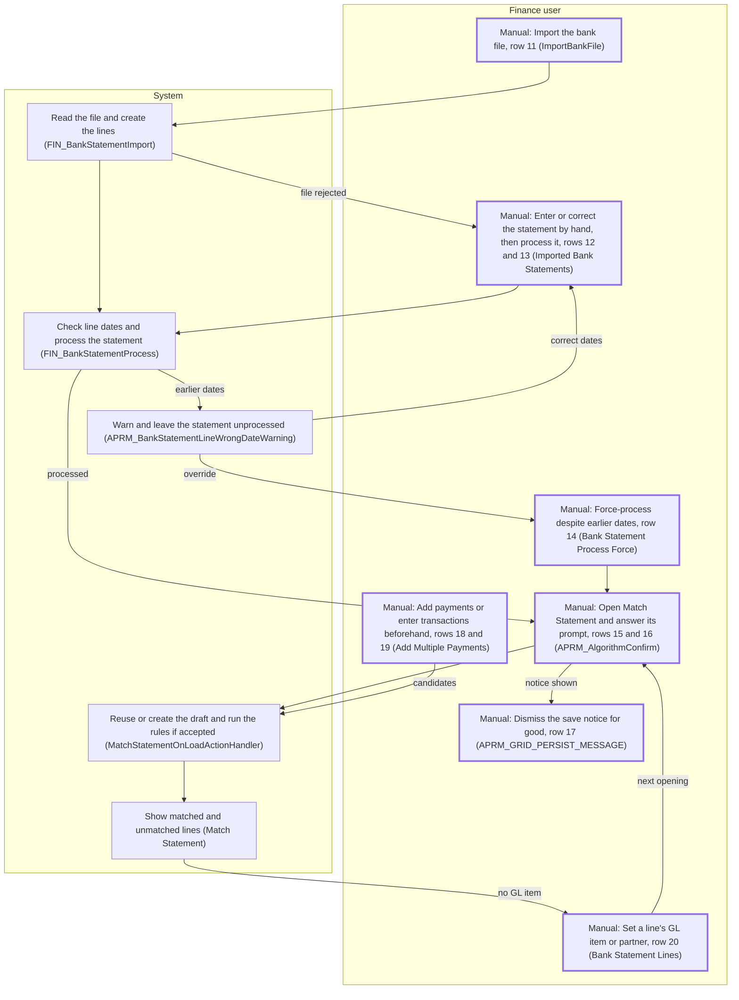

**How to read this:** Bold boxes are manual steps; arrow labels name the condition handing work back.

**Figure S2.3. Matching and Closing**

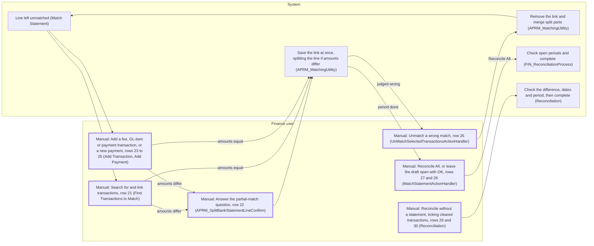

**How to read this:** Bold boxes are manual steps; the unmatch loop returns a wrong link to unmatched.

**Figure S2.4. Corrections, Printing and Posting**

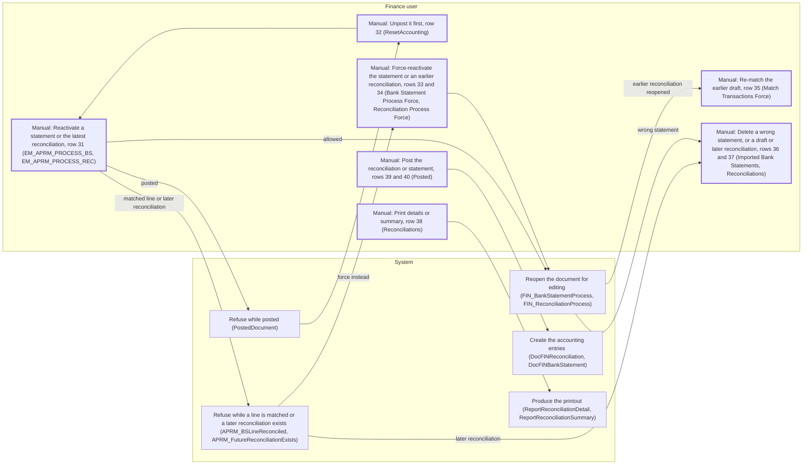

**How to read this:** Bold boxes are manual steps; arrows from a refusal lead to the correction it forces.

### Supporting Detail for Appendix (Section 2)

Buttons and checks without a row of their own:

- `Funds Transfer` (`EM_APRM_FUNDS_TRANS`) moves money between accounts, creating candidates rather than resolving lines, and transaction posting from the `Transaction` tab and the older `C_BANKSTATEMENT` window lie outside this flow.
- Hidden columns `EM_APRM_ADDTRANSACTIONPD` and `EM_APRM_FINDTRANSACTIONSPD` only hold the process definitions of rows 21 and 23 to 25, and `EM_APRM_PROCESS_RECONCILIATION` is never shown.
- `CheckRecordChangedActionHandler` refuses a Search or Add on a line changed meanwhile (`APRM_StaleDate`) and refreshes the grid.

**Requirement implications:** A workbench cuts the most effort by removing the line-level actions (rows 20 to 26) and the per-session prompt (row 16) and by using the switches that already automate steps (rows 6, 9 and 10), not by adding setup or correction screens (`Match Statement`, `FIN_PaymentProcess`).

## 3. Existing Matching Logic

**What this section tells you:** The automatic rules link a bank statement line to a transaction only when the amount and the other compared details agree exactly, and the first candidate found wins. A few settings, mostly shared between accounts, decide how strict the rules are. Each criterion, rule set (Section 3.1) and setting (Section 3.2) comes with its default, how an administrator changes it and an example of failure.

### 3.1 Criteria and Algorithm

The standard rules (`StandardMatchingAlgorithm`, searching through `MatchTransactionDao`) try these passes (rounds of checks) in order and keep the first candidate, a transaction that could settle the line. A strong match is a candidate found by the algorithm's primary rules (passes 1 and 3), a weak match one found only by its looser fallback rules (passes 2 and 4; `FIN_MatchedTransaction`). Figure S3.1 shows the passes for one line, and Figure S3.2 how the switches build pass 3.

| Pass | Applies when | What must agree | Result |
|------|--------------|-----------------|--------|
| 1 | Line carries a GL item | Same GL item, exact amount, transaction dated on or before the line | Strong (`AU`) |
| 2 | Pass 1 found nothing | Same GL item and exact amount, any date; if this also fails, the line goes on to pass 3 | Weak (`AP`) |
| 3 | Every line not matched by pass 1 or 2 | Exact amount, plus each criterion whose switch is on: exact date (date switch); the bank's identifier for the line equal to the identifier entered on the payment or its ERP-assigned number (reference switch, only if the bank's identifier, a mandatory field, is neither empty text nor a double asterisk); the partner name the bank sent identical to the name of the payment's partner (name switch). A switched-off criterion is not compared, so a difference in it does not prevent a strong match | Strong (`AU`) |
| 4 | Pass 3 found nothing | Exact amount, plus exact date if the date switch is on | Weak (`AP`) |
| 5 | Nothing found | — | No match (`NO`) |

**Figure S3.1. Matching Decision Flow for One Bank Line**

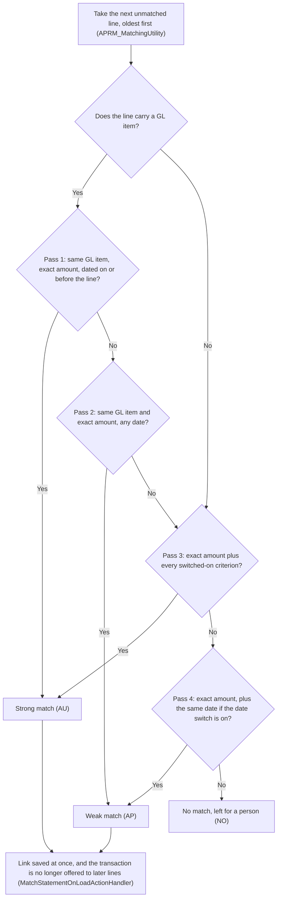

**How to read this:** start at the top with one bank line and follow the Yes and No answers, and the box where the path ends is how the automatic run leaves that line.

**Figure S3.2. How the Three Switches Build Pass 3**

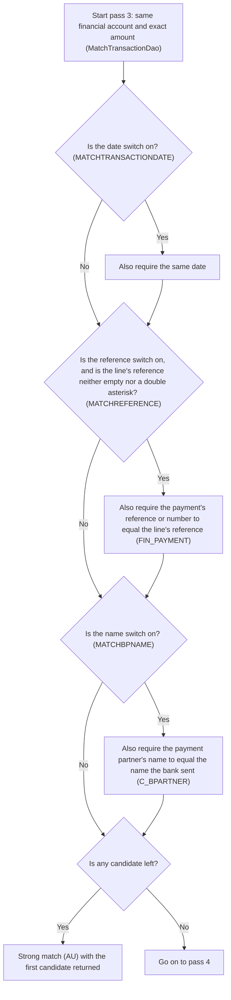

**How to read this:** follow one bank line from the top, where each switch that is on adds one more test a candidate must pass before pass 3 can call it a strong match.

Candidates are processed, unreconciled transactions of the same account that are not already cleared (status `RPPC`), minus those matched earlier in the run. Lines are tried oldest first, then by line number and partner name, with no setting to change the order, and each link is saved before the next line is tried (`APRM_MatchingUtility`, `MatchStatementOnLoadActionHandler`). Earlier lines therefore get first pick of shared candidates.

| Criterion | Default behaviour | How an admin changes it | What defeats it, for example |
|-----------|-------------------|-------------------------|------------------------------|
| Same GL item (passes 1 and 2) | Applies only to lines carrying a GL item (`C_GLITEM_ID`), set by the file format, by hand, or copied at import from an earlier line with the same sender name (`FIN_BankStatementImport`) | No setting | A fee line whose fee was never recorded goes on to passes 3 and 4, which ignore the GL item, and can be linked to an unrelated same-amount payment (`StandardMatchingAlgorithm`) |
| Dated on or before the line (pass 1) | Always applies to GL-item lines, whatever the date switch says (`StandardMatchingAlgorithm`) | No setting | A fee recorded a day after the bank charged it fails pass 1 and is only a weak match in pass 2 (`MatchTransactionDao`) |
| Exact amount (every pass) | The line's money in minus money out must equal the transaction's deposit minus payment, to the cent (`MatchTransactionDao`) | No setting; only another rule set could relax it | A 1,000.00 receipt booked as 997.50 after a bank charge finds no candidate and waits for a person |
| Exact date (passes 3 and 4) | Compared only when the date switch (`MATCHTRANSACTIONDATE`) is on; both passes then need the same day | Date switch (Section 3.2) | A payment entered on the 30th that the bank books on the 1st is never matched automatically |
| Reference (pass 3) | With the reference switch on and the line's reference (`REFERENCENO`) neither empty nor a double asterisk, it must equal the payment's reference or document number (`FIN_PAYMENT`) | Reference switch (Section 3.2) | A customer quoting the invoice number, which is never compared, gets at best a weak match; a transaction with no payment, such as a bank fee, never passes |
| Partner name (pass 3) | With the name switch on, the name the bank sent (`BPARTNERNAME`) must equal the payment partner's name (`C_BPARTNER`); the partner the import guessed (`C_BPARTNER_ID`) is ignored | Name switch (Section 3.2) | "ACME LTD" from the bank against partner "Acme Limited" fails even when the import guessed the right partner. A line arriving with no partner name never passes against a partner's payment |
| Candidate pool (every pass) | Processed, unreconciled, not yet cleared transactions of the same account (`FIN_FINACC_TRANSACTION`) | No setting; a payment joins the pool only once its transaction exists (payment method row, Section 3.2) | A transaction entered but not yet processed is not offered, so its line cannot be linked to it until someone processes it (`FIN_TransactionProcess`) |

Three rule sets can decide a match (`FIN_MatchingAlgorithm`).

| Rule set | Default behaviour | How an admin changes it | Limit or failure scenario, for example |
|----------|-------------------|-------------------------|----------------------------------------|
| Standard rules (`StandardMatchingAlgorithm`) | The only rule set in the repository; it links existing transactions and never creates one, though the prompt warns it may (`APRM_AlgorithmConfirm`) | Select a record that names it, then set its three switches (Section 3.2) | A line on which the rules hit an error is quietly left unmatched, and a run that fails part-way reports the links already saved as a normal result (`MatchStatementOnLoadActionHandler`) |
| Another rule set through the interface (the contract every rule set follows, `FIN_MatchingAlgorithm`) | Not used: no other program in the repository follows the contract, which returns one transaction and one match level per line and removes the transactions it created when a link is undone | Install a module carrying such a program and enter its name as the record's program name (`CLASSNAME`) | The `Matching Algorithm` window then hides the three switches. The contract still returns one transaction per line, so a line covering several transactions stays manual |
| Manual search (`Find Transactions to Match`) | Lists the account's processed transactions not yet in a reconciliation, filtered by default to those dated on or before the line, with no amount, name or reference filter (`TransactionsToMatchTransformer`) | No setting; the filter is defined in the Application Dictionary (the metadata that defines screens, tables and processes) | A payment entered a day after the bank date stays hidden until the user removes the filter (resolution: Section 4.2) |

### 3.2 Configurability

- Each financial account can select one matching algorithm record (`FIN_MATCHING_ALGORITHM_ID` on `FIN_FINANCIAL_ACCOUNT`). The record, kept in the `Matching Algorithm` window and `FIN_MATCHING_ALGORITHM`, names the program that applies the rules (`CLASSNAME`) and holds the three switches (`MATCHBPNAME`, `MATCHREFERENCE`, `MATCHTRANSACTIONDATE`). Choosing another record changes one account, but editing a record changes every account that selects it (`FIN_MATCHING_ALGORITHM_ID`), so one edit can silently shift matching for many accounts. In the F&B International Group sample data, two bank accounts share one record (`referencedata/sampledata/F_B_International_Group/FIN_FINANCIAL_ACCOUNT.xml`).
- A different rule set can be plugged in through the `FIN_MatchingAlgorithm` interface without changing the flow (limits in Section 3.1).
- Left unset, a record's switches default to name and reference on, date off, though the window starts new records with all three on; the F&B International Group sample `Standard` record (`referencedata/sampledata/F_B_International_Group/FIN_MATCHING_ALGORITHM.xml`) turns all three off, so pass 3 makes any same-amount candidate a strong match. The module's own `Standard` record (`modules/org.openbravo.advpaymentmngt/referencedata/standard/Standard_Algorithm.xml`) sets no switch values, so the values it receives when loaded are not determinable from code. The window shows the switches only while the record names the standard rules (`Match BP Name`, `Match Reference`, `Match Transaction Date`). Appendix [Section 3 detail] compares what passes 3 and 4 require under each default.
- **Unconfirmed:** which record each account selects and that record's switches, because both are configuration data that can be edited at any time (consulted `FIN_FINANCIAL_ACCOUNT`, `FIN_MATCHING_ALGORITHM`, `StandardMatchingAlgorithm`).

Every setting the matching code reads (`StandardMatchingAlgorithm`, `MatchStatementOnLoadActionHandler`):

| Parameter | Default behaviour | How an admin changes it | Limit or failure scenario, for example |
|-----------|-------------------|-------------------------|----------------------------------------|
| Account's matching algorithm record (`FIN_MATCHING_ALGORITHM_ID`) | Empty: optional, with no default, and shown only for bank accounts. Without a record the account offers the manual Reconcile button instead of Match Statement (`EM_APRM_RECONCILE`, `EM_APRM_MATCHTRANSACTIONS`) | `Matching Algorithm` field of the `Financial Account` window (Section 2) | A new bank account saved without one never offers automatic matching, so statements are reconciled by ticking transactions |
| Program name (`CLASSNAME`) | Mandatory, with no default; every shipped record names the standard rules (`StandardMatchingAlgorithm`) | `Java Class Name` field in the `Matching Algorithm` window | A mistyped name, or one from a module not installed, stops automatic matching and every unmatch for each account sharing the record (`NoAlgorithmFoundException`). A valid new name also changes how earlier automatic links are undone, since unmatching always asks the account's current record (`APRM_MatchingUtility`) |
| Name switch (`MATCHBPNAME`) | On under both defaults; off in the F&B sample record | `Match BP Name` check box, for every sharing account | Off, two customers' same-amount payments can be swapped as strong matches. On, a sender name spelt differently sends the line to weak matching |
| Reference switch (`MATCHREFERENCE`) | On under both defaults; off in the F&B sample record | `Match Reference` check box | On, a bank reference that is not the payment's reference or number misses strong matching. Off, an exact reference no longer beats another payment of the same amount |
| Date switch (`MATCHTRANSACTIONDATE`) | Off in the database default, on for records created in the window, off in the F&B sample record | `Match Transaction Date` check box | On, a one-day gap blocks both pass 3 and pass 4. Off, a payment dated months away from the line can be linked |
| Automatic deposit or withdrawal on the account's payment method (how money moves, such as transfer or cheque; `AUTOMATIC_DEPOSIT`, `AUTOMATIC_WITHDRAWN`) | Off: processing a payment creates no transaction unless the user picks the action that also deposits or withdraws (`FIN_PaymentProcess`, `FIN_Utility`) | `Automatic Deposit` and `Automatic Withdrawn` on the `Payment Method` tab of the `Financial Account` window | A customer receipt processed without a deposit leaves no candidate for its bank line until someone records the deposit |
| Matching prompt (`APRM_AlgorithmConfirm`) | Asked each time Match Statement opens; declining opens the grid without running the rules (`modules/org.openbravo.advpaymentmngt/web/org.openbravo.advpaymentmngt/js/ob-aprm-matchStatement.js`) | No setting: the screen always asks, and no other screen or job runs the rules (`MatchStatementOnLoadActionHandler`) | A user who declines to reach the grid quickly may resolve by hand lines the rules would have matched |
| Grid-save notice (`APRM_NoPersistInfoMessageInMatching`) | Shown each time the grid opens, warning that every change is saved at once (`APRM_GRID_PERSIST_MESSAGE`) | Each user can hide it with the never-show link (`OBUIAPP_NeverShowMessageAgain`), saving a personal preference (a stored user setting, read by `MatchStatementOnLoadGetPreferenceActionHandler`); deleting it in the `Preference` window restores the notice | Once hidden, nothing on screen reminds the user that a wrong link is saved immediately |

### 3.3 Limits

- No amount or date tolerance (allowed difference) in `MatchTransactionDao`, so a one-cent difference, or a one-day difference in an exact-date pass, leaves the line unmatched for manual work.
- With the name switch (`MATCHBPNAME`) on, pass 3 needs identical partner names, so spelling differences defeat that strong rule and leave the line to the looser pass 4.
- The first candidate wins (`StandardMatchingAlgorithm`), with no scoring between same-amount candidates, so a plausible but wrong link can be made. No setting changes this, and the searches set no order, so which candidate wins is not determinable from code (`MatchTransactionDao`); for example, two open payments of 100.00 can each be linked to the other's line.
- Automatic matching links one line to one transaction; linking one line to several needs a manual search or add that splits it (`APRM_MatchingUtility`). For example, one bank deposit covering three customer cheques is never matched automatically unless a single transaction holds the total.
- Automatic matching runs only when a user opens `Match Statement` and accepts the prompt, so lines wait for a person. Nothing signals that an imported statement is waiting (see Section 4.3).
- Weak matches are applied with no confirmation step and only the Affinity column as a cue, so wrong links surface only on review (`MatchStatementOnLoadActionHandler`). The closing message counts matched lines without separating weak ones (`APRM_AutomaticMatchedLines`).
- Every grid change is saved at once (`APRM_GRID_PERSIST_MESSAGE`), so changes cannot be undone together. The automatic run also saves line by line, so a run's wrong links cannot be rolled back in one step (`MatchStatementOnLoadActionHandler`).

### Supporting Detail for Appendix (Section 3)

What passes 3 and 4 compare under each shipped default (`StandardMatchingAlgorithm`, `FIN_MATCHING_ALGORITHM`):

| Configuration | Name, reference, date switches | Pass 3 (strong) requires | Pass 4 (weak) requires |
|---------------|--------------------------------|--------------------------|------------------------|
| Switches left unset in the database (`FIN_MATCHING_ALGORITHM`) | On, on, off | Amount, reference, partner name | Amount only |
| New record created in the `Matching Algorithm` window | On, on, on | Amount, date, reference, partner name | Amount and date |
| F&B International Group sample `Standard` record | Off, off, off | Amount only | Amount only, so pass 4 never finds what pass 3 missed |

**Requirement implications:** A workbench must show which record and switches produced each automatic link and must let people confirm weak matches, because one shared setting changes matching for many accounts (Section 3.2) and weak links are saved unconfirmed (Section 3.3).

## 4. Current Handling of Unmatched and Exception Items

**What this section tells you:** This section follows each kind of exception the code distinguishes, from the moment it appears to the moment someone clears it. Each is found on one account's screens and cleared by a person acting on one line or one document. None records the owner, age or reason code the objective asks for.

### 4.1 What Counts as Unmatched

An unmatched item is a line of a processed statement with no linked transaction (`FIN_FINACC_TRANSACTION_ID` empty, `MatchTransactionDao`). Lines of a statement still unprocessed, such as one held back by the date check in Section 4.4, do not count, because matching, the grid and the printout read processed statements only (`APRM_MatchingUtility`, `aprm_matchstatement`). Automatic matching also treats an error on a line as no match, so a line the rules could not evaluate looks like one they rejected (`MatchStatementOnLoadActionHandler`).

Such lines show in three places, none of them across accounts (`FIN_FINANCIAL_ACCOUNT_ID`), so no one sees the whole backlog or its age:

| Where it shows | What it lists | What it lacks |
|----------------|---------------|---------------|
| Match Statement grid (`aprm_matchstatement`) | The account's unmatched lines, sorted by date, plus lines matched in the current draft, with the Affinity column | Age, owner, cause; other accounts |
| `Bank Statement Lines` tab | All lines of one statement, with no filter on matched status | An unmatched-only view; age, owner, cause |
| Unreconciled-lines part of the reconciliation printout (`ReportReconciliation`) | Lines dated up to the reconciliation's end date that it did not clear (`modules/org.openbravo.advpaymentmngt/src/org/openbravo/advpaymentmngt/ad_reports/UnreconciledBankStatement.jrxml`) | Age, owner, cause; a printed snapshot, not a worklist |

### 4.2 How Exceptions Are Resolved

Apart from a later automatic run, each resolution below starts from one row of the Match Statement grid (`Match Statement P&E`); Figure S4.1 in Section 4.4 shows how the paths connect.

- Search and link, with an automatic split when amounts differ: the line keeps the matched amount and a new unmatched remainder with the same line number and date carries the rest (`APRM_MatchingUtility`). Splitting is blocked once the reconciliation is posted (`APRM_SplitBSLReconciliationPosted`).
- Add a transaction, which is linked with the match level `AD`, meaning manually added. Unless the user types a description, a fee or GL item transaction reads only "Bank Fee" or "GL Item" and the item's name (`APRM_BankFee`, `APRM_GLItem`).
- Unmatch, which merges the line with its still-unmatched split parts and, under the standard rules, deletes an algorithm-created transaction, and its payment if also algorithm-created, once reactivated, with accounting entries if posted (`APRM_MatchingUtility`, `StandardMatchingAlgorithm`). Search and add stay disabled on a matched row, so correcting a link always takes an unmatch first (`modules/org.openbravo.advpaymentmngt/web/org.openbravo.advpaymentmngt/js/ob-aprm-matchStatement.js`).
- Carry forward: a reconciliation completes with unmatched lines left, and they reappear in the next reconciliation's pending list (`FIN_ReconciliationProcess`) with nothing marking them as old. Reconcile gives no warning that lines remain (`MatchStatementActionHandler`), and each later automatic run retries them (`APRM_MatchingUtility`).

### 4.3 What Is Not Recorded

- `FIN_BANKSTATEMENTLINE` has no owner, reason code, exception status or due date, the gap against "every unmatched item has an owner, age, and reason code"; age can only be derived from the line's transaction date (`DATETRX`) or entry date (`CREATED`), and its only general-purpose note field is `DESCRIPTION`. Free text cannot be counted by cause, so it cannot stand in for a reason code.
- `CREATEDBY` and `UPDATEDBY` record who entered and who last changed a line, so after resolution they show who acted, never who was responsible while it was open (`FIN_BANKSTATEMENTLINE`). Record notes (free-text comments attachable to any record, `OBUIAPP_NOTE`) are the only other place for a cause, and the reconciliation module never reads them (`modules/org.openbravo.advpaymentmngt`).
- No active alert (a system-generated to-do message sent to a user or role) watches statement lines; the one shipped statement rule, "Old not processed Bank Statements", is inactive and reads the older `C_BANKSTATEMENT` table. It flags unprocessed statements dated over ten days ago, so alerts can already express an age limit (`src-db/database/sourcedata/referencedData/AD_ALERTRULE.xml`).
- Checks stop work rather than queue it: closed period, date order, mixed manual and statement reconciliation, split after posting and reactivation limits each show one message to the person who acted and keep no record a user can see (`FIN_BankStatementProcess`, `FIN_ReconciliationProcess`). Section 4.4 traces each check, its message and its bypass, and Figure S4.2 shows the pattern.

### 4.4 Exception Types from Detection to Resolution

The table traces each exception type the code distinguishes. Owner today is the Finance role wherever the work happens inside the `Financial Account` window, which `modules/org.openbravo.v3.datasets/referencedata/standard/V3_Roles.xml` grants it; no type records a person (Section 4.3). Age is never shown; the Age column names the date it could be derived from.

| Exception type | How it is detected and where it is seen | How it is resolved today | Owner today | Age captured | Reason code captured | Missing against the objective |
|----------------|------------------------------------------|--------------------------|-------------|--------------|----------------------|-------------------------------|
| Line left unmatched | No candidate passes the rules (Section 3.1), the run is declined, or a rule error counts as no match (`MatchStatementOnLoadActionHandler`); seen in the places in Section 4.1 | Search and link, or add a transaction (Section 4.2); otherwise carried forward | Finance role; no owner recorded | No; derivable from `DATETRX` or `CREATED` | No; only free-text `DESCRIPTION` | Owner, age and reason code; the line is not "matched without human touch" |
| Wrong automatic match, weak (`AP`) or strong (`AU`) | Nothing flags it beyond the Affinity column (Section 3.3), and a wrong strong match looks like a right one (`FIN_MatchedTransaction`); found only on review | Unmatch, then search or add; failed unmatches are listed once, by reference number (`APRM_ErrorOnUnmatchingRecords`) | Finance role; no reviewer recorded | No | No; unmatching clears `MATCHINGTYPE` and stores no cause | Reason code, so wrong-match causes cannot be counted or fed back into the rules |
| Amount difference resolved by split | Matching needs an exact amount (Section 3.3), so only a person's search finds a transaction covering part of the line (`FindTransactionsToMatchActionHandler`) | Linking splits off a remainder that becomes a new unmatched line; unmatching merges it back (`APRM_MatchingUtility`) | Finance role; the remainder has no owner | No; the remainder keeps the original `DATETRX` | No; nothing says whether the gap was a fee, a partial payment or an error | Reason code for the difference; an owner for the remainder |
| Missing transaction: bank fee, GL item or payment | A search finds nothing because no transaction exists; the standard rules never create one (`StandardMatchingAlgorithm`) | Add Transaction creates and links one with match level `AD` (`AddTransactionActionHandler`) | Finance role; no owner recorded | No; derivable from `DATETRX` | Partly, after resolution only: the transaction's type and GL item (`C_GLITEM`) say what the line was, not why it lacked one | Reason code while open; such a line always needs a person, so it is never "matched without human touch" |
| Carried-forward line | Reconcile completes with the line unmatched and gives no warning (`MatchStatementActionHandler`, `FIN_ReconciliationProcess`) | Reappears in the next draft's grid and the completed reconciliation's printout; resolved like a line left unmatched, later or never | Finance role; no owner recorded | No; derivable from `DATETRX`, and nothing marks the line as older | No | Age, owner and reason code; with no due date (Section 4.3), nothing bounds cycle time |
| Line changed by someone else | Search, add and unmatch first compare the line's last-change time with the grid's copy and refuse on a difference (`APRM_StaleDate`, `CheckRecordChangedActionHandler`) | Refresh the grid and retry | Finance role; nothing assigns a line to one person | No | No | Owner: two people on one account learn of each other only through a refusal |
| Cleared item in a closed accounting period | Reconcile, reactivation and manual reconciliation stop, naming the item, when a cleared transaction's accounting date is in a period not open in `C_PERIODCONTROL`, for organizations set up for accounting (`APRM_PeriodNotAvailableClearedItem`, `FIN_ReconciliationProcess`, `Reconciliation`) | Reopen the period in the Open/Close Period Control window, or unmatch the item | Not determinable from code: no standard role in the role dataset holds the period window | No; the block is not stored | No | An owner; the draft waits untracked, hiding cycle time |
| Statement dates out of order | Processing warns, listing each line dated on or before the latest line of earlier processed statements (if none, the last reconciliation's end date), and leaves the statement unprocessed (`APRM_BankStatementLineWrongDateWarning`, `FIN_BankStatementProcess`) | Correct the dates in `Bank Statement Lines` and process again, or force-process (`EM_APRM_PROCESS_BS_FORCE`, a second button that skips the check) | Finance role; no owner recorded | No; derivable from the statement's `IMPORTDATE` | No | Owner and age: its lines appear in no unmatched list (Section 4.1), and the only age rule for unprocessed statements is inactive (Section 4.3) |
| Manual and statement reconciliation mixed | Opening Match Statement on a draft holding transactions ticked by hand clears those ticks, noting it only in the server log (a technical record users do not see), and raises `APRM_ReconciliationMixed` if that fails (`APRM_MatchingUtility`); manual reconciliation refuses a draft holding statement lines (`Reconciliation`) | Finish the open draft in one mode first | Finance role; no owner recorded | No | No; the repair leaves no record a user can see | Owner and reason code: work done by hand is reversed without notice |
| Split after posting | Linking a transaction of a different amount stops when the reconciliation being worked is posted (`APRM_SplitBSLReconciliationPosted`, `APRM_MatchingUtility`) | Link an exact-amount transaction, or first unpost (remove the accounting entries) with the `Posted` button (`ResetAccounting`) | Finance role; no owner recorded | No | No | Reason code and cycle time: the line waits with no record of why |
| Reactivation limits | Reopening a statement stops if it is posted (`PostedDocument`) or holds a matched line (`APRM_BSLineReconciled`, `FIN_BankStatementProcess`); reopening a reconciliation stops if it is posted, a later one exists (`APRM_FutureReconciliationExists`) or another draft is open (`APRM_DraftReconciliationExists`, `FIN_ReconciliationProcess`) | Force processing skips the matched-line check unless the statement is posted; `Reconciliation Process Force` skips only the later-reconciliation check; otherwise unpost, finish the draft, or reactivate and delete later reconciliations | Finance role; no owner recorded | No | No | Owner and cycle time: correcting a completed period takes a chain of unassigned manual steps |

No row records a person, a cause or a deadline; the closest substitutes are dates, free text and whoever last changed the line (Section 4.3). The checks in the last six rows also leave no trace, so time spent blocked cannot be measured within cycle time. Appendix [Section 4 detail] lists five further messages that interrupt the same work.

Figure S4.1 follows one line from detection to its two outcomes: reconciled, or carried forward unmarked.

**Figure S4.1. Lifecycle of an Unmatched Statement Line**
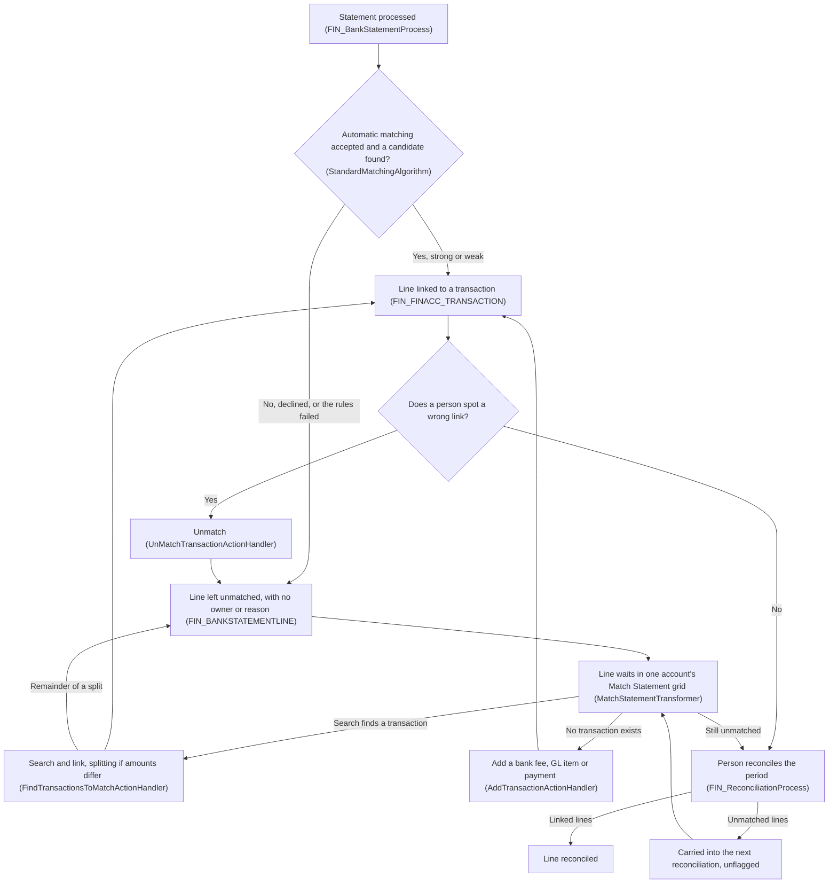
**How to read this:** Start at the top and follow one line: boxes are steps, diamonds are decisions, and every arrow back into "Line left unmatched" is another manual pass over the same line.

Figure S4.2 traces a blocking check from its message to its fix or bypass.

**Figure S4.2. How a Blocking Check Is Detected and Cleared**
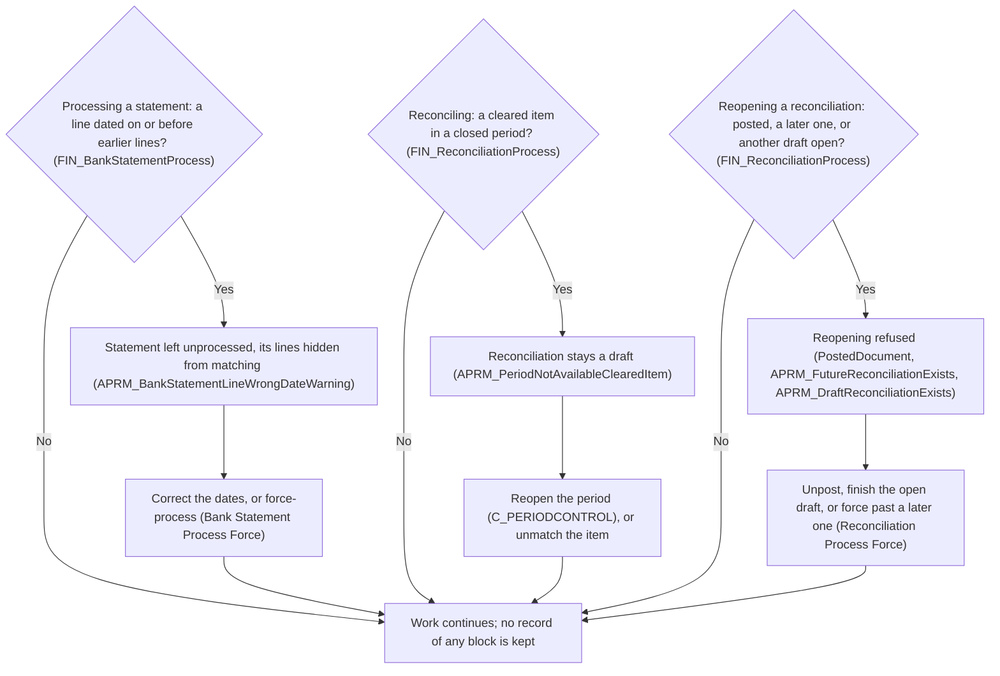
**How to read this:** Each diamond is a check run when a person acts; follow Yes to the message that person sees and the step that clears it, and note that no path leads to a list, a queue or an owner.

### Supporting Detail for Appendix (Section 4)

Further messages that interrupt the same work, beyond those cited in Section 4.4 (`modules/org.openbravo.advpaymentmngt/src-db/database/sourcedata/AD_MESSAGE.xml`), cited there as Appendix [Section 4 detail]:

| Message | What the user is told | Shown by |
|---------|-----------------------|----------|
| `APRM_SplitBSLAlreadyMatched` | The line cannot be split because it is already matched | `APRM_MatchingUtility` |
| `APRM_BSTLine_Matched` | A matched line can be neither changed nor deleted | `APRM_FIN_BNKSTM_LINE_CHECK_TRG` |
| `APRM_ReconciliationDiscrepancy` | In manual reconciliation, the ticked transactions leave a difference with the statement | `Reconciliation` |
| `APRM_ReconcileInFutureOrPast` | A manual reconciliation cannot predate the last one or be dated in the future | `Reconciliation` |
| `PeriodNotAvailable` | A manual reconciliation's statement date falls in a closed period | `Reconciliation` |

**Requirement implications:** A workbench must give every exception type in Section 4.4 an assignee, a visible age and a coded reason across all accounts, and must turn each blocked action into an item someone owns rather than a message shown once.

## 5. Five Largest Sources of Manual Effort

**What this section tells you:** the five sources of manual effort that the code makes largest, in ranked order. Each item gives its evidence, who is affected, the part of the objective it blocks and why it ranks above the next item. The items build on the findings of Sections 2 to 4 and point back to them rather than repeating them.

**Assumption:** the ranking reflects how many statement lines the code lets each source affect, not measured volumes. **Unconfirmed:** actual match rates, line volumes and cycle times, because the repository stores no metrics and they depend on production data (consulted `MatchStatementOnLoadActionHandler`, which only shows the matched count as a message).

1. **Line-by-line resolution of lines the rules never match** — every line the automatic run leaves open needs a person, one line at a time.
   - **Evidence:** each search-and-link or add-transaction request carries a single statement line (`FindTransactionsToMatchActionHandler`, `AddTransactionActionHandler`), and a search that picks several transactions splits that one line into parts (`APRM_MatchingUtility`). Only unmatching works on a selection of lines (`UnMatchSelectedTransactionsActionHandler`), so the search and add actions in Section 2 have no bulk form.
   - **Who is affected:** finance users working the `Match Statement P&E` grid, who hold the Finance role under the Assumption in Section 2. Readers of the reconciliation printout also see every line left over as unreconciled (`ReportReconciliation`).
   - **Business impact:** each line no later run matches needs a person, so this source directly blocks "matched without human touch". Every such line adds at least one manual action to the effort the objective aims to reduce.
   - **Why it ranks above the next item:** it reaches every line that ends unmatched for any reason, including lines with no transaction to find, such as a bank fee, which no rule can match until a person adds one (`AddTransactionActionHandler`). The exact-value rules of item 2 are one of several causes that feed it.
2. **Exact-equality rules with no tolerance, where the first candidate wins** — any field that fails the applicable pass's test (Section 3.1) sends the line to weak matching or manual work.
   - **Evidence:** every amount comparison in the candidate search is an exact equality, and so are the date, reference and partner-name comparisons the switches turn on (`MatchTransactionDao`). The rules keep the first candidate returned, with no scoring (`StandardMatchingAlgorithm`), and the only settings are the three on/off switches of a shared record (`FIN_MATCHING_ALGORITHM`, Section 3.2).
   - **Who is affected:** finance users, who receive every line a rule rejects. Users with edit access to the `Matching Algorithm` window are affected too, because each switch they change applies to every account that selects the record.
   - **Business impact:** these rules cap how many lines are "matched without human touch", since the limits in Section 3.3 turn a small difference into manual work. Each line they reject adds to item 1, and each wrong first-candidate pick adds to item 3.
   - **Why it ranks above the next item:** these rules decide the outcome of every line in every automatic run, whereas wrong matches arise only on the lines where a same-amount candidate was found (Section 3.1).
3. **Correcting wrong automatic matches** — each wrong link (Section 3.3) must be found and undone by a person (Section 4.2).
   - **Evidence:** the automatic run saves each match at once with no confirmation step (`MatchStatementOnLoadActionHandler`), weak matches included (`FIN_MatchedTransaction`). Undoing one is a manual unmatch, row by row or by selection (`UnMatchSelectedTransactionsActionHandler`), which clears the line's match level (`MATCHINGTYPE`), so no record keeps the fact that the rules got it wrong (`APRM_MatchingUtility`).
   - **Who is affected:** finance users, who have only the Affinity column (Section 2) to tell weak matches from strong ones while reviewing. Accounting readers are affected too, because a wrong link marks the wrong transaction as cleared (status `RPPC`) and places it in the reconciliation (`APRM_MatchingUtility`).
   - **Business impact:** each wrong match costs a review, an unmatch and a fresh search or add, adding to the manual effort the objective aims to reduce. Lines the rules matched can therefore still need a person, and the share of wrong matches is not determinable from code.
   - **Why it ranks above the next item:** it adds manual actions to lines the rules did match, and any automatic match may need checking because a wrong link looks like a right one. Item 4 adds no action per line and bites only on lines still open after the work of items 1 to 3.
4. **No structured exception tracking** — the gaps in Sections 4.2 and 4.3 leave each unmatched line with no accountable person.
   - **Evidence:** the statement-line table holds no owner, reason code, exception status or due date (`FIN_BANKSTATEMENTLINE`, Section 4.3). A reconciliation completes with lines still unmatched, and they carry into the next one unflagged (`FIN_ReconciliationProcess`, Section 4.2).
   - **Who is affected:** finance users who inherit carried-forward lines in the next reconciliation (`FIN_ReconciliationProcess`). Anyone answerable for the backlog is affected too, since no record names an owner and no active alert reaches a user or role (Section 4.3).
   - **Business impact:** "every unmatched item has an owner, age, and reason code" cannot be met, because no field exists to hold the owner or the reason and age is never stated (Section 6).
   - **Why it ranks above the next item:** it affects every line that stays open beyond a reconciliation and blocks a whole part of the objective that no current action can satisfy (`FIN_BANKSTATEMENTLINE`). Item 5 costs one prompt answer per opening of the screen and delays lines rather than leaving them untracked.
5. **Matching only on demand, behind a confirmation prompt** — nothing is matched between import and the next user session.
   - **Evidence:** the rules run only inside the opening step of `Match Statement` (`MatchStatementOnLoadActionHandler`), after the user accepts the prompt shown each time the screen opens (`APRM_AlgorithmConfirm`, `modules/org.openbravo.advpaymentmngt/web/org.openbravo.advpaymentmngt/js/ob-aprm-matchStatement.js`). Neither the import (`ImportBankFile`) nor statement processing (`FIN_BankStatementProcess`) starts them, and no background process does.
   - **Who is affected:** finance users, who must open the screen and answer the prompt for each financial account. Everyone waiting on that account's matched lines and completed reconciliation is affected too (`Match Statement`).
   - **Business impact:** waiting time is added to the cycle time the objective aims to cut, and an automatic step still needs a human touch to start.
   - **Why it ranks above the next item:** no sixth item is ranked, and this one outranks the candidates left below the five because it applies to every statement on every account (`MatchStatementOnLoadActionHandler`). Date-order warnings and force processing arise only for statements with a line dated on or before earlier processed lines (`APRM_BankStatementLineWrongDateWarning`), and partner-name exclusion words are upkeep per bank file format (`FIN_BANKFILE_EXCEPTION`). Posting configuration shapes accounting entries, not matching (`DocFINReconciliation`).

**Requirement implications:** the workbench must first cut per-line resolution and widen automatic matching (items 1 and 2), then make automatic matches checkable (item 3), give each open line the owner, age and reason code no field holds today (item 4), and start matching without waiting for a person (item 5).

## 6. Gaps Against the Objective

**What this section tells you:** how far today's code supports each element of the objective quoted in Section 1.1. Owner and reason code have no support, while the auto-match rate (the share of statement lines matched with no person acting) and age are only partly supported. Each row cites its evidence and points to the section that holds the detail.

Support levels: Full means the code delivers the element and records it; Partial means it delivers or records only part of it; None means nothing in the code supports it.

| Objective element | Current support (Full/Partial/None) | Evidence | Where detailed |
|-------------------|-------------------------------------|----------|----------------|
| Auto-match rate: most statement lines matched without human touch | Partial | The rules match lines automatically (`StandardMatchingAlgorithm`) but need exact values and start only when a person accepts the prompt (`APRM_AlgorithmConfirm`). Each line keeps its match level (`AU`, `AP`, manual `MA` or added `AD`) in `MATCHINGTYPE`, shown line by line as the Affinity column (`aprm_matchstatement`), yet no screen or report counts the share matched by the rules. The opening message gives one run's count and is not stored (`APRM_AutomaticMatchedLines`), and unmatching clears the level (`APRM_MatchingUtility`), so the actual rate is not determinable from code. | Sections 3.1, 3.3 and 5 (items 1, 2, 3 and 5) |
| Owner (the person accountable for resolving an unmatched item) | None | `FIN_BANKSTATEMENTLINE` has no owner column, and its `CREATEDBY` and `UPDATEDBY` stamps cannot stand in for one (Section 4.3). Access is granted per role and window (`AD_WINDOW_ACCESS`), never per line. | Sections 4.3, 4.4 and 5 (item 4) |
| Age (how long an unmatched item has been open) | Partial | Age can be derived from the line's `DATETRX` or `CREATED` (`FIN_BANKSTATEMENTLINE`), and the Match Statement grid shows the line's date (`aprm_matchstatement`), but no field, list or report states the age. Lines carried into the next reconciliation carry no marker (`FIN_ReconciliationProcess`). | Sections 4.1, 4.2, 4.3 and 4.4 |
| Reason code | None | No reason column exists on `FIN_BANKSTATEMENTLINE`, and `MATCHINGTYPE` records how a line was matched, not why one is not. The free-text `DESCRIPTION` and record notes (Section 4.3, `OBUIAPP_NOTE`) offer no fixed list of reasons to count or report. | Sections 4.3 and 4.4 |
| Cycle time (from statement import to completed reconciliation) | None | No field keeps when a line was matched or when a reconciliation completed: `FIN_RECONCILIATION` holds the period end (`DATETO`) and the statement date (`STATEMENTDATE`), and the `UPDATED` stamps on it and on each line change with any later edit. Actual cycle times are not determinable from code. | Sections 3.3 and 5 (item 5) |
| Manual effort | Partial | The automatic run, a search that links several transactions to one line, and unmatching a selection each save manual actions (`APRM_MatchingUtility`, `UnMatchSelectedTransactionsActionHandler`). Every line the rules miss still needs its own search or add, and only the current match levels `MA` and `AD` show manual work, so staff time is not determinable from code. | Sections 2 and 5 (items 1 and 3) |

**Requirement implications:** the workbench must add owner and reason code as new recorded data, turn the derivable age into a shown and tracked value, and measure the auto-match rate and cycle time that the code cannot report today.
