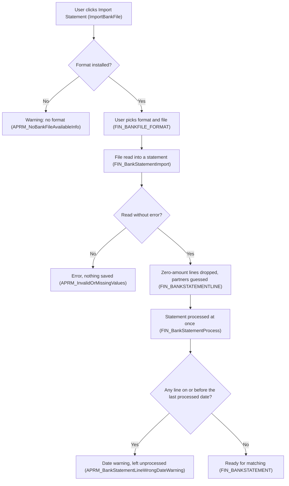
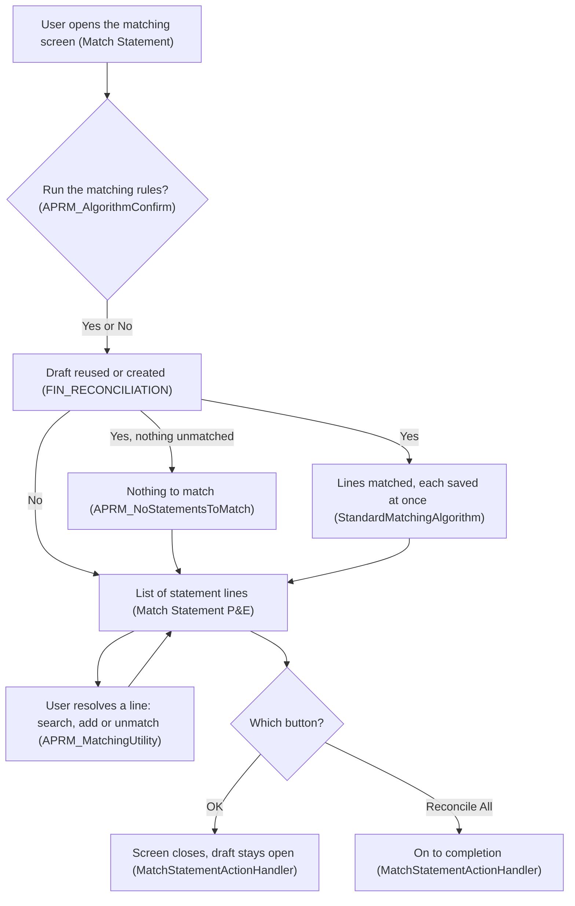
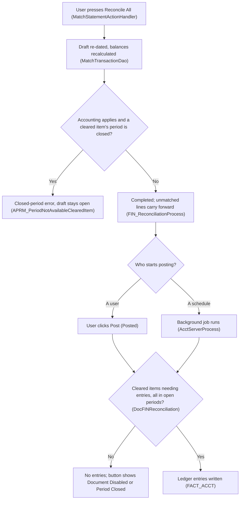
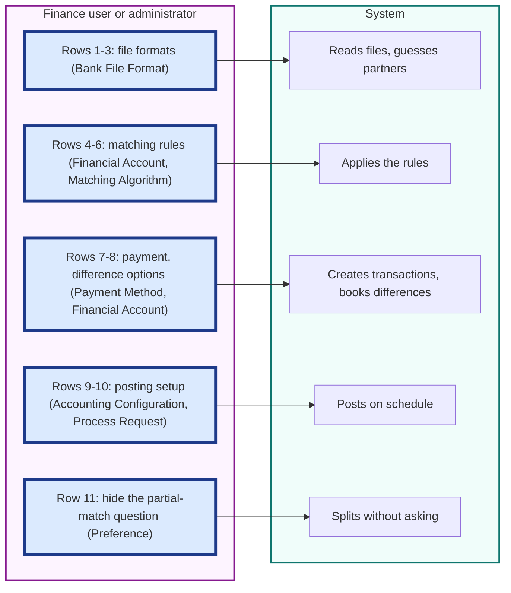
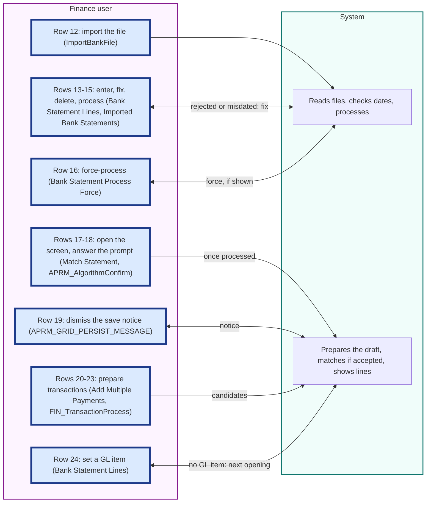
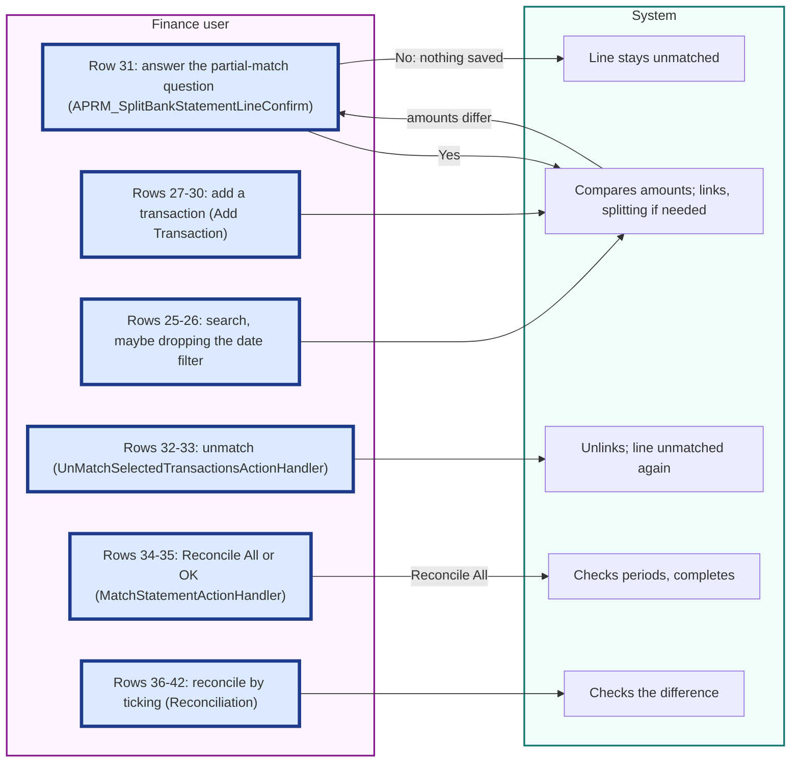
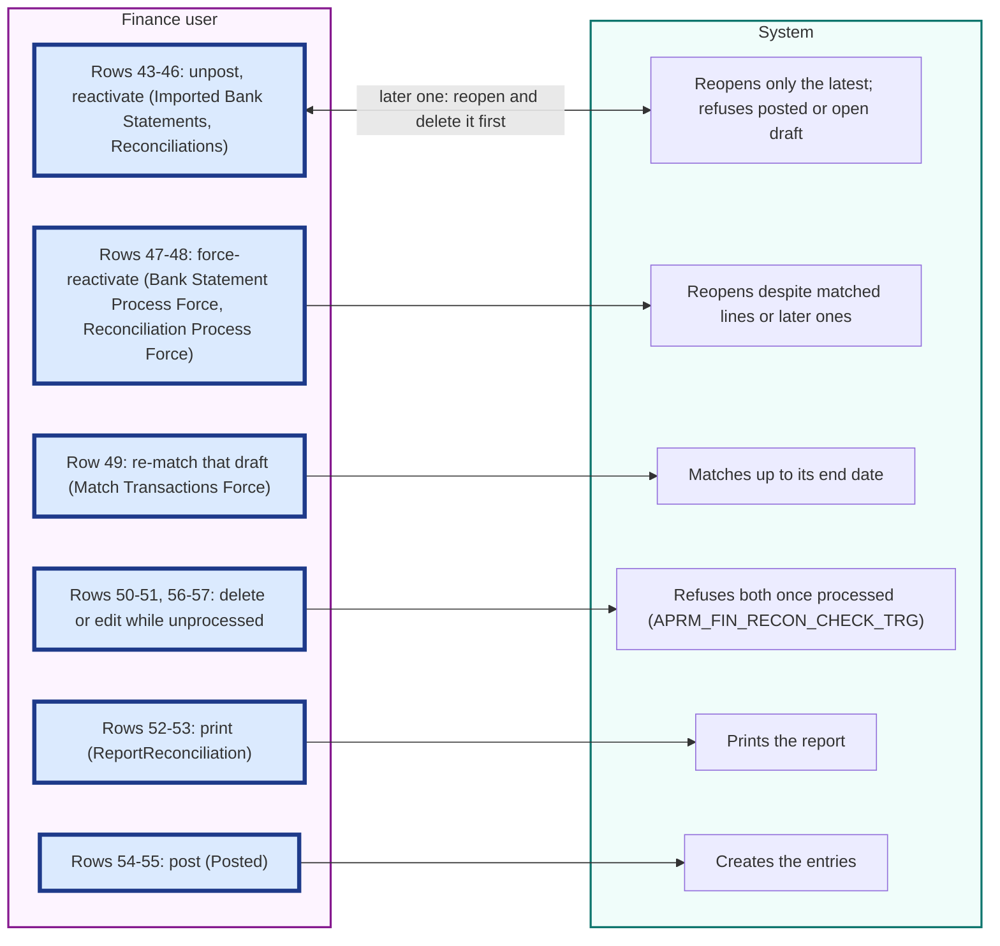
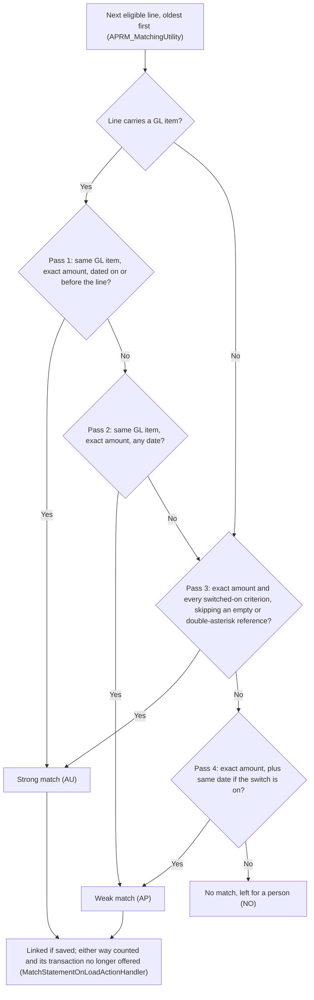
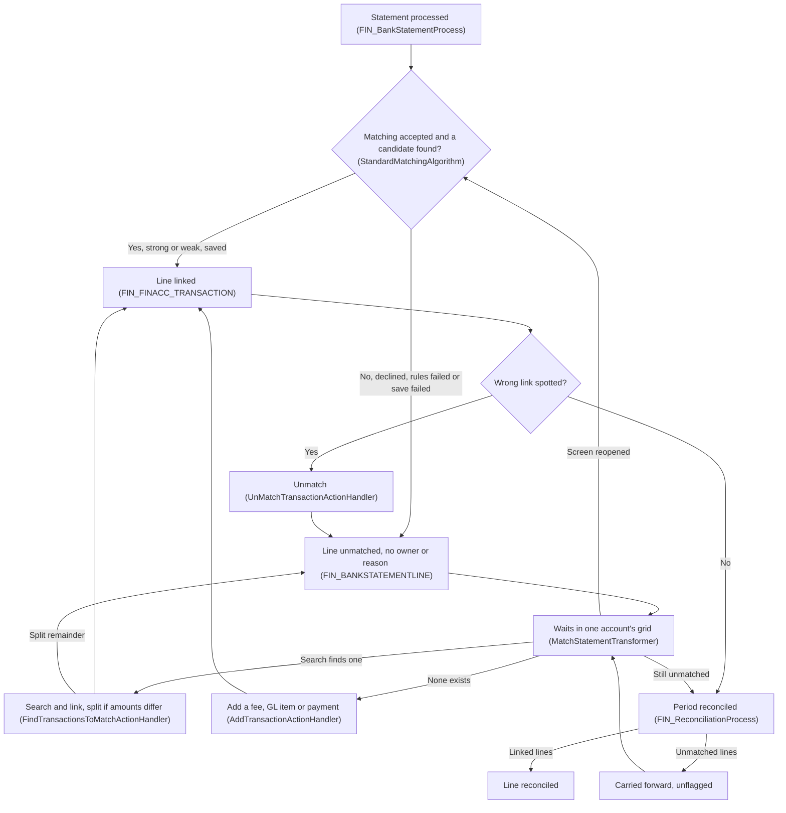

# Analysis 1: Current-State Reconciliation Workflow and Manual Effort

## Key Takeaways

- A bank file reaches the company's books (`FACT_ACCT`) in twelve steps, most started by a person.
- People act at 57 points, most per-line ones in the `Match Statement` screen.
- The rules (`StandardMatchingAlgorithm`) need exact amounts, take the first match and wait for a user.
- No unmatched line records who must fix it or why, or shows how old it is (`FIN_BANKSTATEMENTLINE`).
- Per-line resolution is the top effort (`APRM_MatchingUtility`); match rates are not determinable from code.

## 1. End-to-End Flow from Statement Import to Posted Reconciliation

**What this section tells you:** This section traces a bank file to the company's books. Each stage before the balance is confirmed waits for a person, and confirmation can leave bank lines unlinked (Section 1.2, Figures 1 to 3).

### 1.1 How the Pieces Fit

The objective is to "reduce manual effort and cycle time in bank reconciliation. Most statement lines are matched without human touch, and every unmatched item has an owner, age, and reason code." In this ERP (business-management software), a reconciliation is the period document confirming the ERP balance agrees with the bank (`FIN_RECONCILIATION`), and cycle time is the time from statement import to completed reconciliation. An unmatched item's owner is the person accountable for resolving it, its age is how long it has been open, and its reason code is a record of why it is unresolved; Appendix A collects every definition.

Except for its data tables (stores of records) and accounting step (step 12), both in the core product, the flow lives in one module (a separately packaged part of the ERP), Advanced Payables and Receivables Management (`modules/org.openbravo.advpaymentmngt`). Everything hangs off the financial account (the ERP record for one bank account), kept in the `Financial Account` window (a data-entry screen): statements and their bank statement lines (one entry on the statement the bank sends) in `FIN_BANKSTATEMENT` and `FIN_BANKSTATEMENTLINE`, transactions (the ERP's record of money expected in or out of a financial account) in `FIN_FINACC_TRANSACTION`, and reconciliations in `FIN_RECONCILIATION`. These records, their lists and matching (linking a statement line to the transaction it settles) cover one account at a time (`FIN_FINANCIAL_ACCOUNT_ID`; rule records can be shared, Section 3.2), which matters for working exceptions (items needing a person: unmatched lines, wrong matches and blocked actions) across accounts. Section 1.2 traces bank accounts that select a matching algorithm record (a saved set of matching rules that one or more financial accounts use) in `FIN_MATCHING_ALGORITHM_ID`; Section 1.3 covers cash accounts and bank accounts without one.

### 1.2 Step-by-Step Flow

Twelve steps form three stages: import (steps 1 to 4, Figure 1), matching (steps 5 to 9, Figure 2), and completion and posting (creating the accounting entries in the general ledger, the company's books; steps 10 to 12, Figure 3). Read stage handoffs as waits for a user, not line-resolution work (Sections 2 to 4).

**Figure 1. Import and Statement Processing**

**How to read this:** Diamonds are system checks; only one path reaches matching.

1. **Start the import.**
   - **What happens:** A finance user clicks `Import Statement` (`EM_APRM_IMPORTBANKFILE`); the system checks that a bank file format (one bank's file layout) is installed. `ImportBankFile` takes only uploaded files, so how bank files arrive is not determinable from code.
   - **Done by:** the `Financial Account` window and the `ImportBankFile` class (a program unit), which provides an older hand-built screen.
   - **Tables:** reads `FIN_FINANCIAL_ACCOUNT` and `FIN_BANKFILE_FORMAT`.
   - **User sees:** a pop-up to choose the file and format or, with none installed, `APRM_NoBankFileAvailableInfo` asking an administrator for a format module.
2. **Load the file into a new statement.**
   - **What happens:** On OK, the system creates the statement, and the format's importer (the program that reads a bank file format) turns each entry into a bank statement line; any failure undoes the import (`ImportBankFile`).
   - **Done by:** `ImportBankFile`, running the format's importer, built on `FIN_BankStatementImport`.
   - **Tables:** reads `FIN_BANKFILE_FORMAT` and the statement document type (the setting that numbers a kind of document) in `C_DOCTYPE`; writes `FIN_BANKSTATEMENT` and `FIN_BANKSTATEMENTLINE`.
   - **User sees:** on failure, `APRM_InvalidOrMissingValues` (unreadable values), `APRM_DocumentTypeNotFound` (no numbering) or `APRM_WrongBankFileFormat` (importer not installed).
   - **Unconfirmed:** which bank file formats an installation can import, because nothing in this code base implements the importer, so formats come from separately installed modules (consulted `FIN_BankStatementImport`, `ImportBankFile`, `APRM_NoBankFileAvailableInfo`).
3. **Drop zero-amount lines and guess partners.**
   - **What happens:** Three rules apply to each line:
     - A line with no money in or out is discarded (`FIN_BankStatementImport`).
     - A missing business partner (a customer or supplier) or GL item (a general-ledger category for amounts with no invoice, such as bank fees) is filled separately from the newest of up to ten recent processed (confirmed) same-name lines on the account holding one, ignoring spaces and digit differences (`FIN_BANKSTATEMENTLINE`).
     - A partner still missing comes from the partner with exactly that name, else the only partner sharing a name word (ignoring `FIN_BANKFILE_EXCEPTION` words and those of three letters or fewer); with several, closest-name selection fails, leaving it blank, so `Add Transaction` opens with none (`AddTransactionFilterExpression`).
   - **Done by:** `FIN_BankStatementImport`.
   - **Tables:** reads earlier lines in `FIN_BANKSTATEMENTLINE`, partners in `C_BPARTNER` and excluded words in `FIN_BANKFILE_EXCEPTION`; writes partner and GL item on new lines.
   - **User sees:** nothing; the final message counts only inserted lines (`RowsInserted`), dropping the prepared zero-amount note (`APRM_ZeroAmountNotInserted`).
4. **Process the statement at once.**
   - **What happens:** The import processes the statement at once (`FIN_AddPayment`). A line dated on or before the latest processed line (or, if none, the last reconciliation's end date) leaves it unprocessed (`FIN_BankStatementProcess`). Force-processing (processing despite the date check) may be unavailable (Section 2.1, row 16).
   - **Done by:** `FIN_AddPayment`, which runs `FIN_BankStatementProcess`.
   - **Tables:** reads earlier lines in `FIN_BANKSTATEMENTLINE` and the last completed reconciliation in `FIN_RECONCILIATION`; writes the processed flag on `FIN_BANKSTATEMENT`.
   - **User sees:** the statement number and lines inserted (`APRM_BankStatementNo`), or the date warning naming the cut-off date and lines (`APRM_BankStatementLineWrongDateWarning`, `APRM_BankStatementLineWrongDateWarning2`).

**Figure 2. Matching in the Match Statement Screen**

**How to read this:** The top answer decides automatic matching; the loop is per-line work.

5. **Open Match Statement and answer the prompt.**
   - **What happens:** The user clicks `Match Statement` (`EM_APRM_MATCHTRANSACTIONS`), opening a process definition (Pick and Execute: a pop-up grid where the user selects rows and runs an action); a grid is an on-screen table. At every opening, before data loads, a prompt (a yes-or-no question) asks whether to run the matching rules (`APRM_AlgorithmConfirm`).
   - **Done by:** the `Match Statement` process definition and its browser code, `modules/org.openbravo.advpaymentmngt/web/org.openbravo.advpaymentmngt/js/ob-aprm-matchStatement.js`.
   - **Tables:** reads the user's preference (a saved system setting) in `AD_PREFERENCE`.
   - **User sees:** the prompt, warning that the run may create transactions, and a notice that every grid change is saved at once (`APRM_GRID_PERSIST_MESSAGE`) unless that preference hides it (Section 3.2); the screen has no Cancel or close button.
6. **Prepare the draft reconciliation.**
   - **What happens:** Whatever the answer, the account's draft (unfinished) reconciliation is reused or created (`APRM_MatchingUtility`). A reused draft is re-dated after repairing any transaction shown as cleared (agreed with the bank in a reconciliation, by a link or a tick) without a statement line, a trace of mixed manual and statement reconciliation (Section 4.4). A new draft is numbered, dated at the latest processed line and opened at the last reconciliation's balance (`MatchTransactionDao`).
   - **Done by:** `MatchStatementOnLoadActionHandler`, using `APRM_MatchingUtility`.
   - **Tables:** reads `FIN_BANKSTATEMENTLINE`, `C_DOCTYPE` and `FIN_RECONCILIATION`; writes the draft there, any repaired transaction in `FIN_FINACC_TRANSACTION` and its payment's status (stage, such as cleared) in `FIN_PAYMENT`.
   - **User sees:** nothing, unless `APRM_NoDocTypeRec` (no reconciliation numbering) or `APRM_ReconciliationMixed` (repair failed) stops it.
7. **Run automatic matching, if accepted.**
   - **What happens:** With no processed line unmatched, the system only says so (`APRM_NoStatementsToMatch`). Otherwise it takes each unmatched line in date order (an earlier draft only up to its end date, Section 1.3), asks the account's rules for one transaction and saves each match at once. A matched transaction becomes cleared (`RPPC`) and joins the draft; a line the rules cannot evaluate stays unmatched (Section 4.1).
   - **Done by:** `MatchStatementOnLoadActionHandler`, applying the account's rules (shipped as `StandardMatchingAlgorithm`, through `FIN_MatchingAlgorithm`; Section 3.1).
   - **Tables:** reads `FIN_MATCHING_ALGORITHM`, `FIN_BANKSTATEMENTLINE` and candidates (transactions that could settle the line) in `FIN_FINACC_TRANSACTION`, with `FIN_PAYMENT` and `C_BPARTNER` details; writes the link and match level (the code recording how a line was matched, `MATCHINGTYPE`) on the line, cleared status and draft link on `FIN_FINACC_TRANSACTION`, and cleared status alone on any linked `FIN_PAYMENT`.
   - **User sees:** the match count (`APRM_AutomaticMatchedLines`) or `APRM_NoAutomaticMatchedLines`, then the grid.
8. **Review the grid.**
   - **What happens:** The grid lists, in date order, the account's unmatched processed lines, including those from earlier statements, plus those matched in the current draft; lines cleared in earlier reconciliations are hidden (`MatchStatementTransformer`).
   - **Done by:** the `Match Statement P&E` window, which uses the `aprm_matchstatement` HQL-based table (a read-only list built from a database query, a request for stored records), with rows chosen by `MatchStatementTransformer`.
   - **Tables:** reads `FIN_BANKSTATEMENT`, `FIN_BANKSTATEMENTLINE`, `FIN_FINACC_TRANSACTION`, `C_BPARTNER` and `C_GLITEM`; writes nothing.
   - **User sees:** each line's date, partner, reference (the bank's identifier, not an ERP document number), amount and how it was matched (Section 3.1), and the linked transaction's date, partner, amount and GL item. Search and add work only on unmatched rows, unmatch (undo a match) only on matched ones (`modules/org.openbravo.advpaymentmngt/web/org.openbravo.advpaymentmngt/js/ob-aprm-matchStatement.js`).
9. **Resolve the remaining lines.**
   - **What happens:** For each unmatched line, the user searches for and links one or more transactions, splitting the line (dividing it into a matched part and an unmatched remainder) when amounts differ, or adds and links a missing one; unmatch undoes a wrong link (`APRM_MatchingUtility`). Sections 2 and 4.2 give the actions and side effects, Section 4.4 the stale-line check (refusal if someone else changed it, `CheckRecordChangedActionHandler`).
   - **Done by:** `FindTransactionsToMatchActionHandler`, `AddTransactionActionHandler` and `UnMatchSelectedTransactionsActionHandler`, all through `APRM_MatchingUtility`.
   - **Tables:** reads and writes `FIN_BANKSTATEMENTLINE` (splits add remainder lines), `FIN_FINACC_TRANSACTION` and `FIN_PAYMENT`.
   - **User sees:** a pop-up grid of candidates or an entry form, then the refreshed grid, or `APRM_StaleDate`.

**Figure 3. Completing and Posting the Reconciliation**

**How to read this:** The first diamond can refuse completion; the second shows what starts posting.

10. **Save and leave, or press Reconcile All.**
    - **What happens:** OK closes the screen, leaving the draft open, every match saved (`MatchStatementActionHandler`). `Reconcile All` re-dates the draft to the latest processed line (for an earlier draft, its latest cleared line), recalculates balances and asks for completion.
    - **Done by:** `MatchStatementActionHandler`, using `APRM_MatchingUtility` and `MatchTransactionDao`.
    - **Tables:** reads `FIN_BANKSTATEMENTLINE` and `FIN_FINACC_TRANSACTION`; writes dates and balances on `FIN_RECONCILIATION`.
    - **User sees:** the `Financial Account` window, showing success or the error that stopped completion.
11. **Complete the reconciliation.**
    - **What happens:** For organizations (companies or branches) with accounting, each cleared transaction's accounting date must fall in an open accounting period (a span open for bookings), or nothing is completed; otherwise it and later reconciliations get recalculated balances, and it completes even with lines unmatched (`FIN_ReconciliationProcess`). Balances count every processed line, matched or not, so the document shows the bank's balance while unmatched lines carry forward (Section 4.2).
    - **Done by:** `FIN_ReconciliationProcess`, with balances from `MatchTransactionDao`.
    - **Tables:** reads the cleared items in `FIN_RECONCILIATIONLINE_V`, their transactions in `FIN_FINACC_TRANSACTION` and the open periods in `C_PERIODCONTROL`; writes status and balances on `FIN_RECONCILIATION`.
    - **User sees:** success, or `APRM_PeriodNotAvailableClearedItem` naming the item in a closed period; the completed reconciliation shows in the `Reconciliations` tab (a section of a window), its items in `Cleared items`.
12. **Post the reconciliation.**
    - **What happens:** Posting books only cleared transactions for which the account's accounting setup, and for payments the payment method (a way of paying, such as a bank transfer), names a general-ledger account for cleared items, so a reconciliation with none gets no entries; a closed period also refuses it (`DocFINReconciliation`).
    - **Done by:** the `Posted` button on the `Reconciliations` tab once complete, or `Acct Server Process`, a background process (a job the system runs on a schedule without a user) run by `AcctServerProcess`; both use `DocFINReconciliation`.
    - **Tables:** reads `FIN_FINACC_TRANSACTION`, `FIN_FINACC_PAYMENTMETHOD` and `FIN_FINANCIAL_ACCOUNT_ACCT`; writes entries to `FACT_ACCT` and posting status on `FIN_RECONCILIATION`.
    - **User sees:** the entries in the General Ledger Journal report (`ReportGeneralLedgerJournal`), or a button caption such as `Post: Document Disabled` or `Post: Period Closed`; once posted it reads `Unpost`, which deletes the accounting entries (`ResetAccounting`).
    - **Unconfirmed:** whether posting a reconciliation produces entries, because that depends on how each payment method books cleared items and on the configured accounts (consulted `DocFINReconciliation`, `DocFINBankStatement`).
    - **Unconfirmed:** whether and how often posting runs on a schedule, because core product data sets no schedule and only the QA (test) sample data runs it every five minutes, so each installation sets its own (consulted `AcctServerProcess`, `src-db/database/sourcedata/referencedData/AD_PROCESS_REQUEST.xml`, `referencedata/sampledata/QA_Testing/AD_PROCESS_REQUEST.xml`).

### 1.3 Accounts and Periods Outside the Main Path

- **Accounts reconciled without a bank file:** only bank-type accounts with a record in `FIN_MATCHING_ALGORITHM_ID` show `Import Statement` and `Match Statement`; cash accounts, and bank accounts without one, show `Reconcile` (`EM_APRM_RECONCILE`), opening the older `Reconciliation` screen, where the user ticks cleared transactions without statement lines. A workbench tracking unmatched lines would miss these accounts (Section 2.1, rows 36 to 42; mixing ban, Section 4.4).
- **Reopening an earlier period:** once an earlier reconciliation is force-reactivated (reopened despite later reconciliations or matched lines; Section 2.1, row 48), `Match Transactions Force` replaces `Match Statement`, limited to lines up to its end date (`MatchStatementTransformer`); completing it recalculates later balances (step 11).

**Requirement implications:** A workbench must start from each bank account's processed statement lines, act on the draft `Match Statement` uses, and expect completed reconciliations to leave lines unmatched; accounts without a bank file need separate treatment (Section 1.3).

## 2. Manual User Actions and Their Triggers

**What this section tells you:** Repeated line-level decisions create a different workload from one-time setup (Section 2.1). Distinguishing unavoidable judgment from steps the system can already perform lets requirements target the work that grows with the backlog.

### 2.1 Every Manual Action and What Drives It

Frequency driver is the event that brings an action back. Data volume sensitivity (how work grows with volume) is High per line or transaction, Medium per statement, screen opening or reconciliation, Low per corrected document or record, None for setup, unless a cell says otherwise; real volumes and correction rates are not determinable from code (Section 7). Could be automated is Yes if code does or can skip it, Partly if it does part, No if a person must judge.

**Assumption:** users holding the standard Finance role (a named set of screen and process permissions), shown as Finance, perform every row except 1 (System Administrator), 2, 3, 5 and 6 (windows it may only view, `AD_WINDOW_ACCESS`), and 10 and 11 (windows no standard role is granted). **Unconfirmed:** which people hold that role, because role assignments are installation data (consulted `modules/org.openbravo.v3.datasets/referencedata/standard/V3_Roles.xml`, `AD_USER_ROLES`).

| Step | Who acts | Trigger | Window / class | Frequency driver | Data volume sensitivity | Could be automated |
|------|----------|---------|----------------|------------------|-------------------------|--------------------|
| 1. Install a format module and apply its dataset (packaged setup data) | System Administrator | No format installed (`APRM_NoBankFileAvailableInfo`) | `ImportBankFile` | Setup | None | No: assigned to administrators |
| 2. Maintain a format's program and availability | User with edit access | Program missing (`APRM_WrongBankFileFormat`) or format withdrawn | `Bank File Format` (`CLASSNAME`, `ISACTIVE`) | Setup, revisited | Low | No: a person picks the program (`ImportBankFile`) |
| 3. Maintain words excluded from partner guessing | User with edit access | Partners guessed wrongly | `Bank File Format` (`FIN_BANKFILE_EXCEPTION`) | Setup, revisited | Low | Partly: import reuses earlier lines' partners (`FIN_BankStatementImport`) |
| 4. Choose the account's matching algorithm record | Finance | New account or rules (Section 1.1) | `Financial Account` (`FIN_MATCHING_ALGORITHM_ID`) | Setup | None | No: a business choice |
| 5. Edit a record's three switches, affecting every account using it | User with edit access | Matching too strict or loose | `Matching Algorithm` (`FIN_MATCHING_ALGORITHM`) | Setup, revisited | Low | No: nothing tunes them or tracks match accuracy (`MATCHINGTYPE`, Section 3.2) |
| 6. Name another rule program in a record | User with edit access | Other rules installed (`FIN_MatchingAlgorithm`) | `Matching Algorithm` (`CLASSNAME`) | Setup | None | No: rules must first be written |
| 7. Set which payment methods create transactions | Finance | Payments missing from candidates | `Payment Method` (`AUTOMATIC_DEPOSIT`, `AUTOMATIC_WITHDRAWN`) | Setup | None; methods left off add rows 20 and 29 | No: the switch automates it (`FIN_PaymentProcess`) |
| 8. Set the account's GL item for differences | Finance | Manual differences (row 41) | `Financial Account` (`EM_APRM_GLITEM_DIFF`) | Setup | None | No: an accounting choice |
| 9. Set up posting switches and accounts, including for clearing | Finance | No entries created (Section 1.2) | `Accounting Configuration`, `Payment Method` (`ENABLEBANKSTATEMENT`, `INUPONCLEARINGUSE`) | Setup | None | No: accounting policy |
| 10. Schedule background posting | User granted `Process Request` | Posting should run unattended | `Acct Server Process` (`AD_PROCESS_REQUEST`) | Setup | None | No: the schedule is the automation |
| 11. Switch off the partial-match question (row 31) | User granted `Preference` | Question at every split | `Preference` (`APRM_MATCHSTATEMENT_HIDE_PARTIALMATCH_POPUP`) | Setup | None | No: a display choice |
| 12. Import the bank file | Finance | Statement received | `Financial Account` (`EM_APRM_IMPORTBANKFILE`), `ImportBankFile` | Per statement | Medium | Partly: processing follows upload (`FIN_BankStatementImport`); nothing fetches files |
| 13. Enter or correct a statement by hand | Finance | No file, or file rejected (`APRM_InvalidOrMissingValues`) | `Imported Bank Statements`, `Bank Statement Lines` | Per hand-entered statement | High | Partly: a format module avoids it (row 1) |
| 14. Delete a wrong line of an unprocessed statement | Finance | Wrong line; if processed, row 43 first | `Bank Statement Lines` (`APRM_FIN_BNKSTM_LINE_CHECK_TRG`) | Per wrong line | High | No: a person judges |
| 15. Process a hand-entered statement | Finance | Statement complete | `EM_APRM_PROCESS_BS`, `FIN_BankStatementProcess` | Per hand-entered statement | Medium | Yes: import processes what it creates (`FIN_BankStatementImport`) |
| 16. Force-process despite earlier dates | Finance | Date warning (Section 4.4); shown only if `APRM_ISRECONCILED` finds a matched or later line | `EM_APRM_PROCESS_BS_FORCE`, `FIN_BankStatementProcess` | Per warned statement | Medium | Partly: a person overrides; if hidden, only fixing dates helps (row 13) |
| 17. Open Match Statement | Finance | Statement processed (Sections 1.1 and 1.3) | `Financial Account` (`EM_APRM_MATCHTRANSACTIONS`), `Match Statement` | Per opening | Medium | Partly: matching waits for this screen (Section 1.2) |
| 18. Accept or decline automatic matching | Finance | Prompt at every opening (`APRM_AlgorithmConfirm`) | `Match Statement` | Per opening | Medium | Yes: the run needs no input |
| 19. Dismiss the immediate-save notice permanently | Finance | Notice at every opening (`APRM_GRID_PERSIST_MESSAGE`) | `Match Statement` (`APRM_NoPersistInfoMessageInMatching`) | Once per user | None | No: a personal choice |
| 20. Add several payments as transactions | Finance | Payments lack transactions (row 7) | `Add Multiple Payments`, `AddMultiplePaymentsHandler` | Per batch | Medium: one run | Partly: unneeded where row 7 applies (`FIN_PaymentProcess`) |
| 21. Enter a transaction by hand | Finance | Fee or other amount missing | `Transaction` tab | Per transaction | High | Partly: as row 27 |
| 22. Process that transaction | Finance | Row 21 done | `EM_APRM_PROCESSED`, `FIN_TransactionProcess` | Per transaction | High | Partly: as row 27 |
| 23. Reactivate (reopen for editing) a transaction | Finance | Error; refused once posted (`PostedDocument`) or cleared (`APRM_ReconciledDocument`) | `FIN_TransactionProcess` | Per correction | Low | No: a person decides |
| 24. Correct a processed line's GL item or partner | Finance | GL item missing (Section 3.1) | `Bank Statement Lines` (`C_GLITEM_ID`, `C_BPARTNER_ID`, editable under `APRM_FIN_BNKSTM_LINE_CHECK_TRG`) | Per unmatched line | High | Partly: later imports copy both from same-name lines (`FIN_BankStatementImport`) |
| 25. Search and link, splitting if needed | Finance | Line left unmatched | `Find Transactions to Match`, `FindTransactionsToMatchActionHandler`, `APRM_MatchingUtility` | Per unmatched line | High | Partly: candidates listed, not ranked (Section 3.3) |
| 26. Remove the search's default date filter | Finance | Candidate dated after the line (Section 3.1) | `TransactionsToMatchTransformer` | Per unmatched line | High | No: no setting removes it |
| 27. Add and link a bank-fee transaction | Finance | No transaction exists | `Add Transaction`, `AddTransactionActionHandler` | Per unmatched line | High | Partly: plugged-in rules may (`CREATEDBYALGORITHM`), not standard ones (`StandardMatchingAlgorithm`) |
| 28. Add and link a GL-item transaction | Finance | As row 27 | `AddTransactionActionHandler` | Per unmatched line | High | Partly: as row 27 |
| 29. Link an existing payment instead | Finance | Payment has no transaction | `AddTransactionActionHandler` | Per unmatched line | High | Partly: unneeded where row 7 applies |
| 30. Create a payment instead | Finance | The money has no payment | `Add Payment` (`OBUISEL_AddNewRecord`) | Per unmatched line | High | Partly: only plugged-in rules could (`CREATEDBYALGORITHM`, `FIN_PAYMENT`) |
| 31. Answer the partial-match question: Yes splits, No links nothing | Finance | Chosen amount differs | `Find Transactions to Match`, `Add Transaction` (`APRM_SplitBankStatementLineConfirm`) | Per split | High | Yes: row 11 removes it |
| 32. Unmatch one wrong match | Finance | Wrong link; only the Affinity column (the grid's match-strength code) flags looser matches | `Match Statement P&E`, `UnMatchTransactionActionHandler` | Per wrong match | High | No: nothing flags a wrong link (Section 3.3) |
| 33. Unmatch several at once | Finance | As row 32 | `UnMatchSelectedTransactionsActionHandler` | Per batch | Medium: one run | No: as row 32 |
| 34. Reconcile with Reconcile All | Finance | Matching finished for the period | `Match Statement`, `MatchStatementActionHandler` | Per period | Medium | Partly: checks are automatic; a person decides the timing (Section 1.2) |
| 35. Leave the draft open with OK | Finance | Work to continue later | `MatchStatementActionHandler` | Per opening | Medium | Yes: OK changes nothing; all is saved (`APRM_GRID_PERSIST_MESSAGE`) |
| 36. Reconcile by hand: date, ending balance, difference; save a draft | Finance | Account without matching (Section 1.3) | `Financial Account` (`EM_APRM_RECONCILE`), `Reconciliation` | Per period | Medium | No: no lines are compared; a person supplies balance and cleared items |
| 37. Tick each cleared transaction | Finance | Manual reconciliation open | `Reconciliation` | Per transaction; each tick saves at once | High | No: as row 36 |
| 38. Clear all: tick or untick every listed transaction | Finance | All cleared, or none | `Reconciliation` (`inpClearAll`) | Per reconciliation | Medium: one tick | Partly: one tick; a person still judges |
| 39. Hide cleared transactions | Finance | Only open items wanted | `Reconciliation` (`inpHideCleared`) | Per reconciliation | Medium: one tick | No: a display choice |
| 40. Show transactions dated after the statement date | Finance | Later-dated cleared item, hidden by default | `Reconciliation` (`inpAfterDate`) | Per reconciliation | Medium: one tick | No: a person picks; processing redates them to the statement date (`APRM_DateWillBeUpdated`) |
| 41. Process the manual reconciliation | Finance | Items ticked; dates and period checked, difference booked (row 8) | `Reconciliation` (`APRM_ReconciliationDiscrepancy`) | Per period | Medium | No: as row 36; an unbooked difference is refused |
| 42. Cancel the manual screen | Finance | Work to stop | `Reconciliation` (`buttonCancel`) | Per opening | Medium | Yes: nothing changes; ticks stay saved |
| 43. Reactivate a statement | Finance | Error after completion; refusals in Section 4.4 | `Imported Bank Statements`, `FIN_BankStatementProcess` | Per correction | Low | No: as row 23 |
| 44. Reactivate the latest reconciliation | Finance | As row 43; blocked by another open draft | `Reconciliations`, `FIN_ReconciliationProcess` | Per correction | Low | No: as row 23 |
| 45. Unpost a statement | Finance | Reactivation refused while posted (`PostedDocument`) | `Posted` button, `ResetAccounting` | Per correction | Low | No: as row 23 |
| 46. Unpost a reconciliation | Finance | As row 45 | `Posted` button, `ResetAccounting` | Per correction | Low | No: as row 23 |
| 47. Force-reactivate a statement | Finance | Matched or later-dated line: only Force offered (`APRM_ISRECONCILED`) | `EM_APRM_PROCESS_BS_FORCE` | Per correction | Low | No: as row 23 |
| 48. Force-reactivate an earlier reconciliation | Finance | Earlier, non-manual reconciliation needs correcting, the only case shown | `Reconciliation Process Force` | Per correction | Low | No: as row 23 |
| 49. Re-match that earlier draft | Finance | Row 48 done (Section 1.3) | `Match Transactions Force` (`EM_APRM_MATCHTRANS_FORCE`) | Per correction | Low | No: follows row 48 |
| 50. Delete a wrong, unprocessed statement | Finance | Duplicate or wrong file; if processed, row 43 first | `Imported Bank Statements` (`APRM_FIN_BANK_STMT_CHECK_TRG`) | Per wrong import | Low | No: a person judges |
| 51. Delete an unprocessed reconciliation | Finance | A later reconciliation leaves a manual one no reopen button; if completed, first unpost (row 46) and reactivate it (row 44) | `Reconciliations` (`APRM_FIN_RECON_CHECK_TRG`, `APRM_FutureReconciliationExists`) | Per correction | Low | No: as row 23 |
| 52. Print the reconciliation details | Finance | Printout needed | `ReportReconciliationDetail` | Per reconciliation | Medium, listing every outstanding item and unreconciled line (`ReportReconciliation`) | Partly: only the start is manual |
| 53. Print the reconciliation summary | Finance | Printout needed | `ReportReconciliationSummary` | Per reconciliation | Medium, as row 52 in totals | Partly: as row 52 |
| 54. Post the reconciliation | Finance | Completed, not yet posted | `Posted` button, `DocFINReconciliation` | Per reconciliation | Medium | Yes: `Acct Server Process` posts it once scheduled (row 10), unless disabled (`ISBACKGROUNDDISABLED`) |
| 55. Post the bank statement | Finance | Statement processed, posting on (row 9) | `Posted` button, `DocFINBankStatement` | Per statement | Medium | Yes: as row 54 |
| 56. Edit a draft's number or dates | Finance | Wrong entry; if processed, row 44 first | `Reconciliations` (`DOCUMENTNO`, `DATETO`, `STATEMENTDATE`) | Per correction | Low | No: a person judges; re-dating overwrites dates (`APRM_MatchingUtility`) |
| 57. Delete an unprocessed transaction | Finance | Wrong or duplicate entry; if processed, row 23 first | `Transaction` (`APRM_FIN_FINACC_TRAN_CHECK_TRG`) | Per wrong entry | Low | No: a person judges |

Automation should target recurring interventions (Frequency driver), not button counts (`Match Statement`); Appendix B lists omitted buttons.

### 2.2 Swimlanes of Manual Touchpoints

Figures 4, 5, 6 and 7 are swimlanes (diagrams with one lane per actor) whose shaded boxes are manual steps citing Section 2.1 rows; arrows back to people are further interventions (`Match Statement`, `PostedDocument`).

**Figure 4. Swimlane of Setup Actions**

**How to read this:** Each manual step (left) enables a system step (right).

**Figure 5. Swimlane of Import and Opening**

**How to read this:** Manual steps (left) feed system steps (right); double arrows hand work back.

**Figure 6. Swimlane of Matching and Closing**

**How to read this:** Manual steps (left) feed system steps (right); at the split question, No saves nothing.

**Figure 7. Swimlane of Corrections, Printing and Posting**

**How to read this:** Manual steps (left) feed system steps (right); double arrows are refusals needing correction.

**Requirement implications:** Removing line-level actions (rows 24-33) and the per-opening prompt (row 18), and using automation switches (rows 7, 10 and 11), saves more than new setup or correction screens (`Match Statement`, `FIN_PaymentProcess`).

## 3. Existing Matching Logic

**What this section tells you:** Automatic rules link a statement line to a transaction only when amounts agree exactly, and the first candidate wins; other details count only where a pass (a round of checks) compares them, and a GL-item line accepts an earlier-dated transaction. Fixed gates (conditions no setting changes) and a few mostly shared settings decide what is compared, so one setting change can alter matching on several accounts (Sections 3.1 and 3.2).

### 3.1 Criteria and Algorithm

The standard rules (`StandardMatchingAlgorithm`) try these passes in order. A strong match is a candidate found by the algorithm's primary rules, and a weak match is a candidate found only by its looser fallback rules (`FIN_MatchedTransaction`). Figure 8 shows the passes for one line.

| Pass | Applies when | What must agree | Result |
|------|--------------|-----------------|--------|
| 1 | Line carries a GL item | Same GL item, exact amount, transaction dated on or before the line | Strong (`AU`) |
| 2 | Pass 1 found nothing | Same GL item and exact amount, any date | Weak (`AP`) |
| 3 | Lines not matched by pass 1 or 2 | Exact amount, plus each switched-on criterion below: date, reference unless the line's is empty or a double asterisk, and partner name; a switched-off or skipped criterion cannot block a strong match | Strong (`AU`) |
| 4 | Pass 3 found nothing | Exact amount, plus exact date if the date switch is on | Weak (`AP`) |
| 5 | Nothing found | — | No match (`NO`) |

**Figure 8. Matching Decision Flow for One Bank Line**

**How to read this:** Follow one line down the Yes and No answers; the box where its path ends is how the automatic run leaves it.

These fixed gates decide which lines are tried and which transactions they may take (`APRM_MatchingUtility`, `MatchTransactionDao`).

- Lines: unmatched lines of the account's processed statements (Section 4.1), and, for an earlier draft (Section 1.3), only those dated on or before its end date (`APRM_MatchingUtility`, `MatchTransactionDao`); for example, with March reopened after April's completion, a 2 April line is not tried.
- Line order: oldest first, then line number and partner name (`APRM_MatchingUtility`), so earlier lines get first pick of shared candidates.
- Candidates: the line's account only (`MatchTransactionDao`); for example, a payment into the company's other bank account is never offered.
- Candidates: processed only; for example, an unprocessed fee waits until processed (`FIN_TransactionProcess`).
- Candidates: not already cleared, checked as no reconciliation and status not `RPPC`, which every link or tick sets together (`APRM_MatchingUtility`, `Reconciliation`); for example, a deposit ticked in last month's reconciliation is not offered again.
- Candidates: not taken earlier in the run (`MatchStatementOnLoadActionHandler`); for example, of two 100.00 lines and one 100.00 payment, the older line wins it even when it belongs to the newer.

| Criterion | Default behaviour | How an admin changes it | What defeats it, for example |
|-----------|-------------------|-------------------------|------------------------------|
| Same GL item (passes 1 and 2) | Only lines with a GL item (`C_GLITEM_ID`), set by the file format, by hand or at import (Section 1.2) | No setting | A line for an unrecorded fee falls to passes 3 and 4, which ignore the GL item, and can take an unrelated same-amount payment (`StandardMatchingAlgorithm`) |
| Dated on or before the line (pass 1) | Always, whatever the date switch says (`StandardMatchingAlgorithm`) | No setting | A fee recorded a day after the bank charged it fails pass 1 and is only a weak match in pass 2 (`MatchTransactionDao`) |
| Exact amount (every pass) | Money in minus money out must equal the transaction's deposit minus payment, to the cent (`MatchTransactionDao`) | No setting; only another rule set could relax it | A 1,000.00 receipt booked as 997.50 after a bank charge finds no candidate and waits for a person |
| Exact date (passes 3 and 4) | Compared only with the date switch (`MATCHTRANSACTIONDATE`) on; both passes then need the same day | Date switch (Section 3.2) | With the switch on, passes 3 and 4 miss a payment entered on the 30th that the bank books on the 1st |
| Reference (pass 3) | Only with the reference switch on and a line reference (`REFERENCENO`, mandatory) neither empty nor a double asterisk, which must equal the payment's reference or ERP-assigned document number (`FIN_PAYMENT`) | Reference switch (Section 3.2) | With the switch on, a customer quoting the invoice number, which is never compared, misses pass 3 and gets at best a weak match; a transaction with no payment, such as a bank fee, never passes it |
| Partner name (pass 3) | With the name switch on, the name the bank sent (`BPARTNERNAME`) must equal the payment partner's name (`C_BPARTNER`); the import's guessed partner (`C_BPARTNER_ID`) is ignored | Name switch (Section 3.2) | "ACME LTD" from the bank against partner "Acme Limited" fails pass 3; a line with no partner name never passes it against a partner's payment |

One rule set ships, others can follow the interface (the contract every rule set follows, `FIN_MatchingAlgorithm`), and manual search is a separate path.

| Rule set or path | Default behaviour | How an admin changes it | Limit or failure scenario, for example |
|------------------|-------------------|-------------------------|----------------------------------------|
| Standard rules (`StandardMatchingAlgorithm`) | The only shipped program following the interface; it links existing transactions, never creating one, though the prompt warns it may (`APRM_AlgorithmConfirm`), and undoing its link deletes only algorithm-created records (Section 4.2) | Select a record naming it, then set its switches (Section 3.2) | A rule error counts as no match (Section 4.1), but a link failing to save still counts as matched and its transaction is no longer offered, though the line stays unmatched; a run failing part-way keeps saved links and reports a normal count (`APRM_MatchingUtility`, `MatchStatementOnLoadActionHandler`) |
| Another rule set | None ships; the interface asks for one transaction and match level per line and an undo step | Install a module with one and enter its name as the record's program (`CLASSNAME`) | The `Matching Algorithm` window then hides the three switches, and a line covering several transactions stays manual |
| Manual search (`Find Transactions to Match`) | Lists the account's processed transactions not yet in a reconciliation, by default only those dated on or before the line, with no amount, name or reference filter (`TransactionsToMatchTransformer`) | No setting; the date filter is part of the screen's definition (`AD_TAB`) | A payment entered a day after the bank date stays hidden until the user removes the filter (Section 4.2) |

### 3.2 Configurability

- Each financial account can select one matching algorithm record (`FIN_MATCHING_ALGORITHM_ID`), kept in the `Matching Algorithm` window (`FIN_MATCHING_ALGORITHM`) with the rules program and three switches (table below). Choosing another record changes one account, but editing a record silently shifts matching for every account selecting it; in the F&B International Group sample, two bank accounts share one (`referencedata/sampledata/F_B_International_Group/FIN_FINANCIAL_ACCOUNT.xml`).
- Another rule set can plug in through the interface (`FIN_MatchingAlgorithm`) without changing the flow (Section 3.1).
- New records, from the window or a dataset such as the module's own `Standard` record (which sets no switch), take the application's switch defaults (`AD_COLUMN`, `DataImportService`, `modules/org.openbravo.advpaymentmngt/referencedata/standard/Standard_Algorithm.xml`); the database's apply only to rows inserted directly (`FIN_MATCHING_ALGORITHM`), and reloading a dataset keeps an existing record's switches. The F&B sample `Standard` record (`referencedata/sampledata/F_B_International_Group/FIN_MATCHING_ALGORITHM.xml`) turns all three off, so pass 3 makes any same-amount candidate a strong match and pass 4 can find nothing pass 3 missed.
- **Unconfirmed:** which record each account selects and that record's switches, because both are editable configuration data (consulted `FIN_FINANCIAL_ACCOUNT`, `FIN_MATCHING_ALGORITHM`, `StandardMatchingAlgorithm`).

Every setting read by matching and its screens (`StandardMatchingAlgorithm`, `MatchStatementOnLoadActionHandler`):

| Parameter | Default behaviour | How an admin changes it | Limit or failure scenario, for example |
|-----------|-------------------|-------------------------|----------------------------------------|
| Account's matching algorithm record (`FIN_MATCHING_ALGORITHM_ID`) | Empty: optional, shown only for bank accounts (Section 1.3) | `Matching Algorithm` field of the `Financial Account` window | A new bank account saved without one never offers automatic matching, so its statements are reconciled by ticking |
| Program name (`CLASSNAME`) | Mandatory, no default; every shipped record names the standard rules (`StandardMatchingAlgorithm`) | `Java Class Name` field in the `Matching Algorithm` window | A mistyped name, or one from a module not installed, stops automatic matching and every unmatch for every sharing account (`NoAlgorithmFoundException`); a valid new name also changes how earlier automatic links are undone, since unmatching always asks the account's current record (`APRM_MatchingUtility`) |
| Name switch (`MATCHBPNAME`) | On by application and database default | `Match BP Name` check box | Off, two customers' same-amount payments can be swapped as strong matches; on, see Section 3.1 |
| Reference switch (`MATCHREFERENCE`) | On by application and database default | `Match Reference` check box | Off, an exact reference no longer beats another same-amount payment; on, see Section 3.1 |
| Date switch (`MATCHTRANSACTIONDATE`) | On by application default, off by database default | `Match Transaction Date` check box | Off, a payment dated months away from the line can be linked; on, see Section 3.1 |
| Automatic deposit or withdrawal on the account's payment method (`AUTOMATIC_DEPOSIT`, `AUTOMATIC_WITHDRAWN`) | Off: processing a payment creates no transaction unless the user picks the action that also deposits or withdraws (`FIN_PaymentProcess`, `FIN_Utility`) | `Automatic Deposit` and `Automatic Withdrawn` on the `Payment Method` tab | A customer receipt processed without a deposit leaves its bank line no candidate until the deposit is recorded |
| Partial-match question (`APRM_MATCHSTATEMENT_HIDE_PARTIALMATCH_POPUP`) | Asked when the chosen transactions do not total the line (`APRM_SplitBankStatementLineConfirm`), unless this preference is Y | Y in the `Preference` window, for one window or all (Section 2.1) | Y skips the question, not the split: a 90.00 payment picked for a 100.00 line leaves a 10.00 remainder line unannounced |
| Grid-save notice (`APRM_NoPersistInfoMessageInMatching`) | Shown at every opening (`APRM_GRID_PERSIST_MESSAGE`) | Each user can hide it with the never-show link (`OBUIAPP_NeverShowMessageAgain`), a personal preference read by `MatchStatementOnLoadGetPreferenceActionHandler`; deleting it in the `Preference` window restores it | Once hidden, nothing on screen reminds the user that a wrong link is saved immediately |

### 3.3 Limits

- No amount or date tolerance (allowed difference) in `MatchTransactionDao` (Section 3.1).
- With the name switch (`MATCHBPNAME`) on, pass 3 needs identical partner names (Section 3.1).
- The first candidate wins (`StandardMatchingAlgorithm`), with no scoring between same-amount candidates, so a plausible but wrong link can be made. No setting changes this, and the searches set no order, so the winner is not determinable from code (`MatchTransactionDao`); for example, two open payments of 100.00 can each be linked to the other's line.
- Automatic matching links one line to one transaction; linking it to several needs a manual search or add that splits it (`APRM_MatchingUtility`). For example, one deposit covering three customer cheques is never matched automatically unless one transaction holds the total (`StandardMatchingAlgorithm`).
- Automatic matching runs only when a user opens `Match Statement` and accepts the prompt (`APRM_AlgorithmConfirm`), which no setting removes, so lines wait for a person; for example, a user declining it to reach the grid sooner may hand-resolve lines the rules would have matched. Nothing signals a waiting statement either (Section 4.3).
- Weak matches are applied unconfirmed, with only the Affinity column as a cue, so wrong links surface only on review (`MatchStatementOnLoadActionHandler`); the closing message counts matched lines without separating weak ones (`APRM_AutomaticMatchedLines`).
- Every grid change and every automatic link is saved at once (`APRM_GRID_PERSIST_MESSAGE`, `MatchStatementOnLoadActionHandler`), so neither changes since opening nor a run's wrong links can be undone in one step.

**Requirement implications:** A workbench must show the shared record and switches behind each automatic link and let people confirm weak matches, which are saved unconfirmed (Sections 3.2 and 3.3).

## 4. Current Handling of Unmatched and Exception Items

**What this section tells you:** This section traces each exception type from detection to resolution (Section 4.4, Appendix C). Apart from later accepted automatic runs (Section 4.2), people resolve each; none records an owner, age or reason code (Section 4.3).

### 4.1 What Counts as Unmatched

An unmatched item is a processed statement's line with no linked transaction (`FIN_FINACC_TRANSACTION_ID` empty, `MatchTransactionDao`); a matching error counts as no match, so the line looks rejected (`MatchStatementOnLoadActionHandler`). Lines of unprocessed statements, such as one held by the date check (Section 4.4), do not count: matching, the grid and the printout read only processed ones (`APRM_MatchingUtility`, `aprm_matchstatement`). Unmatched lines show in the Match Statement grid (Section 1.2, step 8), the `Bank Statement Lines` tab (one statement's lines, no unmatched-only filter) and the reconciliation printout's unreconciled-lines part (`ReportReconciliation`), a snapshot of uncleared lines up to the end date, not a worklist (`modules/org.openbravo.advpaymentmngt/src/org/openbravo/advpaymentmngt/ad_reports/UnreconciledBankStatement.jrxml`). None spans accounts (`FIN_FINANCIAL_ACCOUNT_ID`) or gives age, owner or cause, hiding the whole backlog.

### 4.2 How Exceptions Are Resolved

Apart from a later automatic run, each resolution starts from one Match Statement grid row (`Match Statement P&E`).

- Search and link, splitting when amounts differ: the line keeps the matched amount and a new unmatched remainder sharing its line number and date carries the rest (`APRM_MatchingUtility`); splitting's block after posting (`APRM_SplitBSLReconciliationPosted`) is never reached (Section 4.4).
- Add a transaction, linked with match level `AD` (manually added); without a typed description, a fee or GL item transaction reads only "Bank Fee" or "GL Item" and the item's name (`APRM_BankFee`, `APRM_GLItem`).
- Unmatch, which merges (rejoins) the line with its still-unmatched split parts and, under the standard rules, deletes an algorithm-created transaction, and its payment if also algorithm-created, once reactivated, with accounting entries if posted (`APRM_MatchingUtility`, `StandardMatchingAlgorithm`). Because search and add work only on unmatched rows (Section 1.2), correcting a link always takes an unmatch first (`modules/org.openbravo.advpaymentmngt/web/org.openbravo.advpaymentmngt/js/ob-aprm-matchStatement.js`).
- Carry forward: a reconciliation completes with unmatched lines left, and they reappear in the next reconciliation's pending list (`FIN_ReconciliationProcess`) unmarked as old. Reconcile gives no warning that lines remain (`MatchStatementActionHandler`), and each later automatic run retries them (`APRM_MatchingUtility`).

### 4.3 What Is Not Recorded

- `FIN_BANKSTATEMENTLINE` has no owner, reason code, exception status or due date (gap levels in Section 6); age derives only from the line's transaction date (`DATETRX`) or entry date (`CREATED`). Its only general-purpose note field, `DESCRIPTION`, holds free text, which cannot be counted by cause, so cannot replace a reason code.
- `CREATEDBY` and `UPDATEDBY` record who entered and last changed a line, so after resolution they show who acted, never who was responsible while open (`FIN_BANKSTATEMENTLINE`). Record notes (free-text comments attachable to any record, `OBUIAPP_NOTE`) are the only other place for a cause, and the reconciliation module never reads them (`modules/org.openbravo.advpaymentmngt`).
- No active alert (a system-generated to-do message sent to a user or role) watches statement lines; the one shipped statement rule, "Old not processed Bank Statements", is inactive and reads the older `C_BANKSTATEMENT` table. It flags unprocessed statements over ten days old, so alerts can already express an age limit (`src-db/database/sourcedata/referencedData/AD_ALERTRULE.xml`).
- Checks stop work rather than queue it: each in Section 4.4 and Appendix C shows at most one message to whoever acted and keeps no visible record, so blocked time cannot be measured within cycle time (`FIN_BankStatementProcess`, `FIN_ReconciliationProcess`).

### 4.4 Exception Types from Detection to Resolution

No type records an owner (Section 4.3): "Finance, assumed" names Section 2's assumed operator; actual responsibility is not determinable from code (Section 7).

| Exception type | Detected and seen | Resolved today | Owner today | Age and reason captured; gap |
|----------------|-------------------|----------------|-------------|------------------------------|
| Line left unmatched | No candidate, a declined run, or a rule error (Sections 3.1, 4.1) | Later accepted run, search and link, add, or carry forward (Section 4.2) | Finance, assumed | Age derivable, reason free text only (Section 4.3); not "matched without human touch" |
| Wrong automatic match (`AP`, `AU`) | Only on review (Sections 3.3, 5) | Unmatch, then as an unmatched line; failures listed once by reference (`APRM_ErrorOnUnmatchingRecords`) | Finance, assumed; no reviewer recorded | Neither: unmatching empties `MATCHINGTYPE`, so causes cannot be counted or fed back into the rules |
| Amount difference resolved by split | Only by a person's search, amounts being exact (Section 3.3, `FindTransactionsToMatchActionHandler`) | Split and merge (Section 4.2) | Finance, assumed; remainder unowned | Remainder keeps the original `DATETRX`; fee, partial payment or error is never said |
| Missing transaction: fee, GL item or payment | Search finds none; the standard rules never create one (`StandardMatchingAlgorithm`) | Add Transaction, level `AD` (Section 4.2) | Finance, assumed | Age derivable (`DATETRX`); after resolution, type and GL item (`C_GLITEM`) say what, not why |
| Carried-forward line | Reconcile completes with it unmatched (Section 4.2, `FIN_ReconciliationProcess`) | As a line left unmatched, later or never | Finance, assumed | Age derivable (`DATETRX`) but unmarked, no reason; with no due date (Section 4.3), nothing bounds cycle time |
| Line changed by someone else | `APRM_StaleDate`: search and add check only before their pop-up opens (`CheckRecordChangedActionHandler`), unmatch on submission (`UnMatchTransactionActionHandler`), so a change during an open pop-up goes uncaught | Refresh and retry | Finance, assumed; lines unassigned | Neither: colleagues learn of each other by refusal, if at all |
| Cleared item in a closed accounting period | Reconcile and reactivation stop, naming the item, if its accounting date (`DATEACCT`) is in a period not open (`C_PERIODCONTROL`, `APRM_PeriodNotAvailableClearedItem`) for organizations with accounting (`FIN_ReconciliationProcess`); manual checks differ (Appendix C) | Draft: unmatch the item or reopen the period (Open/Close Period Control window); completed: reactivate only after reopening | Not determinable from code: no standard role holds the period window | Neither: the unstored block hides the wait in cycle time |
| Statement dates out of order | Statement left unprocessed, failing lines listed (Section 1.2, `APRM_BankStatementLineWrongDateWarning`) | Correct dates and reprocess, or force-process where offered (Section 1.2, step 4) | Finance, assumed | Age derivable (`IMPORTDATE`), no reason; lines are in no unmatched list (Section 4.1), and the one age rule is inactive (Section 4.3) |
| Manual and statement reconciliation mixed | Match Statement removes a draft's hand ticks, telling only the server log (a technical record users do not see), or fails (`APRM_ReconciliationMixed`, `APRM_MatchingUtility`); manual reconciliation refuses a draft with statement lines (`Reconciliation`) | Finish the draft in one mode | Finance, assumed | Neither: hand work is reversed unannounced |
| Split after posting | A safeguard Match Statement never reaches: its draft is unprocessed; only completed reconciliations post (Section 4.2, `APRM_MatchingUtility`, `FIN_ReconciliationProcess`) | None needed | None needed | None in practice |
| Reactivation limits | Processed statements, lines and reconciliations refuse key-field edits, insertion and deletion (`20501`). Any matched statement line, later-dated account line (`APRM_ISRECONCILED`) or later reconciliation hides the normal reopen button, leaving Force (none for manual reconciliations). `APRM_BSLineReconciled` and `APRM_FutureReconciliationExists` are thus backstops; even Force refuses posted documents or another draft (`APRM_DraftReconciliationExists`) | Reopen first; else unpost, finish the draft or delete later reconciliations (Section 2) | Finance, assumed | Neither: correcting a completed period is a chain of unassigned steps |

Figure 9 traces one line to reconciliation or unmarked carry-forward.

**Figure 9. Lifecycle of an Unmatched Statement Line**

**How to read this:** Diamonds are decisions; the grid's arrow to the first diamond is a later automatic run, other loops manual work.

**Requirement implications:** A workbench must give every exception type in Section 4.4 an assignee, a visible age and a coded reason across all accounts, and turn each blocked action into an owned item rather than a message shown once.

## 5. Five Largest Sources of Manual Effort

**What this section tells you:** This section ranks the five largest sources of manual effort by how many lines each reaches (Sections 2 to 4). It separates the work of getting lines matched (items 1, 2 and 5) from correcting and tracking them (items 3 and 4), so readers can test the order against installation data (Section 7).

**Assumption:** the ranking reflects how many statement lines the code lets each source affect, not measured volumes. **Unconfirmed:** actual match rates, line volumes and cycle times, because this code base stores no metrics and they depend on production data (consulted `MatchStatementOnLoadActionHandler`, which only shows the matched count as a message).

1. **Line-by-line resolution of lines the rules never match** — each line no later automatic run matches needs a person, one line at a time (Section 4.2).
   - **Evidence:** each search, add or split request carries a single statement line (`FindTransactionsToMatchActionHandler`, `AddTransactionActionHandler`, `APRM_MatchingUtility`). Only unmatching works on a selection (`UnMatchSelectedTransactionsActionHandler`), so Section 2.1's search and add actions have no bulk form.
   - **Who is affected:** finance users working the `Match Statement P&E` grid (Section 2), and readers of the reconciliation printout, which lists every line left over (`ReportReconciliation`).
   - **Business impact:** it blocks "matched without human touch", since each such line needs at least one manual action (Section 6).
   - **Why it ranks above the next item:** it reaches every line no automatic run matches, whatever the cause, including a bank fee with no transaction to find (`AddTransactionActionHandler`); item 2's exact-value rules are only one cause feeding it.
2. **Exact-equality rules with no tolerance, where the first candidate wins** — any field that fails the applicable pass's test (Section 3.1) sends the line to weak matching or manual work.
   - **Evidence:** Sections 3.1 to 3.3 give the criteria, switches and first-candidate choice (`MatchTransactionDao`, `StandardMatchingAlgorithm`, `FIN_MATCHING_ALGORITHM`).
   - **Who is affected:** finance users working the lines the rules reject, and users permitted to edit `Matching Algorithm` (Sections 2.1 and 3.2).
   - **Business impact:** they cap how many lines are "matched without human touch" (Section 3.1); lines they keep rejecting feed item 1, and wrong first picks feed item 3.
   - **Why it ranks above the next item:** they decide every line in every automatic run (`StandardMatchingAlgorithm`), whereas wrong matches arise only where a same-amount candidate was found.
3. **Correcting wrong automatic matches** — each wrong link (Section 3.3) must be found and undone by a person (Section 4.2).
   - **Evidence:** Sections 3.3 and 4.4 give the review and correction evidence (`FIN_MatchedTransaction`, `UnMatchSelectedTransactionsActionHandler`).
   - **Who is affected:** finance users, who must detect and correct wrong links (Sections 3.3 and 4.2), and accounting readers, because a wrong link marks the wrong transaction cleared (`RPPC`, `APRM_MatchingUtility`).
   - **Business impact:** each wrong match adds manual effort the objective aims to reduce: a review and an unmatch, after which the line waits for a search, an add or a later automatic run (Section 4.2). The share of wrong matches is not determinable from code (Section 7).
   - **Why it ranks above the next item:** it adds actions to lines the rules did match, and any automatic match may need checking because a wrong link looks right (`FIN_MatchedTransaction`); item 4 adds no action per line and bites only on lines still open after items 1 to 3.
4. **No structured exception tracking** — the gaps in Sections 4.2 and 4.3 leave each unmatched line with no accountable person.
   - **Evidence:** Sections 4.2 and 4.3 give the missing tracking fields and the unflagged carry-forward (`FIN_BANKSTATEMENTLINE`, `FIN_ReconciliationProcess`).
   - **Who is affected:** finance users who inherit carried-forward lines, and anyone answerable for the backlog, which no record or active alert assigns (Section 4.3).
   - **Business impact:** "every unmatched item has an owner, age, and reason code" cannot be met (Section 6).
   - **Why it ranks above the next item:** it affects every line still open after a reconciliation and blocks part of the objective no current action can satisfy (`FIN_BANKSTATEMENTLINE`); item 5 costs one prompt answer per opening and delays lines rather than leaving them untracked.
5. **Matching only on demand, behind a confirmation prompt** — nothing is matched until a user opens `Match Statement` (Section 3.3).
   - **Evidence:** Section 3.3 gives the matching-start limit (`MatchStatementOnLoadActionHandler`, `APRM_AlgorithmConfirm`); neither import nor processing starts matching (Section 1.2, `ImportBankFile`, `FIN_BankStatementProcess`).
   - **Who is affected:** finance users working each bank account that uses matching, and people waiting for its reconciliation (`Match Statement`).
   - **Business impact:** waiting lengthens the cycle time the objective aims to cut, and an automatic step still needs a human touch to start (Section 6).
   - **Why it ranks above the next item:** it outranks the unranked candidates because it applies to every processed statement on each bank account that uses matching (Section 1.1, `MatchStatementOnLoadActionHandler`). Date-order warnings and force-processing arise only for statements dated on or before earlier lines (`APRM_BankStatementLineWrongDateWarning`), exclusion words are upkeep per file format (`FIN_BANKFILE_EXCEPTION`), and posting configuration shapes accounting entries, not matching (`DocFINReconciliation`).

**Requirement implications:** Requirements must cover both preventing manual work and accountable resolution of the exceptions that remain, and this ranking should be checked against workload and outcome data before it sets delivery order (Section 7).

## 6. Gaps Against the Objective

**What this section tells you:** This section rates today's support for each objective element quoted in Section 1.1. Owner and reason code have none; the auto-match rate (the share of statement lines matched with no person acting) and age are partly supported.

Support levels: Full, delivered and recorded; Partial, part only; None, absent.

| Objective element | Current support (Full/Partial/None) | Evidence | Where detailed |
|-------------------|-------------------------------------|----------|----------------|
| Auto-match rate: most statement lines matched without human touch | Partial | Automatic matching exists, with limits (`StandardMatchingAlgorithm`, Sections 3.1 and 3.3). Each line keeps its match level (`AU`, `AP`, manual `MA` or added `AD`) in `MATCHINGTYPE`, but no screen or report counts the share and run counts are not stored (`APRM_AutomaticMatchedLines`). The actual rate is not determinable from code. | Sections 3.1, 3.3 and 5 (items 1, 2, 3 and 5) |
| Owner | None | No owner field (Section 4.3, `FIN_BANKSTATEMENTLINE`); role grants (`AD_WINDOW_ACCESS`) never assign individual lines. | Sections 4.3, 4.4 and 5 (item 4) |
| Age | Partial | Derivable from the line's dates, shown in the grid, but never as an age (Sections 4.3 and 4.4, `FIN_BANKSTATEMENTLINE`, `aprm_matchstatement`). | Sections 4.1 to 4.4 |
| Reason code | None | No reason field; free text cannot be counted (Section 4.3, `FIN_BANKSTATEMENTLINE`, `OBUIAPP_NOTE`); `MATCHINGTYPE` records how a line was matched, not why one is not. | Sections 4.3 and 4.4 |
| Cycle time | None | No field records when lines match or reconciliations complete: `FIN_RECONCILIATION` holds the period end (`DATETO`) and statement date (`STATEMENTDATE`), and its `UPDATED` stamp changes with any edit. Actual cycle times are not determinable from code. | Sections 3.3 and 5 (item 5) |
| Manual effort | Partial | Sections 2.1, 4.2 and 5 (items 1 and 3) show what the code spares users and the per-line work left where no automatic run matches, as later runs retry open lines (`APRM_MatchingUtility`, `UnMatchSelectedTransactionsActionHandler`); `MA` and `AD` mark manual matching, not time spent, so staff time is not determinable from code. | Sections 2 and 5 (items 1 and 3) |

**Requirement implications:** The workbench must record owner and reason code as new data, track the derivable age (Section 4.3), and measure the auto-match rate and cycle time the code cannot report (Section 7).

## 7. Open Questions

**What this section tells you:** Code alone cannot show the workload, results or installation settings needed to judge the objective (Section 1.1). These questions name the evidence needed to set targets and test the Section 5 ranking and Section 6 gaps.

| Question | Why the code cannot answer it | Code consulted | Section it affects |
|----------|-------------------------------|----------------|--------------------|
| How many statement lines arrive per account and period, and so each ranked source's weight | Not determinable from code: volumes are production data, and the ranking rests on code paths (Unconfirmed and Assumption, Section 5) | `FIN_BANKSTATEMENTLINE`, `MatchStatementOnLoadActionHandler` | Sections 2 and 5 |
| What share of lines is matched without human touch, and what share of those is wrong | Not determinable from code: no report counts either, run counts are not stored and unmatching erases the match level (Unconfirmed, Section 5) | `APRM_AutomaticMatchedLines`, `MATCHINGTYPE`, `APRM_MatchingUtility` | Sections 5 and 6 |
| How long lines take from import to completed reconciliation | Not determinable from code: no match or completion time is stored (Unconfirmed, Section 5) | `FIN_RECONCILIATION` | Section 6 |
| What "most" lines and the cycle-time target mean in numbers | Not determinable from code: the objective sets no figures and no setting holds a target | `FIN_MATCHING_ALGORITHM` | Section 1.1 |
| How much staff time each manual action takes | Not determinable from code: no action is timed | `MATCHINGTYPE` | Sections 2 and 6 |
| Which bank file formats are installed | Not determinable from code: formats are separate modules (Unconfirmed, Section 1.2) | `FIN_BankStatementImport` | Section 1.2 |
| How files reach users, including bank-side delivery and connectivity | Not determinable from code: import accepts only an uploaded file | `ImportBankFile` | Section 1.2 |
| Whether posting produces entries, and whether and how often it is scheduled | Not determinable from code: both depend on installation setup (two Unconfirmed findings, Section 1.2) | `DocFINReconciliation`, `AcctServerProcess` | Section 1.2 |
| Which record each account selects, with its switches | Not determinable from code: configuration data (Unconfirmed, Section 3.2) | `FIN_MATCHING_ALGORITHM_ID`, `FIN_MATCHING_ALGORITHM` | Section 3.2 |
| Which of several same-amount candidates wins | Not determinable from code: the searches set no order | `MatchTransactionDao` | Section 3.3 |
| Who holds the Finance role, who may reopen a closed period, and who answers for each open item or blocked check | Not determinable from code: role assignments are installation data (Unconfirmed and Assumption, Section 2), no standard role holds the period window, and nothing records an owner | `AD_USER_ROLES`, `C_PERIODCONTROL` | Sections 2 and 4.4 |

**Requirement implications:** Workbench targets and measures must come from a live installation, and the workbench should record the match, age and timing data the code cannot report (Section 6).

## Appendix A. Glossary

Each technical term as first defined.

| Term | Plain definition |
|------|------------------|
| Accounting period | a span open for bookings |
| Affinity column | the grid's match-strength code |
| Age (of an unmatched item) | how long it has been open |
| Alert | a system-generated to-do message sent to a user or role |
| Auto-match rate | the share of statement lines matched with no person acting |
| Background process | a job the system runs on a schedule without a user |
| Bank file format | one bank's file layout |
| Bank statement line | one entry on the statement the bank sends |
| Business partner | a customer or supplier |
| Candidates | transactions that could settle the line |
| Class | a program unit |
| Cleared | agreed with the bank in a reconciliation, by a link or a tick |
| Cycle time | the time from statement import to completed reconciliation |
| Data tables | stores of records |
| Data volume sensitivity | how work grows with volume |
| Database query | a request for stored records |
| Dataset | packaged setup data |
| Document type | the setting that numbers a kind of document |
| Draft | unfinished |
| ERP | business-management software |
| Exceptions | items needing a person: unmatched lines, wrong matches and blocked actions |
| Financial account | the ERP record for one bank account |
| Fixed gates | conditions no setting changes |
| Force-processing | processing despite the date check |
| Force-reactivate | reopen despite later reconciliations or matched lines |
| Frequency driver | the event that brings an action back |
| General ledger | the company's books |
| GL item | a general-ledger category for amounts with no invoice, such as bank fees |
| Grid | an on-screen table |
| HQL-based table | a read-only list built from a database query |
| Importer | the program that reads a bank file format |
| Interface | the contract every rule set follows |
| Match level | the code recording how a line was matched |
| Matching | linking a statement line to the transaction it settles |
| Matching algorithm record | a saved set of matching rules that one or more financial accounts use |
| Merge | rejoins |
| Module | a separately packaged part of the ERP |
| Organizations | companies or branches |
| Owner (of an unmatched item) | the person accountable for resolving it |
| Pass | a round of checks |
| Payment method | a way of paying, such as a bank transfer |
| Posting | creating the accounting entries in the general ledger |
| Preference | a saved system setting |
| Process definition (Pick and Execute) | a pop-up grid where the user selects rows and runs an action |
| Processed (a statement) | confirmed |
| Prompt | a yes-or-no question |
| QA | test |
| Reactivate | reopen for editing |
| Reason code (of an unmatched item) | a record of why it is unresolved |
| Reconciliation | the period document confirming the ERP balance agrees with the bank |
| Record notes | free-text comments attachable to any record |
| Reference | the bank's identifier, not an ERP document number |
| Role | a named set of screen and process permissions |
| Server log | a technical record users do not see |
| Split (a line) | dividing it into a matched part and an unmatched remainder |
| Stale-line check | refusal if someone else changed the line |
| Status | stage, such as cleared |
| Strong match | a candidate found by the algorithm's primary rules |
| Swimlanes | diagrams with one lane per actor |
| Tab | a section of a window |
| Tolerance | allowed difference |
| Transaction | the ERP's record of money expected in or out of a financial account |
| Unmatch | undo a match |
| Unpost | deletes the accounting entries |
| Weak match | a candidate found only by its looser fallback rules |
| Window | a data-entry screen |

## Appendix B. Buttons and Checks Without a Row

Supports Section 2.1: why these flow buttons and checks have no row.

- `Funds Transfer` (`EM_APRM_FUNDS_TRANS`) moves money between accounts, creating candidates, not resolving lines; `Transaction` tab posting lies outside this flow.
- Hidden columns `EM_APRM_ADDTRANSACTIONPD` and `EM_APRM_FINDTRANSACTIONSPD` only hold the search and add actions' process definitions (Section 2.1, rows 25 and 27 to 30); `EM_APRM_PROCESS_RECONCILIATION` is never shown.
- The stale-line check (`CheckRecordChangedActionHandler`) only refuses actions (Section 4.4).

## Appendix C. Further Checks That Interrupt Exception Work

Supports Section 4.4, in its columns (`modules/org.openbravo.advpaymentmngt/src-db/database/sourcedata/AD_MESSAGE.xml`).

| Check | Detected and seen | Resolved today | Owner today | Age and reason captured; gap |
|-------|-------------------|----------------|-------------|------------------------------|
| Matched line edited or deleted | Deletion, or a change to date, amounts, reference, partner name text (`BPARTNERNAME`), line number, statement, organization or active flag while matched, is refused (`APRM_BSTLine_Matched`, `APRM_FIN_BNKSTM_LINE_CHECK_TRG`); description, GL item and partner link stay editable. Processed statements refuse these first (`20501`), so it surfaces after force-reactivation. Splitting it is refused too (`APRM_SplitBSLAlreadyMatched`, `APRM_MatchingUtility`), a safeguard the screens never reach | Unmatch, then edit or split | Finance, assumed | Neither: why the line needed correcting is lost |
| Manual reconciliation out of balance | Refused while the difference, less any GL-item difference entered, is not zero (`APRM_ReconciliationDiscrepancy`, `Reconciliation`); any manual refusal closes the screen with the message on the tab, keeping the draft's date and balance | Tick or untick, correct the ending balance, or enter the difference, booked to the account's difference GL item (`EM_APRM_GLITEM_DIFF`) | Finance, assumed | Neither: the booking never says why |
| Manual reconciliation date out of range | Dates before the last completed reconciliation's end date, or after tomorrow, are refused; tomorrow passes (`APRM_ReconcileInFutureOrPast`) | Enter a date in range | Finance, assumed | Neither: the block is unrecorded |
| Manual reconciliation in a closed period | Only if posting is configured for a ticked transaction and the organization has accounting: the statement date (`PeriodNotAvailable`), then each ticked transaction's date (`STATEMENTDATE`, `APRM_PeriodNotAvailableClearedItem`), must be in an open period | Pick another date, untick the item, or reopen the period | Not determinable from code (Section 4.4) | Neither: the draft waits |
| Setup missing | With no reconciliation numbering, Match Statement (`APRM_NoDocTypeRec`, `APRM_NoDocNumberDocType`) and manual reconciliation (`APRM_DocumentTypeNotFound`) create no draft; import saves nothing without a format (`APRM_NoBankFileAvailableInfo`) or after a Section 1.2 failure; program name: Section 3.2 | Set numbering in `Document Type`; install a format, fix the program name, document type or file, or hand-enter (Section 2) | Not determinable from code: Company Admin holds `Document Type`, a permission only | Neither: nothing exists to assign or age |
| Search or add refused | The pop-up stays open, saving nothing, if Find has nothing ticked (`APRM_SELECT_RECORD_ERROR`), Add lacks a payment or GL item (`APRM_INVALID_TRANSACTION`), or the new transaction's period is closed while posting is configured (`PeriodNotAvailable`) or its payment awaits automatic execution (`APRM_AutomaticExecutionProcess`, `FIN_TransactionProcess`) | Complete the entry, reopen the period, or execute the payment first (`Payment In`, `Payment Out`) | Finance, assumed | Neither: the line stays unmatched, unexplained |
| Unmatch clean-up refused | Deleting an algorithm-created transaction on unmatch (Section 4.2) fails if its payment method has left the account (`APRM_NoPaymentMethod`, `FIN_TransactionProcess`); the transaction stays, reported only to the server log (`APRM_MatchingUtility`) | Add the method back, then reopen and delete it | Finance, assumed | Neither: no one learns a leftover remains |
