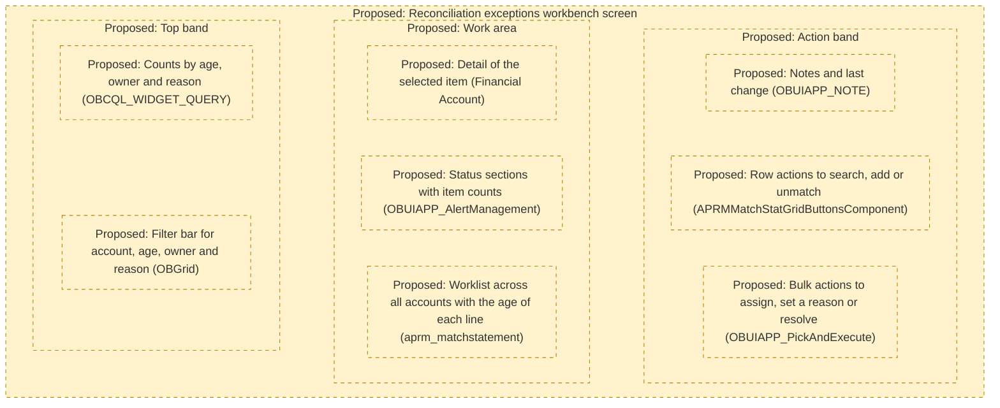
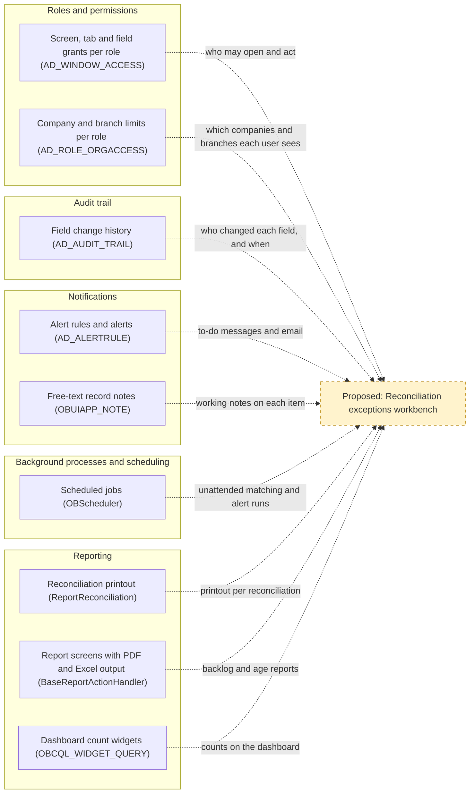
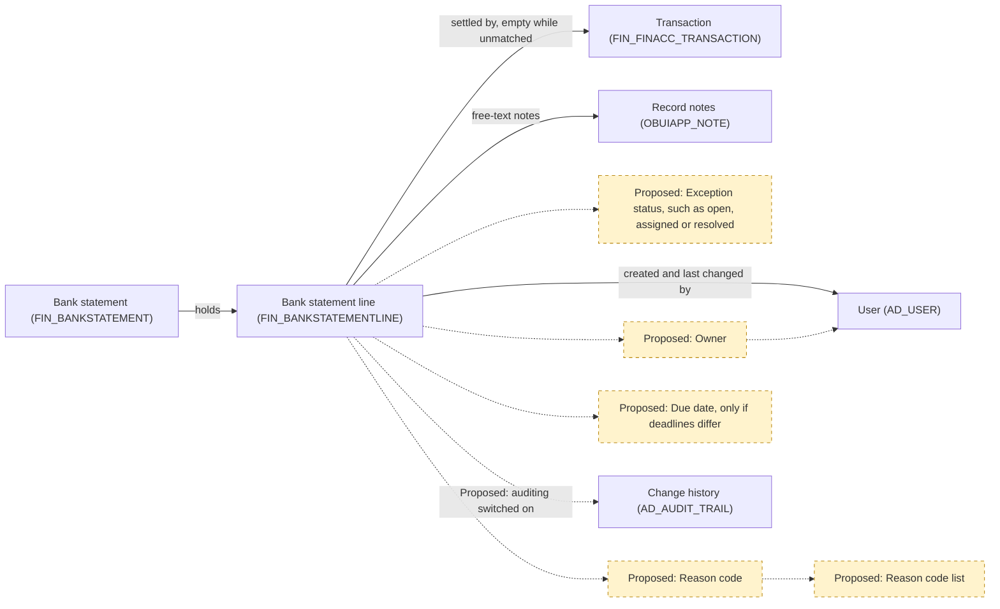
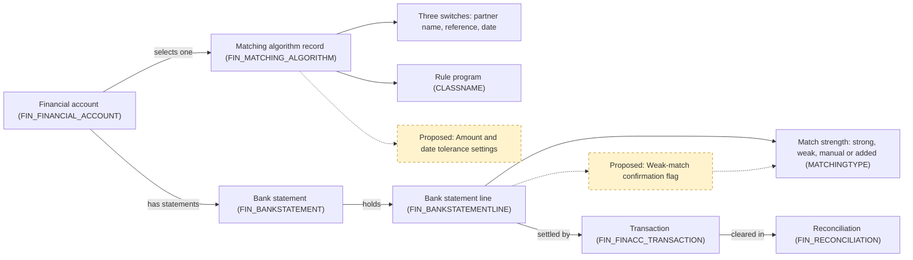
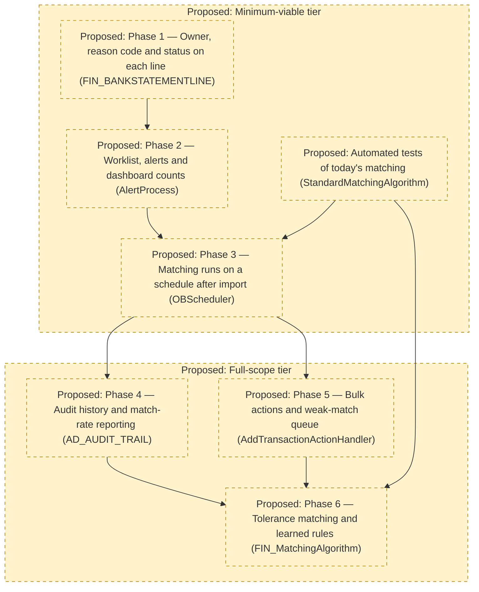

# Analysis 2: Extension Points, Reuse, and Risks for a Reconciliation Exceptions Workbench

## Key Takeaways

- Copy standard screens and pop-up grids such as `Match Statement`, not hand-built pages.
- Permissions, notifications and scheduled jobs (`AD_ROLE`, `AD_ALERT`, `OBScheduler`) are reusable as is.
- Bank lines in `FIN_BANKSTATEMENTLINE` have no owner, reason or status field.
- Importing, linking bank lines and confirming bank balances lack automated tests (`MatchTransactionDao`).
- First build a cross-account worklist like `aprm_matchstatement`, exception fields and scheduled linking.

## 1. UI Framework and Patterns to Follow

**What this section tells you:** The workbench can be built mostly from screen patterns the ERP generates from stored settings, so filtering, permissions and notes need no custom code. Three existing screens (Section 1.3 of this document) already do most of the job, and Figure S1.1 sketches a proposed screen built from them.

The workbench serves one objective: "reduce manual effort and cycle time in bank reconciliation. Most statement lines are matched without human touch, and every unmatched item has an owner, age, and reason code."

In this ERP (enterprise resource planning, the business software that keeps the company's accounts), a financial account (`FIN_FINANCIAL_ACCOUNT`) is the ERP record for one bank account, and a transaction (`FIN_FINACC_TRANSACTION`) is the ERP's record of money expected in or out of a financial account. A statement line (`FIN_BANKSTATEMENTLINE`) is one entry on the statement the bank sends, and matching links it to the transaction it settles. A reconciliation (`FIN_RECONCILIATION`) is the period document confirming the ERP balance agrees with the bank; a reason code records why an item is unmatched.

### 1.1 Technology Baseline

- **Server:** Java (the server's programming language), version 11 or later as `build.xml` enforces, built with Apache Ant (a build tool), version 1.9.2 or later.
- **Screens:** JavaScript (the browser's programming language) on Isomorphic SmartClient (a library of browser grids, meaning spreadsheet-like lists of records, and forms), release v10.0d, bundled in `modules/org.openbravo.userinterface.smartclient`. Each screen is described in the Application Dictionary (the metadata that defines screens, tables and processes: stored records, not code), for example `AD_WINDOW`, `AD_TAB`, `AD_FIELD` and `OBUIAPP_PROCESS`.
- **Data:** PostgreSQL (the database), with each table's structure kept as XML (structured text) files under `src-db/database/model` and in each module's (a separately packaged part of the ERP) own database folder.
- **Java tests:** JUnit 4.13.2 (a Java test framework) and Mockito 4.11.0 (a tool that fakes other program parts in tests), both in `lib/test`, with tests in `src-test/src` and in module folders such as `modules/org.openbravo.client.application/src-test`.
- **Test runs:** `src-test/build.xml` runs two test suites (named bundles of tests): `run.all.tests` runs `StandaloneTestSuite`, `run.webservice.tests` runs `WebserviceTestSuite`, and `run.test` runs any single test, including those in neither suite.
- **User-interface tests:** Jest 29.7 (a JavaScript test runner), declared in `package.json`, runs three utility test files in `modules/org.openbravo.client.application/web-test`. `ViewGeneration`, in `StandaloneTestSuite`, only checks that screen definitions generate without errors. No test clicks through a screen, so new workbench screens start without automated screen-interaction tests.

### 1.2 Patterns for Windows, Views and Dashboards

Every pattern below is stored as Application Dictionary records, which the server turns into a browser screen when a user opens it (`StandardWindowComponent`, `ParameterWindowComponent`). A workbench built this way is mostly new records and server actions, not page code, so it is quicker to build and behaves like `Financial Account`. Appendix [Section 1 detail] lists the records behind each pattern.

| Pattern | Workbench use | Example in the code | Limit for the workbench |
|---------|---------------|---------------------|-------------------------|
| Standard window (a data-entry screen with a header and sub-tabs) defined in the Application Dictionary | Exception records with their owner, reason and status | `Financial Account` window | Each tab shows one table beneath its parent tab (`AD_TAB`), so it suits editing one exception, not a list joining lines, accounts and transactions |
| Process definition, Pick and Execute (a pop-up grid where the user selects rows and runs an action) | Bulk assign, set reason, resolve | `Match Statement` (`OBUIAPP_PickAndExecute`), built on `BaseProcessActionHandler` | It sits over the window that opened it, built for one task; `Match Statement` hides its Cancel and Close buttons to keep users in it (`modules/org.openbravo.advpaymentmngt/web/org.openbravo.advpaymentmngt/js/ob-aprm-matchStatement.js`), a workaround a worklist should avoid |
| HQL-based table (a read-only list built from a database query, a saved request that selects records) | One worklist across all financial accounts, showing age | `aprm_matchstatement`, the Match Statement grid | Being read-only (`HQLDataSourceService`), each change needs its own server action; its speed risk is in Section 4 of this document |
| Manual view (a custom-built screen registered in the Application Dictionary) | Only if a bespoke layout is needed | `OBUIAPP_AlertManagement` | Hand-written JavaScript (`modules/org.openbravo.client.application/web/org.openbravo.client.application/js/alert-management/ob-alert-management-view.js`), so it has only the features its own code builds |
| Workspace and Query/List widgets (small panels on the Workspace dashboard, the latter showing a query's result) | Counts by age, owner and reason | `OBKMO_WIDGET_CLASS`, `OBCQL_WIDGET_QUERY` | Display only (`QueryListDataSource`), though a column can total or open a window tab (`OBCQL_QUERY_COLUMN`), as the shipped `Payment In - awaiting for execution` widget does |
| Classic servlet (an older, hand-coded web page) | Avoid for new work; see Analysis 1, Section 1.2 and Analysis 1, Section 2 | `ImportBankFile`, `Reconciliation` | Each page has its own hand-written template (`XmlDocument`), so none of the behaviour below applies |

Screens defined in the Application Dictionary get filtering and grid behaviour from the shared grid `OBGrid`, and role-based access (a role is a named set of screen and process permissions) through `AD_WINDOW_ACCESS` and `OBUIAPP_PROCESS_ACCESS`, without custom code. Servlets built on `HttpSecureAppServlet` need every page written by hand, which makes them slower to build and harder to keep consistent.

| Built-in behaviour | Where it comes from | What it gives the workbench |
|--------------------|---------------------|-----------------------------|
| Column filters and sorting | `OBGrid`, shared by window, pop-up and `OBUIAPP_AlertManagement` grids (`OBPickAndExecuteGrid`, `OBAlertGrid`) | Any worklist column, such as account or age, can be filtered without new code |
| Saved views (a user's stored columns and filters) and spreadsheet export | Standard windows (`OBUIAPP_UIPERSONALIZATION`, `OBUIAPP_ExportGrid`) | Each owner keeps a view of their own items; a supervisor can export the list |
| Notes, attachments and linked items, plus who created and last changed each record | Standard window forms (`OBViewFieldHandler`, `OBUIAPP_NOTE`, `OBAuditSectionItem`) | Free-text explanations; a structured reason code still needs a field (Section 3 of this document) |
| Buttons and fields shown only when they apply | Per-field display rules (`AD_FIELD`), as on the `Financial Account` buttons | A resolve action can appear only on open items |
| Permissions per role | Each pattern's own grant (Appendix [Section 1 detail]); a pop-up opened from a window button follows that window's grant unless set otherwise (`BaseProcessActionHandler`) | Only granted roles see the workbench (role grants: Section 2 of this document) |

Custom work remains for reconciliation-specific behaviour: Match Statement's Search, Add and Unmatch row buttons are hand-written (`APRMMatchStatGridButtonsComponent`), and an HQL-based table filtered by the screen that opens it needs a small code filter (`HqlQueryTransformer`).

### 1.3 Existing Screens the Workbench Should Mirror

Three existing screens each do part of the workbench's job, so copying their layout and actions shortens the build. Two are screens today's reconciliation runs through (Analysis 1, Section 1.2), so mirroring them keeps the workbench close to today's flow.

| Screen | What it does today | Why the workbench should mirror it | What not to copy |
|--------|--------------------|------------------------------------|------------------|
| `Match Statement`, a process definition opened from `Financial Account` | Lists one account's processed statement lines beside their matched transactions, showing how each was matched and whether it is cleared, meaning counted as agreed with the bank (`aprm_matchstatement`). Rows have Search, Add and Unmatch buttons, ticked rows can be unmatched together (`UnMatchSelectedTransactionsActionHandler`), and Reconcile completes the period (`MatchStatementActionHandler`) | It shows the workbench's records and every way of resolving them, so the workbench can reuse its server actions and keep the same buttons. Its grid is the HQL-based table a cross-account worklist needs | Its query covers one account and only lines unmatched or in its draft (unfinished) reconciliation (`MatchStatementTransformer`); its prompt and instant saving are limits in Analysis 1, Section 3.3 |
| `OBUIAPP_AlertManagement`, the manual view users open as `Alert Management` | Lists alerts (system-generated to-do messages sent to a user or role) for the signed-in user, or their role when no user is named (`ADAlertDatasourceService`). Sections New, Acknowledged, Suppressed and Solved each show a count; users move ticked items between them, add a note and open the record concerned (`OBAlertGrid`) | It is the closest existing screen to an exceptions worklist: a personal queue, status groups with counts, bulk status changes, notes and a link to the source. Its layout puts each item's owner at the centre, as the objective's owner element needs | Its four statuses are fixed in code, with no reason code and no way to reassign an item (fields needed are in Section 3 of this document). Copy its layout in a generated window or pop-up, not its code |
| `Financial Account`, a standard window | Shows each account with tabs for its transactions, imported statements and their lines, and reconciliations (`Imported Bank Statements`, `Bank Statement Lines`, `Reconciliations`). Its buttons start Import Statement, Match Statement and manual Reconcile (`EM_APRM_IMPORTBANKFILE`, `EM_APRM_MATCHTRANSACTIONS`, `EM_APRM_RECONCILE`) | As a generated window it gives every record a form with notes, attachments, saved views and filters (Section 1.2 of this document), as an exception record needs. Its buttons show how to launch an action from the record it affects | Statement lines sit two tab levels below the account (`AD_TAB`), so finding every unmatched line means opening each account and statement. Import Statement and manual Reconcile open classic servlet pages (Section 1.2 of this document) |

Together they cover resolving lines (`Match Statement`), tracking status per owner (`OBUIAPP_AlertManagement`) and editing one exception record (`Financial Account`); Figure S1.1 combines them.

### 1.4 Proposed Workbench Screen Layout

Figure S1.1 is a wireframe (a rough sketch of where things sit on a screen) of one possible workbench screen. Every area is proposed and copies the pattern or screen in parentheses from Sections 1.2 and 1.3 of this document; it implies no field names or data.

**Figure S1.1. Proposed Workbench Screen Layout**

**How to read this:** Each dashed box is a proposed screen area, top to bottom as a user would see it, with the existing pattern or screen it copies in parentheses.

| Proposed area | Copies | Why it serves the objective |
|---------------|--------|-----------------------------|
| Filter bar | `OBGrid` filters and saved views (`OBUIAPP_UIPERSONALIZATION`) | Each owner opens straight onto their own items |
| Counts | A Query/List widget (`OBCQL_WIDGET_QUERY`) | Shows where items pile up by age, owner and reason |
| Status sections | The status layout of `OBUIAPP_AlertManagement` | Keeps every item visible until it is resolved |
| Worklist across all accounts | An HQL-based table like `aprm_matchstatement`, without its one-account filter | Replaces opening accounts one by one, and shows each line's age |
| Detail of the selected item | A standard window form, as in `Financial Account` | Edits one item's owner, reason and status, once added (Section 3 of this document) |
| Row actions | Match Statement row buttons (`APRMMatchStatGridButtonsComponent`) | Keeps today's Search, Add and Unmatch actions |
| Bulk actions | A Pick and Execute pop-up (`OBUIAPP_PickAndExecute`) | Handles many items in one step and reports the outcome (`ResponseActionsBuilder`) |
| Notes and last change | Form notes and change details (`OBUIAPP_NOTE`, `OBAuditSectionItem`) | Records why an item is open and who touched it last |

Section 5.1 of this document rates the worklist, exception fields and counts widget as minimum-viable. How many items the worklist would hold, and so how fast it would load, is not determinable from code; its speed risk is in Section 4 of this document.

### Supporting Detail for Appendix (Section 1)

Records behind each Section 1.2 pattern and its role grant.

| Pattern | Stored in | Permission granted in |
|---------|-----------|-----------------------|
| Standard window | `AD_WINDOW`, `AD_TAB`, `AD_FIELD` and the table's `AD_COLUMN` records | `AD_WINDOW_ACCESS` |
| Process definition, Pick and Execute | `OBUIAPP_PROCESS`, its `OBUIAPP_PARAMETER` records and the grid window it shows (`OBUIAPP_REF_WINDOW`) | `OBUIAPP_PROCESS_ACCESS`, or the opening window's grant |
| HQL-based table | An `AD_TABLE` record holding the query (`HQLQUERY`), with an optional `HqlQueryTransformer` | Read access to the list, checked on each fetch (`HQLDataSourceService`) |
| Manual view | An `OBUIAPP_VIEW_IMPL` record naming hand-written JavaScript | `OBUIAPP_VIEW_ROLE_ACCESS` |
| Workspace and Query/List widgets | `OBKMO_WIDGET_CLASS`, plus `OBCQL_WIDGET_QUERY` and `OBCQL_QUERY_COLUMN` for Query/List; each user's placed widgets (`OBKMO_WIDGET_INSTANCE`) are installation data, not determinable from code | `OBKMO_WIDGET_CLASS_ACCESS` |
| Classic servlet | An `AD_PROCESS` record linked to its Java class through `AD_MODEL_OBJECT`, plus a hand-written page template such as `modules/org.openbravo.advpaymentmngt/src/org/openbravo/advpaymentmngt/ad_actionbutton/ImportBankFile.html` | `AD_PROCESS_ACCESS`, checked on each page request (`HttpSecureAppServlet`) |

**Requirement implications:** Requirements should specify generated windows, Pick and Execute pop-ups, an HQL-based cross-account list and a counts widget modelled on the screens in Section 1.3 of this document, and exclude classic servlets.

## 2. Reusable Components

**What this section tells you:** The workbench needs no new platform services: permissions, change history, alerts, scheduled jobs and reports already exist and are set up through records rather than new code. Each one has limits that turn into requirements, the largest being that nothing in the platform assigns a record to a person, so ownership must come from new data. Section 2.2 of this document rates each component and gives the reason, and Figure S2.1 shows how the five would feed the workbench.

Reuse fit is High when the component meets the workbench need through configuration or new records only, Medium when it exists but must be switched on or extended, and Low when it would need replacing.

### 2.1 What Exists Today

Each row names the parts a workbench can reuse without building them again; whether tests protect them is stated in Section 4 of this document, and field-level detail is in Appendix [Section 2 detail].

| Component | What exists |
|-----------|-------------|
| Roles and permissions | Each role is granted windows, processes and process definitions as editable or view-only (`AD_WINDOW_ACCESS`, `AD_PROCESS_ACCESS`, `OBUIAPP_PROCESS_ACCESS`), single tabs and fields can be made view-only inside a window grant (`AD_TAB_ACCESS`, `AD_FIELD_ACCESS`), and role inheritance (one role taking over another's grants) is handled by `RoleInheritanceManager`. The standard Finance role in `modules/org.openbravo.v3.datasets` holds the reconciliation windows (Financial Account to edit; Bank File Format and Matching Algorithm to view only) and processes (Reconciliation Details, Reconcile, Import Statement, Reconciliation Summary). Roles are also granted organizations (companies or branches) in `AD_ROLE_ORGACCESS`, limiting which records they see, and people receive roles in `AD_USER_ROLES`. A pop-up process opened from a window button inherits that window's grant unless it demands its own (`IS_EXPLICIT_ACCESS`, or the `SecuredProcess` preference, a stored setting), as `BaseProcessActionHandler` checks. |
| Audit trail | An audit trail (a log of who changed which field, and when) is kept in `AD_AUDIT_TRAIL`, which stores for each change the user, time, action, field, old and new value and the process that made it. It is shown in the `Audit Trail` window and per record by `AuditTrailPopup`. It is switched on table by table (`ISFULLYAUDITED`) and off by default, and single fields can be left out (`ISEXCLUDEAUDIT`). Reconciliation tables such as `FIN_BANKSTATEMENTLINE` already record who created and last changed each row, and when (`CREATED`, `UPDATED`). |
| Notifications | Alerts (system-generated to-do messages sent to a user or role) come from rules written as database queries (`AD_ALERTRULE`) and carry a status, user, role and note (`AD_ALERT`), with recipients and optional email set per rule (`AD_ALERTRECIPIENT`). `AlertProcess`, scheduled in the core setup data, raises one alert per new item and closes it once the rule stops returning that item, so an alert on an unmatched line would clear itself when the line is matched. Users acknowledge or suppress alerts in the Alert Management view (`OBUIAPP_AlertManagement`), and a rule can name the screen tab its alerts open (`AD_TAB_ID` on `AD_ALERTRULE`). A WebSocket (live browser connection) client, `MessageClientManager`, and free-text record notes, `OBUIAPP_NOTE`, also exist. |
| Background processes and scheduling | Background processes (jobs the system runs on a schedule without a user) run on a scheduler built on Quartz (a library that starts jobs at set times), `OBScheduler`, through process requests (saved schedules for one job) in `AD_PROCESS_REQUEST`, set in the `Process Request` window, each run logged in `AD_PROCESS_RUN`, reviewed in `Process Monitor`. Process groups (saved chains of jobs run in order, `AD_PROCESS_GROUP`) let one schedule run several jobs, and a job can be barred from running twice at once (`PREVENTCONCURRENT`). `FIN_BankStatementProcess` and `FIN_ReconciliationProcess` are already written in the form the scheduler runs. Automatic matching, however, sits inside a screen action, `MatchStatementOnLoadActionHandler`, so it must be moved out before it can run without a user. |
| Reporting | The printable reconciliation report, `ReportReconciliation`, lists outstanding payments, outstanding deposits and unreconciled statement lines, and is launched by the Reconciliation Details and Reconciliation Summary processes. Newer reports run as process definitions through `BaseReportActionHandler`, with layouts for PDF, Excel and web-page output linked in `OBUIAPP_REPORT`. Query/List widgets (`OBCQL_WIDGET_QUERY`) can show counts, their columns can open the record behind a row (`OBCQL_QUERY_COLUMN`), and each widget is granted per role (`OBKMO_WIDGET_CLASS_ACCESS`). |

### 2.2 Limits, Gaps and Fit

| Component | Limits and gaps | Reuse fit (High/Medium/Low) | Fit rationale |
|-----------|-----------------|-----------------------------|---------------|
| Roles and permissions | Grants open whole windows, tabs, fields and organizations, but no grant assigns records an owner: no reconciliation table has a field assigning a user or role (`FIN_BANKSTATEMENTLINE`, `FIN_FINANCIAL_ACCOUNT`), only who created or last changed a row, so ownership must come from the data. Organization grants (`AD_ROLE_ORGACCESS`) split work by company or branch, not by bank account or team. None of the standard roles in `modules/org.openbravo.v3.datasets/referencedata/standard/V3_Roles.xml` holds the `Alert`, `Process Request` or `Process Monitor` windows, and only Company Admin holds `Audit Trail`, so Finance staff need new grants before they can set up alerts and schedules or read change history. Which people hold the Finance role, and so who could own items, is installation data (`AD_USER_ROLES`) and not determinable from code. | High | Every workbench screen and action can be secured by adding grants, which is configuration only, so the fit is High. The objective's owner for every unmatched item is a data need, met by the owner field in Section 3 of this document, not a change to the permission model. Keeping access in these tables lets role inheritance (`RoleInheritanceManager`) pass workbench grants to every role built on Finance. |
| Audit trail | Switching auditing on for a table takes effect only after the system is rebuilt and the server restarted (`RegenerateAudit`, raised by `SL_TableAudit`), so it is a planned release step, not a setting users change. The log records what changed, by whom and when, but not why, so it cannot stand in for a reason code. Time spent in each status would have to be worked out from log entries (`EVENT_TIME` in `AD_AUDIT_TRAIL`) rather than read from a field. | Medium (see the note below the table) | The history store and its screens exist, but auditing must be switched on for the new exception fields, which is the switched-on case of the fit basis, so the fit is Medium. Once on, it shows who assigned, reassigned or closed each unmatched item, which supports owner accountability without new code (`AD_AUDIT_TRAIL`). |
| Notifications | The core setup runs `AlertProcess` once a day, just before midnight (`src-db/database/sourcedata/referencedData/AD_PROCESS_REQUEST.xml`), so a new unmatched line could wait up to a day for its alert unless that schedule is changed. Who sees an alert is set by the rule's recipients, one user or a whole role (`AD_ALERTRECIPIENT`), not by the user the rule's query returns, so showing each owner only their own items needs a rule filter on the signed-in user (`FILTERCLAUSE`) or one rule per owner. Each item raises one alert until it is solved, with no reminder or escalation as it ages, and email goes out only when an email server is configured (`EmailServerConfiguration`). The live message client is off unless the `OBUIAPP_Enable_Message_Manager` preference is switched on, and the repository defines no message for it to send (`MessageHandler`). | High | Aging and unassigned-item alerts need only new rule and recipient records, the configuration-only case of the fit basis, so the fit is High. Because `AlertProcess` closes an alert once its item no longer qualifies, alerts follow the unmatched backlog without anyone clearing them. The daily run and role-wide visibility are settings to plan, not reasons to replace the component. |
| Background processes and scheduling | Schedules are time-based only, from every few seconds to monthly or by calendar rule (`Frequency`), so matching after each import means either a frequent schedule or starting the job when the import finishes. The statement and reconciliation processes act on one record passed in by a button (`FIN_Bankstatement_ID`, `FIN_Reconciliation_ID`), so a scheduled run still needs a job that picks which statements to handle. Matching also needs the account's draft reconciliation, which today only the Match Statement screen action creates (`MatchStatementOnLoadActionHandler`). The bar on running twice at once stops only a second copy of the same job for the same organization, not a clash with users editing the same lines (`ProcessMonitor`). | High | The scheduler, its run log and its monitor need no change, since scheduling a new job takes only process and process request records (`AD_PROCESS_REQUEST`), so the fit is High. Building that job means moving matching out of the screen action, which Section 5 of this document sizes as effort rather than as a reuse gap. Scheduled matching is what lets lines match without human touch between an import and the next user session (Analysis 1, Section 5, item 5). |
| Reporting | The reconciliation report is an older, hand-coded page (`ReportReconciliation`, built on `HttpSecureAppServlet`) that prints one reconciliation of one account as a PDF, so it cannot show the backlog across accounts. No report breaks unmatched lines down by age, owner or reason, and no reconciliation widget or report definition ships in `modules/org.openbravo.advpaymentmngt`. A statement line keeps how it was matched (`MATCHINGTYPE`) but not when, since `FIN_BANKSTATEMENTLINE` holds only its bank date and its creation and last-change times, so a report can count the share of lines matched by the algorithm but can measure time to match only from the audit trail once it is switched on. | Medium | Dashboard counts and new report screens can be built on existing patterns (`OBCQL_WIDGET_QUERY`, `BaseReportActionHandler`), but each needs new queries and layouts, the extended case of the fit basis, so the fit is Medium. The existing printout stays useful per reconciliation but measures neither the objective's share of lines matched without human touch nor the age of open items. |

**Unconfirmed:** whether reconciliation tables are audited today, because auditing is switched on table by table in each installation and is off by default (consulted `AD_TABLE`, `ISFULLYAUDITED`, `AD_AUDIT_TRAIL`).

### 2.3 How the Components Feed the Workbench

Figure S2.1 maps each existing component to what it would supply: grants (`AD_WINDOW_ACCESS`, `AD_ROLE_ORGACCESS`) decide who may open and act, the audit trail and record notes (`AD_AUDIT_TRAIL`, `OBUIAPP_NOTE`) keep the history of each item, and alerts and scheduled jobs (`AD_ALERTRULE`, `OBScheduler`) keep work moving without a user. Reports and widgets (`ReportReconciliation`, `BaseReportActionHandler`, `OBCQL_WIDGET_QUERY`) would then show the backlog and its age. Only the workbench itself is new, which is why the effort sizes in Section 5 of this document assume these parts are reused rather than rebuilt.

**Figure S2.1. Existing Components Feeding the Proposed Workbench**

**How to read this:** Solid boxes exist in the code today and are grouped by the five components of Section 2.1 of this document, dashed boxes are proposed, and each dotted arrow names what a component would supply to the workbench.

### Supporting Detail for Appendix (Section 2)

| Topic | Detail |
|-------|--------|
| How Finance reaches pop-up processes | The Finance role's only process-definition grant is for an unrelated order process (`modules/org.openbravo.v3.datasets/referencedata/standard/V3_Roles.xml`). It can still run `Match Statement`, because that pop-up opens from a Financial Account button (`EM_APRM_MatchTransactions`) and inherits the window grant (`BaseProcessActionHandler`), so workbench pop-ups opened from a granted window need no grants of their own. |
| What one audit entry holds | Table, record, user, time, action (insert, update or delete), field, old and new value, and the kind of process and the process that made the change (`AD_AUDIT_TRAIL`). Inserts can be left out of the log table by table (`ISAUDITINSERTS`). |
| Alert lifecycle | An alert starts as New when `AlertProcess` raises it, a user moves it to Acknowledged or Suppressed and back to New in the Alert Management view (`modules/org.openbravo.client.application/web/org.openbravo.client.application/js/alert-management/ob-alert-grid.js`), and `AlertProcess` marks it Solved once the rule stops returning its item. A rule whose query does not start with a select, or fails, is skipped and noted only in the job's run log (`AlertSelectConstraint`, `AD_PROCESS_RUN`), so a broken rule fails silently for users. Email from one run lists every new alert of the rule and goes to each recipient user, or to every user of a recipient role (`AD_ALERTRECIPIENT`). |
| Scheduling options and run log | A process request can run now, later, or repeat every chosen number of seconds, minutes, hours, days, weeks or months, or follow a calendar rule (`Frequency`, `AD_PROCESS_REQUEST`). Each run records its status, start and end time, duration, result and log text (`AD_PROCESS_RUN`), and a process group can stop at its first failing job (`STOPWHENFAIL` on `AD_PROCESS_GROUP`). |
| Report output formats | Report screens built on `BaseReportActionHandler` export to PDF, Excel or a web page and refuse other formats (`OBUIAPP_UnsupportedAction`), while the reconciliation printout is produced only as a PDF (`ReportReconciliation`). |

**Requirement implications:** Requirements should reuse these five components as they stand and specify only what they lack: an owner field that drives personal work lists and alert targeting, auditing switched on for the exception fields, an unattended matching job, and backlog reports by age, owner and reason.

## 3. Data Model: Required Changes vs Current Support

**What this section tells you:** The database already records whether a statement line is matched, how old it is and who last touched it, but not who owns an unmatched item, why it is open or where its resolution stands. This section pairs each workbench need with what the data holds today, gives each change's reason and its effect on stored lines, and shows the entities in Figure S3.1 and Figure S3.2.

Analysis 1, Section 4.3 identifies the gaps in the schema (the database structure), and this section does not restate them. The first table pairs each need with current support, mostly in `FIN_BANKSTATEMENTLINE`; the second gives each required change's rationale and downstream impact on existing data. Section 3.1 of this document covers shared effects, Section 3.2 of this document the entities, and Appendix [Section 3 detail] every line column.

| Current schema already supports | Change required |
|---------------------------------|-----------------|
| Unmatched state: a line in `FIN_BANKSTATEMENTLINE` with an empty `FIN_FINACC_TRANSACTION_ID` | An explicit exception status, for example open, assigned or resolved |
| Age, derived from the bank date `DATETRX` or the record creation time `CREATED` | None; age is calculated, not stored |
| Who created or last changed a line (`CREATEDBY`, `UPDATEDBY`) | An owner (a user) for each unmatched item |
| Free text in `DESCRIPTION` | A list of reason codes and a reason on each item |
| Age-based deadlines inside an alert rule's query (`AD_ALERTRULE`); `FIN_BANKSTATEMENTLINE` has no due date | A due date on each item, needed only if deadlines differ by item |
| Match strength in `MATCHINGTYPE`: AU strong (found by the algorithm's primary rules), AP weak (found only by its looser fallback rules), MA matched by hand, and AD linked to a transaction added by hand; plus what the line was matched against in `MATCHED_DOCUMENT` | A confirmation flag, needed only for the weak-match queue in Section 5.2 of this document |
| Record notes (`OBUIAPP_NOTE`) and change history (`AD_AUDIT_TRAIL`) | Auditing switched on for the new fields |
| Three on/off switches and a pluggable rule program (`CLASSNAME`) in `FIN_MATCHING_ALGORITHM`, the matching algorithm record (a saved set of matching rules that one or more financial accounts use) | Amount and date tolerance settings (how far amounts and dates may differ and still match), needed only for tolerance matching in Section 5.2 of this document |
| A trigger (a database rule run on every change), `APRM_FIN_BNKSTM_LINE_CHECK_TRG`, which locks only the original bank fields once a statement is processed | None; new exception fields stay editable after processing |

| Change required | Rationale | Downstream impact on existing data |
|-----------------|-----------|------------------------------------|
| Exception status | An empty link cannot tell an unexamined line from one being worked on or knowingly left open, so no worklist can separate them. Values that program logic acts on fit a reference list (a fixed list of allowed values kept in the Application Dictionary), like `FIN_Matching Type` for match strength. Matching, unmatching, splitting and merging (`APRM_MatchingUtility`) must update it, or status and link will disagree. | Existing lines start with no status. A backfill (filling a new field for rows that already exist) can set open or resolved from `FIN_FINACC_TRANSACTION_ID`, so carried-forward lines become open items keeping their original age. How many existing lines are open is not determinable from code. |
| None for age | A stored age would go stale daily; age worked out from `DATETRX` or `CREATED`, which every line must carry, is always current. Which date counts is a requirement choice: time since the money moved, or since the ERP knew of it. | None: existing lines carry both dates, and a split part keeps the bank date because the split copies the whole line (`DalUtil.copy`). |
| Owner | `CREATEDBY` names whoever imported or keyed the line and `UPDATEDBY` whoever last saved it, a matching run included (`OBInterceptor`), so neither says who must resolve it. An owner linked to a user (`AD_USER`) gives alert rules a user to filter on, so each owner can see only their own items (`FILTERCLAUSE`, Section 2.2 of this document). | Existing lines start with no owner, and the creator, whoever ran the import (`FIN_BankStatementImport`), is no substitute. A backfill needs an assignment rule, for example by financial account, a business decision the code does not settle. |
| Reason codes and a reason on each item | Free text in `DESCRIPTION` cannot be counted or filtered reliably, so reasons can neither be reported nor used to route work. Company-defined codes fit a list kept in a standard window, like the partner-guessing exclusion words in `FIN_BANKFILE_EXCEPTION`; codes that program logic acts on fit a reference list. | Existing lines start with no reason. Descriptions hold whatever users or bank-specific importers entered (`FIN_BankStatementImport` fills none), so they cannot become codes automatically, and whether they hold reasons at all is not determinable from code. |
| Due date | Analysis 1, Section 4.3 lists it as missing, but the objective asks only for age. One deadline for all items can be an alert rule comparing age with a limit (`AD_ALERTRULE`), so a stored date pays off only if deadlines differ by item. | Existing lines start with none; a backfill can derive one from `DATETRX` under the chosen deadline policy, which is not determinable from code. |
| Confirmation flag | Weak matches are applied with no one confirming them (`MatchStatementOnLoadActionHandler`), and `FIN_Matching Type` even labels the weak level "Approved", so the data cannot show which a person has checked. The flag records that check for the weak-match queue in Section 5.2 of this document. | Every existing weak match starts unconfirmed, even those in a completed reconciliation (`FIN_RECONCILIATION_ID` on `FIN_FINACC_TRANSACTION`), so a backfill should confirm them or the queue cover only draft reconciliations. Unmatching clears match strength (`APRM_MatchingUtility`) and must clear the flag too. |
| Auditing switched on for the new fields | History proves who changed an owner, reason or status, and when. Auditing is switched on per table, with single fields left out (Section 2 of this document), so covering only the new fields means auditing all of `FIN_BANKSTATEMENTLINE` and leaving out every other column. | History starts only once auditing takes effect (Section 2 of this document), so past changes to existing lines stay unrecorded. Each change writes one row per changed column (`ad_create_audit_triggers`) and inserts are logged by default (`ISAUDITINSERTS`), so imports add history unless that is off or bank columns are left out; volume is not determinable from code. |
| Amount and date tolerance settings | The record holds only exact criteria, so a line differing at all in amount, or in date while the date switch is on, never matches automatically (Analysis 1, Section 3.3). The settings belong here because each financial account already selects one record (`FIN_MATCHING_ALGORITHM_ID` on `FIN_FINANCIAL_ACCOUNT`). | Existing records, including the shipped `Standard` record (`modules/org.openbravo.advpaymentmngt/referencedata/standard/Standard_Algorithm.xml`), start empty, which must mean no tolerance so matching is unchanged. A value on a shared record changes every account using it (Analysis 1, Section 3.2), and `StandardMatchingAlgorithm` ignores the settings until new matching logic reads them. |
| None for the processing lock | The trigger rejects edits only to the bank's own fields, such as date, amounts and reference (`APRM_FIN_BNKSTM_LINE_CHECK_TRG`; full list in Appendix [Section 3 detail]), so new fields stay editable on processed statements and matched lines. | None for updates, so a backfill can run on processed statements. The trigger does block adding or deleting lines on a processed statement and deleting a matched line (`APRM_BSTLine_Matched`), so the workbench edits lines but never creates or removes them. |

### 3.1 Effects Shared by Every New Line Field

- **Importers:** bank-specific importers build lines through `loadFile`, `FIN_BankStatementImport` saves them and processing follows at once (`FIN_AddPayment`), so new fields must be optional or have defaults, or every installed importer would need changing; which importers are installed is not determinable from code.
- **Split and merge:** a split copies the whole line, new fields included, into the unmatched remainder (`DalUtil.copy`), while a merge deletes the other unmatched parts (`APRM_MatchingUtility`), so values set only on those parts are lost unless the merge carries them over. Both briefly mark the statement unprocessed to pass the trigger, so the workbench should reuse them rather than change amounts itself.
- **Views and reports:** the views (saved queries the database presents as tables) `FIN_RECONCILIATIONLINE_V` and `APRM_RECONCILIATION_V` and the report template `modules/org.openbravo.advpaymentmngt/src/org/openbravo/advpaymentmngt/ad_reports/UnreconciledBankStatement.jrxml` name each column they read, so new fields neither break them nor appear in them until extended; Section 4 of this document covers the Match Statement grid.

### 3.2 Existing and Proposed Entities

Figure S3.1 shows the proposed exception fields beside the entities a statement line already links to, and Figure S3.2 the proposed tolerance settings and confirmation flag beside today's matching configuration. Both draw only links the schema defines, such as `FIN_BANKSTATEMENT_ID` on `FIN_BANKSTATEMENTLINE`.

**Figure S3.1. Exception Fields on the Statement Line: Existing and Proposed**

**How to read this:** Solid boxes and arrows are entities and links the schema holds today, while dashed yellow boxes and dashed arrows are proposed additions.

**Figure S3.2. Matching Settings and Weak-Match Confirmation: Existing and Proposed**

**How to read this:** Solid boxes are the matching configuration and match data stored today, and dashed yellow boxes are proposed additions linked to the entity that would hold them.

### Supporting Detail for Appendix (Section 3)

Every column of `FIN_BANKSTATEMENTLINE`, grouped by whether `APRM_FIN_BNKSTM_LINE_CHECK_TRG` locks it once the statement is processed:

| Columns | Plain meaning | Locked after processing |
|---------|---------------|-------------------------|
| `AD_ORG_ID`, `ISACTIVE`, `FIN_BANKSTATEMENT_ID`, `LINE` | Organization, active flag, statement, and line number (shared by split parts) | Yes |
| `BPARTNERNAME`, `DATETRX`, `CRAMOUNT`, `DRAMOUNT`, `REFERENCENO` | The bank's own data: partner name, date, money in, money out and reference | Yes |
| `FIN_BANKSTATEMENTLINE_ID`, `AD_CLIENT_ID`, `CREATED`, `CREATEDBY`, `UPDATED`, `UPDATEDBY` | The line's identifier, its client (the top-level company grouping that owns the data), and when and by whom it was entered and last saved | No |
| `C_BPARTNER_ID`, `C_GLITEM_ID` | Business partner or GL item (a general-ledger category for amounts with no invoice, such as bank fees), guessed at import or set by a user | No |
| `FIN_FINACC_TRANSACTION_ID`, `MATCHINGTYPE`, `MATCHED_DOCUMENT` | Link to the matched transaction, match strength, and what was matched: a transaction, payment, credit, invoice or order | No |
| `DESCRIPTION` | Free text | No |

**Requirement implications:** The workbench needs line fields for exception status, owner, reason code with its list, an optional due date and weak-match confirmation, plus tolerance settings on the matching algorithm record and auditing on statement lines, each with a rule for rows already stored; age and the processing lock need no change.

## 4. Integration Points and Regression Risks

**What this section tells you:** It lists where a workbench would plug into existing code or data, what could break and how badly, and whether a repository test would catch it. No area is fully tested: eight are partly covered and nine have no test, including import, matching and reconciliation completion. Each area ends with a suggested mitigation, a concrete step that lowers the risk.

An integration point is a place where the workbench connects to existing code, data or another module; a regression is a feature that worked before a change and fails after it. Coverage comes from searching the test folders for each area's classes and following helper code (shared code that several tests call), as Appendix [Section 4 detail] sets out. Only tests in `StandaloneTestSuite` or `WebserviceTestSuite` run when the project's test targets run (`run.all.tests`, `run.webservice.tests`); a test runnable only through `run.test` runs only when someone starts it by name.

**Severity basis:** High when a break could block reconciliation completion or posting (creating the accounting entries in the general ledger), or alter matched or accounting data; Medium when it blocks or degrades workbench or matching work without damaging posted data; Low when it affects only reporting, display or convenience.

**Coverage basis:** Tested when a repository test exercises the area's own reconciliation behaviour at risk, directly or through helper code; Partial when a test covers only part of that behaviour, or only the shared mechanism on another table or process; Untested when no file under `src-test/src`, `modules/org.openbravo.client.application/web-test` or a module's test folder refers to the area's classes. Each Partial cell names the test file, its suite or `run.test`, and what stays uncovered.

### 4.1 What Each Integration Point Connects

| Area | Integration point (what it connects) | What could break |
|------|--------------------------------------|------------------|
| Statement import | `ImportBankFile` and `FIN_BankStatementImport` turn the bank's file, read by an installed bank file format module (an add-on that reads one bank's file layout), into lines in `FIN_BANKSTATEMENTLINE` | New line fields must not break the format modules that create lines; a required field with no default would make every import fail |
| Statement processing | `FIN_BankStatementProcess` confirms a statement; `APRM_FIN_BNKSTM_LINE_CHECK_TRG` then locks the original bank fields, such as date and amounts, of processed or matched lines | Date checks and line locks can block exception updates that alter bank data or add or remove processed lines; a faulty lock change could block matching itself |
| Automatic matching | `StandardMatchingAlgorithm` and `MatchTransactionDao` link lines to transactions under the account's `FIN_MATCHING_ALGORITHM` record; see Analysis 1, Section 3 | Moving or changing matching alters which lines clear and can create wrong strong matches; editing a shared `FIN_MATCHING_ALGORITHM` record changes every account that uses it |
| Manual match, split, unmatch | `APRM_MatchingUtility` links, splits and merges lines, and unmatch deletes algorithm-created transactions and payments (Analysis 1, Section 4.2) | Splits, merges and deletion of algorithm-created records must keep exception data consistent: a split copies every field to the new part (`DalUtil`), so owner and reason would be duplicated, and a merge deletes parts with their data |
| Match Statement grid | `aprm_matchstatement`, the HQL-based table behind the `Match Statement` grid, from which `MatchStatementActionHandler` reconciles | Extra query columns can slow or break the grid, and a broken grid stops statement reconciliation |
| Reconciliation completion and balances | `FIN_ReconciliationProcess` completes once each cleared item's accounting period (a span open for bookings) is open (`APRM_PeriodNotAvailableClearedItem`); `FIN_ReconciliationEventListener` recalculates later balances when a reconciliation is deleted | Holding completion for open exceptions changes how later balances are recalculated |
| Posting | `DocFINReconciliation` writes a completed reconciliation's entries to `FACT_ACCT`, from the Post button or the background `AcctServerProcess` | Write-off (booking a small unexplained difference as an expense) or adjustment actions create entries that posting must handle; a wrong entry changes the books |
| Payments feeding candidates | `FIN_PaymentProcess` and `FIN_TransactionProcess` turn payments and transfers between accounts (`APRM_FUND_TRANSFER_REC`) into the transactions matching chooses from, when the payment method deposits or withdraws automatically | Payment status changes alter the transactions matching can choose from, and so its matches |
| Partner names | Business partner (customer or supplier) records (`C_BPARTNER`), kept outside the reconciliation module, feed the import's partner guess (`FIN_BankStatementImport`) and the name switch (`MatchTransactionDao`) | Partial-name or learned partner matching can pick the wrong partner, and so the wrong transaction |
| Adding missing transactions | `AddTransactionActionHandler` creates a bank-fee, GL item (a general-ledger category for amounts with no invoice, such as bank fees) or payment transaction for a line, processes it and links it with match strength `AD` | Bulk creation can duplicate bank-fee transactions or book them to the wrong GL item, and the entries then post |
| Roles and access | `AD_WINDOW_ACCESS` and `OBUIAPP_PROCESS_ACCESS` grant screens and process definitions to roles, including the Finance role in `modules/org.openbravo.v3.datasets/referencedata/standard/V3_Roles.xml` | New screens need grants for the Finance role; a missing grant hides the workbench, and an over-broad one lets other roles change exception data |
| Alerts | `AlertProcess` runs each `AD_ALERTRULE` query in turn, raises alerts and emails the recipients set in `AD_ALERTRECIPIENT` | Errors in a rule's query appear only when it runs; a slow rule delays every rule after it |
| Scheduling | `OBScheduler` and `ProcessRunner` run background processes from process requests (`AD_PROCESS_REQUEST`), as scheduled matching would | A scheduled matching run can collide with users editing the grid, since both save each match at once (`APRM_GRID_PERSIST_MESSAGE`) |
| Reporting | `ReportReconciliation` builds the reconciliation printout, including its unreconciled-lines part, from JasperReports (report-layout engine) templates | Template changes stop the report from building; new exception statuses change which lines that part should list |
| Audit trail | `ISFULLYAUDITED` switches on, table by table, generated triggers that write each changed field to `AD_AUDIT_TRAIL` | Auditing busy tables adds database write load, so auditing `FIN_BANKSTATEMENTLINE` slows import and matching |
| Record notes | `OBUIAPP_NOTE` attaches free-text notes to any record, statement lines included | A note does not follow its line, so a merge that deletes split parts leaves their notes pointing at nothing |
| Live browser messages | `MessageClientManager` pushes messages to users' open browsers over a WebSocket | A failed push leaves an owner unaware of a new item until the next alert or refresh |

### 4.2 Severity, Test Coverage and Mitigation

| Area | Severity | Test coverage | Suggested mitigation |
|------|----------|---------------|----------------------|
| Statement import | High | Untested: no test refers to `ImportBankFile` or `FIN_BankStatementImport`; how the outside format modules treat new fields is not determinable from code | Give new line fields defaults so format modules work unchanged. Add a regression test (one that re-checks existing behaviour after a change) importing a small file through a test-only importer, and re-test each installed format module |
| Statement processing | High | Untested: no test refers to `FIN_BankStatementProcess` or `APRM_FIN_BNKSTM_LINE_CHECK_TRG` | Keep exception fields out of the lock. Add regression tests that edit exception fields on a processed, matched line and confirm bank fields stay locked |
| Automatic matching | High | Untested: no test refers to `StandardMatchingAlgorithm`, `MatchTransactionDao` or `FIN_MatchingAlgorithm`; `FinancialAccountTest` creates accounts with no matching algorithm record | Before matching moves or changes, add regression tests that run each pass of Analysis 1, Section 3.1 on fixed sample lines. Pilot new rules on a new algorithm record chosen by one account, not by editing a shared record, and compare results on the same statements |
| Manual match, split, unmatch | High | Untested: no test refers to `APRM_MatchingUtility` or the grid's action handlers, such as `FindTransactionsToMatchActionHandler` | Define which exception fields a split part inherits and which survive a merge. Test split, merge and unmatch with those fields filled, including after posting |
| Match Statement grid | High | Partial: `src-test/src/org/openbravo/test/datasource/HQLDataSourceTest.java`, in `WebserviceTestSuite`, filters another HQL-based table, `Aprm_Credit_To_Use`; nothing tests `aprm_matchstatement`, its speed or the grid's screen code | Build the cross-account worklist as a new HQL-based table instead of adding columns to `aprm_matchstatement`. Add a test like `HQLDataSourceTest` for both, and time both on the largest account |
| Reconciliation completion and balances | High | Untested: no test refers to `FIN_ReconciliationProcess` or `FIN_ReconciliationEventListener` | Make any hold on completion for open exceptions a per-account setting, off by default. Add regression tests for completing, reactivating and deleting a reconciliation that check later balances |
| Posting | High | Partial: `src-test/src/org/openbravo/test/accounting/RecordID2Test.java`, in `StandaloneTestSuite`, reposts three sample reconciliations through the accounting engine, which runs `DocFINReconciliation`, and checks balances; new write-off or adjustment entries and the `AcctServerProcess` run are not covered | Add `RecordID2Test` cases that post a reconciliation holding a workbench-created fee or write-off. Try write-off on a test copy of the data before switching it on |
| Payments feeding candidates | High | Partial: `src-test/src/org/openbravo/test/cancelandreplace/CancelAndReplaceTestUtils.java`, helper of `CancelAndReplaceTest` in `StandaloneTestSuite`, processes payments through `FIN_PaymentProcess`. `src-test/src/org/openbravo/advpaymentmngt/test/TestUtility.java` does so for payment and payment-proposal tests such as `PaymentTest_01`, and `FundsTransferTest` checks transfer transactions, both runnable only through `run.test`. How matching uses the resulting transactions is not covered | Test that a payment whose method deposits automatically yields a matching candidate. Add the payment and transfer tests to `StandaloneTestSuite` so `run.all.tests` runs them |
| Partner names | High | Untested: no test refers to `FIN_BankStatementImport` or `MatchTransactionDao`, which hold partner guessing and name matching | Add regression tests with near-identical partner names for the import guess and the name switch. Apply partial or learned partner matches as weak matches first, for review in the weak-match queue (Section 5.2 of this document) |
| Adding missing transactions | High | Partial: `src-test/src/org/openbravo/advpaymentmngt/test/FundsTransferTest.java`, runnable only through `run.test`, processes bank-fee and GL item transactions through `FIN_TransactionProcess`, but for transfers; no test refers to `AddTransactionActionHandler`, so adding from a statement line is uncovered | Preview what a bulk action will create, with its GL item, before creating it. Add regression tests for bulk creation from statement lines followed by posting |
| Roles and access | Medium | Partial: `src-test/src/org/openbravo/test/role/inheritance/RoleInheritanceTestSuite.java` and `AccessLevelTest`, in `StandaloneTestSuite`, check how window, process-definition and alert-recipient grants pass between test roles and how access levels apply; Finance role grants for new screens are not covered | Ship the Finance role's workbench grants in the same dataset (packaged setup data) as the screens. Check that the Finance role can open each new screen and that a role without the grants cannot |
| Alerts | Medium | Untested: no test refers to `AlertProcess` or `EmailManager`; `DalLockingTest` uses an alert rule only to test record locking, and `SendEmailTest` checks a mail-server choice (`EmailUtils`) that `AlertProcess` does not use | Run each new rule's query on sample data before switching it on. Add a regression test that runs `AlertProcess` on a test rule and checks one alert per unmatched line, no repeat while it is open, and the email |
| Scheduling | High | Partial: `src-test/src/org/openbravo/scheduling/ProcessSchedulingTest.java` runs test-only jobs through `ProcessRunner`, and `TriggerProviderTest` and `MisfirePolicyTest` check start times and missed runs, all in `StandaloneTestSuite`; no test runs matching or a job alongside user edits | Have the job and the grid's saves take the platform's record lock (a hold that makes a second writer wait), tested by `DalLockingTest`, per account. Add a regression test running the job while a user matches the same account |
| Reporting | Low | Partial: `src-test/src/org/openbravo/test/reporting/AllJrxmlCompilation.java`, in `StandaloneTestSuite`, compiles every template, the four reconciliation ones included; no test runs `ReportReconciliation` or fills its templates | Report age, owner and reason in a new report rather than changing the printout. Add a test that fills the unreconciled-lines template from sample data |
| Audit trail | Medium | Untested: no test refers to `AD_AUDIT_TRAIL` or `AuditTrailPopup`; `ETagGeneration`, in `WebserviceTestSuite`, switches auditing on `C_ORDER` only to check that browsers reload a changed screen | Audit the line table with every column except the new exception fields excluded (`ISEXCLUDEAUDIT`). Time import and matching with auditing on before release |
| Record notes | Low | Partial: `src-test/src/org/openbravo/test/datasource/TestNoteDatasource.java`, in `WebserviceTestSuite`, adds, reads and removes a note on an order (`C_ORDER`); notes on statement lines and merges are not covered | Keep reasons in the coded reason field, not in notes. Move notes to the surviving line on merge, and extend the note test to statement lines |
| Live browser messages | Low | Untested: no test refers to `MessageClientManager` | Treat live messages as an extra on top of alerts. Test delivery to a connected test user before relying on them |

### Supporting Detail for Appendix (Section 4)

No module test folder mentions reconciliation, and the three JavaScript tests in `modules/org.openbravo.client.application/web-test` cover only shared date, number and web-address helpers, so the grid's screen code, `modules/org.openbravo.advpaymentmngt/web/org.openbravo.advpaymentmngt/js/ob-aprm-matchStatement.js`, has no test.

- `RecordID2Test` reaches `DocFINReconciliation` through `AcctServer`; `PostDocumentTest` posts only invoices and GL journals.
- Of the tests in `src-test/src/org/openbravo/advpaymentmngt/test`, only `DocumentNumberGeneration` is in a suite; `FinancialAccountTest`, the payment tests and `FundsTransferTest` run only through `run.test`.
- The role inheritance tests copy the `Alert Process` grant and the `OBUIAPP_AlertManagement` view between roles; `JasperReportsExportTest` exports only a sales order report.
- `DalLockingTest` checks that a locked record (`getObjectLockForNoKeyUpdate`) makes a second writer wait.
- A split marks the statement unprocessed for a moment to get past `APRM_FIN_BNKSTM_LINE_CHECK_TRG`, then copies the line.
- Audit triggers come from `src-db/database/model/postscript-PostgreSql.sql`, which skips columns flagged `ISEXCLUDEAUDIT`.
- A note links to its record only by `RECORD_ID`, so a merge in `APRM_MatchingUtility` that deletes split parts leaves their notes behind.

**Requirement implications:** The six High-severity Untested areas, from import (`FIN_BankStatementImport`) through matching (`StandardMatchingAlgorithm`, `APRM_MatchingUtility`) to completion (`FIN_ReconciliationProcess`), need the regression tests above, run in `StandaloneTestSuite`, before the workbench changes them, and new matching or completion rules should roll out per account behind a setting.

## 5. Recommended Capability Set

**What this section tells you:** This section recommends eleven capabilities (things the workbench lets people or the system do) in two tiers (packages delivered together): a minimum-viable tier, the smallest set meeting the objective's basic needs, and a full-scope tier that completes it. Each is rated for impact and effort, described in business terms, tied to the Analysis 1 section it answers, and given its dependencies (what must exist before it can work), which set the order proposed in Section 6 of this document.

Impact is High when a capability itself raises the share of lines matched with no person acting, or itself gives unmatched items an owner, age or reason code; Medium when it cuts the effort or cycle time of work people still do; Low when it only measures, records or displays the work. Effort S means configuration or metadata on an existing component; M means new fields, a screen, a process definition or a background process built from existing patterns; L means new or changed matching logic in an untested area.

Each tier is ranked by impact (High, Medium, Low), then effort (S, M, L); ties keep the order of the effort sources in Analysis 1, Section 5, lowest item number first, then the order shown. Item numbers below refer to those effort sources, and each capability names the existing part it reuses. **Assumption:** effort sizes assume reuse of the patterns and components in Sections 1 and 2 of this document.

Each tier has a ratings table and a companion table keyed by rank. Dependencies name other capabilities by tier and rank, for example "minimum-viable rank 2", and point to the components, data changes and risks in Sections 2, 3 and 4 of this document.

### 5.1 Minimum-Viable Tier

The minimum-viable tier lets every unmatched line be seen across accounts, carry an owner, age and reason code, and be matched without waiting for a person to open `Match Statement`.

| Rank | Capability | Impact | Effort |
|------|------------|--------|--------|
| 1 | Cross-account exceptions worklist showing each unmatched line's age (items 1 and 4; an HQL-based table like `aprm_matchstatement`) | High | M |
| 2 | Owner, reason code and status on every unmatched line (item 4; new fields on `FIN_BANKSTATEMENTLINE`) | High | M |
| 3 | Automatic matching after each import as a scheduled background process (item 5; `OBScheduler`) | High | M |
| 4 | Alerts to owners for aging items and to the Finance role for unassigned items (item 4; `AD_ALERTRULE`, `AlertProcess`, `AD_ALERTRECIPIENT`) | Medium | S |
| 5 | Dashboard widget with exception counts by age, owner and reason (item 4; `OBCQL_WIDGET_QUERY`) | Low | S |

| Rank | Description (business terms) | Analysis 1 section addressed | Effort rationale | Dependencies |
|------|------------------------------|------------------------------|------------------|--------------|
| 1 | One list of every unmatched bank line across all financial accounts, showing how long each has waited, so the whole backlog is visible in one place. It is High because it supplies the age the objective requires, calculated from the bank date `DATETRX`. | Analysis 1, Section 4.1; Analysis 1, Section 5, items 1 and 4 | M: a new HQL-based table and screen built like `aprm_matchstatement`, which already lists processed statement lines with their match state; no matching logic changes. | Minimum-viable rank 2, for the owner, reason and status columns. Components: the HQL-based table and Pick and Execute patterns (Section 1.2 of this document) and role grants (`OBUIAPP_PROCESS_ACCESS`). Risk: reusing the Match Statement query instead of a new one exposes the Match Statement grid row in Section 4 of this document. |
| 2 | Every unmatched line gets an owner (the person accountable for clearing it), a reason code from a fixed list, and a status such as open, assigned or resolved. Owner and reason code are two of the three things the objective asks of every unmatched item, so this is High (`FIN_BANKSTATEMENTLINE`). | Analysis 1, Section 4.3; Analysis 1, Section 5, item 4 | M: new fields and a reason-code list added through the Application Dictionary; the statement trigger leaves new fields editable (`APRM_FIN_BNKSTM_LINE_CHECK_TRG`, Section 3 of this document), so statement processing is unchanged. | None; the worklist, alerts, widget, bulk actions, audit history and reporting all read these fields. Data: the owner, reason and status changes in Section 3 of this document. Risks: the statement import and manual match, split and unmatch rows in Section 4 of this document, because a split copies the whole line, new fields included, into the remaining part (`APRM_MatchingUtility`). |
| 3 | The existing matching rules run by themselves after each import or on a schedule, so lines no longer wait for someone to open a screen. This raises the share matched with no person acting and shortens cycle time (`StandardMatchingAlgorithm`). | Analysis 1, Section 3.3; Analysis 1, Section 5, item 5 | M: a background process built like `FIN_BankStatementProcess`, already in the scheduler's form, calling the existing rules. It must also reuse or create the account's draft reconciliation, which only the screen does today (`MatchStatementOnLoadActionHandler`, Section 2 of this document); no rule changes, so it is not L. | Minimum-viable ranks 1 and 2, so lines an unattended run leaves unmatched are visible and owned. Component: scheduling (`OBScheduler`, Section 2 of this document). Risks: the automatic matching, scheduling and reconciliation completion rows in Section 4 of this document; while a draft exists, reactivating an earlier reconciliation is refused (`APRM_DraftReconciliationExists`). |
| 4 | Owners get an alert when a line passes an age limit the business sets, and the Finance role gets one for each line with no owner. They speed up work people still do, so impact is Medium (`AlertProcess`). | Analysis 1, Section 4.3; Analysis 1, Section 5, item 4 | S: new alert rule records (`AD_ALERTRULE`) with their recipients and email settings (`AD_ALERTRECIPIENT`), run by the already scheduled `AlertProcess`. A rule's query can store each line's owner as the alert's user (`AD_USER_ID`), but the recipients, not that user, decide who sees the alert. Owners see only their own lines through a rule filter that matches that stored user to the signed-in user (`FILTERCLAUSE`), or through one rule per owner (Section 2.2 of this document); either way the work is rule and recipient records only, so it is not M. | Minimum-viable rank 2, for the owner and status fields. Component: notifications (Section 2 of this document). Risk: the alerts row in Section 4 of this document. |
| 5 | A Workspace panel counting open exceptions by age range, owner and reason, so managers see where the backlog sits without opening the worklist. It only displays the work, so impact is Low (`OBKMO_WIDGET_CLASS`). | Analysis 1, Section 4.1; Analysis 1, Section 5, item 4 | S: a Query/List widget is a saved query with column records (`OBCQL_WIDGET_QUERY`), and role access is a record in `OBKMO_WIDGET_CLASS_ACCESS`. | Minimum-viable rank 2, for the fields it counts. Component: reporting (Section 2 of this document). It only reads data, so of the risks in Section 4 of this document only roles and access applies. |

### 5.2 Full-Scope Tier

These capabilities add to the minimum-viable tier.

| Rank | Capability | Impact | Effort |
|------|------------|--------|--------|
| 1 | Tolerance matching: amount and date windows and partial partner names (item 2; a new rule set through `FIN_MatchingAlgorithm`) | High | L |
| 2 | Matching rules learned from manual resolutions (item 2; the partner-guessing approach in `FIN_BankStatementImport`) | High | L |
| 3 | Bulk actions: assign, set reason, create bank-fee transactions (item 1; `AddTransactionActionHandler`) | Medium | M |
| 4 | Queue to accept or reject weak matches in bulk (item 3; `MATCHINGTYPE` in a Pick and Execute grid) | Medium | M |
| 5 | Audit history on the exception fields (item 4; `AD_AUDIT_TRAIL`) | Low | S |
| 6 | Reporting of the share of lines matched untouched and of cycle time (items 1 and 5; `BaseReportActionHandler`) | Low | M |

| Rank | Description (business terms) | Analysis 1 section addressed | Effort rationale | Dependencies |
|------|------------------------------|------------------------------|------------------|--------------|
| 1 | Matching that accepts small differences the business allows: amounts or dates within a set window, or partner names that only partly agree. Lines that today just miss a strong match could then clear with no person acting, so this is High; the business sets each window (`FIN_MATCHING_ALGORITHM`). | Analysis 1, Section 3.3; Analysis 1, Section 5, item 2 | L: new matching logic in an untested area, as a new rule set plugged in through `FIN_MatchingAlgorithm` and chosen through the record's rule program (`CLASSNAME`). | Full-scope rank 4 first, so the extra looser matches can be reviewed in bulk, since matches are applied unconfirmed today (`MatchStatementOnLoadActionHandler`). Data: the tolerance settings in Section 3 of this document. Risks: the automatic matching and partner names rows in Section 4 of this document, because looser rules can make wrong matches. |
| 2 | Matching that learns from earlier manual resolutions: when the same bank text recurs, the system proposes or applies the partner, GL item (a general-ledger category for amounts with no invoice, such as bank fees) or transaction chosen last time. Recurring lines such as bank fees then stop needing a person each time they recur, so this is High. Import already does a narrow version for partner and GL item (`FIN_BankStatementImport`). | Analysis 1, Section 3.3; Analysis 1, Section 4.2; Analysis 1, Section 5, item 2 | L: new matching logic in an untested area. Manual resolutions are already recorded (`MATCHINGTYPE` MA or AD, `MATCHED_DOCUMENT`), but using them changes which transaction the rules choose (`StandardMatchingAlgorithm`). | Full-scope rank 1, so both rule changes share one new rule program and its tests. Risks: the automatic matching, statement import and partner names rows in Section 4 of this document, because import guessing sets the GL item the first two passes compare (Analysis 1, Section 3.1). |
| 3 | Acting on many worklist lines at once: assign an owner, set a reason, or create and link bank-fee transactions. Each search, add or split works on one line today, so this cuts effort per line; people still act, so impact is Medium. | Analysis 1, Section 2; Analysis 1, Section 4.2; Analysis 1, Section 5, item 1 | M: a Pick and Execute process on `BaseProcessActionHandler` repeating for each selected line what `AddTransactionActionHandler` does for one; `AddMultiplePaymentsHandler` already creates transactions for many payments in one action. | Minimum-viable ranks 1 and 2: the list to select from and the fields to set. Risks: the manual match, split and unmatch row, the adding missing transactions row and the posting row in Section 4 of this document, because created transactions must post (`DocFINReconciliation`). |
| 4 | One cross-account queue of every weakly matched line, where a person accepts or rejects many at once. Wrong weak links are then caught by a deliberate check, not by chance; the note below explains the Medium rating. | Analysis 1, Section 3.3; Analysis 1, Section 4.2; Analysis 1, Section 5, item 3 | M: a Pick and Execute grid of lines whose `MATCHINGTYPE` is AP, plus a confirmation flag; rejecting reuses the unmatch action (`UnMatchSelectedTransactionsActionHandler`). | Minimum-viable ranks 1 and 3: the list, and weak matches made without a user session. Data: the confirmation flag in Section 3 of this document. Risk: the manual match, split and unmatch row in Section 4 of this document, because rejecting can delete transactions the rules created (`APRM_MatchingUtility`). |
| 5 | A history of who changed each exception's owner, reason or status, and when, so reviewers see how an item moved. It records the work rather than doing it, so impact is Low (`AD_AUDIT_TRAIL`). | Analysis 1, Section 4.3; Analysis 1, Section 5, item 4 | S: auditing is switched on per table (`ISFULLYAUDITED`) and single columns can be left out (`ISEXCLUDEAUDIT`), so only the new fields need tracking, by configuration alone. | Minimum-viable rank 2, for the fields to track. Component: the audit trail (Section 2 of this document). Risk: the audit trail row in Section 4 of this document. |
| 6 | A report of the share of lines matched with no person acting and of cycle time, measured from a line's import to its resolution, by account and period. Today the only figure is the count matched in one run (`MatchStatementOnLoadActionHandler`), so no one can tell whether the objective is met; the report only measures, so impact is Low. | Analysis 1, Section 5, items 1 and 5; Analysis 1, Section 6 | M: a report process definition on `BaseReportActionHandler`. The untouched share can be counted from today's match codes, AU and AP against MA and AD (`MATCHINGTYPE`), but no column stores when a line was resolved, so cycle time needs full-scope rank 5. | Minimum-viable ranks 2 and 3 and full-scope rank 5. Component: reporting (Section 2 of this document). Risk: the reporting row in Section 4 of this document (`ReportReconciliation`). |

The weak-match queue is Medium, not High, because weak matches are already applied automatically (`MatchStatementOnLoadActionHandler`), so the queue cuts correction effort rather than raising the share of lines matched with no person acting.

**Requirement implications:** Requirements must deliver the owner, reason code and status fields before the capabilities that read them, and must treat scheduled matching and rule changes (minimum-viable rank 3, full-scope ranks 1 and 2) as untested work that needs its own automated tests.

## 6. Recommended Sequencing

**What this section tells you:** This section proposes delivering the eleven capabilities of Section 5 of this document in six phases (releases delivered one after another) and explains the order. The order follows dependencies rather than ranks, so a High capability can wait for a lower-rated one it needs; the phases set an order only, with no dates or durations.

Four rules set the order:

- **Data before what reads it:** six capabilities read the owner, reason and status fields (`FIN_BANKSTATEMENTLINE`), so those fields come first.
- **Visible before unattended:** a scheduled run leaves the lines it cannot match with no one present, so the worklist and alerts come first (`MatchStatementOnLoadActionHandler`).
- **Tests before matching changes:** Section 4 of this document finds automatic matching and manual match, split and unmatch untested, so tests of today's behaviour come first (`StandardMatchingAlgorithm`, `APRM_MatchingUtility`).
- **Measure before tuning:** reporting comes before tolerance and learned rules, so the business can see whether looser rules raise the share matched with no person acting (`MATCHINGTYPE`).

| Phase | Capabilities delivered | Why this order | Depends on |
|-------|------------------------|----------------|------------|
| Proposed Phase 1: Exception data | Minimum-viable rank 2 | Adding these fields changes no matching or posting (`APRM_FIN_BNKSTM_LINE_CHECK_TRG`), and they already supply the objective's owner and reason code. | Nothing earlier; the data changes in Section 3 of this document |
| Proposed Phase 2: See and chase exceptions | Minimum-viable ranks 1, 4 and 5 | All three only read Phase 1 data, so they bring age, accountability and backlog counts early and at low risk (`aprm_matchstatement`, `AlertProcess`, `OBCQL_WIDGET_QUERY`). | Phase 1 |
| Proposed Phase 3: Matching without waiting | Minimum-viable rank 3, after automated tests of today's matching | It is the first change to untested matching code, so the tests come first; it changes when the rules run, not what they decide (`OBScheduler`). It completes the minimum-viable tier. | Phases 1 and 2; the matching tests; the one-draft-per-account rule (`APRM_DraftReconciliationExists`) |
| Proposed Phase 4: Record and measure | Full-scope ranks 5 and 6 | Measuring before rules change gives a baseline for Phase 6, and audit history dates the status changes that cycle time needs (`AD_AUDIT_TRAIL`, `BaseReportActionHandler`). | Phases 1 and 3 |
| Proposed Phase 5: Review in bulk | Full-scope ranks 3 and 4 | Both reuse existing actions without changing rules (`AddTransactionActionHandler`, `UnMatchSelectedTransactionsActionHandler`). The queue must exist before Phase 6 adds looser matches. | Phases 1 to 3; the confirmation flag (Section 3 of this document) |
| Proposed Phase 6: Smarter matching | Full-scope ranks 1 and 2, tolerance first because learned rules reuse its rule program | These carry the full-scope tier's highest impact but are new logic in untested code (`FIN_MatchingAlgorithm`). Going last puts the tests of Phase 3, the reports of Phase 4 and the queue of Phase 5 in place to check their results. | Phases 3 to 5; the tolerance settings (Section 3 of this document) |

Figure S6.1 shows the phases by tier, with the matching tests feeding both matching phases. Phases 4 and 5 do not rely on each other (Section 5 of this document), so they can swap or overlap.

**Figure S6.1. Proposed phased delivery roadmap**

**How to read this:** Every dashed box is a proposed step, each arrow runs from a step to a step that needs it finished first, and the two frames group the phases by tier.

**Requirement implications:** Each phase's requirements should name the earlier phases they rely on, and Phases 3 and 6 should be accepted only once automated tests of the matching they change pass.
