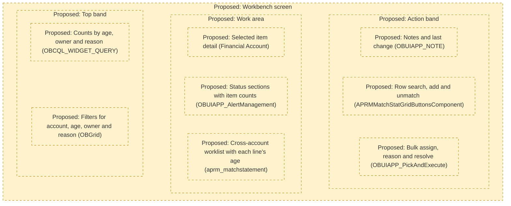
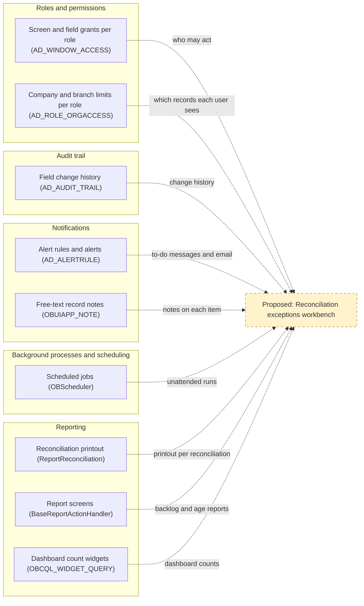
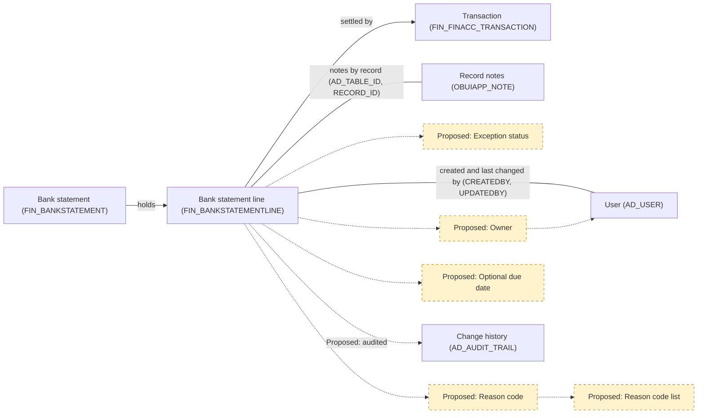
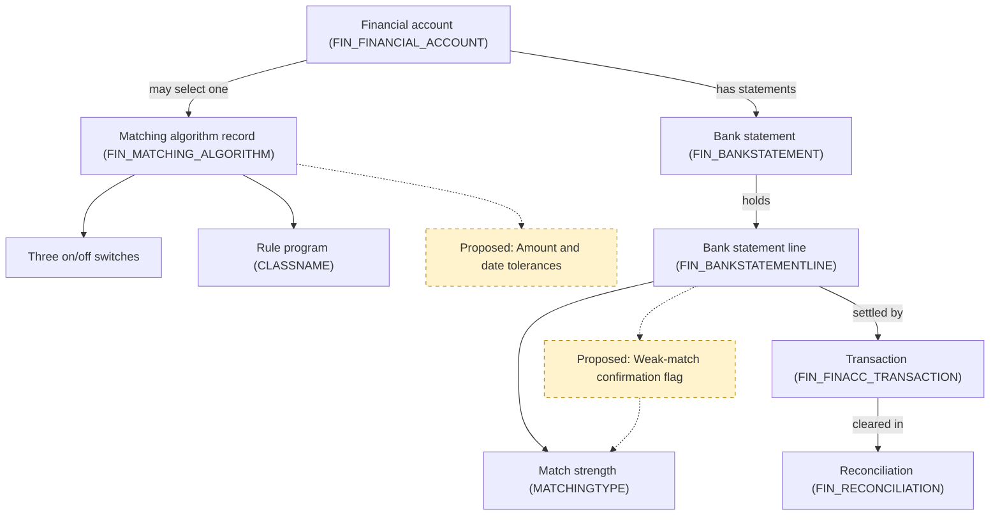
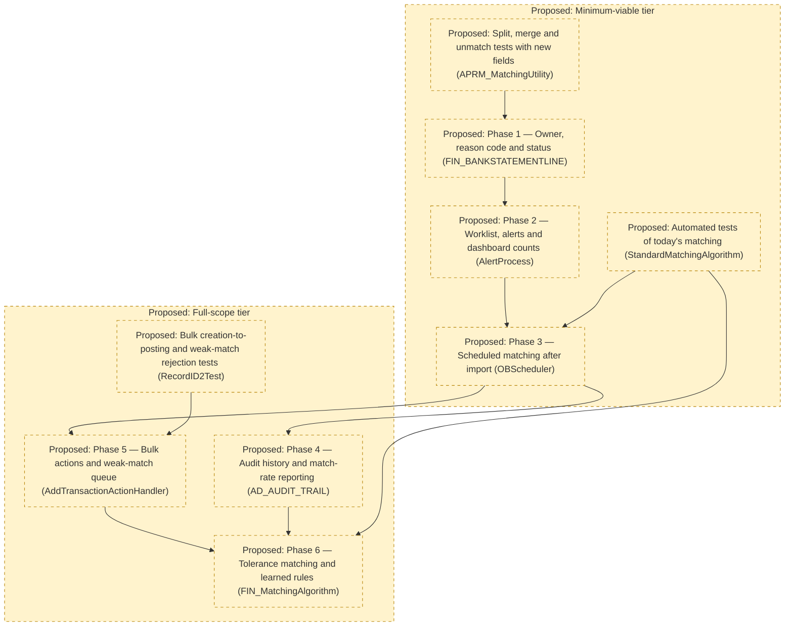

# Analysis 2: Extension Points, Reuse, and Risks for a Reconciliation Exceptions Workbench

## Key Takeaways

- Mirror `Match Statement`, `Alert Management` and `Financial Account`, not hand-coded pages.
- Permissions, alerts and schedules (`AD_ROLE`, `AD_ALERT`, `OBScheduler`) are reusable, but none sets owners.
- Bank lines in `FIN_BANKSTATEMENTLINE` need owner, reason code and status fields; age needs none.
- Import, matching and reconciliation completion have no automated tests (`MatchTransactionDao`).
- Phase 1 adds exception fields; a worklist like `aprm_matchstatement` and alerts come next.

## 1. UI Framework and Patterns to Follow

**What this section tells you:** The workbench can be built mostly from screen patterns the system generates from stored settings, so filtering, permissions and notes need no custom code. Three existing screens already do most of the job, and Figure 1 sketches a proposed screen built from them.

In this ERP (enterprise resource planning, the business software that keeps the company's accounts), a financial account (`FIN_FINANCIAL_ACCOUNT`) is the ERP record for one bank account, and a transaction (`FIN_FINACC_TRANSACTION`) is the ERP's record of money expected in or out of a financial account. A bank statement line (`FIN_BANKSTATEMENTLINE`) is one entry on the statement the bank sends, and matching is linking a statement line to the transaction it settles. A reconciliation (`FIN_RECONCILIATION`) is the period document confirming the ERP balance agrees with the bank; an owner is the person accountable for clearing an unmatched item, and a reason code records why it is unmatched.

The workbench serves one objective: "reduce manual effort and cycle time in bank reconciliation. Most statement lines are matched without human touch, and every unmatched item has an owner, age, and reason code." Cycle time is the time from statement import to completed reconciliation.

### 1.1 Technology Baseline

- **Server:** Java (the server's programming language), version 11 or later as `build.xml` enforces, built with Apache Ant (a build tool) 1.9.2 or later.
- **Screens:** JavaScript (the browser's programming language) on Isomorphic SmartClient (a library of browser grids, meaning spreadsheet-like lists of records, and forms), release v10.0d, bundled in `modules/org.openbravo.userinterface.smartclient`. Each screen is described in the Application Dictionary (the metadata that defines screens, tables and processes: stored records, not code), for example `AD_WINDOW`, `AD_TAB`, `AD_FIELD` and `OBUIAPP_PROCESS`.
- **Data:** PostgreSQL (the database), with each table's structure kept as XML (structured text) under `src-db/database/model` and in each module's (a separately packaged part of the ERP) database folder.
- **Java tests:** JUnit 4.13.2 (a Java test framework) and Mockito 4.11.0 (a tool that fakes other program parts in tests), both in `lib/test`, with tests in `src-test/src` and in module folders such as `modules/org.openbravo.client.application/src-test`.
- **Test runs:** `src-test/build.xml` runs two test suites (named bundles of tests), `StandaloneTestSuite` through `run.all.tests` and `WebserviceTestSuite` through `run.webservice.tests`, while `run.test` runs any single test, including those in neither suite.
- **User-interface tests:** Jest 29.7 (a JavaScript test runner), declared in `package.json`, runs three utility test files in `modules/org.openbravo.client.application/web-test`.

### 1.2 Patterns for Windows, Views and Dashboards

Every pattern below is stored as Application Dictionary records that the server turns into a browser screen when a user opens it (`StandardWindowComponent`, `ParameterWindowComponent`), so a workbench built this way is mostly records and server actions, quicker to build and consistent with `Financial Account`. Appendix B lists the records behind each pattern.

| Pattern | Workbench use | Example in the code | Limit for the workbench |
|---------|---------------|---------------------|-------------------------|
| Standard window (a data-entry screen with a header and sub-tabs) defined in the Application Dictionary | Exception records with their owner, reason and status | `Financial Account` window | Each tab shows one table beneath its parent (`AD_TAB`), so it suits editing one exception, not a list joining lines, accounts and transactions |
| Process definition, Pick and Execute (a pop-up grid where the user selects rows and runs an action) | Bulk assign, set reason, resolve | `Match Statement` (`OBUIAPP_PickAndExecute`), built on `BaseProcessActionHandler` | It sits over the window that opened it, for one task; `Match Statement` hides its Cancel and Close buttons to keep users in it (`modules/org.openbravo.advpaymentmngt/web/org.openbravo.advpaymentmngt/js/ob-aprm-matchStatement.js`), a workaround to avoid |
| HQL-based table (a read-only list built from a database query, a saved request that selects records) | One worklist across all financial accounts, showing age | `aprm_matchstatement`, the Match Statement grid | Being read-only (`HQLDataSourceService`), each change needs its own server action |
| Manual view (a custom-built screen registered in the Application Dictionary) | Only if a bespoke layout is needed | `OBUIAPP_AlertManagement` | Hand-written JavaScript (`modules/org.openbravo.client.application/web/org.openbravo.client.application/js/alert-management/ob-alert-management-view.js`), with only the features its code builds |
| Workspace and Query/List widgets (small panels on the Workspace dashboard, the latter showing a query's result) | Counts by age, owner and reason | `OBKMO_WIDGET_CLASS`, `OBCQL_WIDGET_QUERY` | Display only (`QueryListDataSource`), though a column can total or open a window tab (`OBCQL_QUERY_COLUMN`), as in the shipped `Payment In - awaiting for execution` widget |
| Classic servlet (an older, hand-coded web page) | Avoid for new work; see Analysis 1, Section 1.2 and Analysis 1, Section 2 | `ImportBankFile`, `Reconciliation` | Each page has a hand-written template (`XmlDocument`), so none of the behaviour below applies |

Screens defined in the Application Dictionary get filtering and grid behaviour from the shared grid `OBGrid`, and role-based access (a role is a named set of screen and process permissions) through `AD_WINDOW_ACCESS` and `OBUIAPP_PROCESS_ACCESS`, each pattern with its own grant (Appendix B), without custom code. Servlets built on `HttpSecureAppServlet` need every page written by hand, so they are slower to build and harder to keep consistent.

| Built-in behaviour | Where it comes from | What it gives the workbench |
|--------------------|---------------------|-----------------------------|
| Column filters and sorting | `OBGrid`, shared by window, pop-up and `OBUIAPP_AlertManagement` grids (`OBPickAndExecuteGrid`, `OBAlertGrid`) | Any worklist column, such as account or age, filters without new code |
| Saved views (a user's stored columns and filters) and spreadsheet export | Standard windows (`OBUIAPP_UIPERSONALIZATION`, `OBUIAPP_ExportGrid`) | Owners keep views of their own items; supervisors export the list |
| Notes, attachments and linked items, plus who created and last changed each record | Standard window forms (`OBViewFieldHandler`, `OBUIAPP_NOTE`, `OBAuditSectionItem`) | Free-text explanations, though a reason code still needs a field |
| Buttons and fields shown only when they apply | Per-field display rules (`AD_FIELD`), as on the `Financial Account` buttons | A resolve action can appear only on open items |

Custom work remains for reconciliation-specific behaviour: Match Statement's Search, Add and Unmatch row buttons are hand-written (`APRMMatchStatGridButtonsComponent`), and an HQL-based table filtered by its opening screen needs a small code filter (`HqlQueryTransformer`).

### 1.3 Existing Screens the Workbench Should Mirror

Three existing screens each do part of the workbench's job, so copying their layout and actions shortens the build; two sit in today's reconciliation flow (Analysis 1, Section 1.2), which keeps the workbench familiar.

| Screen | What it does today | Why the workbench should mirror it | What not to copy |
|--------|--------------------|------------------------------------|------------------|
| `Match Statement`, a process definition opened from `Financial Account` | Lists one account's processed lines beside their matched transactions, with how each was matched and whether it is cleared, meaning agreed with the bank (`aprm_matchstatement`). Rows have Search, Add and Unmatch buttons, ticked rows unmatch together (`UnMatchSelectedTransactionsActionHandler`), and Reconcile completes the period (`MatchStatementActionHandler`) | It shows the workbench's records and every way to resolve them, so its server actions, buttons and HQL-based grid can be reused | Its query covers one account and only lines unmatched or in its draft (unfinished) reconciliation (`MatchStatementTransformer`); its prompt and instant saving are limits in Analysis 1, Section 3.3 |
| `OBUIAPP_AlertManagement`, the manual view users open as `Alert Management` | Lists alerts (system-generated to-do messages sent to a user or role) for the signed-in user, or their role when no user is named (`ADAlertDatasourceService`), in New, Acknowledged, Suppressed and Solved sections with counts; users move ticked items between them, add a note and open the record (`OBAlertGrid`) | It is the closest screen to an exceptions worklist: a personal queue, status groups with counts, bulk status changes, notes and a link to the source, centred on each item's owner | Its four statuses are fixed in code, with no reason code or reassignment; copy its layout in a generated window or pop-up, not its code |
| `Financial Account`, a standard window | Shows each account with tabs for transactions, imported statements, their lines and reconciliations (`Imported Bank Statements`, `Bank Statement Lines`, `Reconciliations`), and buttons for Import Statement, Match Statement and manual Reconcile (`EM_APRM_IMPORTBANKFILE`, `EM_APRM_MATCHTRANSACTIONS`, `EM_APRM_RECONCILE`) | As a generated window it gives each record a form with notes, attachments, saved views and filters, and its buttons launch actions from the record they affect | Statement lines sit two tab levels below the account (`AD_TAB`), so finding every unmatched line means opening each account and statement; Import Statement and manual Reconcile open classic servlet pages |

Figure 1 combines the three.

### 1.4 Proposed Workbench Screen Layout

Figure 1 is a wireframe (a rough sketch of where things sit on a screen) of one possible workbench screen; every area is proposed, copies the pattern or screen in parentheses from Sections 1.2 and 1.3 of this document, and implies no field names or data.

**Figure 1. Proposed Workbench Screen Layout**

**How to read this:** Each dashed box is a proposed screen area, top to bottom as a user would see it, with the existing pattern or screen it copies in parentheses.

| Proposed area (what it copies) | Why it serves the objective |
|--------------------------------|-----------------------------|
| Filters (`OBGrid`, saved views in `OBUIAPP_UIPERSONALIZATION`) | Each owner opens straight onto their own items |
| Counts (`OBCQL_WIDGET_QUERY`) | Shows where items pile up by age, owner and reason |
| Status sections (`OBUIAPP_AlertManagement`) | Keeps every item visible until it is resolved |
| Cross-account worklist (`aprm_matchstatement` without its one-account filter) | Replaces opening accounts one by one, and shows each line's age |
| Item detail (a `Financial Account` style form) | Edits one item's owner, reason and status, once added |
| Row actions (`APRMMatchStatGridButtonsComponent`) | Keeps today's Search, Add and Unmatch actions |
| Bulk actions (`OBUIAPP_PickAndExecute`) | Handles many items in one step and reports the outcome (`ResponseActionsBuilder`) |
| Notes and last change (`OBUIAPP_NOTE`, `OBAuditSectionItem`) | Records why an item is open and who touched it last |

Section 5.1 of this document places the worklist, exception fields and counts widget among the first capabilities (things the workbench lets people or the system do); how many items the worklist would hold, and so how fast it loads, is not determinable from code.

**Requirement implications:** Requirements should specify generated windows, Pick and Execute pop-ups, an HQL-based cross-account list and a counts widget modelled on the screens in Section 1.3 of this document, and exclude classic servlets.

## 2. Reusable Components

**What this section tells you:** The workbench needs no new platform services: permissions, change history, alerts, scheduled jobs and reports exist and are set up through records, not new code. Their largest limit is that nothing assigns a record to a person, so ownership must come from new data. Section 2.2 of this document rates each component, and Figure 2 shows how the five feed the workbench.

### 2.1 How Reuse Fit Is Rated

Reuse fit is High when the component meets the workbench need through configuration or new records only, Medium when it exists but must be switched on or extended, and Low when it would need replacing.

Test protection is in Section 4 of this document and field-level detail in Appendix C.

### 2.2 What Exists, Limits and Fit

| Component | What exists | Reuse fit (High/Medium/Low) | Limits and gaps | Fit rationale |
|-----------|-------------|-----------------------------|-----------------|---------------|
| Roles and permissions | Roles get windows, processes and process definitions as editable or view-only (`AD_WINDOW_ACCESS`, `AD_PROCESS_ACCESS`, `OBUIAPP_PROCESS_ACCESS`), with tabs and fields made view-only inside a window grant (`AD_TAB_ACCESS`, `AD_FIELD_ACCESS`); role inheritance (one role taking over another's grants) is `RoleInheritanceManager`. The standard Finance role in `modules/org.openbravo.v3.datasets` holds the reconciliation windows (Financial Account to edit; Bank File Format and Matching Algorithm view-only) and processes (Reconciliation Details, Reconcile, Import Statement, Reconciliation Summary). Organizations (companies or branches) granted in `AD_ROLE_ORGACCESS` limit which records a role sees, and `AD_USER_ROLES` assigns roles to people. A pop-up opened from a window button inherits that window's grant unless it demands its own (`IS_EXPLICIT_ACCESS`, or the `SecuredProcess` preference, a stored setting), as `BaseProcessActionHandler` checks. | High | Grants open whole windows, tabs, fields and organizations, but none assigns records an owner (Analysis 1, Section 4.3). Organization grants (`AD_ROLE_ORGACCESS`) split work by company or branch, not by bank account or team. Finance needs grants to administer alerts, schedules and history, since no standard role in `modules/org.openbravo.v3.datasets/referencedata/standard/V3_Roles.xml` holds the `Alert`, `Process Request` or `Process Monitor` windows and only Company Admin holds `Audit Trail`; reading its own alerts (`ADAlertDatasourceService`) or a record's history from its tab (`AuditTrailPopup`) needs none. Who holds the Finance role, and so who could own items, is installation data (`AD_USER_ROLES`), not determinable from code. | New grants alone secure every workbench screen and action (`AD_WINDOW_ACCESS`, `OBUIAPP_PROCESS_ACCESS`), so the fit is High. Ownership is a data need, met by the owner field (Section 3 of this document). Inherited grants (`RoleInheritanceManager`) never replace a role's own entries, and no role can inherit from the shipped Finance role (`ISTEMPLATE`). |
| Audit trail | An audit trail (a log of who changed which field, and when) is kept in `AD_AUDIT_TRAIL` (entry contents in Appendix C), shown in the `Audit Trail` window and per record by `AuditTrailPopup`. It is switched on per table (`ISFULLYAUDITED`), off by default, and single fields can be left out (`ISEXCLUDEAUDIT`). Tables such as `FIN_BANKSTATEMENTLINE` already record who created and last changed each row, and when (`CREATED`, `UPDATED`). | Medium (see the note below the table) | Auditing takes effect only after a system rebuild and server restart (`RegenerateAudit`, raised by `SL_TableAudit`), so switching it on is a release step. The log records what changed, by whom and when, but not why, so it cannot replace a reason code, and time in each status must be derived from log entries (`EVENT_TIME` in `AD_AUDIT_TRAIL`). | The history store and screens exist, but auditing must be switched on for the new fields (`ISFULLYAUDITED`), so the fit is Medium. It then shows who assigned, reassigned or closed each item (`AD_AUDIT_TRAIL`). |
| Notifications | Alerts come from rules written as database queries (`AD_ALERTRULE`) and carry a status, user, role and note (`AD_ALERT`), with recipients and optional email per rule (`AD_ALERTRECIPIENT`). `AlertProcess`, scheduled in the core setup data, raises one alert per new item and closes it once the rule stops returning the item, so an unmatched line's alert clears itself on matching. Users acknowledge or suppress alerts in `OBUIAPP_AlertManagement`, and a rule can name the tab its alerts open (`AD_TAB_ID`). A WebSocket (live browser connection) client, `MessageClientManager`, and free-text notes, `OBUIAPP_NOTE`, also exist. | High | The core setup runs `AlertProcess` daily just before midnight (`src-db/database/sourcedata/referencedData/AD_PROCESS_REQUEST.xml`), so a new unmatched line could wait a day for its alert. The rule's recipients, one user or a whole role (`AD_ALERTRECIPIENT`), decide who sees an alert, not the user the query returns, so per-owner lists need a rule filter on the signed-in user (`FILTERCLAUSE`) or one rule per owner. Each item raises one alert until solved, with no reminder or escalation as it ages, and email needs a configured server (`EmailServerConfiguration`). The live message client is off unless the `OBUIAPP_Enable_Message_Manager` preference is on, and nothing in the repository sends it a message (`MessageHandler`). | Aging and unassigned-item alerts need only new rule and recipient records (`AD_ALERTRULE`), so the fit is High; self-closing alerts (`AlertProcess`) track the backlog with no manual clearing. The daily run (`AD_PROCESS_REQUEST`) and role-wide visibility (`AD_ALERTRECIPIENT`) are settings to plan, not reasons to replace it. |
| Background processes and scheduling | A background process (a job the system runs on a schedule without a user) runs on `OBScheduler`, built on Quartz (a library that starts jobs at set times), through process requests (saved schedules for one job) set in the `Process Request` window (`AD_PROCESS_REQUEST`), each run logged in `AD_PROCESS_RUN` and shown in `Process Monitor`. Process groups (saved chains of jobs run in order, `AD_PROCESS_GROUP`) share one schedule, and a job can be barred from running twice at once (`PREVENTCONCURRENT`). `FIN_BankStatementProcess` and `FIN_ReconciliationProcess` already have the form the scheduler runs, but automatic matching sits inside a screen action, `MatchStatementOnLoadActionHandler`, and must move out to run without a user. | High | Schedules are time-based only: now, once later, or repeating from seconds to months or by calendar rule (`TimingOption`, `Frequency`), so matching after each import needs a frequent schedule or a job started when import ends. The statement and reconciliation processes act on the one record a button passes (`FIN_Bankstatement_ID`, `FIN_Reconciliation_ID`), so a scheduled run needs a job that picks statements. Matching also needs the account's draft reconciliation, which only the Match Statement screen action creates (`MatchStatementOnLoadActionHandler`). The bar on running twice at once stops only a second copy of a job for the same organization, not clashes with users editing lines (`ProcessMonitor`). | The scheduler, run log and monitor need no change: a new job needs only process and process request records (`AD_PROCESS_REQUEST`), so the fit is High. Building the matching job is effort (Section 5 of this document), not a reuse gap, and lets lines match with no person acting between an import and the next session (Analysis 1, Section 5, item 5). |
| Reporting | The printable reconciliation report, `ReportReconciliation`, lists outstanding payments, outstanding deposits and unreconciled statement lines, launched by the Reconciliation Details and Reconciliation Summary processes. Newer reports run as process definitions through `BaseReportActionHandler`, with layouts linked in `OBUIAPP_REPORT` (formats in Appendix C), and Query/List widgets (`OBCQL_WIDGET_QUERY`) show query rows or counts, linking only to single records (`OBCQL_QUERY_COLUMN`). | Medium | The printable report is an older, hand-coded page (built on `HttpSecureAppServlet`) printing one reconciliation of one account as a PDF, so it cannot show the cross-account backlog. No report breaks unmatched lines down by age, owner or reason, and `modules/org.openbravo.advpaymentmngt` ships no reconciliation widget or report definition. A line keeps how it was matched (`MATCHINGTYPE`) but not when, holding only its bank date and creation and last-change times (`FIN_BANKSTATEMENTLINE`), so a report can count the share matched by the algorithm but time matching only from the audit trail. | Dashboard counts and report screens can follow existing patterns (`OBCQL_WIDGET_QUERY`, `BaseReportActionHandler`) but need new queries, layouts and links from counts to lines, so the fit is Medium. The printout stays useful per reconciliation but shows neither the share matched unaided nor open-item age (`ReportReconciliation`). |

**Unconfirmed:** whether reconciliation tables are audited today, because auditing is switched on table by table in each installation and is off by default (consulted `AD_TABLE`, `ISFULLYAUDITED`, `AD_AUDIT_TRAIL`).

### 2.3 How the Components Feed the Workbench

Every box in Figure 2, from grants (`AD_WINDOW_ACCESS`) to reports (`BaseReportActionHandler`), exists except the workbench, so Section 5 of this document sizes effort assuming reuse.

**Figure 2. Existing Components Feeding the Proposed Workbench**

**How to read this:** Solid boxes exist today, grouped by the five components of Section 2.2 of this document; the dashed box is proposed, and dotted arrows name what each component would supply.

**Requirement implications:** Requirements should reuse these five components as they stand (Section 2.2 of this document) and specify only what they lack: an owner field that drives personal work lists and alert targeting, auditing switched on for the exception fields, an unattended matching job, and backlog reports by age, owner and reason.

## 3. Data Model: Required Changes vs Current Support

**What this section tells you:** Most needs become optional statement-line fields, plus matching tolerance settings; age and the processing lock need no change. Each need is paired with today's data and each change with its reason and effect on stored lines.

For current gaps in the schema (the database structure), see Analysis 1, Section 4.3. The tables assess changes, mostly to `FIN_BANKSTATEMENTLINE`, and their effect on existing records, with protected fields in Appendix D.

| Current schema already supports | Change required |
|---------------------------------|-----------------|
| Whether a line is unmatched: an empty `FIN_FINACC_TRANSACTION_ID` on `FIN_BANKSTATEMENTLINE` | An exception status, such as open, assigned or resolved |
| Age, derived from the bank date `DATETRX` or the record creation time `CREATED` | None; age is calculated, not stored |
| Who created or last changed a line (`CREATEDBY`, `UPDATEDBY`) | A user named as owner of each unmatched item |
| Free text in `DESCRIPTION` | A list of reason codes and a reason on each item |
| Age-based deadlines in an alert rule's query (`AD_ALERTRULE`), but no due date on `FIN_BANKSTATEMENTLINE` | A due date per item, needed only if deadlines differ by item |
| Match strength in `MATCHINGTYPE`, where a candidate is a transaction that could settle a line: AU strong (a candidate found by the algorithm's primary rules), AP weak (a candidate found only by its looser fallback rules), MA matched by hand, and AD linked to a transaction added by hand; plus what the line was matched against in `MATCHED_DOCUMENT` | A confirmation flag (a mark that a person checked a weak match), needed only for the weak-match queue, and kept evidence of manual interventions, needed only to count lines matched untouched (Section 5.2 of this document) |
| Record notes (`OBUIAPP_NOTE`) and change history (`AD_AUDIT_TRAIL`) | Auditing switched on for the new fields |
| Three on/off switches and a pluggable rule program (`CLASSNAME`) in `FIN_MATCHING_ALGORITHM`, the matching algorithm record (a saved set of matching rules that one or more financial accounts use) | Amount and date tolerance settings (how far amounts and dates may differ and still match), needed only for tolerance matching in Section 5.2 of this document |
| A trigger (a database rule run on every change), `APRM_FIN_BNKSTM_LINE_CHECK_TRG`, locking only the bank's own fields once a statement is processed | None; new exception fields stay editable after processing |

| Change required | Rationale | Downstream impact on existing data |
|-----------------|-----------|------------------------------------|
| Exception status | An empty link (`FIN_FINACC_TRANSACTION_ID`) cannot separate unexamined lines from ones in work or knowingly left open. Its values fit a reference list (a fixed list of allowed values kept in the Application Dictionary), like `FIN_Matching Type`. Matching, unmatching, splitting (dividing a line into a matched part and an unmatched remainder) and merging (rejoining its unmatched parts) must update it (`APRM_MatchingUtility`). | Existing lines start with none; a backfill (filling a new field for rows that already exist) can set open or resolved from `FIN_FINACC_TRANSACTION_ID`, so carried-forward lines become open items with their age; how many is not determinable from code (Section 7 of this document). |
| None for age | Age derived from `DATETRX` or `CREATED` stays current, unlike a stored one; which date counts is a requirement choice. | None: every line carries both dates, and split parts keep the bank date (Section 3.1 of this document). |
| Owner | Creator and last editor (`CREATEDBY`; `UPDATEDBY`, set even by matching runs, `OBInterceptor`) show who acted, not who must resolve; a user-linked owner (`AD_USER`) lets alert rules show owners their items (Section 2.2 of this document). | Existing lines have none, and the importing user (`FIN_BankStatementImport`) is no substitute, so a backfill needs a business rule, such as by financial account. |
| Reason codes and a reason on each item | Free text in `DESCRIPTION` cannot be counted or used to route work. Company-defined codes fit a standard-window list, like the partner-guessing exclusion words (`FIN_BANKFILE_EXCEPTION`), and codes program logic acts on fit a reference list. | Existing lines have none, and descriptions hold whatever users or importers (programs that read a bank's file format) entered (`FIN_BankStatementImport` fills none), so they cannot become codes automatically; whether they hold reasons is not determinable from code. |
| Due date | Analysis 1, Section 4.3 lists it as missing, but the objective asks only for age, and one deadline for all can be an alert rule comparing age with a limit (`AD_ALERTRULE`). | Existing lines have none; a backfill can derive one from `DATETRX` under a deadline policy not determinable from code. |
| Confirmation flag | No stored value shows which weak matches a person checked (Analysis 1, Section 3.3), and `FIN_Matching Type` even labels the weak level "Approved"; the flag serves the weak-match queue (Section 5.2 of this document). | Existing weak matches start unconfirmed, even in completed reconciliations (`FIN_RECONCILIATION_ID` on `FIN_FINACC_TRANSACTION`), so a backfill should confirm them or the queue cover only drafts; unmatching clears match strength (`APRM_MatchingUtility`) and must clear the flag. |
| Intervention evidence | Today's codes give only the current automatic-match share, since a line unmatched by hand and rematched by a later run shows AU or AP again, and splits add lines (`APRM_MatchingUtility`); an untouched share needs a fixed base, such as lines as imported, plus intervention evidence. | Stored lines hold none, so past interventions cannot be rebuilt from match codes alone (`MATCHINGTYPE`). |
| Auditing switched on for the new fields | History proves who changed an owner, reason or status, and when; for the new fields alone, `FIN_BANKSTATEMENTLINE` is audited with every other column left out (Section 2.2 of this document). | History starts once auditing takes effect (Section 2.2 of this document), so past changes stay unrecorded. Each change logs every changed included column and each insert every included column, empty or not, unless insert auditing (on by default, `ISAUDITINSERTS`) is off, which still logs an included identifier (`ad_create_audit_triggers`); leaving bank columns out cuts volume, not import history. |
| Amount and date tolerance settings | The exact-match limits in Analysis 1, Section 3.3 need business-set tolerances, which no column holds (`FIN_MATCHING_ALGORITHM`); they belong on this record, which accounts may select and share (`FIN_MATCHING_ALGORITHM_ID` on `FIN_FINANCIAL_ACCOUNT`). | Existing records, the shipped `Standard` one included (`modules/org.openbravo.advpaymentmngt/referencedata/standard/Standard_Algorithm.xml`), start empty, which must mean no tolerance; a value on a shared record changes every account using it (Analysis 1, Section 3.2), and `StandardMatchingAlgorithm` ignores it until new logic reads it. A scheduled run must skip and report accounts selecting none (`MatchStatementOnLoadActionHandler`). |
| None for the processing lock | The lock covers only the bank's own fields, such as date, amounts and reference (Appendix D), even on matched lines. | None for updates, so a backfill can run on processed statements, but adding or deleting lines on them, or deleting a matched line, stays blocked (`APRM_BSTLine_Matched`), so the workbench never creates or removes lines. |

### 3.1 Effects Shared by Every New Line Field

- **Importers:** importers build lines through `loadFile`, `FIN_BankStatementImport` saves them and processing follows at once (`FIN_AddPayment`), so new fields need defaults or must be optional, or every installed importer must change.
- **Split and merge:** a split copies the whole line, new fields included, into the unmatched remainder (`DalUtil.copy`), and a merge deletes the other parts, losing values set only on them unless carried over; both briefly unprocess the statement to pass the trigger (`APRM_MatchingUtility`), so the workbench should reuse them rather than change amounts.
- **Views and reports:** the views (saved queries the database presents as tables) `FIN_RECONCILIATIONLINE_V` and `APRM_RECONCILIATION_V` and the template `modules/org.openbravo.advpaymentmngt/src/org/openbravo/advpaymentmngt/ad_reports/UnreconciledBankStatement.jrxml` name each column they read, so new fields neither break nor appear in them until extended.

### 3.2 Existing and Proposed Entities

Figure 3 adds the proposed exception fields to the entities around `FIN_BANKSTATEMENTLINE`, and Figure 4 tolerance settings and a confirmation flag to today's matching setup.

**Figure 3. Exception Fields on the Statement Line: Existing and Proposed**

**How to read this:** Solid arrows are links the database enforces, plain lines are references it does not enforce, and dotted arrows and dashed yellow boxes are proposed.

**Figure 4. Matching Settings and Weak-Match Confirmation: Existing and Proposed**

**How to read this:** Solid elements are today's matching setup and data, the account's algorithm choice being optional, and dashed yellow boxes on dotted arrows are proposed.

**Requirement implications:** Requirements need `FIN_BANKSTATEMENTLINE` fields for status, owner, reason code with its list, an optional due date and weak-match confirmation, plus intervention evidence, `FIN_MATCHING_ALGORITHM` tolerances and line auditing, each with a backfill rule.

## 4. Integration Points and Regression Risks

**What this section tells you:** It lists where a workbench would plug into existing code or data, what could break and how badly, and whether a repository test would catch it. No area is fully tested: eight are partly covered and nine have no test, including import, matching and reconciliation completion (Section 4.2 of this document). Each area ends with a suggested mitigation, a concrete step that lowers the risk.

An integration point is a place where the workbench connects to existing code, data or another module; a regression is a feature that worked before a change and fails after it. The coverage qualifications distinguish protection for the affected reconciliation behaviour from checks of shared services, so release decisions should follow the stated gaps, not a test's presence alone (Appendix E; test suites in Section 1.1 of this document). No test clicks through a screen: `ViewGeneration`, in `StandaloneTestSuite`, only checks that screen definitions generate, so new workbench screens start with no automated screen tests.

### 4.1 Severity and Coverage Basis

**Severity basis:** High when a break could block reconciliation completion or posting (creating the accounting entries in the general ledger, the company's books), or alter matched or accounting data; Medium when it blocks or degrades workbench or matching work without damaging posted data; Low when it affects only reporting, display or convenience.

**Coverage basis:** Tested when a repository test exercises the area's own reconciliation behaviour at risk, directly or through helper code (shared code that several tests call); Partial when a test covers only part of that behaviour, or only the shared mechanism on another table or process; Untested when no file under `src-test/src`, `modules/org.openbravo.client.application/web-test` or a module's test folder refers to the area's classes (each a program unit).

### 4.2 Integration Points, Risks and Coverage

| Area | Integration point (what it connects) | What could break | Severity | Test coverage | Suggested mitigation |
|------|--------------------------------------|------------------|----------|---------------|----------------------|
| Statement import | `ImportBankFile` and `FIN_BankStatementImport` turn the bank's file, read by an installed bank file format module (an add-on that reads one bank's file layout), into lines (`FIN_BANKSTATEMENTLINE`) | New line fields must not break the format modules that create lines (Section 3.1 of this document) | High | Untested: no test refers to `ImportBankFile` or `FIN_BankStatementImport`; how format modules treat new fields is not determinable from code | Give new line fields defaults so format modules work unchanged, add a regression test (one that re-checks existing behaviour after a change) importing a small file through a test-only importer, and re-test each installed module |
| Statement processing | `FIN_BankStatementProcess` confirms a statement, after which `APRM_FIN_BNKSTM_LINE_CHECK_TRG` locks the bank fields, such as date and amounts, of processed or matched lines | Date checks and line locks can block exception updates that alter bank data or add or remove processed lines, and a faulty lock change could block matching | High | Untested: no test refers to `FIN_BankStatementProcess` or `APRM_FIN_BNKSTM_LINE_CHECK_TRG` | Keep exception fields out of the lock, and test editing them on a processed, matched line while bank fields stay locked |
| Automatic matching | `StandardMatchingAlgorithm` and `MatchTransactionDao` link lines to transactions under the account's `FIN_MATCHING_ALGORITHM` record (Analysis 1, Section 3) | Moving or changing matching alters which lines clear and can create wrong strong matches; editing a shared record changes every account using it | High | Untested: no test refers to `StandardMatchingAlgorithm`, `MatchTransactionDao` or `FIN_MatchingAlgorithm`; `FinancialAccountTest` creates accounts with no matching algorithm record | Before matching changes, add regression tests running each pass of Analysis 1, Section 3.1 on fixed sample lines, and pilot new rules on a new record chosen by one account, comparing results on the same statements |
| Manual match, split, unmatch | `APRM_MatchingUtility` links, splits and merges lines, and unmatch deletes algorithm-created transactions and payments (Analysis 1, Section 4.2) | Splits, merges and deletion of algorithm-created records must keep exception data consistent (Section 3.1 of this document) | High | Untested: no test refers to `APRM_MatchingUtility` or the grid's action handlers, such as `FindTransactionsToMatchActionHandler` | Define which exception fields a split part inherits and a merge keeps, and test split, merge and unmatch with them filled, including after posting |
| Match Statement grid | `aprm_matchstatement`, the HQL-based table behind the `Match Statement` grid, from which `MatchStatementActionHandler` reconciles | Extra query columns can slow or break the grid, which stops statement reconciliation | High | Partial: `src-test/src/org/openbravo/test/datasource/HQLDataSourceTest.java`, in `WebserviceTestSuite`, filters another HQL-based table, `Aprm_Credit_To_Use`; nothing tests `aprm_matchstatement`, its speed or the grid's screen code | Build the worklist as a new HQL-based table rather than widening `aprm_matchstatement`, and test and time both like `HQLDataSourceTest` on the largest account |
| Reconciliation completion and balances | `FIN_ReconciliationProcess` completes once each cleared item's accounting period (a span open for bookings) is open (`APRM_PeriodNotAvailableClearedItem`); `FIN_ReconciliationEventListener` recalculates later balances when a reconciliation is deleted | Holding completion for open exceptions changes how later balances are recalculated | High | Untested: no test refers to `FIN_ReconciliationProcess` or `FIN_ReconciliationEventListener` | Make any completion hold for open exceptions a per-account setting, off by default, and test completing, reactivating (reopening for editing) and deleting a reconciliation against later balances |
| Posting | `DocFINReconciliation` writes a completed reconciliation's entries to `FACT_ACCT`, from the Post button or the background `AcctServerProcess` | Write-off (booking a small unexplained difference as an expense) or adjustment actions create entries posting must handle; a wrong entry changes the books | High | Partial: `src-test/src/org/openbravo/test/accounting/RecordID2Test.java`, in `StandaloneTestSuite`, reposts three sample reconciliations through `DocFINReconciliation` and checks balances; new write-off or adjustment entries and `AcctServerProcess` runs are uncovered | Add `RecordID2Test` cases posting a reconciliation with a workbench-created fee or write-off, and try write-off on a test copy of the data first |
| Payments feeding candidates | `FIN_PaymentProcess` creates a payment's transaction, a matching candidate, when the payment is deposited or withdrawn, explicitly or automatically by its payment method. Fund transfers (`APRM_FUND_TRANSFER_REC`) create their own transactions through `FundsTransferUtility` and process them through `FIN_TransactionProcess`, independently of payment-method settings | Payment status changes alter the transactions matching can choose from | High | Partial: `src-test/src/org/openbravo/test/cancelandreplace/CancelAndReplaceTestUtils.java`, helper of `CancelAndReplaceTest` in `StandaloneTestSuite`, processes payments through `FIN_PaymentProcess`, as `src-test/src/org/openbravo/advpaymentmngt/test/TestUtility.java` does for payment and payment-proposal tests such as `PaymentTest_01`; these and `FundsTransferTest`, checking transfer transactions, run only through `run.test`. Matching's use of the resulting transactions is uncovered | Test that a payment whose method deposits automatically yields a matching candidate, and add the payment and transfer tests to `StandaloneTestSuite` |
| Partner names | Business partner (customer or supplier) records (`C_BPARTNER`), outside the reconciliation module, feed the import's partner guess (`FIN_BankStatementImport`) and the name switch (`MatchTransactionDao`) | Partial-name or learned partner matching can pick the wrong partner and transaction | High | Untested: no test refers to `FIN_BankStatementImport` or `MatchTransactionDao`, which hold partner guessing and name matching | Test near-identical partner names against the import guess and the name switch, and apply partial or learned partner matches as weak matches for the weak-match queue (Section 5.2 of this document) |
| Adding missing transactions | `AddTransactionActionHandler` creates, processes and links a bank-fee, GL item (a general-ledger category for amounts with no invoice, such as bank fees) or payment transaction for a line, with match strength `AD` | Bulk creation can duplicate bank-fee transactions or book them to the wrong GL item, and the entries post | High | Partial: `src-test/src/org/openbravo/advpaymentmngt/test/FundsTransferTest.java`, runnable only through `run.test`, processes bank-fee and GL item transactions through `FIN_TransactionProcess`, but for transfers; no test refers to `AddTransactionActionHandler`, so adding from a statement line is uncovered | Preview what a bulk action will create, with its GL item, and test bulk creation from statement lines through to posting |
| Roles and access | `AD_WINDOW_ACCESS` and `OBUIAPP_PROCESS_ACCESS` grant screens and process definitions to roles, Finance included (`modules/org.openbravo.v3.datasets/referencedata/standard/V3_Roles.xml`) | New screens need Finance grants; a missing one hides the workbench, and an over-broad one lets other roles change exception data | Medium | Partial: `src-test/src/org/openbravo/test/role/inheritance/RoleInheritanceTestSuite.java` and `AccessLevelTest`, in `StandaloneTestSuite`, check how window, process-definition and alert-recipient grants pass between test roles and how access levels apply; Finance grants for new screens are uncovered | Ship the Finance workbench grants in the screens' dataset (packaged setup data), and check that Finance can open each new screen and other roles cannot |
| Alerts | `AlertProcess` runs each `AD_ALERTRULE` query in turn, raises alerts and emails the recipients in `AD_ALERTRECIPIENT` | Errors in a rule's query appear only when it runs; a slow rule delays every rule after it | Medium | Untested: no test refers to `AlertProcess` or `EmailManager`; `DalLockingTest` uses an alert rule only to test record locking (a hold that makes a second writer wait), and `SendEmailTest` checks a mail-server choice (`EmailUtils`) `AlertProcess` does not use | Run each new rule's query on sample data first, and add a regression test running `AlertProcess` on a test rule, checking one alert per unmatched line, no repeat while open, and the email |
| Scheduling | `OBScheduler` and `ProcessRunner` run background processes from process requests (`AD_PROCESS_REQUEST`), as scheduled matching would | A scheduled matching run can collide with users editing the grid, since both save each match at once (`APRM_GRID_PERSIST_MESSAGE`) | High | Partial: `src-test/src/org/openbravo/scheduling/ProcessSchedulingTest.java` runs test-only jobs through `ProcessRunner`, and `TriggerProviderTest` and `MisfirePolicyTest` check start times and missed runs, all in `StandaloneTestSuite`; no test runs matching or a job beside user edits | Have the job and the grid's saves take the platform's record lock (`getObjectLockForNoKeyUpdate`) per account, and test the job running while a user matches the same account |
| Reporting | `ReportReconciliation` builds the reconciliation printout, including its unreconciled-lines part, from JasperReports (report-layout engine) templates | Template changes stop the report building; new exception statuses change which lines that part should list | Low | Partial: `src-test/src/org/openbravo/test/reporting/AllJrxmlCompilation.java`, in `StandaloneTestSuite`, compiles every template, the four reconciliation ones included; no test runs `ReportReconciliation` or fills its templates | Report age, owner and reason in a new report, not the printout, and test filling the unreconciled-lines template from sample data |
| Audit trail | `ISFULLYAUDITED` switches on, per table, generated triggers that write each changed field to `AD_AUDIT_TRAIL` | Auditing busy tables adds database write load, so auditing `FIN_BANKSTATEMENTLINE` slows import and matching | Medium | Untested: no test refers to `AD_AUDIT_TRAIL` or `AuditTrailPopup`; `ETagGeneration`, in `WebserviceTestSuite`, audits `C_ORDER` only to check that browsers reload a changed screen | Audit the line table with every column but the new fields excluded (`ISEXCLUDEAUDIT`), and time import and matching with auditing on before release |
| Record notes | `OBUIAPP_NOTE` attaches free-text notes to any record, statement lines included | A note links to its record only by `RECORD_ID`, so a merge that deletes split parts orphans their notes | Low | Partial: `src-test/src/org/openbravo/test/datasource/TestNoteDatasource.java`, in `WebserviceTestSuite`, adds, reads and removes a note on an order (`C_ORDER`); notes on statement lines and merges are uncovered | Keep reasons in the reason field, move notes to the surviving line on merge, and extend the note test to statement lines |
| Live browser messages | `MessageClientManager` pushes messages to open browsers over a WebSocket | A failed push leaves an owner unaware of a new item until the next alert | Low | Untested: no test refers to `MessageClientManager` | Treat live messages as an extra beside alerts, tested with a connected test user first |

**Requirement implications:** The six High-severity Untested areas, from import (`FIN_BankStatementImport`) through matching (`StandardMatchingAlgorithm`, `APRM_MatchingUtility`) to completion (`FIN_ReconciliationProcess`), need the regression tests above, run in `StandaloneTestSuite`, before the workbench changes them, and new matching or completion rules should roll out per account behind a setting.

## 5. Recommended Capability Set

**What this section tells you:** Two tiers (packages delivered together) separate basic exception control from broader automation. The minimum-viable tier, the smallest set meeting the objective's basic needs, combines owned, visible exceptions with unattended use of existing matching rules; the full-scope tier completes it with bulk review, better matching and measurement. Dependencies (what must exist before a capability can work), rather than impact ratings alone, determine the delivery order in Section 6 of this document.

Impact is High when a capability itself raises the share of lines matched with no person acting, or itself gives unmatched items an owner, age or reason code; Medium when it cuts the effort or cycle time of work people still do; Low when it only measures, records or displays the work. Effort S means configuration or metadata on an existing component; M means new fields, a screen, a process definition or a background process built from existing patterns; L means new or changed matching logic in an untested area.

Each tier is ranked by impact (High, Medium, Low), then effort (S, M, L); ties keep the order of the effort sources in Analysis 1, Section 5, lowest item number first, then the order shown. Item numbers refer to those effort sources, and each capability names the part it reuses. **Assumption:** effort sizes assume reuse of the patterns and components in Sections 1 and 2 of this document.

### 5.1 Minimum-Viable Tier

| Rank | Capability | Impact | Effort |
|------|------------|--------|--------|
| 1 | Cross-account exceptions worklist showing each unmatched line's age (items 1 and 4; an HQL-based table like `aprm_matchstatement`) | High | M |
| 2 | Owner, reason code and status on every unmatched line (item 4; new fields on `FIN_BANKSTATEMENTLINE`) | High | M |
| 3 | Automatic matching after each import as a scheduled background process (item 5; `OBScheduler`) | High | M |
| 4 | Alerts to owners for aging items and to the Finance role for unassigned items (item 4; `AD_ALERTRULE`, `AlertProcess`, `AD_ALERTRECIPIENT`) | Medium | S |
| 5 | Dashboard widget with exception counts by age, owner and reason (item 4; `OBCQL_WIDGET_QUERY`) | Low | S |

| Rank | Description | Analysis 1 section | Effort rationale | Dependencies and risks (Section 4 of this document) |
|------|------------------------------|------------------------------|------------------|--------------|
| 1 | One list of every unmatched bank line across all financial accounts, showing how long each has waited, so the whole backlog shows in one place. It is High because it supplies the objective's age, from a date the business chooses (`DATETRX` or `CREATED`). | Analysis 1, Section 4.1 | M: a new HQL-based table and screen built like `aprm_matchstatement`; matching is unchanged. | Minimum-viable rank 2 for its columns; the HQL-based table and Pick and Execute patterns (Section 1.2 of this document) and role grants (`OBUIAPP_PROCESS_ACCESS`). Risk: Match Statement grid. |
| 2 | Every unmatched line gets an owner, a reason code from a fixed list, and a status such as open, assigned or resolved. Owner and reason code are two of the objective's three demands, so this is High (`FIN_BANKSTATEMENTLINE`). | Analysis 1, Section 4.3 | M: new fields and a reason-code list added through the Application Dictionary; the statement trigger leaves new fields editable (`APRM_FIN_BNKSTM_LINE_CHECK_TRG`, Section 3 of this document), so processing is unchanged. | Owner and reason-code choices (Section 7 of this document); the worklist, alerts, widget, bulk actions, audit history and reporting read these fields (Section 3 of this document). Risks: statement import and manual match, split, unmatch (`APRM_MatchingUtility`). |
| 3 | Today's matching rules run unattended after each import or on a schedule, so lines stop waiting for a person, raising the share matched with no person acting and shortening cycle time (`StandardMatchingAlgorithm`). | Analysis 1, Section 3.3 | M: a background process built like `FIN_BankStatementProcess`, calling the existing rules and reusing or creating the account's draft reconciliation (`MatchStatementOnLoadActionHandler`, Section 2.2 of this document); no rule changes, so it is not L. | Minimum-viable ranks 1 and 2; scheduling (`OBScheduler`). Risks: automatic matching, scheduling and completion; while a draft exists, reactivating an earlier reconciliation is refused (`APRM_DraftReconciliationExists`). |
| 4 | Owners get an alert when a line passes a business-set age limit, and the Finance role one for each unowned line; this speeds work people still do, so impact is Medium (`AlertProcess`). | Analysis 1, Section 4.3 | S: new rule and recipient records only, run by the scheduled `AlertProcess` and limited per owner (Section 2.2 of this document). | Minimum-viable rank 2 for owner and status. Risk: alerts. |
| 5 | A Workspace panel counting open exceptions by age range, owner and reason, showing managers where the backlog sits; it only displays the work, so impact is Low (`OBKMO_WIDGET_CLASS`). | Analysis 1, Section 4.1 | S: a saved query with column records (`OBCQL_WIDGET_QUERY`) and a role access record (`OBKMO_WIDGET_CLASS_ACCESS`). | Minimum-viable rank 2 for the fields it counts; though read-only, its query must be correct, fast at real volumes and limited to the user's organizations (`QueryListDataSource`). Risk: roles and access. |

### 5.2 Full-Scope Tier

These capabilities add to the minimum-viable tier.

| Rank | Capability | Impact | Effort |
|------|------------|--------|--------|
| 1 | Tolerance matching: amount and date windows and partial partner names (item 2; a new rule set through `FIN_MatchingAlgorithm`) | High | L |
| 2 | Matching rules learned from manual resolutions (item 2; the partner-guessing approach in `FIN_BankStatementImport`) | High | L |
| 3 | Bulk actions: assign, set reason, create bank-fee transactions (item 1; `AddTransactionActionHandler`) | Medium | M |
| 4 | Queue to accept or reject weak matches in bulk (item 3; `MATCHINGTYPE` in a Pick and Execute grid) | Medium | M |
| 5 | Audit history on the exception fields (item 4; `AD_AUDIT_TRAIL`) | Low | S |
| 6 | Reporting of the share of lines matched untouched and of cycle time (items 1 and 5; `BaseReportActionHandler`) | Low | M |

| Rank | Description | Analysis 1 section | Effort rationale | Dependencies and risks (Section 4 of this document) |
|------|------------------------------|------------------------------|------------------|--------------|
| 1 | Matching that accepts differences within business-set windows (`FIN_MATCHING_ALGORITHM`): amounts, dates or partly matching partner names. Lines that just miss a strong match today (`StandardMatchingAlgorithm`) could then match with no person acting, so this is High. Under the proposed policy an amount difference stays open as a split-off line for its owner (`APRM_MatchingUtility`). | Analysis 1, Section 3.3 | L: new matching logic in an untested area, chosen by the record's rule program (`CLASSNAME`). | Full-scope rank 4 first, and a proposed rule, enforced nowhere today (`FIN_MatchedTransaction`), saving tolerance and learned matches as weak and unconfirmed for the queue; tolerance settings (Section 3 of this document). Risks: automatic matching, partner names and manual split. |
| 2 | Matching that learns from manual resolutions: when the same bank text recurs, the rules use the partner or GL item chosen before to find a new unreconciled transaction (`MatchTransactionDao`), so recurring lines whose transaction exists stop needing a person, which makes this High; lines with none, such as an unentered bank fee, go to bulk actions (full-scope rank 3). | Analysis 1, Section 3.3; Analysis 1, Section 4.2 | L: new matching logic in an untested area; manual resolutions are already recorded (`MATCHINGTYPE` MA or AD, `MATCHED_DOCUMENT`), but using them changes which transaction the rules choose (`StandardMatchingAlgorithm`). | Full-scope rank 1's rule program, tests and weak-match rule; rank 3 where no transaction exists. Risks: automatic matching, statement import and partner names, since import guessing sets the GL item the first two passes compare (Analysis 1, Section 3.1). |
| 3 | Acting on many worklist lines at once: assign an owner, set a reason, or create and link bank-fee transactions. Search, add and split work on one line today (`FindTransactionsToMatchActionHandler`), so this cuts effort, but people still act: impact is Medium. | Analysis 1, Section 2; Analysis 1, Section 4.2 | M: a Pick and Execute process on `BaseProcessActionHandler` repeating for each selected line what `AddTransactionActionHandler` does for one; `AddMultiplePaymentsHandler` already creates transactions for many payments at once. | Minimum-viable ranks 1 and 2: the list and the fields to set. Risks: manual match, adding missing transactions and posting, since created transactions must post (`DocFINReconciliation`). |
| 4 | One cross-account queue of weakly matched lines, where a person accepts or rejects many at once, so wrong weak links are caught by a deliberate check, not by chance. | Analysis 1, Section 3.3; Analysis 1, Section 4.2 | M: a Pick and Execute grid of lines whose `MATCHINGTYPE` is AP, plus a confirmation flag; rejecting reuses the unmatch action (`UnMatchSelectedTransactionsActionHandler`). | Minimum-viable ranks 1 and 3: the list, and weak matches made without a user session; the confirmation flag (Section 3 of this document). Risk: manual match, split, unmatch, since rejecting can delete transactions the rules created (`APRM_MatchingUtility`). |
| 5 | A history of who changed each exception's owner, reason or status, and when, so reviewers see how an item moved. It only records, so impact is Low (`AD_AUDIT_TRAIL`). | Analysis 1, Section 4.3 | S: configuration alone, auditing the line table with every other column left out (`ISEXCLUDEAUDIT`, Section 3 of this document). | Minimum-viable rank 2 for the fields to track. Risk: audit trail. |
| 6 | Reports, by account and period, the untouched share, cycle time per statement (Analysis 1, Section 1.1) and item-resolution time, one line's time from import to resolution. Today the only figure is one run's matched count (`MatchStatementOnLoadActionHandler`), so no one can tell whether the objective is met; the report only measures, so impact is Low. | Analysis 1, Section 6 | M: a report process definition on `BaseReportActionHandler`. Match codes (`MATCHINGTYPE`) show only an algorithm-matched share, since rematching overwrites and unmatching clears them (`APRM_MatchingUtility`), and nothing dates resolutions or completions (Analysis 1, Section 6). So full-scope rank 5 must also audit the lines' match and amount columns and reconciliation status (`FIN_RECONCILIATION`), logging who or which run made each match, unmatch, split and completion (`AD_AUDIT_TRAIL`). | Minimum-viable ranks 2 and 3; full-scope rank 5, extended; agreed lines to count, from the day logging starts. Risks: reporting and audit trail (`ReportReconciliation`). |

The weak-match queue is Medium, not High, because weak matches are already applied automatically (`MatchStatementOnLoadActionHandler`), so the queue cuts correction effort rather than raising the share of lines matched with no person acting.

**Requirement implications:** Requirements must deliver the owner, reason code and status fields before the capabilities that read them, and must treat scheduled matching and rule changes (minimum-viable rank 3, full-scope ranks 1 and 2) as untested work that needs automated tests (Sections 4.2 and 6 of this document).

## 6. Recommended Sequencing

**What this section tells you:** This section proposes delivering the eleven capabilities of Section 5 of this document in six phases (releases delivered in sequence). Dependencies, not ranks, set the order; phases carry no dates or durations.

Four rules set the order:

- **Data before what reads it:** six capabilities read the new fields (`FIN_BANKSTATEMENTLINE`).
- **Visible before unattended:** owners watch unmatched lines before runs go unattended (`MatchStatementOnLoadActionHandler`).
- **Tests before changes:** untested matching, split, merge, unmatch and transaction adding (Section 4 of this document) change only after tests (`StandardMatchingAlgorithm`, `APRM_MatchingUtility`, `AddTransactionActionHandler`).
- **Measure before tuning:** match history is logged before looser rules arrive, so their effect on the untouched share shows (`AD_AUDIT_TRAIL`).

| Phase | Capabilities delivered | Why this order | Depends on |
|-------|------------------------|----------------|------------|
| Proposed Phase 1: Exception data | Minimum-viable rank 2 and its backfill | Adding these fields changes no matching decision or posting (`APRM_FIN_BNKSTM_LINE_CHECK_TRG`), yet supplies the objective's owner and reason code. | Split, merge and unmatch tests with the fields filled; the business choices (Section 7 of this document) |
| Proposed Phase 2: See and chase exceptions | Minimum-viable ranks 1, 4 and 5 | All three only read Phase 1 data, bringing age, accountability and backlog counts early at low risk (`aprm_matchstatement`, `AlertProcess`, `OBCQL_WIDGET_QUERY`). | Phase 1 |
| Proposed Phase 3: Matching without waiting | Minimum-viable rank 3 | It changes when the rules run, not what they decide (`OBScheduler`), and completes the minimum-viable tier. | Phases 1 and 2; the matching tests |
| Proposed Phase 4: Record and measure | Full-scope ranks 5 and 6 | Audit history dates the status and match changes the measures need, and measuring first gives Phase 6 a baseline (`AD_AUDIT_TRAIL`, `BaseReportActionHandler`). | Phases 1 and 3 |
| Proposed Phase 5: Review in bulk | Full-scope ranks 3 and 4 | Both reuse existing actions without changing rules (`AddTransactionActionHandler`, `UnMatchSelectedTransactionsActionHandler`), and the queue must exist before Phase 6 adds looser matches. | Phases 1 to 3; the confirmation flag; tests of bulk creation through posting and weak-match rejection (Section 4.2 of this document) |
| Proposed Phase 6: Smarter matching | Full-scope ranks 1 and 2 | Though their tier's highest-impact work, they add new logic in untested code (`FIN_MatchingAlgorithm`), so they come last, once Phases 3 to 5 supply tests, reports, the queue and bulk fee creation. | Phases 3 to 5; tolerance settings; proof that looser matches reach the queue and differences stay open (Section 5.2 of this document) |

Figure 5 shows the phases by tier and the tests each waits for.

**Figure 5. Proposed Phased Delivery Roadmap**

**How to read this:** Every dashed box is a proposed step, each arrow points from a step to one that needs it finished first, and the two frames group the phases by tier.

**Requirement implications:** Each phase's requirements should name the phases and choices they rely on, and Phases 1, 3, 5 and 6 should be accepted only once the tests in Figure 5 pass (Section 4.2 of this document).

## 7. Open Questions and Assumptions

**What this section tells you:** Some answers sit in installation data or business choices, not in code. It lists those questions, each not determinable from code and none estimated, then the assumptions behind Sections 5 and 6 of this document and what changes if one fails.

| Question | Why the code cannot answer it | Code consulted | Sections of this document it affects |
|----------|-------------------------------|----------------|--------------------|
| Are reconciliation tables audited today? | Auditing is set per table in each installation (the Unconfirmed note in Section 2.2 of this document) | `ISFULLYAUDITED` | 2.2, 3 |
| Which bank file format modules are installed, and do they accept new line fields? | No importer ships in this repository | `FIN_BankStatementImport` | 3.1, 4.2 |
| How many lines arrive and are open now, what share matches automatically, how long items stay open, and do descriptions hold reasons? | No volumes or match rates are stored; a run reports only its own count | `MatchStatementOnLoadActionHandler`, `DESCRIPTION` | 3, 5, 6 |
| Which accounts share an algorithm record, with which switches? | Both are configuration data | `FIN_MATCHING_ALGORITHM_ID` | 3, 4.2 |
| Who holds the Finance role and could own items? | Role assignments are installation data | `AD_USER_ROLES` | 2.2, 3 |
| How fast would `Match Statement` and a cross-account worklist load at real volumes? | Speed depends on volume, and no test times the grid | `aprm_matchstatement` | 1.4, 4.2 |
| How often does `AlertProcess` run in each installation? | Core setup runs it daily, but installations can change that | `AD_PROCESS_REQUEST` | 2.2, 5.1 |
| What share counts as "most" lines, what cycle time is the target, and how much staff time reconciliation takes? | The objective gives no numbers, and no table records targets or time spent | `FIN_BANKSTATEMENTLINE` | 5, 6 |
| How does the bank deliver statements, and could files arrive with no person involved? | No code connects to a bank; files arrive by user upload | `ImportBankFile` | 5.1, 6 |
| How much history would line auditing write, which widgets have users placed, and what deadline policy applies? | These depend on change volumes, installation data and business policy | `ad_create_audit_triggers`, `OBKMO_WIDGET_INSTANCE` | 3, Appendix B |

| Assumption | Where it is used | What changes if it is wrong |
|------------|------------------|-----------------------------|
| Effort sizes assume reuse of Sections 1 and 2 of this document (the Assumption in Section 5 of this document) | Every effort rating | Efforts rise wherever a part must be built |
| Scheduled matching calls today's rules unchanged (`StandardMatchingAlgorithm`) | Minimum-viable rank 3; Phase 3 | A rule change makes it L |
| The business sets the age basis, owner assignment rule, reason codes, existing lines' backfill, alert age limit and tolerance windows (`FIN_BANKSTATEMENTLINE`, `AD_ALERTRULE`) | Minimum-viable ranks 1, 2, 4 and 5; full-scope rank 1; Phases 1 and 2 | Fields, alerts and tolerance matching have nothing agreed to apply |
| A rule filter or one rule per owner limits alerts to each owner (`FILTERCLAUSE`) | Minimum-viable rank 4 rated S | Alerts need code, rated M |
| Impact follows the stated basis, not measured volumes (`MATCHINGTYPE`) | Every impact rating | Real volumes could change delivery priority or prompt evidence-based re-rating, not reorder unchanged ratings |
| The business wants a baseline over agreed lines before rules loosen (`BaseReportActionHandler`) | Full-scope rank 6; Phase 4 before Phase 6 | Phase 6 could move earlier, losing the before-and-after comparison |
| Phases 4 and 5 are independent and carry no dates (`AD_AUDIT_TRAIL`) | The order of phases | A link fixes their order; dates could split or merge phases |
| New rules save matches weak and unconfirmed, leave amount differences open and create no transactions (`FIN_MatchingAlgorithm`) | Full-scope ranks 1, 2 and 4; Phase 6 | Matches skip the queue, or Phase 6 needs posting tests (Section 4.2 of this document) |

**Requirement implications:** Requirements should gather these installation figures and business choices before sizing or scheduling the work, and revisit Sections 5 and 6 of this document if an assumption fails.

## Appendix A. Glossary

| Term | Plain definition |
|------|------------------|
| Accounting period | a span open for bookings |
| Alert | a system-generated to-do message sent to a user or role |
| Apache Ant | a build tool |
| Application Dictionary | the metadata that defines screens, tables and processes |
| Audit trail | a log of who changed which field, and when |
| Backfill | filling a new field for rows that already exist |
| Background process | a job the system runs on a schedule without a user |
| Bank file format module | an add-on that reads one bank's file layout |
| Bank statement line | one entry on the statement the bank sends |
| Business partner | a customer or supplier |
| Candidate | a transaction that could settle a line |
| Capability | something the workbench lets people or the system do |
| Class | a program unit |
| Cleared | agreed with the bank |
| Client | the top-level company grouping that owns the data |
| Confirmation flag | a mark that a person checked a weak match |
| Cycle time | the time from statement import to completed reconciliation |
| Database query | a saved request that selects records |
| Dataset | packaged setup data |
| Dependency | what must exist before a capability can work |
| Draft | unfinished |
| ERP | enterprise resource planning, the business software that keeps the company's accounts |
| Financial account | the ERP record for one bank account |
| Full-scope tier | the tier that completes the minimum-viable tier |
| General ledger | the company's books |
| GL item | a general-ledger category for amounts with no invoice, such as bank fees |
| Grid | a spreadsheet-like list of records |
| Helper code | shared code that several tests call |
| HQL-based table | a read-only list built from a database query |
| Importer | a program that reads a bank's file format |
| Integration point | a place where the workbench connects to existing code, data or another module |
| Isomorphic SmartClient | a library of browser grids and forms |
| Item-resolution time | one line's time from import to resolution |
| JasperReports | a report-layout engine |
| Java | the server's programming language |
| JavaScript | the browser's programming language |
| Jest | a JavaScript test runner |
| JUnit | a Java test framework |
| Manual view | a custom-built screen registered in the Application Dictionary |
| Match strength | how a line was matched: strong, weak, by hand, or to a transaction added by hand |
| Matching | linking a statement line to the transaction it settles |
| Matching algorithm record | a saved set of matching rules that one or more financial accounts use |
| Minimum-viable tier | the smallest set of capabilities meeting the objective's basic needs |
| Mitigation | a concrete step that lowers the risk |
| Mockito | a tool that fakes other program parts in tests |
| Module | a separately packaged part of the ERP |
| Organization | a company or branch |
| Owner | the person accountable for clearing an unmatched item |
| Phase | a release delivered in sequence |
| PostgreSQL | the database |
| Posting | creating the accounting entries in the general ledger |
| Preference | a stored setting |
| Process definition (Pick and Execute) | a pop-up grid where the user selects rows and runs an action |
| Process group | a saved chain of jobs run in order |
| Process request | a saved schedule for one job |
| Quartz | a library that starts jobs at set times |
| Reactivating | reopening for editing |
| Reason code | a record of why an item is unmatched |
| Reconciliation | the period document confirming the ERP balance agrees with the bank |
| Record lock | a hold that makes a second writer wait |
| Reference list | a fixed list of allowed values kept in the Application Dictionary |
| Regression | a feature that worked before a change and fails after it |
| Regression test | a test that re-checks existing behaviour after a change |
| Role | a named set of screen and process permissions |
| Role inheritance | one role taking over another's grants |
| Saved view | a user's stored columns and filters |
| Schema | the database structure |
| Servlet, classic | an older, hand-coded web page |
| Split and merge | dividing a line into a matched part and an unmatched remainder, and rejoining its unmatched parts |
| Standard window | a data-entry screen with a header and sub-tabs |
| Strong match | a candidate found by the algorithm's primary rules |
| Test suite | a named bundle of tests |
| Tier | a package of capabilities delivered together |
| Tolerance settings | how far amounts and dates may differ and still match |
| Transaction | the ERP's record of money expected in or out of a financial account |
| Trigger | a database rule run on every change |
| View (database) | a saved query the database presents as a table |
| Weak match | a candidate found only by its looser fallback rules |
| WebSocket | a live browser connection |
| Wireframe | a rough sketch of where things sit on a screen |
| Workspace and Query/List widgets | small panels on the Workspace dashboard, the latter showing a query's result |
| Write-off | booking a small unexplained difference as an expense |
| XML | structured text |

## Appendix B. Screen Pattern Records and Grants

Supports Section 1.2 of this document.

| Pattern | Stored in | Permission granted in |
|---------|-----------|-----------------------|
| Standard window | `AD_WINDOW`, `AD_TAB`, `AD_FIELD` and the table's `AD_COLUMN` records | `AD_WINDOW_ACCESS` |
| Process definition, Pick and Execute | `OBUIAPP_PROCESS`, its `OBUIAPP_PARAMETER` records and the grid window it shows (`OBUIAPP_REF_WINDOW`) | `OBUIAPP_PROCESS_ACCESS`, or the opening window's grant |
| HQL-based table | An `AD_TABLE` record holding the query (`HQLQUERY`), with an optional `HqlQueryTransformer` | Read access to the list, checked on each fetch (`HQLDataSourceService`) |
| Manual view | An `OBUIAPP_VIEW_IMPL` record naming hand-written JavaScript | `OBUIAPP_VIEW_ROLE_ACCESS` |
| Workspace and Query/List widgets | `OBKMO_WIDGET_CLASS`, plus `OBCQL_WIDGET_QUERY` and `OBCQL_QUERY_COLUMN` for Query/List; each user's placed widgets (`OBKMO_WIDGET_INSTANCE`) are installation data, not determinable from code | `OBKMO_WIDGET_CLASS_ACCESS` |
| Classic servlet | An `AD_PROCESS` record linked to its Java class through `AD_MODEL_OBJECT`, plus a hand-written page template such as `modules/org.openbravo.advpaymentmngt/src/org/openbravo/advpaymentmngt/ad_actionbutton/ImportBankFile.html` | `AD_PROCESS_ACCESS`, checked on each page request (`HttpSecureAppServlet`) |

## Appendix C. Component Details

Supports Section 2.2 of this document.

| Topic | Detail |
|-------|--------|
| How Finance reaches pop-up processes | The Finance role's only process-definition grant covers an unrelated order process (`modules/org.openbravo.v3.datasets/referencedata/standard/V3_Roles.xml`), yet it runs `Match Statement` from a Financial Account button (`EM_APRM_MATCHTRANSACTIONS`) on that window's grant, as the process demands no grant of its own (`IS_EXPLICIT_ACCESS`); workbench pop-ups can too, unless they demand one (Section 2.2 of this document). |
| What one audit entry holds | Table, record, user, time, action (insert, update or delete), field, old and new value, and the process behind the change and its kind (`AD_AUDIT_TRAIL`); inserts log every audited field, or just the identifier with insert logging off (`ISAUDITINSERTS`), so excluding bank columns (`ISEXCLUDEAUDIT`) only shrinks import history. |
| Alert lifecycle | Alert states and automatic closing are in Sections 1.3 and 2.2 of this document. A rule whose query does not start with a select is skipped with a run-log note (`AlertSelectConstraint`, `AD_PROCESS_RUN`), as is a failing one, also logged as a server error (`AlertProcess`); the job tells no user. Email goes to recipients marked Send Email (`SENDEMAIL`), a named user or the role's users in its client, listing only the run's new alerts within that role's organizations, skipping inactive or addressless users, repeated addresses and empty messages (`AD_ALERTRECIPIENT`). |
| Run log and process groups | Timing is in Section 2.2 of this document; each run records status, start, end, duration, result and log (`AD_PROCESS_RUN`), and process groups can stop at their first failing job (`STOPWHENFAIL`). |
| Report output formats | `BaseReportActionHandler` report screens export to PDF, Excel or a web page and refuse other formats (`OBUIAPP_UnsupportedAction`); the printout is PDF only (`ReportReconciliation`). |

## Appendix D. Statement Line Columns

Supports Section 3 of this document: every `FIN_BANKSTATEMENTLINE` column, and whether `APRM_FIN_BNKSTM_LINE_CHECK_TRG` locks it once the statement is processed.

| Columns | Plain meaning | Locked after processing |
|---------|---------------|-------------------------|
| `AD_ORG_ID`, `ISACTIVE`, `FIN_BANKSTATEMENT_ID`, `LINE` | Organization, active flag, statement, and line number (shared by split parts) | Yes |
| `BPARTNERNAME`, `DATETRX`, `CRAMOUNT`, `DRAMOUNT`, `REFERENCENO` | The bank's own data: partner name, date, money in, money out and reference | Yes |
| `FIN_BANKSTATEMENTLINE_ID`, `AD_CLIENT_ID`, `CREATED`, `CREATEDBY`, `UPDATED`, `UPDATEDBY` | The line's identifier, its client (the top-level company grouping that owns the data), and when and by whom it was entered and last saved | No |
| `C_BPARTNER_ID`, `C_GLITEM_ID` | Business partner or GL item, guessed at import or set by a user | No |
| `FIN_FINACC_TRANSACTION_ID`, `MATCHINGTYPE`, `MATCHED_DOCUMENT` | Link to the matched transaction, match strength, and what was matched: a transaction, payment, credit, invoice or order | No |
| `DESCRIPTION` | Free text | No |

## Appendix E. How Test Coverage Was Established

Supports Section 4 of this document.

No module test folder mentions reconciliation, and the three JavaScript tests in `modules/org.openbravo.client.application/web-test` cover only shared date, number and web-address helpers, so the grid's screen code (`modules/org.openbravo.advpaymentmngt/web/org.openbravo.advpaymentmngt/js/ob-aprm-matchStatement.js`) has no test.

- `RecordID2Test` reaches `DocFINReconciliation` through `AcctServer`; `PostDocumentTest` posts only invoices and manual accounting entries (`GL_JOURNAL`).
- Of the tests in `src-test/src/org/openbravo/advpaymentmngt/test`, only `DocumentNumberGeneration` is in a suite; `FinancialAccountTest`, the payment tests and `FundsTransferTest` run only through `run.test`.
- Role inheritance tests copy the `Alert Process` grant and the `OBUIAPP_AlertManagement` view between roles; `JasperReportsExportTest` exports only a sales order report.
- Audit triggers come from `src-db/database/model/postscript-PostgreSql.sql`, which skips columns flagged `ISEXCLUDEAUDIT`.
