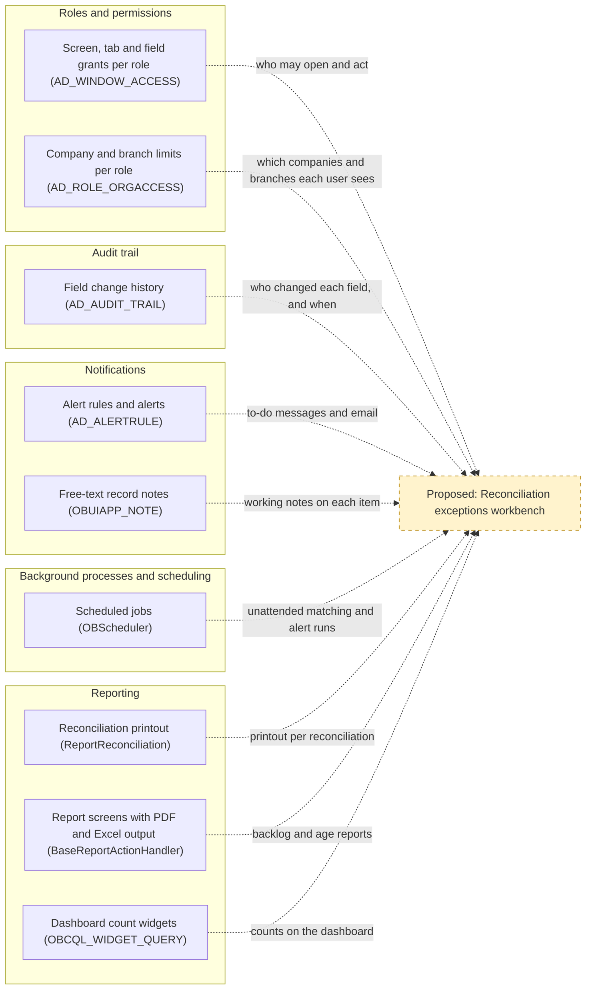

# Analysis 2: Extension Points, Reuse, and Risks for a Reconciliation Exceptions Workbench

## Key Takeaways

- Copy standard screens and pop-up grids such as `Match Statement`, not hand-built pages.
- Permissions, notifications and scheduled jobs (`AD_ROLE`, `AD_ALERT`, `OBScheduler`) are reusable as is.
- Bank lines in `FIN_BANKSTATEMENTLINE` have no owner, reason or status field.
- Importing, linking bank lines and confirming bank balances lack automated tests (`MatchTransactionDao`).
- First build a cross-account worklist like `aprm_matchstatement`, exception fields and scheduled linking.

## 1. UI Framework and Patterns to Follow

The workbench serves one objective: "reduce manual effort and cycle time in bank reconciliation. Most statement lines are matched without human touch, and every unmatched item has an owner, age, and reason code."

In this ERP (enterprise resource planning, the business software that keeps the company's accounts), a financial account (`FIN_FINANCIAL_ACCOUNT`) is the ERP record for one bank account, and a transaction (`FIN_FINACC_TRANSACTION`) is the ERP's record of money expected in or out of a financial account. A statement line (`FIN_BANKSTATEMENTLINE`) is one entry on the statement the bank sends, and matching links it to the transaction it settles. A reconciliation (`FIN_RECONCILIATION`) is the period document confirming the ERP balance agrees with the bank; a reason code records why an item is unmatched.

### 1.1 Technology Baseline

- **Server:** Java (the server's programming language), version 11 or later as `build.xml` enforces, built with Apache Ant (a build tool), version 1.9.2 or later.
- **Screens:** JavaScript (the browser's programming language) on Isomorphic SmartClient (a library of browser grids and forms), in `modules/org.openbravo.userinterface.smartclient`. Each screen is described in the Application Dictionary (the metadata that defines screens, tables and processes: stored records, not code), for example `AD_WINDOW`, `AD_TAB`, `AD_FIELD` and `OBUIAPP_PROCESS`.
- **Data:** PostgreSQL (the database), with each table's structure kept as XML (structured text) files under `src-db/database/model` and in each module's (a separately packaged part of the ERP) own database folder.
- **Java tests:** JUnit 4.13.2 (a Java test framework) and Mockito 4.11.0 (a tool that fakes other program parts in tests), both in `lib/test`, with tests in `src-test/src` and in module folders such as `modules/org.openbravo.client.application/src-test`.
- **Test runs:** `src-test/build.xml` runs two test suites (named bundles of tests): `run.all.tests` runs `StandaloneTestSuite`, `run.webservice.tests` runs `WebserviceTestSuite`, and `run.test` runs any single test, including those in neither suite.
- **User-interface tests:** Jest 29.7 (a JavaScript test runner), declared in `package.json`, runs three utility test files in `modules/org.openbravo.client.application/web-test`. `ViewGeneration`, in `StandaloneTestSuite`, only checks that screen definitions generate without errors. No test clicks through a screen, so new workbench screens start without automated screen-interaction tests.

### 1.2 Patterns for Windows, Views and Dashboards

| Pattern | Workbench use | Example in the code |
|---------|---------------|---------------------|
| Standard window (a data-entry screen with a header and sub-tabs) defined in the Application Dictionary | Exception records with their owner, reason and status | `Financial Account` window |
| Process definition, Pick and Execute (a pop-up grid where the user selects rows and runs an action) | Bulk assign, set reason, resolve | `Match Statement` (`OBUIAPP_PickAndExecute`), built on `BaseProcessActionHandler` |
| HQL-based table (a read-only list built from a database query, a saved request that selects records) | One worklist across all financial accounts, showing age | `aprm_matchstatement`, the Match Statement grid |
| Manual view (a custom-built screen registered in the Application Dictionary) | Only if a bespoke layout is needed | `OBUIAPP_AlertManagement` |
| Workspace and Query/List widgets (small panels on the Workspace dashboard, the latter showing a query's result) | Counts by age, owner and reason | `OBKMO_WIDGET_CLASS`, `OBCQL_WIDGET_QUERY` |
| Classic servlet (an older, hand-coded web page) | Avoid for new work; see Analysis 1, Section 1.2 and Analysis 1, Section 2 | `ImportBankFile`, `Reconciliation` |

Screens defined in the Application Dictionary get filtering and grid behaviour from the shared grid `OBGrid`, and role-based access (a role is a named set of screen and process permissions) through `AD_WINDOW_ACCESS` and `OBUIAPP_PROCESS_ACCESS`, without custom code. Servlets built on `HttpSecureAppServlet` need every page written by hand, which makes them slower to build and harder to keep consistent.

## 2. Reusable Components

**What this section tells you:** The workbench needs no new platform services: permissions, change history, alerts, scheduled jobs and reports already exist and are set up through records rather than new code. Each one has limits that turn into requirements, the largest being that nothing in the platform assigns a record to a person, so ownership must come from new data. Section 2.2 of this document rates each component and gives the reason, and Figure S2.1 shows how the five would feed the workbench.

Reuse fit is High when the component meets the workbench need through configuration or new records only, Medium when it exists but must be switched on or extended, and Low when it would need replacing.

### 2.1 What Exists Today

Each row names the parts a workbench can reuse without building them again; whether tests protect them is stated in Section 4 of this document, and field-level detail is in Appendix [Section 2 detail].

| Component | What exists |
|-----------|-------------|
| Roles and permissions | Each role is granted windows, processes and process definitions as editable or view-only (`AD_WINDOW_ACCESS`, `AD_PROCESS_ACCESS`, `OBUIAPP_PROCESS_ACCESS`), single tabs and fields can be made view-only inside a window grant (`AD_TAB_ACCESS`, `AD_FIELD_ACCESS`), and role inheritance (one role taking over another's grants) is handled by `RoleInheritanceManager`. The standard Finance role in `modules/org.openbravo.v3.datasets` holds the reconciliation windows (Financial Account to edit; Bank File Format and Matching Algorithm to view only) and processes (Reconciliation Details, Reconcile, Import Statement, Reconciliation Summary). Roles are also granted organizations (companies or branches) in `AD_ROLE_ORGACCESS`, limiting which records they see, and people receive roles in `AD_USER_ROLES`. A pop-up process opened from a window button inherits that window's grant unless it demands its own (`IS_EXPLICIT_ACCESS`, or the `SecuredProcess` preference, a stored setting), as `BaseProcessActionHandler` checks. |
| Audit trail | An audit trail (a log of who changed which field, and when) is kept in `AD_AUDIT_TRAIL`, which stores for each change the user, time, action, field, old and new value and the process that made it. It is shown in the `Audit Trail` window and per record by `AuditTrailPopup`. It is switched on table by table (`ISFULLYAUDITED`) and off by default, and single fields can be left out (`ISEXCLUDEAUDIT`). Reconciliation tables such as `FIN_BANKSTATEMENTLINE` already record who created and last changed each row, and when (`CREATED`, `UPDATED`). |
| Notifications | Alerts (system-generated to-do messages sent to a user or role) come from rules written as database queries (`AD_ALERTRULE`) and carry a status, user, role and note (`AD_ALERT`), with recipients and optional email set per rule (`AD_ALERTRECIPIENT`). `AlertProcess`, scheduled in the core setup data, raises one alert per new item and closes it once the rule stops returning that item, so an alert on an unmatched line would clear itself when the line is matched. Users acknowledge or suppress alerts in the Alert Management view (`OBUIAPP_AlertManagement`), and a rule can name the screen tab its alerts open (`AD_TAB_ID` on `AD_ALERTRULE`). A WebSocket (live browser connection) client, `MessageClientManager`, and free-text record notes, `OBUIAPP_NOTE`, also exist. |
| Background processes and scheduling | Background processes (jobs the system runs on a schedule without a user) run on a scheduler built on Quartz (a library that starts jobs at set times), `OBScheduler`, through process requests (saved schedules for one job) in `AD_PROCESS_REQUEST`, set in the `Process Request` window, each run logged in `AD_PROCESS_RUN`, reviewed in `Process Monitor`. Process groups (saved chains of jobs run in order, `AD_PROCESS_GROUP`) let one schedule run several jobs, and a job can be barred from running twice at once (`PREVENTCONCURRENT`). `FIN_BankStatementProcess` and `FIN_ReconciliationProcess` are already written in the form the scheduler runs. Automatic matching, however, sits inside a screen action, `MatchStatementOnLoadActionHandler`, so it must be moved out before it can run without a user. |
| Reporting | The printable reconciliation report, `ReportReconciliation`, lists outstanding payments, outstanding deposits and unreconciled statement lines, and is launched by the Reconciliation Details and Reconciliation Summary processes. Newer reports run as process definitions through `BaseReportActionHandler`, with layouts for PDF, Excel and web-page output linked in `OBUIAPP_REPORT`. Query/List widgets (`OBCQL_WIDGET_QUERY`) can show counts, their columns can open the record behind a row (`OBCQL_QUERY_COLUMN`), and each widget is granted per role (`OBKMO_WIDGET_CLASS_ACCESS`). |

### 2.2 Limits, Gaps and Fit

| Component | Limits and gaps | Reuse fit (High/Medium/Low) | Fit rationale |
|-----------|-----------------|-----------------------------|---------------|
| Roles and permissions | Grants open whole windows, tabs, fields and organizations, but no grant assigns records an owner: no reconciliation table has a field assigning a user or role (`FIN_BANKSTATEMENTLINE`, `FIN_FINANCIAL_ACCOUNT`), only who created or last changed a row, so ownership must come from the data. Organization grants (`AD_ROLE_ORGACCESS`) split work by company or branch, not by bank account or team. None of the standard roles in `modules/org.openbravo.v3.datasets/referencedata/standard/V3_Roles.xml` holds the `Alert`, `Process Request` or `Process Monitor` windows, and only Company Admin holds `Audit Trail`, so Finance staff need new grants before they can set up alerts and schedules or read change history. Which people hold the Finance role, and so who could own items, is installation data (`AD_USER_ROLES`) and not determinable from code. | High | Every workbench screen and action can be secured by adding grants, which is configuration only, so the fit is High. The objective's owner for every unmatched item is a data need, met by the owner field in Section 3 of this document, not a change to the permission model. Keeping access in these tables lets role inheritance (`RoleInheritanceManager`) pass workbench grants to every role built on Finance. |
| Audit trail | Switching auditing on for a table takes effect only after the system is rebuilt and the server restarted (`RegenerateAudit`, raised by `SL_TableAudit`), so it is a planned release step, not a setting users change. The log records what changed, by whom and when, but not why, so it cannot stand in for a reason code. Time spent in each status would have to be worked out from log entries (`EVENT_TIME` in `AD_AUDIT_TRAIL`) rather than read from a field. | Medium (see the note below the table) | The history store and its screens exist, but auditing must be switched on for the new exception fields, which is the switched-on case of the fit basis, so the fit is Medium. Once on, it shows who assigned, reassigned or closed each unmatched item, which supports owner accountability without new code (`AD_AUDIT_TRAIL`). |
| Notifications | The core setup runs `AlertProcess` once a day, just before midnight (`src-db/database/sourcedata/referencedData/AD_PROCESS_REQUEST.xml`), so a new unmatched line could wait up to a day for its alert unless that schedule is changed. Who sees an alert is set by the rule's recipients, one user or a whole role (`AD_ALERTRECIPIENT`), not by the user the rule's query returns, so showing each owner only their own items needs a rule filter on the signed-in user (`FILTERCLAUSE`) or one rule per owner. Each item raises one alert until it is solved, with no reminder or escalation as it ages, and email goes out only when an email server is configured (`EmailServerConfiguration`). The live message client is off unless the `OBUIAPP_Enable_Message_Manager` preference is switched on, and the repository defines no message for it to send (`MessageHandler`). | High | Aging and unassigned-item alerts need only new rule and recipient records, the configuration-only case of the fit basis, so the fit is High. Because `AlertProcess` closes an alert once its item no longer qualifies, alerts follow the unmatched backlog without anyone clearing them. The daily run and role-wide visibility are settings to plan, not reasons to replace the component. |
| Background processes and scheduling | Schedules are time-based only, from every few seconds to monthly or by calendar rule (`Frequency`), so matching after each import means either a frequent schedule or starting the job when the import finishes. The statement and reconciliation processes act on one record passed in by a button (`FIN_Bankstatement_ID`, `FIN_Reconciliation_ID`), so a scheduled run still needs a job that picks which statements to handle. Matching also needs the account's draft reconciliation, which today only the Match Statement screen action creates (`MatchStatementOnLoadActionHandler`). The bar on running twice at once stops only a second copy of the same job for the same organization, not a clash with users editing the same lines (`ProcessMonitor`). | High | The scheduler, its run log and its monitor need no change, since scheduling a new job takes only process and process request records (`AD_PROCESS_REQUEST`), so the fit is High. Building that job means moving matching out of the screen action, which Section 5 of this document sizes as effort rather than as a reuse gap. Scheduled matching is what lets lines match without human touch between an import and the next user session (Analysis 1, Section 5, item 5). |
| Reporting | The reconciliation report is an older, hand-coded page (`ReportReconciliation`, built on `HttpSecureAppServlet`) that prints one reconciliation of one account as a PDF, so it cannot show the backlog across accounts. No report breaks unmatched lines down by age, owner or reason, and no reconciliation widget or report definition ships in `modules/org.openbravo.advpaymentmngt`. A statement line keeps how it was matched (`MATCHINGTYPE`) but not when, since `FIN_BANKSTATEMENTLINE` holds only its bank date and its creation and last-change times, so a report can count the share of lines matched by the algorithm but can measure time to match only from the audit trail once it is switched on. | Medium | Dashboard counts and new report screens can be built on existing patterns (`OBCQL_WIDGET_QUERY`, `BaseReportActionHandler`), but each needs new queries and layouts, the extended case of the fit basis, so the fit is Medium. The existing printout stays useful per reconciliation but measures neither the objective's share of lines matched without human touch nor the age of open items. |

**Unconfirmed:** whether reconciliation tables are audited today, because auditing is switched on table by table in each installation and is off by default (consulted `AD_TABLE`, `ISFULLYAUDITED`, `AD_AUDIT_TRAIL`).

### 2.3 How the Components Feed the Workbench

Figure S2.1 maps each existing component to what it would supply: grants (`AD_WINDOW_ACCESS`, `AD_ROLE_ORGACCESS`) decide who may open and act, the audit trail and record notes (`AD_AUDIT_TRAIL`, `OBUIAPP_NOTE`) keep the history of each item, and alerts and scheduled jobs (`AD_ALERTRULE`, `OBScheduler`) keep work moving without a user. Reports and widgets (`ReportReconciliation`, `BaseReportActionHandler`, `OBCQL_WIDGET_QUERY`) would then show the backlog and its age. Only the workbench itself is new, which is why the effort sizes in Section 5 of this document assume these parts are reused rather than rebuilt.

**Figure S2.1. Existing Components Feeding the Proposed Workbench**

**How to read this:** Solid boxes exist in the code today and are grouped by the five components of Section 2.1 of this document, dashed boxes are proposed, and each dotted arrow names what a component would supply to the workbench.

### Supporting Detail for Appendix (Section 2)

| Topic | Detail |
|-------|--------|
| How Finance reaches pop-up processes | The Finance role's only process-definition grant is for an unrelated order process (`modules/org.openbravo.v3.datasets/referencedata/standard/V3_Roles.xml`). It can still run `Match Statement`, because that pop-up opens from a Financial Account button (`EM_APRM_MatchTransactions`) and inherits the window grant (`BaseProcessActionHandler`), so workbench pop-ups opened from a granted window need no grants of their own. |
| What one audit entry holds | Table, record, user, time, action (insert, update or delete), field, old and new value, and the kind of process and the process that made the change (`AD_AUDIT_TRAIL`). Inserts can be left out of the log table by table (`ISAUDITINSERTS`). |
| Alert lifecycle | An alert starts as New when `AlertProcess` raises it, a user moves it to Acknowledged or Suppressed and back to New in the Alert Management view (`modules/org.openbravo.client.application/web/org.openbravo.client.application/js/alert-management/ob-alert-grid.js`), and `AlertProcess` marks it Solved once the rule stops returning its item. A rule whose query does not start with a select, or fails, is skipped and noted only in the job's run log (`AlertSelectConstraint`, `AD_PROCESS_RUN`), so a broken rule fails silently for users. Email from one run lists every new alert of the rule and goes to each recipient user, or to every user of a recipient role (`AD_ALERTRECIPIENT`). |
| Scheduling options and run log | A process request can run now, later, or repeat every chosen number of seconds, minutes, hours, days, weeks or months, or follow a calendar rule (`Frequency`, `AD_PROCESS_REQUEST`). Each run records its status, start and end time, duration, result and log text (`AD_PROCESS_RUN`), and a process group can stop at its first failing job (`STOPWHENFAIL` on `AD_PROCESS_GROUP`). |
| Report output formats | Report screens built on `BaseReportActionHandler` export to PDF, Excel or a web page and refuse other formats (`OBUIAPP_UnsupportedAction`), while the reconciliation printout is produced only as a PDF (`ReportReconciliation`). |

**Requirement implications:** Requirements should reuse these five components as they stand and specify only what they lack: an owner field that drives personal work lists and alert targeting, auditing switched on for the exception fields, an unattended matching job, and backlog reports by age, owner and reason.

## 3. Data Model: Required Changes vs Current Support

Analysis 1, Section 4.3 identifies the gaps in the schema (the database structure).

| Current schema already supports | Change required |
|---------------------------------|-----------------|
| Unmatched state: a line in `FIN_BANKSTATEMENTLINE` with an empty `FIN_FINACC_TRANSACTION_ID` | An explicit exception status, for example open, assigned or resolved |
| Age, derived from the bank date `DATETRX` or the record creation time `CREATED` | None; age is calculated, not stored |
| Who created or last changed a line (`CREATEDBY`, `UPDATEDBY`) | An owner (a user) for each unmatched item |
| Free text in `DESCRIPTION` | A list of reason codes and a reason on each item |
| Match strength in `MATCHINGTYPE`: AU strong (found by the algorithm's primary rules), AP weak (found only by its looser fallback rules), MA matched by hand, and AD linked to a transaction added by hand; plus what the line was matched against in `MATCHED_DOCUMENT` | A confirmation flag, needed only for the weak-match queue in Section 5.2 of this document |
| Record notes (`OBUIAPP_NOTE`) and change history (`AD_AUDIT_TRAIL`) | Auditing switched on for the new fields |
| Three on/off switches and a pluggable rule program (`CLASSNAME`) in `FIN_MATCHING_ALGORITHM`, the matching algorithm record (a saved set of matching rules that one or more financial accounts use) | Amount and date tolerance settings (how far amounts and dates may differ and still match), needed only for tolerance matching in Section 5.2 of this document |
| A trigger (a database rule run on every change), `APRM_FIN_BNKSTM_LINE_CHECK_TRG`, which locks only the original bank fields once a statement is processed | None; new exception fields stay editable after processing |

## 4. Integration Points and Regression Risks

An area is tested when a test in the repository exercises that area's own behaviour, directly or through helper code, wherever the test sits; otherwise it is untested. A shared mechanism tested on another table or process does not make a reconciliation area tested, so each label says in brackets what the test covers, whether a suite runs it, and what stays uncovered.

| Area | Integration point | Regression risk | Tested |
|------|-------------------|-----------------|--------|
| Statement import | `ImportBankFile`, `FIN_BankStatementImport`, installed bank file format modules (add-ons that each read one bank's file layout) | New line fields must not break the format modules that create lines | untested (no test refers to either class) |
| Statement processing | `FIN_BankStatementProcess`, `APRM_FIN_BNKSTM_LINE_CHECK_TRG` | Date checks and line locks can block exception updates that alter bank data or add or remove processed lines | untested (no test refers to either) |
| Automatic matching | `StandardMatchingAlgorithm`, `MatchTransactionDao`; see Analysis 1, Section 3 | Moving or changing matching alters which lines clear and can create wrong strong matches; editing a shared `FIN_MATCHING_ALGORITHM` record changes every account that uses it | untested (no test refers to the matching classes) |
| Manual match, split, unmatch | `APRM_MatchingUtility` | Splits, merges and deletion of algorithm-created records must keep exception data consistent | untested (no test refers to it) |
| Match Statement grid | `aprm_matchstatement` | Extra query columns can slow or break the grid | untested (`HQLDataSourceTest`, in `WebserviceTestSuite`, covers HQL-based tables only on `Aprm_Credit_To_Use`; the Match Statement query and its speed are not covered) |
| Reconciliation completion and balances | `FIN_ReconciliationProcess`, `FIN_ReconciliationEventListener` | Holding completion for open exceptions changes how later balances are recalculated | untested (no test refers to either class) |
| Posting | `DocFINReconciliation`, `AcctServerProcess` | Write-off (booking a small unexplained difference as an expense) or adjustment actions create entries that posting (creating the accounting entries in the general ledger) must handle | tested (`RecordID2Test`, in `StandaloneTestSuite`, removes and recreates three sample reconciliations' entries and checks balances; posting of new adjustment entries is not covered) |
| Payments feeding candidates | `FIN_PaymentProcess`, `FIN_TransactionProcess` | Payment status changes alter the transactions matching can choose from | tested (payment processing, by `CancelAndReplaceTest` in `StandaloneTestSuite` and by the payment tests through `TestUtility`, runnable only through `run.test`; how matching uses the resulting transactions is not covered) |
| Roles and access | `AD_WINDOW_ACCESS`, `OBUIAPP_PROCESS_ACCESS` | New screens need grants for the Finance role | tested (role inheritance and access checks, `RoleInheritanceTestSuite` in `StandaloneTestSuite`; grants for new screens are not covered) |
| Alerts | `AlertProcess`, `AD_ALERTRULE` | Errors in a rule's query appear only when it runs | untested (alert rules appear only as stored data, for example in `DalLockingTest`; no test runs `AlertProcess`) |
| Scheduling | `OBScheduler`, `ProcessRunner`, `AD_PROCESS_REQUEST` | A scheduled matching run can collide with users editing the grid | tested (scheduler only: `ProcessSchedulingTest` with test-only jobs, `TriggerProviderTest` and `MisfirePolicyTest`, all in `StandaloneTestSuite`; matching alongside user edits is not covered) |
| Reporting | `ReportReconciliation` and its JasperReports (report-layout engine) templates | Template changes stop the report from building | tested (building only: `AllJrxmlCompilation`, in `StandaloneTestSuite`; the reconciliation report's content is not covered) |
| Audit trail | `AD_AUDIT_TRAIL`, `ISFULLYAUDITED` | Auditing busy tables adds database write load | untested (`ETagGeneration` switches auditing on `C_ORDER` only to test when browsers reuse saved pages; no test reads the audit trail) |

## 5. Recommended Capability Set

Impact is High when a capability itself raises the share of lines matched with no person acting, or itself gives unmatched items an owner, age or reason code; Medium when it cuts the effort or cycle time of work people still do; Low when it only measures, records or displays the work. Effort S means configuration or metadata on an existing component; M means new fields, a screen, a process definition or a background process built from existing patterns; L means new or changed matching logic in an untested area.

Each tier is ranked by impact (High, Medium, Low), then effort (S, M, L); ties keep the order of the effort sources in Analysis 1, Section 5, lowest item number first, then the order shown. Item numbers below refer to those effort sources, and each capability names the existing part it reuses. **Assumption:** effort sizes assume reuse of the patterns and components in Sections 1 and 2 of this document.

### 5.1 Minimum-Viable Tier

| Rank | Capability | Impact | Effort |
|------|------------|--------|--------|
| 1 | Cross-account exceptions worklist showing each unmatched line's age (items 1 and 4; an HQL-based table like `aprm_matchstatement`) | High | M |
| 2 | Owner, reason code and status on every unmatched line (item 4; new fields on `FIN_BANKSTATEMENTLINE`) | High | M |
| 3 | Automatic matching after each import as a scheduled background process (item 5; `OBScheduler`) | High | M |
| 4 | Alerts to owners for aging items and to the Finance role for unassigned items (item 4; `AD_ALERTRULE`, `AlertProcess`, `AD_ALERTRECIPIENT`) | Medium | S |
| 5 | Dashboard widget with exception counts by age, owner and reason (item 4; `OBCQL_WIDGET_QUERY`) | Low | S |

### 5.2 Full-Scope Tier

These capabilities add to the minimum-viable tier.

| Rank | Capability | Impact | Effort |
|------|------------|--------|--------|
| 1 | Tolerance matching: amount and date windows and partial partner names (item 2; a new rule set through `FIN_MatchingAlgorithm`) | High | L |
| 2 | Matching rules learned from manual resolutions (item 2; the partner-guessing approach in `FIN_BankStatementImport`) | High | L |
| 3 | Bulk actions: assign, set reason, create bank-fee transactions (item 1; `AddTransactionActionHandler`) | Medium | M |
| 4 | Queue to accept or reject weak matches in bulk (item 3; `MATCHINGTYPE` in a Pick and Execute grid) | Medium | M |
| 5 | Audit history on the exception fields (item 4; `AD_AUDIT_TRAIL`) | Low | S |
| 6 | Reporting of the share of lines matched untouched and of cycle time (items 1 and 5; `BaseReportActionHandler`) | Low | M |

The weak-match queue is Medium, not High, because weak matches are already applied automatically (`MatchStatementOnLoadActionHandler`), so the queue cuts correction effort rather than raising the share of lines matched with no person acting.
