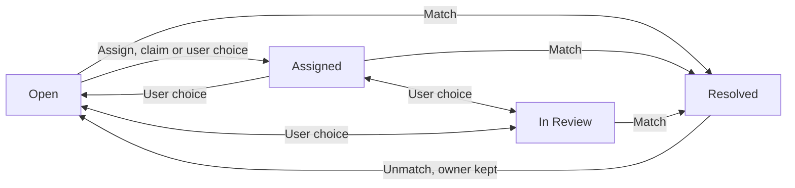

# Requirements: Bank Reconciliation Exceptions Workbench

## Key Takeaways

- Every bank statement line left unlinked gets an owner (the person accountable), a status (its stage), a reason code (why it is open) and an age in days.
- Three phases: data foundation; a cross-account list, to-do alerts and dashboard counts; then matching on a timetable with no person acting.
- Cash accounts and bank accounts without saved matching rules keep today's screens; six deferred items get only a hook.
- The conflicts register settles the main mismatches: alerts count per company or branch, a reopened earlier period limits matching, and fields reach every line.
- Still `TBD`, numbers to be set by measurement: the share of lines counting as "most", the cycle-time target and load times; age bands await a decision.

## 1. Summary

### 1.1 What the workbench does

The request's objective is: "Reduce manual effort and cycle time in bank reconciliation. Most statement lines are matched without human touch, and every unmatched item has an owner, age, and reason code." A reconciliation is the period document confirming the system's balance agrees with the bank; cycle time is the time from statement import to completed reconciliation, and manual effort is the staff work reconciliation takes.

Today, matching, linking a statement line (one entry on the statement the bank sends) to the transaction it settles, waits until someone opens Match Statement, the screen opened from a bank account to match its lines (Analysis 1, Section 3.3). A transaction is the system's record of money expected in or out of a financial account, the system's record for one bank account or one cash account; a matching algorithm is the saved set of matching rules a bank account uses.

The workbench is the whole set of capabilities this document specifies. Each unmatched line, a line on a processed statement (one the system has confirmed) not yet linked to a transaction, becomes an exception, an unmatched line under the workbench's tracking. Each exception gets an owner (the person accountable for resolving a line), an exception status (a line's stage in the workbench), a reason code (a coded record of why a line is unresolved) and an age (whole calendar days since the bank's date for the line), none recorded today (Analysis 1, Section 4.3).

The request's five capabilities are exception fields; the worklist, the single list of exceptions across all in-scope bank accounts (those with a matching algorithm); alerts, each a system-generated on-screen to-do message sent to a user or role (a named set of screen and process permissions); the counts widget, a dashboard tile showing counts from a saved query; and scheduled matching by a scheduled job, work the system runs on a timetable without a user. Section 1.2 breaks them into nine, F1 to F9, by phase.

### 1.2 Delivery phases

The phases follow Analysis 2, Section 6: data before what reads it, visible before unattended, and tests before changes. Each phase ends with its test gate, the tests that must pass before a phase is accepted (Sections 4.2.12, 4.3.12 and 4.4.4). The order rests on the effort ranking of Analysis 1, Section 5 (A-2).

| Phase | Capabilities | What users get |
|---|---|---|
| Phase 1: Data foundation | F1 Exception fields, F3 Weak-match flag, F4 Measurement stamps | Each line can carry a status, owner, reason code and due date (an optional target date for resolving it), kept right on every match and unmatch (undoing a link). A weak match, a link the rules made using only their looser fallback checks, carries an unconfirmed weak match flag, meaning no confirmation has been recorded for it. Measurement stamps are each match's recorded time and source and each reconciliation's completion time. A backfill, filling a new field for rows that already exist, sets existing unmatched lines to Open. |
| Phase 2: Visibility and follow-up | F2 Age, F5 Worklist, F6 Alerts, F7 Counts widget, F8 Reconcile warning | Ages in age bands, the ranges of ages used to group lines, and the worklist, with filters and single-line actions. Daily alerts reach owners and the Finance role, the standard role for finance staff. The counts widget shows the backlog, and a warning flags lines left at completion. |
| Phase 3: Automated matching | F9 Scheduled matching | Today's rules run after each import and nightly, so the worklist holds only what they could not match. |

### 1.3 What is excluded and deferred

Excluded accounts are cash accounts and bank accounts with no matching algorithm, which use the older Reconciliation screen to tick cleared transactions without linking statement lines (Analysis 1, Section 1.3). Their users see what they see today; Operations acceptance is O-05.

| Area | In-scope bank account | Excluded account |
|---|---|---|
| Financial account buttons | Import Statement and Match Statement | Reconcile, opening the older Reconciliation screen |
| Worklist and counts widget | Listed and counted | Never listed or counted |
| Aging and unassigned alerts | Raised daily | None |
| Reconcile warning | Shown when lines remain | None |
| Scheduled matching | After each import and nightly | Skipped and logged |
| Exception fields | Set by worklist actions, match and unmatch | Creation default and release backfill only; shown nowhere |

The table-wide data foundation sets these accounts' new and existing unmatched processed lines to Open (REQ-01, REQ-08, C-18), but no workbench requirement (REQ-12 to REQ-25) targets them.

Analysis 2, Section 5.2 ranks six full-scope capabilities this release defers, each with a hook and no requirement.

| Deferred item | Hook it relies on | Requirement in this release |
|---|---|---|
| Tolerance matching (rank 1) | F3 flag, so looser matches land as unconfirmed weak matches; F4 stamps, a before-and-after baseline | None |
| Learned rules (rank 2) | F3 flag and F4 stamps | None |
| Bulk actions (rank 3) | Ordinary stored F1 fields with defined change rules (Section 4.1.2) | None |
| Weak-match review queue (rank 4) | F3 flag | None |
| Audit history (rank 5) | Every new field is stored, so the change log can record it once switched on (Analysis 2, Section 2.2) | None |
| Match-rate and cycle-time reporting (rank 6) | F4 stamps | None |

## 2. Traceability

### 2.1 Traceability table

Each row links a finding of the analyses to its capability, requirements, phase and objective element, one of the six that Analysis 1, Section 6 lists (C-02), such as the auto-match rate, the share of statement lines matched with no person acting.

| Analysis finding | Capability (F#) | REQ IDs | Objective element | Phase |
|---|---|---|---|---|
| Lines have no owner, reason, status or due date (Analysis 1, Section 4.3; Analysis 2, Section 3) | F1 | REQ-01 to REQ-08 | Owner, reason code | 1 |
| Free text cannot be counted by cause (Analysis 1, Sections 4.3 and 6) | F1 | REQ-03 | Reason code | 1 |
| The processing lock, the database rule that stops changes to the bank's own details on a confirmed statement, leaves new fields editable (Analysis 2, Sections 3 and 5.1, rank 2) | F1 | REQ-07, NFR-04 | Owner, reason code | 1 |
| Weak matches are applied unconfirmed, and wrong links surface only on review (Analysis 1, Sections 3.3 and 5, item 3; Analysis 2, Section 5.2, rank 4) | F3 | REQ-09 | Auto-match rate, manual effort | 1 |
| Run counts are not stored, unmatching clears the match level (the code recording how a line was matched), and no match or completion time is kept (Analysis 1, Sections 6 and 7; Analysis 2, Section 5.2, rank 6) | F4 | REQ-10, REQ-11 | Auto-match rate, cycle time | 1 |
| Age can be derived but is never shown (Analysis 1, Sections 4.3 and 6) | F2 | REQ-12 | Age | 2 |
| No view spans accounts, and line-by-line resolution is the largest effort (Analysis 1, Sections 4.1 and 5, item 1; Analysis 2, Section 5.1, ranks 1 and 2) | F5 | REQ-13 to REQ-18 | Owner, age, reason code, manual effort | 2 |
| Nothing watches lines, and carried-forward lines, unmatched lines left open when a reconciliation completes, are not marked as old (Analysis 1, Sections 4.2 and 4.3; Analysis 2, Section 5.1, rank 4) | F6 | REQ-19, REQ-20 | Owner, age | 2 |
| No one sees the whole backlog (Analysis 1, Section 4.1; Analysis 2, Section 5.1, rank 5) | F7 | REQ-21 | Owner, age, reason code | 2 |
| Reconcile gives no warning that lines remain (Analysis 1, Section 4.2) | F8 | REQ-22 | Cycle time, owner | 2 |
| Nothing is matched between import and a user session, and nothing signals a waiting statement (Analysis 1, Sections 3.3 and 5, item 5; Analysis 2, Section 5.1, rank 3) | F9 | REQ-23 to REQ-25 | Auto-match rate, cycle time, manual effort | 3 |
| Worklist speed cannot be determined from code (Analysis 2, Sections 1.4 and 7) | F5, F7 | NFR-01 | Manual effort | 2 |
| Organization grants limit each role to its organizations, the companies or branches whose records a role may see (Analysis 2, Section 2.2) | F5 to F7 | NFR-02 | Owner | 2 |
| Posting, creating the accounting entries in the general ledger (the company's books), is High severity and only partly tested (`RecordID2Test` reposts existing reconciliations); statement processing is High severity and untested; the processing lock covers only the bank's fields (Analysis 2, Sections 3 and 4.2) | F1, F4, F9 | NFR-03, NFR-04 | Safeguard, no element | 1 to 3 |

### 2.2 Two-way check

Forward, each of F1 to F9 has at least one requirement; backward, every REQ and NFR names its capability, cites both analyses and appears in Sections 2.1 and 9. Reading each cited section against its requirement found these gaps:

| Item | What the check found |
|---|---|
| REQ-22 | Not a miss: Analysis 2 has no finding on a reconcile warning, so its only Analysis 2 source is a risk row. |
| NFR-01, NFR-02 | Partial: Analysis 1 supports only that volumes are unknown (Analysis 1, Section 7) and that roles grant access (Analysis 1, Section 2.1); speed and organization scoping rest on Analysis 2. |

## 3. Conflicts

### 3.1 Conflicts register

Code evidence is a file and line numbers at `master` commit `77692f968d`; full paths close Section 3.2.

| ID | What the request or a source says against what the code or a source shows | Requirements affected | Resolution |
|---|---|---|---|
| C-01 | The stated paths `docs/analysis/analysis-1-current-state-reconciliation.md`, `docs/analysis/analysis-2-extension-points-and-risks.md` and `blitzy/documentation/Project Guide - e5d40ea1-c3ed-4994-87eb-e962dec9dc66.md` are absent from `master` and sit on branch `blitzy-e5d40ea1-c3ed-4994-87eb-e962dec9dc66`, read at `68ab20e6bd`; later commits `e26102ab7b` to head `af6933f42b` reword both analyses but keep every heading. | All citations | Cite by stated path and section number, valid at both commits. |
| C-02 | The request names four Analysis 1, Section 6 elements and adds cycle time and manual effort, which that section already lists. | Section 6 | Use its six once each. |
| C-03 | The Project Guide describes earlier analyses: 8 steps, 17 manual actions and 13 integration areas (Project Guide, Sections 1.1 and 1.3), not today's 12, 55 and 17. U1 to U7 and A-1 to A-3 appear only in Project Guide, Sections 1.4 and 2.1, which agree. | Section 7 | Findings from the analyses, identifiers from the Project Guide; none is missing. |
| C-04 | The request wants owner aging alerts from new alert rules (saved queries that raise alerts) and one recommended design. Alerts show only to recipient users or roles (`ADAlertDatasourceService.java:99-109`), a filter clause can narrow them to the owner (`ADAlertDatasourceService.java:152-173`), and email reaches every user of each recipient role (`AlertProcess.java:343-452`). An alert repeats only once the earlier one is solved, keyed by a 32-character reference (`AlertProcess.java:109-111`; `AD_ALERT.xml:68`). | REQ-19, NFR-02 | One rule with an owner filter, recipients every role granted the worklist, on screen, no email; one rule per owner is rejected, as each new owner would need one, conflicting with claiming. It raises one alert per owner per organization per day, because Alert Management, the screen listing a user's alerts, hides whole alerts by organization, never a count inside one (`ADAlertDatasourceService.java:165-183`). This departs from "one alert per owner per day" only for owners in several organizations. The key changes daily, so the previous day's alert closes itself (`AlertProcess.java:475-484`). |
| C-05 | Analysis 2, Section 5.1, rank 4 gives Finance one alert per unowned line; the request asks for a daily digest, one alert carrying a count instead of one alert per line. | REQ-20 | One digest per organization, so users see only counts they may read (`ADAlertDatasourceService.java:169-170`). |
| C-06 | Analysis 2, Section 6 puts the confirmation flag in its Phase 5 and measurement in its Phase 4; the request puts F3 and F4 in Phase 1. | REQ-09 to REQ-11 | Follow the request; the flag gains a reader in Phase 2 (REQ-13), and only the stamps wait for the deferred reporting. |
| C-07 | The request cites Analysis 2, Sections 4 and 6 for every gate; Analysis 2, Section 6 names gates only for its Phases 1, 3, 5 and 6. | Section 4.3.12 | Draw the Phase 2 gate from the Analysis 2, Section 4.2 mitigations. |
| C-08 | No test clicks through a screen (Analysis 2, Section 4), and the browser test runner covers three utility files (Analysis 2, Section 1.1), so the warning's display has no automated test. | REQ-22 | JUnit, the Java test framework, for the server response; a recorded manual test for the display. |
| C-09 | Analysis 2, Section 4.2 has no widget row, no test refers to `QueryListDataSource`, and the widget query runs with elevated rights (`QueryListDataSource.java:164`), so the organization limit must sit in the query, as in shipped widgets (`OBUIAPP_PARAMETER.xml:188-190`). | REQ-21, NFR-02 | Add a datasource test on the existing harness (`BaseDataSourceTestDal.java:43`). |
| C-10 | The request says reactivating an "earlier" reconciliation is refused while a draft reconciliation, an unfinished one, exists; the code refuses any of the account's reconciliations, latest included, forced or not (`FIN_ReconciliationProcess.java:121-139`). | REQ-25 | The job reuses the draft and creates one only when it links a line; users finish or delete a draft first, as today (Analysis 1, Section 2.1, rows 44 and 51). |
| C-11 | The request opens a line "in Match Statement", which opens only from a financial account record (`MatchStatementOnLoadActionHandler.java:59`; `AD_FIELD.xml:13477`). With an earlier reconciliation as the open draft, the account shows Match Transactions Force, the variant limited to that period (`AD_FIELD.xml:16298-16304`), listing only lines up to its end date (`MatchStatementTransformer.java:74-78`). | REQ-17 | The worklist opens the line's financial account (`ResponseActionsBuilder.java:136-185`), one click from Match Statement. A line dated after an earlier open draft's end date stays absent until that draft is completed or deleted (C-10), so not every row resolves at once. A direct launch would need new screen code, which Analysis 2, Section 1.2 advises against. |
| C-12 | F1 adds a due date that F5 never shows, and alerts use age. | REQ-04, REQ-13, REQ-15 | Show and edit it on the worklist; no alert uses it. |
| C-13 | Users set status, yet Resolved is automatic on a match. | REQ-05, REQ-15 | Per the edit policy (Section 4.1.2), users choose Open, Assigned or In Review, and only a match sets Resolved. |
| C-14 | F3 calls weak matches unconfirmed; the match-level list labels them "Approved" (`AD_REF_LIST.xml:9273-9274`). | REQ-09 | No relabel; the flag reads "Unconfirmed weak match", and the glossary explains the label. |
| C-15 | Analysis 2, Section 3 would confirm existing weak matches by backfill; the request backfills status only. | REQ-08, REQ-09 | No flag backfill; the deferred review queue decides older weak matches. |
| C-16 | Excluded accounts can hold hand-entered processed statements (Analysis 1, Section 2.1, row 13). | REQ-13, REQ-21 | The worklist and counts widget cover only in-scope accounts. |
| C-17 | F5 lists unmatched lines yet shows the weak-match flag, which only matched lines carry. | REQ-09, REQ-13, REQ-15 | The worklist also lists weak-flagged lines of a draft reconciliation, Resolved and read-only, until completion, as the Match Statement grid lists draft-matched lines (`MatchStatementTransformer.java:66-67`). Alerts and the counts widget count unmatched lines only. |
| C-18 | F1 puts the fields on every line and backfills every unmatched processed line, including excluded accounts' hand-entered ones (C-16). | REQ-01, REQ-08; Section 1.3 | Treat F1 as a table-wide data foundation, so an account that later gains a matching algorithm arrives classified; every workbench behaviour (REQ-12 to REQ-25) excludes those accounts. |

### 3.2 Confirmed as described

Every other name the request uses exists as described.

| Name in the request | What it is | Confirmed in |
|---|---|---|
| `FIN_BANKSTATEMENTLINE` | Statement-line table, with no owner, status, reason, due date or flag column, even from modules | `FIN_BANKSTATEMENTLINE.xml:2-112` |
| `DATETRX` | Bank's date for the line, required and copied to a remainder | `FIN_BANKSTATEMENTLINE.xml:52`; `APRM_MatchingUtility.java:806` |
| `MATCHINGTYPE` | Match level: AU Auto, AP Approved, MA Manual, AD Added, NO None (C-14) | `FIN_BANKSTATEMENTLINE.xml:68`; `AD_REF_LIST.xml:9273, 10822, 11763, 12112, 13881` |
| `DESCRIPTION` | Free text up to 2,000 characters | `FIN_BANKSTATEMENTLINE.xml:76` |
| `AD_USER` | System users | `AD_USER.xml:3` |
| `AD_ALERTRULE` and recipient records | Rules with filter clause and query; recipient records with a required role, optional user and send-email flag (C-04) | `tables/AD_ALERTRULE.xml:40-48`; `AD_ALERTRECIPIENT.xml:4, 44, 48`; `AD_ALERT.xml:44-68` |
| `OBCQL_WIDGET_QUERY` | Query/List widget query, granted by role (C-09) | `OBCQL_WIDGET_QUERY.xml:36-47`; `OBKMO_WIDGET_CLASS_ACCESS.xml:3` |
| `MatchStatementOnLoadActionHandler` | Opens Match Statement on one account's draft, matching only on acceptance and showing, not storing, the count | `MatchStatementOnLoadActionHandler.java:59-98, 117-172` |
| `APRM_MatchingUtility` | Writes each match and unmatch in one place, unmatch clearing the match level; copies a line before dividing it, deletes parts when rejoining, and reads the browser for messages | `APRM_MatchingUtility.java:283-329, 377-436, 445-496, 801-806, 868-870` |
| `AlertProcess` | Runs alert rules as process 800170, daily at 23:59 (C-04, C-05) | `AlertProcess.java:106-162`; `AD_PROCESS_REQUEST.xml:47, 54, 56`; `Frequency.java:27` |
| `OBScheduler` | Starts jobs now or on saved schedules | `OBScheduler.java:124, 159` |
| `Reconciliation` servlet | The older manual Reconciliation screen, completing on its own | `Reconciliation.java:74, 357` |
| `aprm_matchstatement` | HQL-based table behind the Match Statement grid, HQL being the query language that selects the records a list shows | `sourcedata/AD_TABLE.xml:218, 230` |
| Match Statement | A Pick and Execute screen, a pop-up grid where a user selects rows and runs an action on them (C-11); its Reconcile All, the action that completes a reconciliation, returns a plain success message | `OBUIAPP_PROCESS.xml:84, 91`; `AD_WINDOW.xml:205, 208`; `MatchStatementActionHandler.java:59-66` |
| Finance role | Standard "Finance" role of the V3 Roles dataset: Financial Account (editable), Import Statement, Reconcile and both reconciliation reports; no alert-recipient or widget grant | `V3_Roles.xml:1898-1906`; `AD_DATASET.xml:8-13` |
| `APRM_DraftReconciliationExists` | Refuses reactivation while a draft exists (C-10) | `AD_MESSAGE.xml:849-850`; `FIN_ReconciliationProcess.java:132-139` |
| "Old not processed Bank Statements" | Inactive rule `1000010` on the older `c_bankstatement` table, flagging statements unprocessed over 10 days | `referencedData/AD_ALERTRULE.xml:150` |
| Processing-lock trigger `APRM_FIN_BNKSTM_LINE_CHECK_TRG` | Locks only the bank's own fields on processed or matched lines | `APRM_FIN_BNKSTM_LINE_CHECK_TRG.xml:46-56, 63, 67, 72-83` |
| Pick and Execute | Pattern of Find Transactions to Match and Match Statement | `OBUIAPP_PROCESS.xml:14, 91` |
| Draft reconciliation | Status `DR`, checked before reactivation (C-10); completion stores no time | `APRM_MatchingUtility.java:681`; `FIN_ReconciliationProcess.java:99-106, 189-202`; `FIN_RECONCILIATION.xml:48-64` |

```text
Files named in Sections 3.1 and 3.2, under their folders
modules/org.openbravo.advpaymentmngt/src-db/database/model/triggers/
  APRM_FIN_BNKSTM_LINE_CHECK_TRG.xml
modules/org.openbravo.advpaymentmngt/src-db/database/sourcedata/
  AD_FIELD.xml, AD_MESSAGE.xml, AD_TABLE.xml, AD_WINDOW.xml, OBUIAPP_PROCESS.xml
modules/org.openbravo.advpaymentmngt/src/org/openbravo/advpaymentmngt/
  actionHandler/MatchStatementActionHandler.java
  actionHandler/MatchStatementOnLoadActionHandler.java
  ad_actionbutton/Reconciliation.java
  hqlinjections/MatchStatementTransformer.java
  process/FIN_ReconciliationProcess.java
  utility/APRM_MatchingUtility.java
modules/org.openbravo.client.application/src/org/openbravo/client/application/
  ADAlertDatasourceService.java
  process/ResponseActionsBuilder.java
modules/org.openbravo.client.myob/src-db/database/model/tables/
  OBKMO_WIDGET_CLASS_ACCESS.xml
modules/org.openbravo.client.querylist/src-db/database/model/tables/
  OBCQL_WIDGET_QUERY.xml
modules/org.openbravo.client.querylist/src-db/database/sourcedata/
  OBUIAPP_PARAMETER.xml
modules/org.openbravo.client.querylist/src/org/openbravo/client/querylist/
  QueryListDataSource.java
modules/org.openbravo.v3.datasets/referencedata/standard/
  V3_Roles.xml
modules/org.openbravo.v3.datasets/src-db/database/sourcedata/
  AD_DATASET.xml
src-db/database/model/tables/
  AD_ALERT.xml, AD_ALERTRECIPIENT.xml, AD_ALERTRULE.xml, AD_USER.xml,
  FIN_BANKSTATEMENTLINE.xml, FIN_RECONCILIATION.xml
src-db/database/sourcedata/
  AD_REF_LIST.xml
src-db/database/sourcedata/referencedData/
  AD_ALERTRULE.xml, AD_PROCESS_REQUEST.xml
src-test/src/org/openbravo/test/datasource/
  BaseDataSourceTestDal.java
src/org/openbravo/erpCommon/ad_process/
  AlertProcess.java
src/org/openbravo/scheduling/
  Frequency.java, OBScheduler.java

Evidence for the tests and tools that Sections 4 and 7 reuse
Phase 2 gate harnesses, run in the web-service suite (Section 4.3.12)
  src-test/src/org/openbravo/test/datasource/HQLDataSourceTest.java:31-60
  src-test/src/org/openbravo/test/datasource/DataSourceSecurity.java:57-64
  src-test/src/org/openbravo/test/WebserviceTestSuite.java:93, 102
Standalone suite with the scheduling and posting tests (Sections 2.1, 4.2.12, 4.4.4, 5.1.3)
  src-test/src/org/openbravo/test/StandaloneTestSuite.java:309, 343
  src-test/src/org/openbravo/scheduling/ProcessSchedulingTest.java:42-48, 94-101
  src-test/src/org/openbravo/test/accounting/RecordID2Test.java:59-69, 97-121
Build targets that run both suites
  src-test/build.xml:76-103
Browser test runner (Jest) and its three utility tests (C-08)
  package.json:44-49
  modules/org.openbravo.client.application/web-test/
    ob-utilities-date.test.js:20-24
    ob-utilities-number.test.js:30-36
    ob-utilities-validUrl.test.js:25-30
Grid column filters and saved views (REQ-14)
  modules/org.openbravo.client.application/web/org.openbravo.client.application/js/grid/
    ob-grid.js:1248-1261
    ob-view-grid.js:1350-1365
Scheduler run log (REQ-24)
  src/org/openbravo/scheduling/ProcessLogger.java:19-20, 44-57
  src/org/openbravo/scheduling/ProcessRunner.java:82-83, 99-102
Record locking (REQ-25)
  src/org/openbravo/dal/service/OBDal.java:752-791
Process-response warnings (REQ-22)
  modules/org.openbravo.client.application/src/org/openbravo/client/application/process/
    ResponseActionsBuilder.java:39-40, 82-85, 120-127
Audit state (U6): auditing per table, a separate setting for new records, excludable columns
  src-db/database/model/tables/AD_TABLE.xml:120-127
  src-db/database/sourcedata/AD_ELEMENT.xml:31346-31350
  src/org/openbravo/erpCommon/ad_callouts/SL_TableAudit.java:38-51
  src-db/database/model/tables/AD_COLUMN.xml:184-186
```

## 4. Requirements by Phase

### 4.1 How to read a requirement

#### 4.1.1 Entry format

Each requirement keeps a fixed ID; a dropped one is marked "Withdrawn", so ticket links stay valid. Each acceptance criterion is a Given/When/Then statement, a three-part test statement: one starting state, one action and one observable result. The regression risk, a chance that something working today breaks, names its Analysis 2, Section 4.2 integration areas and their severity.

#### 4.1.2 Edit policy

This is the one statement of who may change the new fields; REQ-07, REQ-15, REQ-16, C-13 and C-17 follow it. A split divides a line into a matched part and an unmatched remainder, and a merge rejoins the unmatched parts.

| Record | Users may change | Through | The system changes |
|---|---|---|---|
| Unmatched line of an in-scope account (bank account with a matching algorithm) | Owner (Finance assigns, giving a line to someone; any worklist user claims, taking an unassigned line for oneself), reason code, due date, and status among Open, Assigned and In Review | Worklist actions only, one line per action; bulk actions are deferred | Status to Assigned on assign or claim of an Open line; status, flag and stamps on a match |
| Matched line, including Resolved weak-match rows | Nothing | None; read-only | Back to Open, flag and stamps cleared on unmatch; split and merge rules (REQ-06) |
| Line of an excluded account | Nothing | Never listed | Creation default and release backfill only |
| Reconciliation | Nothing | None | Completion time set on completion, cleared on reactivation |
| Reason-code list | Codes and their wording, by users granted its maintenance screen | Its maintenance screen | None |

The new fields are not made editable on existing screens such as the Bank Statement Lines tab.

### 4.2 Phase 1, Data foundation

#### 4.2.1 REQ-01: Exception status (F1)

- Requirement: The system shall give every statement line a status of Open, Assigned, In Review or Resolved, treating new lines and a missing status as Open.
- Sources: Analysis 1, Section 4.3; Analysis 2, Sections 3 and 3.1.
- Reused / new: Reuses the match-level list's pattern; the default (C-18) keeps bank file formats working.
- Acceptance criteria:
  - Given a bank file, when a user imports it, then every new line is Open.
  - Given an in-scope account's unmatched line with no status, when a worklist user who can read its organization opens the worklist, then the line shows Open.
- Regression risk: Statement import (High).

#### 4.2.2 REQ-02: Owner (F1)

- Requirement: The system shall let every statement line carry at most one owner, a system user, starting with none.
- Sources: Analysis 1, Sections 4.3 and 6; Analysis 2, Section 3.
- Reused / new: Reuses the system user record (`AD_USER`); adds the owner field.
- Acceptance criteria:
  - Given a newly imported line, when a user views it, then it has no owner.
  - Given an owned line, when Finance assigns it to another user, then only the new owner shows.
- Regression risk: Statement import (High).

#### 4.2.3 REQ-03: Reason code (F1)

- Requirement: The system shall let every statement line carry at most one reason code from a company-maintained list, shipped with eight codes worded exactly: Bank fee, no transaction; Timing difference; Amount mismatch; Partner or reference mismatch; Duplicate; Payment missing in ERP; Wrong weak match; Other.
- Sources: Analysis 1, Sections 4.3 and 6; Analysis 2, Section 3.
- Reused / new: Reuses the partner-guessing exclusion list's pattern; adds the list, its maintenance screen and the field (O-03).
- Acceptance criteria:
  - Given a new installation, when an administrator opens the reason-code list, then it holds exactly these eight codes.
  - Given a line with no reason code, when its reconciliation completes, then completion succeeds.
- Regression risk: Statement import (High).

#### 4.2.4 REQ-04: Due date (F1)

- Requirement: The system shall let every statement line carry an optional due date, edited on the worklist and used by no alert.
- Sources: Analysis 1, Section 4.3; Analysis 2, Section 3.
- Reused / new: Adds the field; alerts keep using age (C-12).
- Acceptance criteria:
  - Given an unmatched line, when a worklist user sets a due date, then the worklist shows it.
  - Given a line past its due date but under the age limit, when alerts run, then no aging alert counts it.
- Regression risk: Manual match, split, unmatch (High).

#### 4.2.5 REQ-05: Status follows matching (F1)

- Requirement: The system shall set a line's status to Resolved whenever the line is
  matched, by the rules or by a user, and back to Open when it is unmatched, keeping its
  owner, reason code and due date.
- Sources: Analysis 1, Section 4.2; Analysis 2, Section 3.
- Reused / new: Reuses the existing match and unmatch actions; adds the status change (C-13).
- Acceptance criteria:
  - Given an Assigned line, when a user links it to a transaction, then its status is Resolved.
  - Given a Resolved line with an owner, when a user unmatches it, then its status is Open
    and the owner, reason code and due date are unchanged.
- Regression risk: Manual match, split, unmatch (High).

**Figure 1. Exception status of a statement line**



**How to read this:** Boxes are statuses, arrows the events that change them; users choose among Open, Assigned and In Review, and only a match sets Resolved.

#### 4.2.6 REQ-06: Split and merge (F1)

- Requirement: The system shall give a split's remainder the status, owner, reason code and due date the line had before the match, and keep the surviving line's values on a merge.
- Sources: Analysis 1, Section 4.2; Analysis 2, Sections 3.1 and 4.2.
- Reused / new: Reuses the split, which copies the line before matching, and the merge, which keeps the line being unmatched.
- Acceptance criteria:
  - Given an Assigned line with all four values, when a user splits it, then the remainder keeps them.
  - Given a matched part whose remainder later gained another owner, when the part is unmatched, then the merged line is Open with the part's values.
- Regression risk: Manual match, split, unmatch (High).

#### 4.2.7 REQ-07: Outside the processing lock (F1)

- Requirement: The system shall write the new fields on processed and matched lines without changing the processing lock, let users change them only as the edit policy (Section 4.1.2) allows, and require them for no step from import to posting.
- Sources: Analysis 1, Section 2.1, rows 14 and 24; Analysis 2, Sections 3 and 4.2.
- Reused / new: Reuses the lock, which checks only the bank's own fields.
- Acceptance criteria:
  - Given a processed, matched line, when the system writes its status, then the write succeeds and its amounts stay locked.
  - Given lines with no owner or reason code, when a user imports, processes, matches, reconciles or posts them, then that step succeeds.
  - Given the Bank Statement Lines tab, when a user opens a line, then the new fields are not editable.
- Regression risk: Statement processing (High).

#### 4.2.8 REQ-08: Release backfill (F1)

- Requirement: The system shall, at release, set every existing unmatched line on a processed statement, on any account, to Open with no owner or reason code, leaving other lines' status empty and no weak-match flag set.
- Sources: Analysis 1, Sections 4.2 and 4.3; Analysis 2, Section 3.
- Reused / new: Adds a one-time, table-wide backfill (C-18), so carried-forward lines become Open exceptions.
- Acceptance criteria:
  - Given an organization's unmatched processed lines on an in-scope account and a cash account, when the backfill runs, then both are Open and a worklist user who can read that organization sees only the first.
  - Given a weak match made before release, when the backfill runs, then its status stays empty and it has no flag (C-15).
- Regression risk: Statement processing (High).

#### 4.2.9 REQ-09: Weak-match flag (F3)

- Requirement: The system shall set the unconfirmed weak match flag whenever the rules link a line at the weak level, clear it on unmatch, and never set it on a manual match.
- Sources: Analysis 1, Sections 3.3 and 5, item 3; Analysis 2, Sections 3 and 5.2, rank 4.
- Reused / new: Reuses the weak level (`AP`, labelled "Approved", C-14); adds the flag, shown as "Unconfirmed weak match" (C-06, C-15, C-17).
- Acceptance criteria:
  - Given a line only a fallback check matches, when automatic matching runs, then it is linked weakly and flagged.
  - Given a flagged line, when a user unmatches it, then it has no flag.
  - Given an unmatched line, when a user links it by search, then it has no flag.
- Regression risk: Automatic matching (High); Manual match, split, unmatch (High).

#### 4.2.10 REQ-10: Match time and source (F4)

- Requirement: The system shall record on every match its date, time and source (rules run from Match Statement, a user's search or add, or the scheduled job), clearing them on unmatch.
- Sources: Analysis 1, Sections 6 and 7; Analysis 2, Sections 3 and 5.2, rank 6.
- Reused / new: Reuses the single place every match is written; adds the fields (C-06).
- Acceptance criteria:
  - Given an unmatched line, when a user links it by search, then it records the time and the source "user search or add".
  - Given a line the rules matched, when a user unmatches it, then its time and source are empty.
- Regression risk: Manual match, split, unmatch (High).

#### 4.2.11 REQ-11: Completion time (F4)

- Requirement: The system shall record the date and time of each completion made through the reconciliation completion process, clearing it on reactivation.
- Sources: Analysis 1, Sections 6 and 7; Analysis 2, Section 5.2, rank 6.
- Reused / new: Reuses the completion step (C-06); the older Reconciliation screen is excluded.
- Acceptance criteria:
  - Given a draft reconciliation, when a user completes it with Reconcile All, then it records the completion time.
  - Given a completed reconciliation, when a user reactivates it, then its completion time is empty.
- Regression risk: Reconciliation completion and balances (High).

#### 4.2.12 Phase 1 test gate

| Test | Gates | Harness |
|---|---|---|
| Split with status, owner, reason code, due date, flag and stamps filled | REQ-06, REQ-09, REQ-10 | JUnit in the standalone suite |
| Merge on unmatch with the same fields filled | REQ-05, REQ-06 | JUnit in the standalone suite |
| Unmatch setting Open with the owner kept, and clearing flag and stamps | REQ-05, REQ-09, REQ-10 | JUnit in the standalone suite |

No test refers to the matching utility (`APRM_MatchingUtility`) today, so these tests first pin today's behaviour (Analysis 2, Section 4.2).

### 4.3 Phase 2, Visibility and follow-up

#### 4.3.1 REQ-12: Age and age bands (F2)

- Requirement: The system shall calculate, without storing it, each exception's age in whole calendar days from the bank's date for the line (`DATETRX`) to today, shown on the worklist, alerts and widget and grouped into administrator-set age bands.
- Sources: Analysis 1, Sections 4.3 and 6; Analysis 2, Sections 3 and 5.1, rank 1.
- Reused / new: Reuses the bank date; adds the bands (O-04).
- Acceptance criteria:
  - Given a line whose bank date was yesterday, when a user opens the worklist, then its age shows one day.
  - Given a remainder split from an older line, when the worklist shows it, then its age counts from the original bank date.
- Regression risk: Match Statement grid (High).

#### 4.3.2 REQ-13: Cross-account worklist (F5)

- Requirement: The system shall list on one worklist every unmatched processed line of in-scope accounts within the user's organizations, plus weak-flagged lines of draft reconciliations, showing account, bank date, amount, age, owner, status, reason code, due date and weak-match flag.
- Sources: Analysis 1, Sections 4.1 and 5, item 1; Analysis 2, Sections 1.2 to 1.4 and 5.1, ranks 1 and 2.
- Reused / new: Reuses the Match Statement grid's HQL-based table pattern (`aprm_matchstatement`); adds a table, screen and menu entry (C-12, C-16, C-17).
- Acceptance criteria:
  - Given a user whose worklist-granted role reads an organization with unmatched lines on two in-scope accounts, when they open the worklist, then both are listed.
  - Given an unmatched line on a cash account, when anyone opens the worklist, then it is not listed.
  - Given a weak-flagged line in a draft, when that reconciliation completes, then the line leaves the worklist.
- Regression risk: Match Statement grid (High).

#### 4.3.3 REQ-14: Worklist filters (F5)

- Requirement: The system shall let worklist users filter by account, owner, status, reason code and age band.
- Sources: Analysis 1, Section 4.1; Analysis 2, Sections 1.2 and 1.4.
- Reused / new: Reuses the grid's column filters and saved views; adds the age-band filter.
- Acceptance criteria:
  - Given lines of several owners, when a user filters by their own name, then only their lines remain.
  - Given Open lines and Resolved weak-match rows, when a user filters status to Open, then the Resolved rows are hidden.
- Regression risk: Match Statement grid (High).

#### 4.3.4 REQ-15: Single-line edits (F5)

- Requirement: The system shall let worklist users set the reason code, due date and status (Open, Assigned or In Review) of one unmatched line per action, make an Open line Assigned on assign or claim, and keep matched lines read-only to users.
- Sources: Analysis 1, Sections 4.3 and 5, item 4; Analysis 2, Sections 1.2 and 1.4.
- Reused / new: Reuses Pick and Execute, limited to one line; adds the set actions (C-12, C-13, C-17).
- Acceptance criteria:
  - Given an Open line, when a worklist user sets its reason code, then the line shows that code.
  - Given an unmatched line, when a user changes its status, then Resolved is not offered.
  - Given a Resolved weak-match row, when a user tries to change it, then the action is refused.
- Regression risk: Roles and access (Medium).

#### 4.3.5 REQ-16: Assign and claim (F5)

- Requirement: The system shall let Finance assign one line at a time, by a separately granted action, only to a user holding a worklist-granted role in the line's client (the top-level company grouping that owns the data) whose organization access covers the line's organization, let any worklist user claim an unassigned line they can see, and never assign automatically or change anyone's access.
- Sources: Analysis 1, Sections 2.1 and 4.3; Analysis 2, Section 2.2.
- Reused / new: Reuses role grants and organization access, checked apart from the client.
- Acceptance criteria:
  - Given an Open line, when Finance assigns it to a colleague whose worklist role covers its client and organization, then the colleague owns it and it is Assigned.
  - Given a line, when Finance assigns it to a user with no worklist-granted role covering its client and organization, then the assignment is refused.
  - Given a worklist user without the assign grant, when they view a line, then no assign action is offered.
  - Given an unassigned Open line, when a worklist user claims it, then they own it and it is Assigned.
- Regression risk: Roles and access (Medium).

#### 4.3.6 REQ-17: Path to matching (F5)

- Requirement: The system shall let a user open a worklist line's financial account, which offers Match Statement, or Match Transactions Force when an earlier reconciliation is the open draft, limited to lines dated up to that draft's end date.
- Sources: Analysis 1, Section 1.3; Analysis 2, Sections 1.3 and 1.4.
- Reused / new: Reuses the process response that opens a record; adds the link but no way to close that draft (C-11).
- Acceptance criteria:
  - Given no earlier open draft, when the user opens a line's account, then Match Statement is offered.
  - Given an earlier open draft, when the user opens its account, then Match Transactions Force is offered.
  - Given an earlier open draft, when the user opens Match Transactions Force, then no line dated after its end date is listed.
- Regression risk: Match Statement grid (High).

#### 4.3.7 REQ-18: Role grants (F5)

- Requirement: The system shall control the worklist, its actions, the reason-code list, the alerts and the counts widget through role grants shipped to the standard Finance role, creating no new role.
- Sources: Analysis 1, Section 2.1; Analysis 2, Sections 2.2 and 4.2.
- Reused / new: Reuses role grants and the Finance role, which lacks alert and widget grants today (O-06, U7).
- Acceptance criteria:
  - Given a user holding only the Finance role, when they open the menu, then the worklist is offered.
  - Given a user whose roles hold no workbench grant, when they open the menu, then it is not offered.
- Regression risk: Roles and access (Medium).

#### 4.3.8 REQ-19: Aging alert (F6)

- Requirement: The system shall once a day give each owner one on-screen alert per organization where they own lines past the age limit (5 calendar days by default, changeable by an administrator), with that organization's count and a worklist link, from one rule with an owner filter, sent to every worklist-granted role, without email.
- Sources: Analysis 1, Sections 4.2 and 4.3; Analysis 2, Sections 2.2 and 5.1, rank 4.
- Reused / new: Reuses the daily alert run and Alert Management; adds the rule and recipients (C-04).
- Acceptance criteria:
  - Given an owner with lines past the limit in one organization, when alerts run, then they see one alert with the count and get no email.
  - Given an owner with such lines in two organizations, under a role reading one, when they open Alert Management, then they see one alert, with that organization's count.
  - Given an owner's aging alert, when they open it, then the worklist opens.
- Regression risk: Alerts (Medium).

#### 4.3.9 REQ-20: Unassigned digest (F6)

- Requirement: The system shall once a day give the Finance role one on-screen digest per organization counting its unassigned unmatched lines, never one alert per line, with email following each recipient's send-email setting and holding only digests of organizations that role can read.
- Sources: Analysis 1, Sections 4.2 and 4.3; Analysis 2, Sections 2.2 and 5.1, rank 4.
- Reused / new: Reuses the alert run's email setting and organization filter; adds the rule (C-05).
- Acceptance criteria:
  - Given a Finance user whose role reads one of two organizations with unassigned lines, when they open Alert Management, then they see one digest, with that organization's count.
  - Given a recipient with email on, when the digest email is sent, then it holds only digests of organizations that role can read.
- Regression risk: Alerts (Medium).

#### 4.3.10 REQ-21: Counts widget (F7)

- Requirement: The system shall provide a counts widget showing open unmatched lines by age band, owner and reason code, granted by role and limited to organizations readable under the role in use.
- Sources: Analysis 1, Section 4.1; Analysis 2, Sections 1.2 and 5.1, rank 5.
- Reused / new: Reuses the Query/List widget and its grants; its query holds the organization limit (C-09, C-16).
- Acceptance criteria:
  - Given lines in an organization the user's role cannot read, when the widget loads, then they are not counted.
  - Given a Resolved weak-match row, when the widget loads, then it is not counted.
- Regression risk: Roles and access (Medium).

#### 4.3.11 REQ-22: Reconcile warning (F8)

- Requirement: The system shall, when a user completes a reconciliation from Match Statement with unmatched lines left, still complete it and show a non-blocking warning with their count and a worklist link.
- Sources: Analysis 1, Section 4.2; Analysis 2, Section 4.2, its risk row only.
- Reused / new: Reuses Reconcile All and process-response warnings; adds the count and link (C-08).
- Acceptance criteria:
  - Given a draft with unmatched lines left, when a user clicks Reconcile All, then it completes and a warning shows how many remain, linking to the worklist.
  - Given a draft with every line matched, when a user clicks Reconcile All, then no warning shows.
- Regression risk: Reconciliation completion and balances (High).

#### 4.3.12 Phase 2 test gate

| Test | Gates | Harness |
|---|---|---|
| Worklist query and each filter | REQ-13, REQ-14 | HQL datasource tests in the web-service suite, like `HQLDataSourceTest` |
| Organization and role scoping on worklist, alerts and widget, including an owner with lines in two organizations under a role reading one (C-04) | REQ-18, REQ-19, REQ-21, NFR-02 | Role-scoped datasource tests like `DataSourceSecurity`, plus a new widget test (C-09) |
| An assignment refused when the assignee has no worklist-granted role covering the line's client and organization | REQ-16 | JUnit |
| Aging and unassigned alert queries | REQ-19, REQ-20 | JUnit runs of the alert run (`AlertProcess`) on test data |
| Reconcile warning response and its on-screen display | REQ-22 | JUnit on the response; a recorded manual check of the message and link (C-08) |

This gate draws on the Analysis 2, Section 4.2 mitigations (C-07).

### 4.4 Phase 3, Automated matching

#### 4.4.1 REQ-23: Shared matching logic (F9)

- Requirement: The system shall run automatic matching through shared logic that Match Statement and the scheduled job both call, with today's rules and results unchanged and no dependence on an open screen.
- Sources: Analysis 1, Sections 3.1 and 3.3; Analysis 2, Sections 2.2 and 5.1, rank 3.
- Reused / new: Reuses today's rules and switches, moved out of the screen action.
- Acceptance criteria:
  - Given fixed sample lines, when matching runs from Match Statement before and after the change, then every line gets the same link at the same level.
  - Given fixed sample lines and no user signed in, when the job runs, then each line gets its Match Statement link and level.
- Regression risk: Automatic matching (High).

#### 4.4.2 REQ-24: When matching runs (F9)

- Requirement: The system shall run matching for an account right after each import of its statement and nightly for every bank account with a matching algorithm, skipping and logging every other account.
- Sources: Analysis 1, Sections 3.3 and 5, item 5; Analysis 2, Sections 2.2 and 3.
- Reused / new: Reuses the scheduler and its run log; adds the job, ending before the alert run (O-07).
- Acceptance criteria:
  - Given an in-scope account, when a user imports its statement, then matching runs without anyone opening Match Statement.
  - Given a cash account, when the nightly job runs, then it is skipped and the run log records it.
- Regression risk: Scheduling (High).

#### 4.4.3 REQ-25: Job safeguards (F9)

- Requirement: The system shall have the job reuse the account's draft reconciliation, create one only when it links a line, never complete a reconciliation, write the F3 flag and the F4 source "scheduled job", and leave alone any line a user is changing.
- Sources: Analysis 1, Sections 1.3 and 4.4; Analysis 2, Sections 4.2 and 5.1, rank 3.
- Reused / new: Reuses today's draft handling and the platform's per-record locking (C-10).
- Acceptance criteria:
  - Given an account with a draft, when the job links lines, then it uses that draft, creates no other and completes none.
  - Given an account with no draft and nothing to match, when the job runs, then no draft is created.
  - Given a user matching a line, when the job reaches the same account, then the user's match stands.
- Regression risk: Scheduling (High); Reconciliation completion and balances (High).

#### 4.4.4 Phase 3 test gate

| Test | Gates | Harness |
|---|---|---|
| Each matching pass of Analysis 1, Section 3.1 on fixed sample lines, before and after the move | REQ-23 | JUnit in the standalone suite |
| The job: after-import start, skip of accounts without an algorithm, draft reuse, no completion, and a run beside a user matching the same account | REQ-24, REQ-25 | JUnit job runs like the process-scheduling test (`ProcessSchedulingTest`) |

## 5. Non-Functional Requirements

### 5.1 Requirement entries

#### 5.1.1 NFR-01: Speed at real volumes (F5, F7)

- Requirement: The system shall load the worklist and the counts widget within a `TBD` time limit, set by timing the first rows on a copy of production holding the largest account's open lines.
- Sources: Analysis 1, Section 7; Analysis 2, Sections 1.4 and 4.2.
- Reused / new: Reuses the grid timing Analysis 2, Section 4.2 suggests; volumes are unknown from code (U3).
- Acceptance criteria:
  - Given the production copy, when a user opens the worklist, then its first rows appear within the limit.
  - Given the production copy, when the counts widget loads, then its counts appear within the limit.
- Regression risk: Match Statement grid (High).

#### 5.1.2 NFR-02: Organization and role scoping (F5, F6, F7)

- Requirement: The system shall scope the worklist, both alerts and the counts widget by role grants and organization access, so every count a user sees covers only organizations readable under the role in use.
- Sources: Analysis 1, Section 2.1; Analysis 2, Sections 2.2 and 5.1, rank 5.
- Reused / new: Reuses role grants and organization access; both alerts count per organization (C-04, C-05); the widget query holds the organization limit (C-09).
- Acceptance criteria:
  - Given a role reading one of two organizations, when its user opens the worklist, then only that organization's lines show.
  - Given a role reading one of two organizations, when its user opens the counts widget, then it counts only that organization's lines.
  - Given a role reading one of two organizations, when its user opens Alert Management, then only that organization's aging alerts and digests show.
- Regression risk: Roles and access (Medium).

#### 5.1.3 NFR-03: No change to posting (F1, F4, F9)

- Requirement: The system shall leave posting and every accounting entry it produces unchanged.
- Sources: Analysis 1, Section 1.2; Analysis 2, Section 4.2.
- Reused / new: Reuses posting unchanged; the job never completes or posts (REQ-25, U4, U5).
- Acceptance criteria:
  - Given the sample reconciliations the posting test (`RecordID2Test`) reposts, when it runs after each phase, then the balances are unchanged.
  - Given a reconciliation completed after release, when it is posted, then its entries equal those of the same lines completed before release.
- Regression risk: Posting (High).

#### 5.1.4 NFR-04: No change to the processing lock (F1)

- Requirement: The system shall leave the processing-lock trigger (`APRM_FIN_BNKSTM_LINE_CHECK_TRG`) unchanged.
- Sources: Analysis 1, Section 2.1; Analysis 2, Sections 3 and 4.2.
- Reused / new: Reuses the lock unchanged; REQ-07 relies on the new fields staying outside it.
- Acceptance criteria:
  - Given a processed line, when a user changes its date, amount or reference, then the change is refused as today.
  - Given the trigger before and after release, when the two are compared, then they are identical.
- Regression risk: Statement processing (High).

## 6. Gap Closure for the Objective

The objective reads: "Reduce manual effort and cycle time in bank reconciliation. Most statement lines are matched without human touch, and every unmatched item has an owner, age, and reason code." The six elements are those of Analysis 1, Section 6 (C-02). Support is Full when the code delivers and records an element, Partial for part, None otherwise.

| Objective element | Support now | Support after this release | How this release changes it |
|---|---|---|---|
| Auto-match rate | Partial | Partial | F9 raises it; F3 and F4 make it measurable |
| Owner | None | Full | F1, F5 and F6 give every exception an owner |
| Age | Partial | Full | F2 shows it on the worklist, alerts and widget (F5, F6, F7) |
| Reason code | None | Full | F1, F5 and F7 record and count it; it is never mandatory (REQ-07) |
| Cycle time | None | Partial | F9 shortens waits, F4 records match and completion times, and F8 surfaces leftovers |
| Manual effort | Partial | Partial | F5 and F9 cut manual touches; staff time is still unrecorded |

Auto-match rate and cycle time, enabled by F4, stay unmeasured until the deferred reporting ships. Their targets are O-01 and O-02.

## 7. Unconfirmed Items and Assumptions

The seven unconfirmed facts and three assumptions keep their IDs from Project Guide, Section 1.4, as placed in Project Guide, Section 2.1; none is missing, and the guide's outdated counts are C-03.

| ID | Item | Raised in | Requirements affected |
|---|---|---|---|
| U1 | Installed bank file formats | Analysis 1, Section 1.2 | REQ-01 to REQ-04 (formats must accept the defaults); REQ-24 (after-import start) |
| U2 | Each account's matching record and switches | Analysis 1, Section 3.2 | REQ-23, REQ-24 |
| U3 | Match rates and volumes | Analysis 1, Section 5 | NFR-01, REQ-13, REQ-21, O-01 |
| U4 | Posting configuration | Analysis 1, Section 1.2 | NFR-03 |
| U5 | Posting schedule | Analysis 1, Section 1.2 | NFR-03; REQ-25 (the job never completes or posts) |
| U6 | Audit state | Analysis 2, Section 2.2 | REQ-01 to REQ-04, REQ-09, REQ-10, whose audited fields add log volume on every change, and at import only if new records are audited (Analysis 2, Section 4.2) |
| U7 | Finance role holders | Analysis 1, Section 2.1 | REQ-16, REQ-18, REQ-20 |
| A-1 | Finance role coverage | Analysis 1, Section 2.1 | REQ-16, REQ-18, REQ-19, REQ-20 |
| A-2 | The basis of the effort ranking | Analysis 1, Section 5 | Phase order (Section 1.2); REQ-13; REQ-23 to REQ-25 |
| A-3 | Effort sizes | Analysis 2, Section 5 | REQ-13, REQ-19 to REQ-21, REQ-23 |

## 8. Open Items

| ID | Open item | Measurement or decision that closes it | Requirements affected |
|---|---|---|---|
| O-01 | The share of lines that counts as "most" matched without human touch: `TBD` | Lines whose recorded match source is the job or the rules, divided by lines imported, per account and month, over a baseline after Phase 3. The decision also settles whether rules run from Match Statement count as untouched. A line a user unmatched and a later run rematched looks untouched, which the deferred audit history refines (Analysis 2, Section 3). | Section 6 |
| O-02 | Cycle-time target: `TBD` | Median time from statement import to the completion time (REQ-11), per statement, over a baseline | Section 6 |
| O-03 | Final wording of the eight reason codes | Confirmation by Finance | REQ-03 |
| O-04 | Age-band boundaries | Decision by Finance | REQ-12, REQ-14, REQ-21 |
| O-05 | Operations team acceptance of the exclusion | Operations team sign-off | Section 1.3 |
| O-06 | Installation fact: the V3 Roles dataset is applied in each client, so the Finance role exists | A check of each client | REQ-16, REQ-18, REQ-20 |
| O-07 | Installation fact: the alert run's time in each installation, which core setup puts daily at 23:59 | A check of each schedule, so nightly matching finishes first | REQ-19, REQ-20, REQ-24 |
| O-08 | Installation fact: installed bank file formats accept the new fields through their defaults (U1) | A test import through each installed format | REQ-01, REQ-24 |
| O-09 | Decision: whether owners also need email, which a single rule cannot target (C-04) | Decision by Finance | REQ-19 |

## 9. Handoff to Tickets

Each requirement becomes at least one story, a delivery ticket, whose tests are its criteria unchanged. Stories follow phase order and are accepted only after their phase's gate passes, the manual check of C-08 included. Gate tests are their own stories, and tests of today's split, merge, unmatch and matching passes come before the stories that change them (Analysis 2, Section 6).

| REQ IDs | Minimum stories | Phase | Gate before acceptance |
|---|---|---|---|
| REQ-01 to REQ-11 | One per requirement | 1 | Phase 1 gate (Section 4.2.12) |
| REQ-12 to REQ-22, NFR-01, NFR-02 | One per requirement | 2 | Phase 2 gate (Section 4.3.12) |
| REQ-23 to REQ-25 | One per requirement | 3 | Phase 3 gate (Section 4.4.4) |
| NFR-03, NFR-04 | One each, rechecked in every phase | 1 to 3 | Every gate |
| Gate tests | One per gate row, written first | 1 to 3 | Passing before the stories they gate |

## Appendix A. Glossary

Existing terms are confirmed by the code cited, `...` marking omitted folders; Proposed terms come from the requirement or source cited.

| Term | Plain meaning | Basis |
|---|---|---|
| Age, age band | Whole calendar days since the bank's date for the line; a range of ages used to group lines | Proposed (REQ-12), from the bank date `.../tables/FIN_BANKSTATEMENTLINE.xml:52` |
| Alert, alert rule, Alert Management | A system-generated on-screen to-do message sent to a user or role; the saved query that raises alerts; the screen listing a user's alerts | Existing: `.../tables/AD_ALERT.xml:3`; `.../tables/AD_ALERTRULE.xml:3`; `.../ADAlertDatasourceService.java:96-121` |
| Auto-match rate, cycle time, manual effort | The share of statement lines matched with no person acting; the time from statement import to completed reconciliation; the staff work reconciliation takes | Proposed: Analysis 1, Sections 1.1 and 6; not measured in code today |
| Backfill | Filling a new field for rows that already exist | Proposed (REQ-08) |
| Carry forward, carried-forward line | Leaving unmatched lines open when a reconciliation completes, so they reappear next period; such a line | Existing: Analysis 1, Section 4.2; `.../FIN_ReconciliationProcess.java:99-106`; `.../MatchStatementTransformer.java:63-78` |
| Client | The top-level company grouping that owns the data | Existing: `.../SecurityChecker.java:139-178` |
| Counts widget | A dashboard tile showing counts from a saved query, the product's Query/List widget | Existing type: `.../tables/OBCQL_WIDGET_QUERY.xml:36-47`; the backlog widget is Proposed (REQ-21) |
| Digest | One alert carrying a count instead of one alert per line | Proposed (REQ-19, REQ-20) |
| Draft reconciliation | An unfinished reconciliation, at most one per account, that blocks reopening the account's other reconciliations | Existing, status `DR`: `.../APRM_MatchingUtility.java:681`; `.../FIN_ReconciliationProcess.java:132-139` |
| Exception, workbench, worklist | An unmatched line under the workbench's tracking; the whole set of capabilities this document specifies; the single list of exceptions across all in-scope bank accounts | Proposed (REQ-13) |
| Exception status, reason code, due date | A line's stage in the workbench; a coded record of why a line is unresolved; an optional target date for resolving it | Proposed (REQ-01, REQ-03, REQ-04) |
| Financial account, in-scope account | The system's record for one bank account or one cash account; a bank account with a matching algorithm, the only kind importing statements and using Match Statement | Existing: `.../tables/FIN_FINANCIAL_ACCOUNT.xml:48`; `...advpaymentmngt/.../AD_FIELD.xml:13450, 13505` |
| Finance role | The standard role for finance staff | Existing: `.../V3_Roles.xml:1898` |
| Given/When/Then, story, `TBD` | A three-part test statement; a delivery ticket; a number still to be set by measurement | Proposed: document convention |
| HQL | The query language that selects the records a list shows | Existing: `...advpaymentmngt/.../AD_TABLE.xml:230` |
| Match level, strong match, weak match | The code recording how a line was matched; a link the rules made using their main checks, labelled "Auto"; a link the rules made using only their looser fallback checks, labelled "Approved" (C-14) | Existing: `.../FIN_MatchedTransaction.java:26-27`; `src-db/.../sourcedata/AD_REF_LIST.xml:9273-9274` |
| Match Statement, Match Transactions Force, Reconcile All | The screen opened from a bank account to match its lines; the variant limited to that period, shown when an earlier reconciliation is the open draft; the action that completes a reconciliation | Existing: `...advpaymentmngt/.../AD_FIELD.xml:13477, 16298-16304`; `.../MatchStatementActionHandler.java:59-66` |
| Matching, matching algorithm, unmatch | Linking a statement line to the transaction it settles; the saved set of matching rules a bank account uses; undoing a link | Existing: `.../APRM_MatchingUtility.java:283-329, 377-436`; `.../tables/FIN_FINANCIAL_ACCOUNT.xml:116` |
| Measurement stamps | Each match's recorded time and source, and each reconciliation's completion time | Proposed (REQ-10, REQ-11) |
| Organization, role | A company or branch whose records a role may see; a named set of screen and process permissions | Existing: `.../tables/AD_ROLE.xml:3`; `.../SecurityChecker.java:156-178` |
| Owner, assign, claim | The person accountable for resolving a line; giving a line to someone; taking an unassigned line for oneself | Proposed (REQ-02, REQ-16) |
| Pick and Execute | A pop-up grid where a user selects rows and runs an action on them | Existing: `...advpaymentmngt/.../OBUIAPP_PROCESS.xml:91` |
| Posting | Creating the accounting entries in the general ledger, the company's books | Existing: `.../DocFINReconciliation.java:71` |
| Processed statement, processing lock | A statement the system has confirmed; the database rule that stops changes to the bank's own details on a confirmed statement | Existing: `.../tables/FIN_BANKSTATEMENT.xml:76`; `.../APRM_FIN_BNKSTM_LINE_CHECK_TRG.xml:39-56` |
| Reconciliation, older Reconciliation screen | The period document confirming the system's balance agrees with the bank; the screen where excluded accounts tick cleared transactions | Existing: `.../tables/FIN_RECONCILIATION.xml:48-64`; `.../Reconciliation.java:74` |
| Regression risk, test gate | A chance that something working today breaks; the tests that must pass before a phase is accepted | Proposed: Analysis 2, Section 4 |
| Scheduled job | Work the system runs on a timetable without a user | Existing: `.../OBScheduler.java:124, 159`; the matching job is Proposed (REQ-24) |
| Split, merge | Dividing a line into a matched part and an unmatched remainder; rejoining the unmatched parts | Existing: `.../APRM_MatchingUtility.java:774-852, 445-496` |
| Statement line, unmatched line | One entry on the statement the bank sends; a line on a processed statement not yet linked to a transaction | Existing: `.../tables/FIN_BANKSTATEMENTLINE.xml:2-112`; `.../APRM_MatchingUtility.java:628-641` |
| Transaction | The system's record of money expected in or out of a financial account | Existing: `.../tables/FIN_FINACC_TRANSACTION.xml:3` |
| Unconfirmed weak match flag | A mark the system sets when the rules make a weak match, meaning no confirmation has been recorded for it; only an unmatch clears it in this release | Proposed (REQ-09) |
